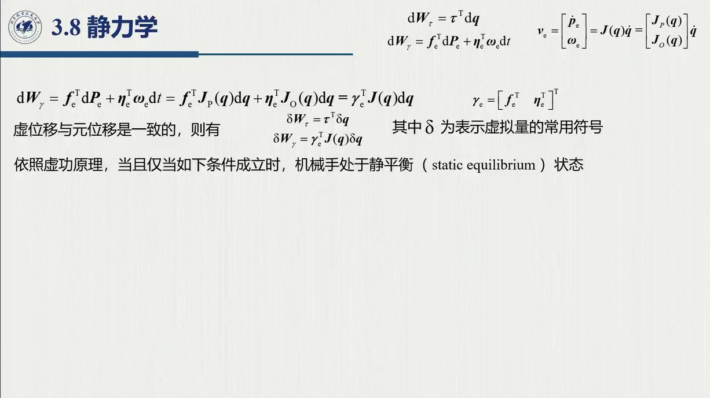
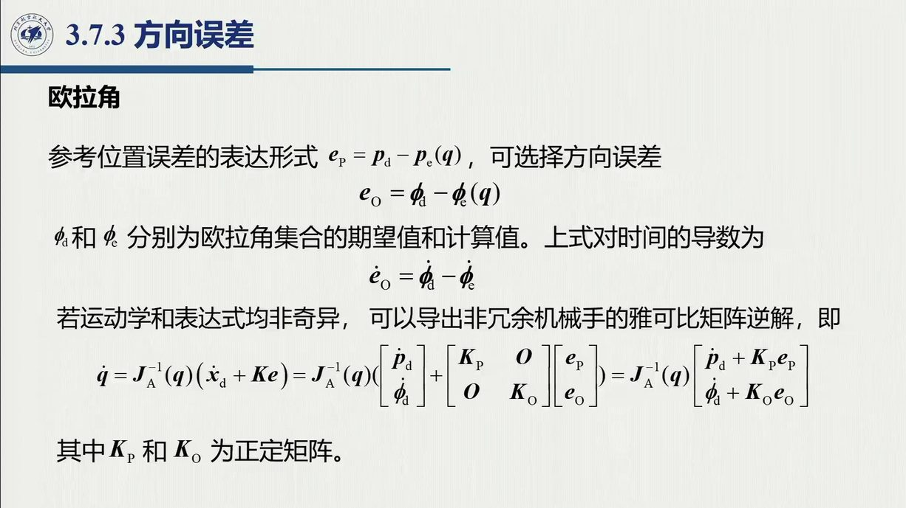

# 3.8 静力学

末端执行器顶住工件时，力和力矩会沿着运动学链一路「传」回关节，变成电机需要输出的力矩。这里起作用的桥梁不是 $J$ 本身，而是 $J$ 的**转置**——因为功率守恒要求「速度变换的对偶就是力变换」。别小看这条 $\tau=J^{\mathrm T}F_e$：它是全章最短、也最有用的一条公式。录播 0:03:02–0:19:28（开课即讲）+ 2:27:09–2:27:52（末段）。

<aside class="lesson-brief" aria-label="3.8 学习简报">

PREREQUISITE<strong>你需要先会</strong>
虚功原理（理论力学）；几何雅可比 $v_e=J\dot q$（[@def-3.1.1]）；$S(\tilde p)$ 与旋转矩阵（[3.1](sec3-1.md)、[2.2](../ch02/sec2-2.md)）。

TARGET<strong>本节要建立</strong>
末端广义力 $F_e$；虚功原理 ⇒ $\tau=J^{\mathrm T}F_e$；速度 / 力变换矩阵互为转置对偶；闭链静力学（了解）。

CHECKPOINT<strong>学完的标准</strong>
能用虚功原理独立推出 $\tau=J^{\mathrm T}F_e$；能写出两坐标系间的速度 / 力变换矩阵并说明「为什么是转置关系」；能解释 $\tau$ 的物理含义（每个关节电机要出多大力矩）。

</aside>

## 3.8.1 运动静力学对偶与 $\tau=J^{\mathrm T}F_e$

老师在开课导论里就直接给出了结论（0:17:41–0:19:23）：「关节需要输出的力矩，按静态平衡，等于**几何雅可比的转置**再乘以末端执行器所受到的六维力（三个平动的力 + 三个转动的矩）。物理意义就是：末端受力和矩时，为保持机械臂静态平衡，每个关节电机要输出什么样的力矩。」他同时交代，这个结论的推导「基于虚功原理和能量守恒」。

::: def 定义 3.8.1 · 末端广义力与关节力矩 {#def-3.8.1}
$$F_e=\begin{bmatrix}f_e\\ \mu_e\end{bmatrix}\in\mathbb R^6\qquad(3\ \text{平动力}+3\ \text{转动力矩}),\qquad
\tau=[\tau_1,\dots,\tau_n]^{\mathrm T}$$

静力平衡关系（**运动静力学对偶**）：

$$\boxed{\ \tau=J^{\mathrm T}(q)\,F_e\ }$$
:::

::: proof 推导（虚功原理，2:27:09–2:27:52 课件页）
设关节虚位移 $\mathrm dq$，对应末端虚位移 $\mathrm dx_e=J\,\mathrm dq$。

- 关节端做功（关节力矩做的功）：$\mathrm dW_\tau=\tau^{\mathrm T}\mathrm dq$；
- 末端处外力做的功：$\mathrm dW_F=f_e^{\mathrm T}\mathrm dP_e+\mu_e^{\mathrm T}\omega_e\,\mathrm dt$（外力 $F_e$ 在末端虚位移上做的功）；

静态平衡时**系统总虚功为零**（能量守恒，可逆虚位移）：

$$\mathrm dW_\tau+\mathrm dW_F=0
\ \Longrightarrow\ \tau^{\mathrm T}\mathrm dq=-F_e^{\mathrm T}\begin{bmatrix}\mathrm dP_e\\ \omega_e\mathrm dt\end{bmatrix}
=-F_e^{\mathrm T}J\,\mathrm dq$$

对任意 $\mathrm dq$ 成立 ⇒ $\tau^{\mathrm T}=-F_e^{\mathrm T}J$，取转置即 $\tau=J^{\mathrm T}F_e$。□
:::

::: intuition 为什么是 $J^{\mathrm T}$ 而不是 $J^{-1}$ / $J^\dagger$
速度方向有 $v_e=J\dot q$（$n$ 个关节速度 → $6$ 维末端速度）；力的传递方向正好反过来（$6$ 维末端力 → $n$ 个关节力矩），但**不是求逆**——因为能量必须守恒：$\dot q^{\mathrm T}\tau=v_e^{\mathrm T}F_e=(J\dot q)^{\mathrm T}F_e=\dot q^{\mathrm T}J^{\mathrm T}F_e$，对任意 $\dot q$ 成立即 $\tau=J^{\mathrm T}F_e$。这就是「**速度与力的变换互为转置（对偶）**」的一般原理；$J$ 是长方阵时也照样成立（无需方阵、无需满秩）。
:::

把「速度与力互为转置」画成一张对偶图，就是下图：上行是熟悉的 $v_e=J\dot q$，下行把传递方向掉转过来、矩阵换成转置，中间由功率守恒把两行钉在一起。

<figure>
<svg class="figure-svg" viewBox="0 0 920 340" xmlns="http://www.w3.org/2000/svg" role="img" aria-labelledby="fig-38-title fig-38-desc">
<title id="fig-38-title">速度映射与力映射的转置对偶</title>
<desc id="fig-38-desc">左为关节空间：上行是 n 维关节速度、下行是 n 维关节力矩；右为操作空间：上行是 6 维末端速度、下行是 6 维广义力。上行箭头从左到右标 J，下行箭头从右到左标 J 转置，中间框写明功率守恒把两个矩阵钉成转置关系。</desc>
<defs>
<marker id="f38-m" markerWidth="9" markerHeight="9" refX="7" refY="3" orient="auto"><path d="M0,0 L7,3 L0,6 Z" fill="var(--muted)"/></marker>
<marker id="f38-b" markerWidth="9" markerHeight="9" refX="7" refY="3" orient="auto"><path d="M0,0 L7,3 L0,6 Z" fill="var(--fig-blue)"/></marker>
<marker id="f38-g" markerWidth="9" markerHeight="9" refX="7" refY="3" orient="auto"><path d="M0,0 L7,3 L0,6 Z" fill="var(--fig-green)"/></marker>
</defs>
<text class="diagram-text" x="460" y="36" text-anchor="middle">速度与力的变换：互为转置的对偶</text>
<rect class="diagram-node" x="60" y="70" width="190" height="196" rx="10"/>
<text class="diagram-text" x="155" y="96" text-anchor="middle">关节空间（n 维）</text>
<rect x="85" y="112" width="140" height="48" rx="8" stroke="var(--fig-blue)" fill="var(--accent)" fill-opacity=".04"/>
<text class="diagram-text" fill="var(--fig-blue)" x="155" y="132" text-anchor="middle">关节速度 q′</text>
<text class="diagram-note" x="155" y="151" text-anchor="middle">n 个关节</text>
<rect x="85" y="196" width="140" height="48" rx="8" stroke="var(--fig-green)" fill="var(--sage)" fill-opacity=".06"/>
<text class="diagram-text" fill="var(--fig-green)" x="155" y="216" text-anchor="middle">关节力矩 τ</text>
<text class="diagram-note" x="155" y="235" text-anchor="middle">每个电机出多大力矩</text>
<rect class="diagram-node" x="670" y="70" width="190" height="196" rx="10"/>
<text class="diagram-text" x="765" y="96" text-anchor="middle">操作空间（6 维）</text>
<rect x="695" y="112" width="140" height="48" rx="8" stroke="var(--fig-blue)" fill="var(--accent)" fill-opacity=".04"/>
<text class="diagram-text" fill="var(--fig-blue)" x="765" y="132" text-anchor="middle">末端速度 v<tspan class="sb">e</tspan></text>
<text class="diagram-note" x="765" y="151" text-anchor="middle">线速度 + 角速度</text>
<rect x="695" y="196" width="140" height="48" rx="8" stroke="var(--fig-green)" fill="var(--sage)" fill-opacity=".06"/>
<text class="diagram-text" fill="var(--fig-green)" x="765" y="216" text-anchor="middle">广义力 F<tspan class="sb">e</tspan> = (f, μ)</text>
<text class="diagram-note" x="765" y="235" text-anchor="middle">力 + 力矩</text>
<line x1="250" y1="136" x2="670" y2="136" stroke="var(--fig-blue)" stroke-width="2.2" marker-end="url(#f38-b)"/>
<text class="diagram-text" fill="var(--fig-blue)" x="460" y="118" text-anchor="middle">J：v<tspan class="sb">e</tspan> = J q′（正问题，一次乘法）</text>
<line x1="670" y1="220" x2="250" y2="220" stroke="var(--fig-green)" stroke-width="2.2" marker-end="url(#f38-g)"/>
<text class="diagram-text" fill="var(--fig-green)" x="460" y="248" text-anchor="middle">J<tspan class="sp">T</tspan>：τ = J<tspan class="sp">T</tspan> F<tspan class="sb">e</tspan>（力反向传递，不求逆）</text>
<rect class="diagram-node" x="330" y="152" width="260" height="48" rx="9" stroke="var(--accent)"/>
<text class="diagram-text" fill="var(--accent-text)" x="460" y="172" text-anchor="middle">功率守恒：q′<tspan class="sp">T</tspan>τ = v<tspan class="sb">e</tspan><tspan class="sp">T</tspan> F<tspan class="sb">e</tspan></text>
<text class="diagram-note" x="460" y="191" text-anchor="middle">对任意 q′ 成立 ⇒ 两矩阵互为转置</text>
<text class="diagram-note" x="460" y="300" text-anchor="middle">无需方阵、无需满秩——对偶比求逆更普适；静力平衡专用，含惯性 / 科氏力时回到动力学方程</text>
<text class="diagram-note" x="460" y="322" text-anchor="middle">同一 J 的两副面孔：正向传速度（第 3 章主线），转置传力（本节）</text>
</svg>
<figcaption>运动静力学对偶（本教程绘）：上行 $v_e=J\dot q$ 与下行 $\tau=J^{\mathrm T}F_e$ 由功率守恒 $\dot q^{\mathrm T}\tau=v_e^{\mathrm T}F_e$ 钉成转置关系——这就是 [@def-3.8.1] 的 $\tau=J^{\mathrm T}F_e$ 不需要方阵与满秩的原因。</figcaption>
</figure>

老师对它的定位很清楚：「主要是记住这个公式就可以」（0:25:53）；在导论里说得更直白：「其实我们可以不讲 PPT，大家就记住这些内容就可以了」（0:19:21）。结论记住之后，还剩一个问题：换一个坐标系，这套速度 / 力关系该怎么写？这正是下一小节的内容。

## 3.8.2 两坐标系间的速度与力变换

3.8.1 的转置对偶发生在关节空间与操作空间之间；一旦涉及两个坐标系，同一副对偶结构会再次出现——同一速度 / 力在不同坐标系下的表示，恰好也构成一对**转置对偶**。设坐标系 1 相对基系 $0$ 有旋转 $R_1^0$ 与平移 $\tilde p$（牵连项用 $S(\tilde p)$ 表示）：

$$\begin{bmatrix}\dot p_1^0\\ \omega_1^0\end{bmatrix}=\begin{bmatrix}R_1^0&-R_1^0S(\tilde p)\\ 0&R_1^0\end{bmatrix}\begin{bmatrix}v_1\\ \omega_1\end{bmatrix},
\qquad
\begin{bmatrix}f_1^0\\ \mu_1^0\end{bmatrix}=\begin{bmatrix}R_1^0&0\\ R_1^0S(\tilde p)&R_1^0\end{bmatrix}\begin{bmatrix}f_1\\ \mu_1\end{bmatrix}$$

**力（右）的变换矩阵恰是速度（左）变换矩阵的转置**。看细节：平移部分 $S(\tilde p)$ 在速度块里带负号、在力块里不带负号并移位，这正是「对偶」的体现（可与 [3.1.3](sec3-1.md#sec-3.1.3) 的 $J^u$ 坐标变换对照：$J^u$ 只改旋转块，这里还含平移的耦合）。

老师应用提示（2:27:34）：「最后还有一个任务：在（不同）姿态坐标系与基坐标系之间做表示的转换，后面大家应用的时候要考虑一下。」实际开发中，传感器、工件、工具各自的坐标系都不一样，**要先把力 / 速度统一到同一个坐标系，再谈平衡**——这与 [3.1.3](sec3-1.md#sec-3.1.3) 的 $J^u$ 是同一件事的力版本。

## 3.8.3 闭链与可操作椭球（了解）

本节最后两块内容只作了解，知道「有这一块」即可：

- **闭链静力学**（课件图示，2:27:25）：多机器人 / 闭链结构里，力的分配需要额外约束（内力不可任意指定）。本节只点明「有这一块」，细节留到后续章节；
- **可操作椭球**（了解，2:26:01 老师明确「不讲」）：「跟手术机器人手臂的**灵巧性**设计相关」——它由 $w(q)=\sqrt{\det(JJ^{\mathrm T})}$ 与速度 / 力椭球刻画末端在各方向上的运动 / 施力能力，也可在 [3.5.1](sec3-5.md#sec-3.5.1) 的可操作度 $\dot q_0$ 里作为优化目标。教材上有对应内容，自学。

::: think 默写点 · 合上书再写（主动回忆）

不看正文与速查卡，先独立写出下面三条，再展开核对。若写不出来，就说明这一节还没真正「拿走」。

1. 用虚功原理推出 $\boldsymbol\tau=J^{\mathrm T}F_e$。
2. 为什么力变换是 $J^{\mathrm T}$ 而不是 $J^{-1}$ 或 $J^\dagger$？
3. 两坐标系间的速度变换与力变换是什么关系？

::: sol 核对

设关节虚位移 $\mathrm dq$，末端虚位移 $\mathrm dx_e=J\mathrm dq$。关节端做功 $\tau^{\mathrm T}\mathrm dq$，末端处外力做功 $-F_e^{\mathrm T}J\mathrm dq$；静态平衡时总虚功为零 ⇒ $\tau^{\mathrm T}=-F_e^{\mathrm T}J$，取转置即 $\boldsymbol\tau=J^{\mathrm T}F_e$。

因为能量必须守恒：$\dot{\boldsymbol q}^{\mathrm T}\boldsymbol\tau=\boldsymbol v_e^{\mathrm T}F_e=(J\dot{\boldsymbol q})^{\mathrm T}F_e=\dot{\boldsymbol q}^{\mathrm T}J^{\mathrm T}F_e$，对任意 $\dot{\boldsymbol q}$ 成立。**无需方阵、无需满秩**——这正是对偶比求逆更普适之处。

**互为转置**：力变换矩阵恰是速度变换矩阵的转置（平移块 $S(\tilde{\boldsymbol p})$ 在速度式里带负号、在力式里移位且不带负号）。

:::

:::

## 3.8 小结与常见错误

- **一条主线**：末端广义力 $F_e$ → 虚功原理 → $\tau=J^{\mathrm T}F_e$（记住这条就够）→ 速度 / 力变换互为转置对偶 → 闭链 / 可操作椭球（了解）。
- **一句话**：「末端受力和矩时，每个关节电机该出多大力矩」——这就是 $J^{\mathrm T}$ 的物理含义。

::: think 常见错误清单 · 自查三条
1. 用 $J^{-1}$ 或 $J^\dagger$ 传力——力变换是 $J^{\mathrm T}$（对偶），不是求逆；$J$ 是长方阵时同样成立；
2. 忘记力所在的坐标系——$F_e$ 与 $J$ 必须在**同一坐标系**下；传感器测得的力，要先用 [3.8.2](#sec-3.8.2) 的转置对偶关系变换到基系；
3. 把 $\tau=J^{\mathrm T}F_e$ 用在动态 / 高速情形——它只是**静力**平衡式；一旦含惯性、科氏力，就必须回到动力学方程（见后续动力学章节）。
:::
