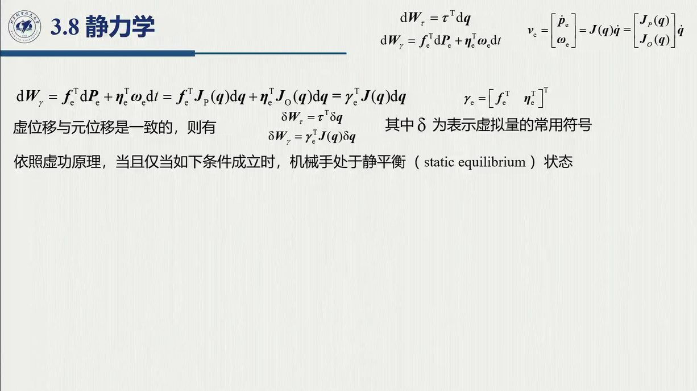
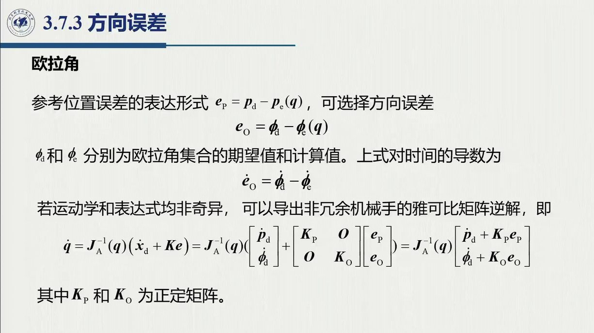

# 3.8 静力学

前面由关节速度计算末端怎样运动。现在让末端向工件施力，反过来问：为了保持平衡，每个关节需要多大驱动力矩？速度公式中的雅可比仍然有用，但这次通过[虚功与功率配对](../recall.md#wrench)确定力的映射，不能把速度公式直接求逆。课堂回看：0:03:02–0:19:28、2:27:09–2:27:52。

## 3.8.1 运动静力学对偶与 $\tau=J^{\mathrm T}F_e$

::: def 定义 3.8.1 · 末端广义力与关节力矩 {#def-3.8.1}
令 $F_e=[f_e;\mu_e]\in\mathbb R^6$，前三项是力，后三项是关于指定工具点的力矩，分别用N和N·m。这里统一把 $F_e$ 定义为机器人施加给环境的力系，环境对机器人的反作用为 $-F_e$。

$J$ 的线速度也取这个工具点，轴和分量采用同一基系。先忽略重力、摩擦与惯性等其他需求，静态保持时所需关节广义力满足

$$\tau=J^{\mathrm T}F_e.$$

转动关节的 $\tau_i$ 为力矩，移动关节的 $\tau_i$ 为力；这是与各自关节坐标做虚功配对的结果。
:::

::: proof 用允许的虚位移推导
给关节一个符合机构约束的无穷小虚位移 $\delta q$，末端相应的虚平移与虚转角满足 $\delta x_g=J\delta q$。这里的后三项是物理无穷小转角，不是直接拿欧拉角差替代。

关节驱动做虚功 $\tau^{\mathrm T}\delta q$，环境反力做虚功 $-F_e^{\mathrm T}J\delta q$。平衡时总和为零：

$$(\tau-J^{\mathrm T}F_e)^{\mathrm T}\delta q=0.$$

上式对全部允许的独立关节虚位移成立，因此系数为零，得到 $\tau=J^{\mathrm T}F_e$。若将力的符号改定义为环境输入力，则应相应写成 $\tau=-J^{\mathrm T}F_{env}$。
:::

转置保证内积相等：$F_e^{\mathrm T}J\delta q=(J^{\mathrm T}F_e)^{\mathrm T}\delta q$。因此它对长方阵和降秩雅可比也成立。求 $J^{-1}$ 回答的是速度方程的另一个问题，不会自动保证功的配对。

<figure>
<svg class="figure-svg" viewBox="0 0 920 340" xmlns="http://www.w3.org/2000/svg" role="img" aria-labelledby="fig-38-title fig-38-desc">
<title id="fig-38-title">速度映射与力映射的转置对偶</title>
<desc id="fig-38-desc">左为关节空间：上行是 n 维关节速度、下行是 n 维关节力矩；右为操作空间：上行是 6 维末端速度、下行是 6 维广义力。上行箭头从左到右标 J，下行箭头从右到左标 J 转置，中间框写明功率守恒把两个矩阵钉成转置关系。</desc>
<defs>
<marker id="f38-m" markerWidth="9" markerHeight="9" refX="7" refY="3" orient="auto"><path d="M0,0 L7,3 L0,6 Z" fill="var(--muted)"/></marker>
<marker id="f38-b" markerWidth="9" markerHeight="9" refX="7" refY="3" orient="auto"><path d="M0,0 L7,3 L0,6 Z" fill="var(--fig-blue)"/></marker>
<marker id="f38-g" markerWidth="9" markerHeight="9" refX="7" refY="3" orient="auto"><path d="M0,0 L7,3 L0,6 Z" fill="var(--fig-green)"/></marker>
</defs>
<text class="diagram-text" x="460" y="36" text-anchor="middle">速度与力的变换：互为转置的对偶</text>
<rect class="diagram-node" x="60" y="70" width="190" height="196" rx="10"/>
<text class="diagram-text" x="155" y="96" text-anchor="middle">关节空间（n 维）</text>
<rect x="85" y="112" width="140" height="48" rx="8" stroke="var(--fig-blue)" fill="var(--accent)" fill-opacity=".04"/>
<text class="diagram-text" fill="var(--fig-blue)" x="155" y="132" text-anchor="middle">关节速度 q′</text>
<text class="diagram-note" x="155" y="151" text-anchor="middle">n 个关节</text>
<rect x="85" y="196" width="140" height="48" rx="8" stroke="var(--fig-green)" fill="var(--sage)" fill-opacity=".06"/>
<text class="diagram-text" fill="var(--fig-green)" x="155" y="216" text-anchor="middle">关节力矩 τ</text>
<text class="diagram-note" x="155" y="235" text-anchor="middle">每个电机出多大力矩</text>
<rect class="diagram-node" x="670" y="70" width="190" height="196" rx="10"/>
<text class="diagram-text" x="765" y="96" text-anchor="middle">操作空间（6 维）</text>
<rect x="695" y="112" width="140" height="48" rx="8" stroke="var(--fig-blue)" fill="var(--accent)" fill-opacity=".04"/>
<text class="diagram-text" fill="var(--fig-blue)" x="765" y="132" text-anchor="middle">末端速度 v<tspan class="sb">e</tspan></text>
<text class="diagram-note" x="765" y="151" text-anchor="middle">线速度 + 角速度</text>
<rect x="695" y="196" width="140" height="48" rx="8" stroke="var(--fig-green)" fill="var(--sage)" fill-opacity=".06"/>
<text class="diagram-text" fill="var(--fig-green)" x="765" y="216" text-anchor="middle">广义力 F<tspan class="sb">e</tspan> = (f, μ)</text>
<text class="diagram-note" x="765" y="235" text-anchor="middle">力 + 力矩</text>
<line x1="250" y1="136" x2="670" y2="136" stroke="var(--fig-blue)" stroke-width="2.2" marker-end="url(#f38-b)"/>
<text class="diagram-text" fill="var(--fig-blue)" x="460" y="118" text-anchor="middle">J：v<tspan class="sb">e</tspan> = J q′（正问题，一次乘法）</text>
<line x1="670" y1="220" x2="250" y2="220" stroke="var(--fig-green)" stroke-width="2.2" marker-end="url(#f38-g)"/>
<text class="diagram-text" fill="var(--fig-green)" x="460" y="248" text-anchor="middle">J<tspan class="sp">T</tspan>：τ = J<tspan class="sp">T</tspan> F<tspan class="sb">e</tspan>（力反向传递，不求逆）</text>
<rect class="diagram-node" x="330" y="152" width="260" height="48" rx="9" stroke="var(--accent)"/>
<text class="diagram-text" fill="var(--accent-text)" x="460" y="172" text-anchor="middle">功率守恒：q′<tspan class="sp">T</tspan>τ = v<tspan class="sb">e</tspan><tspan class="sp">T</tspan> F<tspan class="sb">e</tspan></text>
<text class="diagram-note" x="460" y="191" text-anchor="middle">对任意 q′ 成立 ⇒ 两矩阵互为转置</text>
<text class="diagram-note" x="460" y="300" text-anchor="middle">无需方阵、无需满秩——对偶比求逆更普适；静力平衡专用，含惯性 / 科氏力时回到动力学方程</text>
<text class="diagram-note" x="460" y="322" text-anchor="middle">同一 J 的两副面孔：正向传速度（第 3 章主线），转置传力（本节）</text>
</svg>
<figcaption>速度从关节映到末端，负载的关节广义力则按转置折回。两条映射由虚功内积配对；转置关系不要求雅可比是方阵。</figcaption>
</figure>

### 先用两杆力臂核对一次

两杆各1 m，取 $q=(0,\pi/2)$，末端位置为 $(1,1)$ m。位置雅可比是

$$J_P=\begin{bmatrix}-1&-1\\1&0\end{bmatrix}.$$

机器人向环境施加 $f=(2,3)^{\mathrm T}$ N，则

$$\tau=J_P^{\mathrm T}f
=\begin{bmatrix}(-1)2+(1)3\\(-1)2+(0)3\end{bmatrix}
=\begin{bmatrix}1\\-2\end{bmatrix}\ \mathrm{N\cdot m}.$$

绕第一关节的力臂是 $(1,1)$，其矩为 $1\times3-1\times2=1$；绕第二关节的力臂是 $(0,1)$，其矩为 $0\times3-1\times2=-2$，与转置计算一致。

再给虚拟关节速度 $(0.2,-0.1)^{\mathrm T}$ rad/s，得到末端速度 $(-0.1,0.2)^{\mathrm T}$ m/s。关节功率为 $1(0.2)+(-2)(-0.1)=0.4$ W，末端功率为 $2(-0.1)+3(0.2)=0.4$ W。这组非零功率可以检查符号；真正静止时功率全零，不能完成同样检查。

若还存在重力，静止总驱动力矩应为 $\tau=g+J^{\mathrm T}F_e$。运动时还要加入惯性、速度项和摩擦。$J^{\mathrm T}F_e$ 作为负载的广义力贡献仍可使用，错误的是把它在所有工况下都当作完整驱动力矩。

## 3.8.2 两坐标系间的速度与力变换

传感器原点、工具点和任务原点经常不重合。计算前先分清两个操作：换表达坐标轴会旋转向量分量；换力矩参考点则会增加或减去力臂矩。分别写出两步后，再合并矩阵，较容易核对各块的符号。

### 同一点，只换表达坐标系

令 $R=R_1^0$ 把系1分量变成系0分量。同一物理点的线速度、角速度、力与力矩都按 $R$ 旋转，因此

$$v^0=Dv^1,\qquad F^0=DF^1,\qquad D=\operatorname{diag}(R,R).$$

正交性保证 $(F^0)^{\mathrm T}v^0=(F^1)^{\mathrm T}v^1$。速度与力都从系1换到系0时，使用同一个旋转矩阵；若要写成转置配对，应将其中一个映射方向反过来。

### 同一表达系，改变参考点

设 $r=p_B-p_A$ 从A指向B，两点固连在同一刚体上。第三章的两点速度式给

$$\dot p_B=\dot p_A+\omega\times r
=\dot p_A-S(r)\omega,$$

所以对线速度在前的堆叠，

$$v_B=Xv_A,\qquad X=\begin{bmatrix}I&-S(r)\\0&I\end{bmatrix}.$$

若关于B的力系为 $F_B=[f_B;\mu_B]$，折到A时合力不变、力矩增加 $r\times f_B$：

$$F_A=X^{\mathrm T}F_B,\qquad
f_A=f_B,\quad\mu_A=\mu_B+r\times f_B.$$

也可由功率验证 $F_B^{\mathrm T}Xv_A=(X^{\mathrm T}F_B)^{\mathrm T}v_A$。速度从A传到B，力从B折回A，方向相反；若力也要从A算到B，才使用 $F_B=X^{-\mathrm T}F_A$。

### 两个原点、两套表达系一起改变

现在A为系0原点，B为系1原点，$r=p_B^0-p_A^0$。先传到B，再用 $R^{\mathrm T}$ 换成系1分量：

$$v_B^1=Mv_A^0,\qquad
M=\begin{bmatrix}R^{\mathrm T}&-R^{\mathrm T}S(r)\\0&R^{\mathrm T}\end{bmatrix}.$$

相反方向的力折算为

$$F_A^0=M^{\mathrm T}F_B^1
=\begin{bmatrix}R&0\\S(r)R&R\end{bmatrix}F_B^1.$$

读左下块时按从右到左的顺序计算：先把力旋转到系0，再与系0中的力臂叉乘。若直接把 $S(r)R$ 改为 $RS(r)$，却不换算力臂分量，两者便不在同一表达系中。

::: ex 跟算 · 非零功率同时检查旋转和力臂 {#ex-3.8.transform}
取 $R=R_z(90^\circ)$、$r=(1,0,0)^{\mathrm T}$ m。A 点速度为 $(0,1,0)^{\mathrm T}$ m/s，角速度为 $(0,0,2)^{\mathrm T}$ rad/s；B 点系 1 中测得 $f_B^1=(4,0,0)^{\mathrm T}$ N、$\mu_B^1=(0,0,1)^{\mathrm T}$ N·m。

先传速度：$\omega\times r=(0,2,0)$，故 $\dot p_B^0=(0,3,0)$，换基得 $\dot p_B^1=(3,0,0)$。再折算力：$f_A^0=Rf_B^1=(0,4,0)$，$\mu_A^0=R\mu_B^1+r\times f_A^0=(0,0,5)$。两处功率分别为

$$P_B=4\times3+1\times2=14\ {\rm W},\qquad
P_A=4\times1+5\times2=14\ {\rm W}.$$

漏掉力臂时，第二处功率会被算成6 W；速度或力换基方向错误，也会破坏这次核验。实际静止时，两处功率都为零，无法据此排查符号，所以这里另取一组非零虚拟速度检查线性映射。
:::

## 3.8.3 闭链与可操作椭球（了解）

闭链或多臂共同抓持物体时，同一物体运动可能对应多种内部受力分配。确定这种分配，除了运动学约束，还需列出平衡、接触与驱动条件；单独使用开链雅可比转置不足以唯一恢复全部内部载荷。

力椭球则可由本节关系直接连接到§3.3的速度椭球。设在统一尺度下，某奇异方向满足 $Jv_i=\sigma_i u_i$。末端沿 $u_i$ 施力 $F=\beta u_i$ 时，所需关节负载为 $J^{\mathrm T}F=\beta\sigma_i v_i$。同一理想关节力范数预算内，允许的 $|\beta|$ 与 $1/\sigma_i$ 成比例。

这解释了速度困难方向与理想静态承载方向的对偶，但不表示奇点处能承受无限真实力。结构强度、轴承、接触与未计入的负载仍限制实际承载；$\sigma_i=0$ 时，应回到所选任务和约束分析，而不是把 $1/0$ 填进设备能力表。

::: think 检查理解
1. 为什么本节可以把非方阵转置传力，却不能一般地把它求逆？
2. 换原点时合力不变，力矩为什么会改变？
3. 若 $v_B=Mv_A$，力从A变到B用什么矩阵？反向又用什么？
4. 有重力、正在加速时，$J^{\mathrm T}F_e$ 还能表示什么，不能单独表示什么？

::: sol 核对
转置由虚功内积确定，不依赖可逆性。合力作用线相对取矩点的力臂改变，需要迁移力矩。同向用逆转置 $M^{-\mathrm T}$，反向用转置 $M^{\mathrm T}$。$J^{\mathrm T}F_e$ 仍是该末端负载的关节广义力贡献，但完整驱动力还须承担重力、惯性、摩擦等项。
:::
:::
