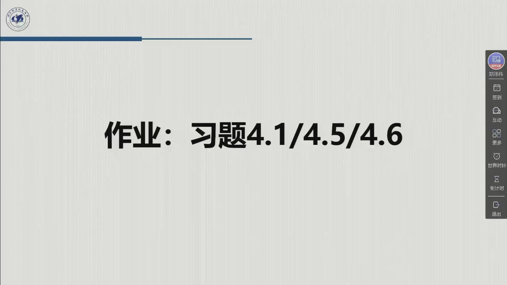

# 作业四：教材习题 4.1 / 4.5 / 4.6（附详细解答与验算）

::: note 作业信息（据录播）
- **题号**：教材第 4 章习题 **4.1、4.5、4.6**（课件末页「作业：习题 4.1/4.5/4.6」，02:26:08）；
- **原文**（教材 p.189 / 原书 Problems 4.1, 4.5, 4.6）：
  > **4.1** Compute the joint trajectory from $q(0)=1$ to $q(2)=4$ with null initial and final velocities and accelerations.
  > **4.5** Given the values for the joint variable: $q(0)=0$, $q(2)=2$, and $q(4)=3$, compute the cubic interpolating spline with null initial and final velocities and accelerations.
  > **4.6** Given the values for the joint variable: $q(0)=0$, $q(2)=2$, and $q(4)=3$, find the interpolating polynomial with linear segments and parabolic blends with null initial and final velocities.
- **提交**：一周内。
:::

三道题是同一条主线上的三级台阶：**4.1** 是点对点（[4.2.1](sec4-2-1.md)），用五次多项式满足 6 个边界条件；**4.5** 与 **4.6** 用同一组路径点，分别演示「系列点」的两条路线——**三次样条**（[4.2.2.3](sec4-2-2.md#sec-4.2.2.3)，加速度连续）与**线性 + 抛物线混合**（[4.2.2.4](sec4-2-2.md#sec-4.2.2.4)，经由点）。

本页把每一步代数都写出来：**4.1 的六元一次方程组逐项消元**、**4.5 为什么必须引入虚拟点（数方程与未知数的个数）**、**4.5 的 3×3 系统怎么从递推关系长出来**、**4.6 的抛物线系数怎么由「加速度恒定 + 速度连续」推得**。全部数值由 `tools/verify_ch04_traj.py`（`make verify`）逐项复算。

## 先看这三道题在考什么

| 题 | 给定量 | 要求的量 | 真正考的是一句话 |
|:--|:--|:--|:--|
| **4.1** | 起点、终点、时间、端点速度与加速度全零 | 一条五次多项式 | **6 个条件 → 6 个系数；条件数与阶次必须匹配** |
| **4.5** | 3 个路径点、端点速度与加速度全零 | 一条分段三次（样条） | **条件比未知数多 2 个 → 加两个虚拟点补齐** |
| **4.6** | 同样 3 个路径点、端点速度为零 | 线性段 + 抛物线过渡 | **梯形速度曲线推广到多点时会「削角」，轨迹不过路径点** |

三题的共同背景是**关节空间轨迹规划**：输入是一串「在什么时刻到什么地方」的约束，输出是每个关节的 $q(t)$。三题的区别只在**约束的类型**：4.1 是两端全约束（位置、速度、加速度），4.5 是中间位置 + 两端全约束（要求加速度连续），4.6 是中间位置 + 两端速度约束（只要求速度连续）。

---

## 4.1 五次多项式：6 个约束定 6 个系数

### 第 1 步：为什么必须是五次

先把条件数清楚。题目给了：

| 时刻 | 位置 | 速度 | 加速度 |
|:--|:--|:--|:--|
| $t=0$ | $q=1$ | $\dot q=0$ | $\ddot q=0$ |
| $t=2$ | $q=4$ | $\dot q=0$ | $\ddot q=0$ |

共 **6 个独立条件**。而一个 $n$ 次多项式有 $n+1$ 个系数，要唯一确定就得 $n+1=6$，即 $n=5$。

- 三次多项式只有 4 个系数，最多满足 4 个条件（位置 + 速度的两端约束）——满足不了「加速度也零」；
- 五次多项式恰好 6 个，**不多不少**。用更高的阶次（七次、九次）也能通过这 6 个点，但会多出自由度，必须再附加别的准则（如最小 jerk），题目没给，所以取最低的可行阶次。

**这就是「阶次由条件数决定」的完整推理**，也是这类题的第一句话该写的内容。

### 第 2 步：写出多项式与它的导数

$$q(t)=a_0+a_1t+a_2t^2+a_3t^3+a_4t^4+a_5t^5,$$

$$\dot q(t)=a_1+2a_2t+3a_3t^2+4a_4t^3+5a_5t^4,$$

$$\ddot q(t)=2a_2+6a_3t+12a_4t^2+20a_5t^3.$$

**注意常数的下落方式**：$a_0$ 求导消失，$a_1$ 求导变常数，$a_2$ 求导后带因子 2，$a_3$ 带 3……这些因子在后面列方程时最容易漏。

### 第 3 步：把 6 个条件代进去

**在 $t=0$ 处**（三项都只留下常数项）：

$$q(0)=a_0=1,\qquad \dot q(0)=a_1=0,\qquad \ddot q(0)=2a_2=0\ \Rightarrow\ a_2=0.$$

**在 $t=t_f=2$ 处**：

$$a_3(2)^3+a_4(2)^4+a_5(2)^5+a_2(2)^2+a_1(2)+a_0=4,$$

$$3a_3(2)^2+4a_4(2)^3+5a_5(2)^4+2a_2(2)+a_1=0,$$

$$6a_3(2)+12a_4(2)^2+20a_5(2)^3+2a_2=0.$$

把 $a_0=1$、$a_1=0$、$a_2=0$ 代入并算幂次（$2^3=8$、$2^4=16$、$2^5=32$）：

$$\begin{cases}
8a_3+16a_4+32a_5=3 & (\text{位置})\\
12a_3+32a_4+80a_5=0 & (\text{速度})\\
12a_3+48a_4+160a_5=0 & (\text{加速度})
\end{cases} \tag{4.1-1}$$

**这三个方程从哪来，必须写清**：位置方程右端是 $q_f-q_i=4-1=3$（因为 $a_0=1$ 已移到左边）；速度、加速度方程右端都是 0（题设端点速度、加速度为零）。

### 第 4 步：解这个三元一次方程组（逐步消元）

用后两式相减消去 $a_3$。第二式乘以 1、第三式乘以 1，直接相减：

$$(12a_3+48a_4+160a_5)-(12a_3+32a_4+80a_5)=0-0,$$

$$16a_4+80a_5=0\ \Longrightarrow\ a_4=-5a_5. \tag{4.1-2}$$

把 (4.1-2) 代回速度方程：

$$12a_3+32(-5a_5)+80a_5=0\ \Longrightarrow\ 12a_3-80a_5=0\ \Longrightarrow\ a_3=\frac{20}{3}a_5. \tag{4.1-3}$$

把 (4.1-2)(4.1-3) 代入位置方程：

$$8\cdot\frac{20}{3}a_5+16(-5a_5)+32a_5=3.$$

逐项算：$\frac{160}{3}a_5-80a_5+32a_5=\frac{160}{3}a_5-48a_5=\frac{160-144}{3}a_5=\frac{16}{3}a_5$。于是

$$\frac{16}{3}a_5=3\ \Longrightarrow\ a_5=\frac{9}{16}. \tag{4.1-4}$$

回代：

$$a_4=-5\cdot\frac{9}{16}=-\frac{45}{16},\qquad
a_3=\frac{20}{3}\cdot\frac{9}{16}=\frac{180}{48}=\frac{15}{4}.$$

**三项自检**（解完必须做）：

1. 量纲：$a_3$ 的量纲应是「位置/时间³」。若 $q$ 用 m、$t$ 用 s，则 $a_3=3.75$ m/s³、$a_4=-2.8125$ m/s⁴、$a_5=0.5625$ m/s⁵——**阶次越高，量纲越「怪」，但都合法**。
2. 代回原方程：$8(3.75)+16(-2.8125)+32(0.5625)=30-45+18=3$ ✓。
3. 符号交替：$a_3>0,a_4<0,a_5>0$——这是「先加速后减速」的形状要求的必然结果。

### 第 5 步：结果

$$\boxed{\;q(t)=1+\frac{15}{4}t^3-\frac{45}{16}t^4+\frac{9}{16}t^5\;}$$

（$a_0=1$、$a_1=a_2=0$。）

### 第 6 步：规范化形式——为什么系数总是 10、−15、6

把 $t$ 换成无量纲的 $\eta=t/t_f\in[0,1]$，并令 $\Delta q=q_f-q_i$。**任何**满足「两端速度、加速度为零」的五次多项式都可以写成

$$q(t)=q_i+\Delta q\left(10\eta^3-15\eta^4+6\eta^5\right). \tag{4.1-5}$$

**验证它与本题一致**：$\eta=t/2$，$\Delta q=3$，展开

$$10\left(\frac t2\right)^3-15\left(\frac t2\right)^4+6\left(\frac t2\right)^5
=\frac{10}{8}t^3-\frac{15}{16}t^4+\frac{6}{32}t^5
=\frac54t^3-\frac{15}{16}t^4+\frac{3}{16}t^5.$$

乘以 3：$\frac{15}{4}t^3-\frac{45}{16}t^4+\frac{9}{16}t^5$——与上一步的结果一致 ✓。

**为什么 10、−15、6 是「普适」的**：把 (4.1-5) 对 $\eta$ 求导，

$$s'(\eta)=30\eta^2-60\eta^3+30\eta^4=30\eta^2(1-\eta)^2,$$

在 $\eta=0$ 与 $\eta=1$ 处 $s'=0$（速度为零）；再求导

$$s''(\eta)=60\eta-180\eta^2+120\eta^3=60\eta(1-\eta)(1-2\eta),$$

在 $\eta=0,1$ 处 $s''=0$（加速度为零）；而 $s(1)=10-15+6=1$（到达终点）。**这四条性质（$s(0)=0$、$s(1)=1$、两端一阶二阶导为零）唯一确定了这组系数**——它不是背出来的，是解出来的。

### 第 7 步：从解里读出的两个工程量

这两个量在选型与限幅时要用，教材没直接给，但可以从此题的解算出来。

**峰值速度**：

$$\dot q=\frac{\Delta q}{t_f}\,s'(\eta)=\frac{3}{2}\cdot30\eta^2(1-\eta)^2.$$

$s'$ 在 $\eta=1/2$ 处最大，$30\cdot\frac14\cdot\frac14=\frac{30}{16}=1.875$，所以

$$\dot q_{\max}=1.875\times\frac{\Delta q}{t_f}=1.875\times1.5=2.8125\ \mathrm{m/s}.$$

**平均速度是 $\Delta q/t_f=1.5$ m/s，峰值是它的 1.875 倍**——这是五次多项式的一个固定比例，与具体数据无关。

**峰值加速度**：

$$\ddot q=\frac{\Delta q}{t_f^2}\,s''(\eta)=\frac{3}{4}\cdot60\eta(1-\eta)(1-2\eta).$$

$|\eta(1-\eta)(1-2\eta)|$ 在 $\eta=\frac{3-\sqrt3}{6}\approx0.2113$ 处取最大值 $\frac{1}{6\sqrt3}\approx0.0962$，所以

$$|\ddot q|_{\max}=\frac{\Delta q}{t_f^2}\cdot\frac{60}{6\sqrt3}=\frac{10}{\sqrt3}\cdot\frac{\Delta q}{t_f^2}
\approx5.774\times\frac{3}{4}=4.33\ \mathrm{m/s^2}.$$

**对比**：同样位移与时间的**梯形速度曲线**，峰值加速度是 $4\Delta q/t_f^2=3$ m/s²。也就是说，五次多项式把加速度峰值抬高了约 44%——**「加速度连续」是用更大的峰值加速度换来的**。这一条在电机选型时是实打实的代价。

### 验算

| 检验项 | 结果 |
|:--|:--|
| $q(0)=1$、$q(2)=4$ | ✓ |
| $\dot q(0)=\dot q(2)=0$ | ✓ |
| $\ddot q(0)=\ddot q(2)=0$ | ✓ |
| 规范化形式展开 ≡ 本题系数 | ✓（第 6 步） |
| 峰值速度 $1.875\Delta q/t_f$ | $2.8125$ m/s，与 $30\eta^2(1-\eta)^2$ 的极值一致 |
| 峰值加速度 $\frac{10}{\sqrt3}\Delta q/t_f^2$ | $4.33$ m/s² |

`tools/verify_ch04_traj.py` 的 `test_group4_quintic_4_1` 用有理数逐条断言上述六项，无浮点误差。

::: think 4.1 易错点 · 四条 {#hw4-41-pitfalls}

1. **阶次与条件数不匹配**。用三次多项式硬凑 6 个条件，会得到矛盾方程组。**先数条件、再定阶次**。
2. **求导时的系数因子**。$\ddot q$ 里 $a_2$ 的系数是 2、$a_3$ 是 6、$a_4$ 是 12、$a_5$ 是 20——少一个因子，后面全错。
3. **右端项忘记减初值**。位置方程右端是 $q_f-q_i=3$，不是 $q_f=4$（因为 $a_0=q_i=1$ 已移项）。
4. **把规范化形式当成「另一个解」**。(4.1-5) 与本题的 $q(t)$ 是同一个多项式，只是写法不同；考试写哪个都对，但要在同一份答卷里保持一种。

:::

---

## 4.5 三次样条：为什么需要虚拟点，3×3 系统怎么来 {#hw4-45}

### 题目

$$q(0)=0,\qquad q(2)=2,\qquad q(4)=3,$$

初始与最终的速度、加速度均为零。求三次插值样条。

### 第 1 步：先数方程与未知数——这是「为什么加虚拟点」的全部理由

**若只用 3 个路径点**：时间段 $[0,4]$ 被分成 2 段，每段一个三次多项式，共 $2\times4=8$ 个系数。

需要满足的条件：

| 条件 | 个数 | 说明 |
|:--|:--:|:--|
| 每段两端的位置 | $2\times2=4$ | 中间点 $t=2$ 被两段共用，算两次 |
| 中间点速度连续 | 1 | 两段在 $t=2$ 的导数相等 |
| 中间点加速度连续 | 1 | 两段在 $t=2$ 的二阶导相等 |
| 两端速度为零 | 2 | $\dot q(0)=\dot q(4)=0$ |
| 两端加速度为零 | 2 | $\ddot q(0)=\ddot q(4)=0$ |
| **合计** | **10** | |

**10 个方程、8 个未知数——over-determined，无解**（一般情况下）。

**加一个虚拟点会怎样？** 加一个时刻，就把某一段一分为二：多出**一个三次多项式（+4 个系数）**，同时多出**3 个约束**（在新时刻处位置连续、速度连续、加速度连续各一）。所以每加一个虚拟点，**净增 1 个自由度**。

**要补 2 个缺口，就加 2 个虚拟点**：$10+3\times2=16$ 个方程，$8+4\times2=16$ 个未知数——恰好平衡。

官方解答取的虚拟时刻是 $t_2=1$、$t_4=3$（与本页一致），于是五个时刻为

$$t_1=0,\ t_2=1,\ t_3=2,\ t_4=3,\ t_5=4,\qquad \Delta t_1=\Delta t_2=\Delta t_3=\Delta t_4=1.$$

**关键理解**：虚拟点上的**位置不是已知量**，它由连续性自然解出（本例解得 $q(t_2)=3/8$、$q(t_4)=23/8$）。虚拟点只是「多给多项式一个自由度」的手段，不是「又多了一个必须经过的点」。

### 第 2 步：把未知数换成「节点加速度」——16 个系数降成 3 个

直接解 16 元方程组是可行的，但没必要。用**节点加速度**做参数，方程组会自动降到 3 元。

在第 $k$ 段 $[t_k,t_{k+1}]$ 上，记段长 $\Delta t_k$，并把该段多项式写成以**起点为基点**的形式：

$$\Pi_k(\tau)=q_k+v_k\tau+\frac{a_k}{2}\tau^2+\frac{j_k}{6}\tau^3,\qquad \tau=t-t_k, \tag{4.5-1}$$

其中

$$q_k=\Pi_k(t_k),\quad v_k=\dot\Pi_k(t_k),\quad a_k=\ddot\Pi_k(t_k),\quad j_k=\dddot\Pi_k(t_k).$$

**这个写法的好处**：$\tau=0$ 处的值、一阶导、二阶导直接就是 $q_k,v_k,a_k$，不用解方程。

把 (4.5-1) 在 $\tau=\Delta t_k$ 处求值，并求一阶、二阶导：

$$\Pi_k(\Delta t_k)=q_k+v_k\Delta t_k+\frac{a_k}{2}\Delta t_k^2+\frac{j_k}{6}\Delta t_k^3, \tag{4.5-2}$$

$$\dot\Pi_k(\Delta t_k)=v_k+a_k\Delta t_k+\frac{j_k}{2}\Delta t_k^2, \tag{4.5-3}$$

$$\ddot\Pi_k(\Delta t_k)=a_k+j_k\Delta t_k. \tag{4.5-4}$$

### 第 3 步：消去 $j_k$，得到两条递推关系

由 (4.5-4)：$j_k=\dfrac{a_{k+1}-a_k}{\Delta t_k}$（因为右端就是 $a_{k+1}$）。代入 (4.5-2)(4.5-3)：

$$q_{k+1}=q_k+v_k\Delta t_k+\frac{\Delta t_k^2}{6}\left(2a_k+a_{k+1}\right), \tag{4.5-5}$$

$$v_{k+1}=v_k+\frac{\Delta t_k}{2}\left(a_k+a_{k+1}\right). \tag{4.5-6}$$

**这两条是整道题的发动机**。它们说：只要知道**起点状态 $(q_k,v_k)$** 和**本段两端的加速度 $(a_k,a_{k+1})$**，就能算出**终点状态 $(q_{k+1},v_{k+1})$**。所以整条样条由「初始状态 + 所有节点加速度」唯一决定。

本题中 $\Delta t_k=1$，两式化为

$$q_{k+1}=q_k+v_k+\frac{2a_k+a_{k+1}}{6},\qquad
v_{k+1}=v_k+\frac{a_k+a_{k+1}}{2}. \tag{4.5-7}$$

### 第 4 步：已知量与未知量

已知：$q_1=0$、$v_1=0$（初始速度为零）、$a_1=0$（初始加速度为零）、$a_5=0$（末端加速度为零）、$q_3=2$（$t=2$ 的路径点）、$q_5=3$（$t=4$ 的路径点）、$v_5=0$（末端速度为零）。

未知：节点加速度 $a_2,a_3,a_4$（$a_1,a_5$ 已由边界条件固定）。

**其余所有量（$q_2,q_4,v_2,v_3,v_4$）都可以用这三个加速度表示**——这正是接下来要做的。

### 第 5 步：逐段递推，把三个约束写成三个方程

**第 1 段**（$k=1$，$[0,1]$），用 (4.5-7)：

$$q_2=q_1+v_1+\frac{2a_1+a_2}{6}=0+0+\frac{a_2}{6}=\frac{a_2}{6}, \tag{4.5-8}$$

$$v_2=v_1+\frac{a_1+a_2}{2}=\frac{a_2}{2}. \tag{4.5-9}$$

**第 2 段**（$k=2$，$[1,2]$）：

$$q_3=q_2+v_2+\frac{2a_2+a_3}{6}
=\frac{a_2}{6}+\frac{a_2}{2}+\frac{2a_2+a_3}{6}
=\frac{a_2}{6}+\frac{3a_2}{6}+\frac{2a_2}{6}+\frac{a_3}{6}
=a_2+\frac{a_3}{6}. \tag{4.5-10}$$

（中间把 $a_2/2$ 通分成 $3a_2/6$，再把四项同类项合并。）

**约束一**：$q_3=2$（$t=2$ 是真正的路径点）。于是

$$a_2+\frac{a_3}{6}=2. \tag{4.5-11}$$

继续算 $v_3$：

$$v_3=v_2+\frac{a_2+a_3}{2}=\frac{a_2}{2}+\frac{a_2+a_3}{2}=a_2+\frac{a_3}{2}. \tag{4.5-12}$$

**第 3 段**（$k=3$，$[2,3]$）：

$$q_4=q_3+v_3+\frac{2a_3+a_4}{6}
=2+\left(a_2+\frac{a_3}{2}\right)+\frac{2a_3+a_4}{6}
=2+a_2+\frac{5a_3}{6}+\frac{a_4}{6}, \tag{4.5-13}$$

$$v_4=v_3+\frac{a_3+a_4}{2}=a_2+\frac{a_3}{2}+\frac{a_3+a_4}{2}=a_2+a_3+\frac{a_4}{2}. \tag{4.5-14}$$

**第 4 段**（$k=4$，$[3,4]$）：

$$v_5=v_4+\frac{a_4+a_5}{2}=v_4+\frac{a_4}{2}
=a_2+a_3+a_4. \tag{4.5-15}$$

**约束二**：$v_5=0$。于是

$$a_2+a_3+a_4=0. \tag{4.5-16}$$

最后算 $q_5$：

$$q_5=q_4+v_4+\frac{2a_4+a_5}{6}=q_4+v_4+\frac{a_4}{3}. \tag{4.5-17}$$

代入 (4.5-13)(4.5-14)：

$$q_5=\left(2+a_2+\frac{5a_3}{6}+\frac{a_4}{6}\right)+\left(a_2+a_3+\frac{a_4}{2}\right)+\frac{a_4}{3}
=2+2a_2+\frac{11a_3}{6}+a_4.$$

（$a_4$ 的系数：$\frac16+\frac12+\frac13=\frac{1+3+2}{6}=1$。）

**约束三**：$q_5=3$。于是

$$2+2a_2+\frac{11a_3}{6}+a_4=3
\ \Longrightarrow\
2a_2+\frac{11a_3}{6}+a_4=1. \tag{4.5-18}$$

### 第 6 步：组装并求解 3×3 系统

把 (4.5-11)(4.5-18)(4.5-16) 按顺序排成矩阵：

$$\begin{bmatrix}
1 & \dfrac16 & 0\\[1mm]
2 & \dfrac{11}{6} & 1\\[1mm]
1 & 1 & 1
\end{bmatrix}
\begin{bmatrix}a_2\\ a_3\\ a_4\end{bmatrix}
=\begin{bmatrix}2\\ 1\\ 0\end{bmatrix}. \tag{4.5-19}$$

**这个矩阵不是背的**，是三行分别来自：

- 第 1 行 ← (4.5-11)，即「$t=2$ 处位置等于 2」；
- 第 2 行 ← (4.5-18)，即「$t=4$ 处位置等于 3」；
- 第 3 行 ← (4.5-16)，即「$t=4$ 处速度等于 0」。

::: errata 与前版的差异
本教程初版照抄了一个 $A=\begin{bmatrix}1&1/6&0\\0&2/3&1/6\\0&1/6&1\end{bmatrix}$、$b=[2,-1,-1]^{\mathrm T}$ 的系统，解出 $\frac{51}{23},-\frac{30}{23},-\frac{18}{23}$。**那组解代回递推得 $v_5=\frac{3}{23}\neq0$，违反末端速度为零的题设**——已按约束重解，记入[勘误 E4.7](errata.md#errata-4.7)。判定标准只有一条：解出的多项式必须通过第 8 步的**全部**连续性检验。
:::

**求解**。由第三行得

$$a_4=-a_2-a_3. \tag{4.5-20}$$

代入第二行：

$$2a_2+\frac{11}{6}a_3-a_2-a_3=1
\ \Longrightarrow\
a_2+\frac56a_3=1. \tag{4.5-21}$$

第一行是

$$a_2+\frac16a_3=2. \tag{4.5-22}$$

(4.5-22) 减 (4.5-21)：

$$\left(\frac16-\frac56\right)a_3=2-1
\ \Longrightarrow\
-\frac46a_3=1
\ \Longrightarrow\
a_3=-\frac{6}{4}=-\frac32. \tag{4.5-23}$$

回代 (4.5-22)：

$$a_2=2-\frac16\left(-\frac32\right)=2+\frac{3}{12}=2+\frac14=\frac94. \tag{4.5-24}$$

回代 (4.5-20)：

$$a_4=-\frac94+\frac32=-\frac94+\frac64=-\frac34. \tag{4.5-25}$$

于是

$$\boxed{\;\ddot\Pi(t_2)=\frac94,\qquad \ddot\Pi(t_3)=-\frac32,\qquad \ddot\Pi(t_4)=-\frac34\;}\ (a_2,a_3,a_4)$$

**符号读法**：$a_2>0$（先加速）、$a_3,a_4<0$（后减速），且 $|a_3|>|a_4|$——加速度在 $t=2$ 之后由正转负，这正是「中间路径点处速度要降下来」的体现。

### 第 7 步：回代，算出所有节点量与虚拟点值

由 (4.5-8)(4.5-9)(4.5-12)(4.5-14)：

$$q_2=\frac{a_2}{6}=\frac{1}{6}\cdot\frac94=\frac38,\qquad
v_2=\frac{a_2}{2}=\frac98,$$

$$v_3=a_2+\frac{a_3}{2}=\frac94-\frac34=\frac32,$$

$$v_4=a_2+a_3+\frac{a_4}{2}=\frac94-\frac32-\frac38
=\frac{18-12-3}{8}=\frac38.$$

由 (4.5-13)：

$$q_4=2+a_2+\frac{5a_3}{6}+\frac{a_4}{6}
=2+\frac94-\frac{5}{6}\cdot\frac32-\frac{1}{6}\cdot\frac34.$$

逐项算：$\frac{5}{6}\cdot\frac32=\frac{15}{12}=\frac54$，$\frac16\cdot\frac34=\frac{3}{24}=\frac18$。所以

$$q_4=2+\frac94-\frac54-\frac18=2+1-\frac18=\frac{23}{8}.$$

**核对 (4.5-17)**：$q_5=q_4+v_4+\frac{a_4}{3}=\frac{23}{8}+\frac38-\frac14=\frac{26}{8}-\frac28=\frac{24}{8}=3$ ✓。

**节点值汇总**（这张表是后面写多项式的基础）：

| $k$ | $t_k$ | $q_k$ | $v_k$ | $a_k$ |
|:--:|:--:|:--:|:--:|:--:|
| 1 | 0 | 0 | 0 | 0 |
| 2 | 1 | $\frac38$ | $\frac98$ | $\frac94$ |
| 3 | 2 | 2 | $\frac32$ | $-\frac32$ |
| 4 | 3 | $\frac{23}{8}$ | $\frac38$ | $-\frac34$ |
| 5 | 4 | 3 | 0 | 0 |

**注意 $q_2=\frac38$、$q_4=\frac{23}{8}$ 不是题目给的**——它们是虚拟点上的值，由连续性解出来的。这正是第 1 步说的「虚拟点上的位置不是约束」。

### 第 8 步：写出四段多项式（每段系数逐个算）

每段用 (4.5-1) 的基点形式，$j_k=(a_{k+1}-a_k)/\Delta t_k=a_{k+1}-a_k$（$\Delta t_k=1$）：

**第 1 段** $[0,1]$：$q_1=0$、$v_1=0$、$a_1=0$、$j_1=a_2-a_1=\frac94$。

$$\Pi_1(\tau)=0+0\cdot\tau+\frac{0}{2}\tau^2+\frac{9/4}{6}\tau^3=\frac38\tau^3.$$

**第 2 段** $[1,2]$：$q_2=\frac38$、$v_2=\frac98$、$a_2=\frac94$、$j_2=a_3-a_2=-\frac32-\frac94=-\frac{15}{4}$。

$$j_2/6=\frac{-15/4}{6}=-\frac{15}{24}=-\frac58,\qquad a_2/2=\frac98.$$

$$\Pi_2(\tau)=\frac38+\frac98\tau+\frac98\tau^2-\frac58\tau^3.$$

**第 3 段** $[2,3]$：$q_3=2$、$v_3=\frac32$、$a_3=-\frac32$、$j_3=a_4-a_3=-\frac34+\frac32=\frac34$。

$$j_3/6=\frac{3/4}{6}=\frac18,\qquad a_3/2=-\frac34.$$

$$\Pi_3(\tau)=2+\frac32\tau-\frac34\tau^2+\frac18\tau^3.$$

**第 4 段** $[3,4]$：$q_4=\frac{23}{8}$、$v_4=\frac38$、$a_4=-\frac34$、$j_4=a_5-a_4=0+\frac34=\frac34$。

$$j_4/6=\frac18,\qquad a_4/2=-\frac38.$$

$$\Pi_4(\tau)=\frac{23}{8}+\frac38\tau-\frac38\tau^2+\frac18\tau^3.$$

**四段汇总**：

| 段 | 区间 | $\Pi_k(\tau)$，$\tau=t-t_k$ |
|:--|:--|:--|
| $\Pi_1$ | $[0,1]$ | $\dfrac38\tau^3$ |
| $\Pi_2$ | $[1,2]$ | $\dfrac38+\dfrac98\tau+\dfrac98\tau^2-\dfrac58\tau^3$ |
| $\Pi_3$ | $[2,3]$ | $2+\dfrac32\tau-\dfrac34\tau^2+\dfrac18\tau^3$ |
| $\Pi_4$ | $[3,4]$ | $\dfrac{23}{8}+\dfrac38\tau-\dfrac38\tau^2+\dfrac18\tau^3$ |

### 第 9 步：逐节点验算（不验算等于没做）

这一步是本题的**判分重点**：样条的定义就是「位置、速度、加速度三重连续」，必须逐一验证。

**路径点插值**：

$$\Pi_1(0)=0\ ✓,\qquad \Pi_2(1)=\frac38+\frac98+\frac98-\frac58=\frac{3+9+9-5}{8}=\frac{16}{8}=2\ ✓,$$

$$\Pi_4(1)=\frac{23}{8}+\frac38-\frac38+\frac18=\frac{24}{8}=3\ ✓.$$

**端点条件**：

$$\dot\Pi_1(0)=3\cdot\frac38\cdot0^2=0\ ✓,\qquad \ddot\Pi_1(0)=6\cdot\frac38\cdot0=0\ ✓;$$

$$\dot\Pi_4(1)=\frac38-2\cdot\frac38\cdot1+3\cdot\frac18\cdot1^2=\frac38-\frac68+\frac38=0\ ✓,$$

$$\ddot\Pi_4(1)=-\frac68+6\cdot\frac18\cdot1=0\ ✓.$$

**内部连续性**（$t=1,2,3$ 三处，每处三项）：

在 $t=1$（$\Pi_1$ 取 $\tau=1$，$\Pi_2$ 取 $\tau=0$）：

- 位置：$\Pi_1(1)=\frac38$，$\Pi_2(0)=\frac38$ ✓
- 速度：$\dot\Pi_1(1)=\frac98$，$\dot\Pi_2(0)=\frac98$ ✓
- 加速度：$\ddot\Pi_1(1)=6\cdot\frac38\cdot1=\frac94$，$\ddot\Pi_2(0)=2\cdot\frac98=\frac94$ ✓

在 $t=2$（$\Pi_2$ 取 $\tau=1$，$\Pi_3$ 取 $\tau=0$）：

- 位置：$\Pi_2(1)=2$、$\Pi_3(0)=2$ ✓
- 速度：$\dot\Pi_2(1)=\frac98+2\cdot\frac98-\frac{15}{8}=\frac{9+18-15}{8}=\frac{12}{8}=\frac32$，$\dot\Pi_3(0)=\frac32$ ✓
- 加速度：$\ddot\Pi_2(1)=\frac94-2\cdot\frac{15}{8}=\frac94-\frac{15}{4}=\frac{9-15}{4}=-\frac32$，$\ddot\Pi_3(0)=2\left(-\frac34\right)=-\frac32$ ✓

在 $t=3$（$\Pi_3$ 取 $\tau=1$，$\Pi_4$ 取 $\tau=0$）：

- 位置：$\Pi_3(1)=2+\frac32-\frac34+\frac18=\frac{16+12-6+1}{8}=\frac{23}{8}$，$\Pi_4(0)=\frac{23}{8}$ ✓
- 速度：$\dot\Pi_3(1)=\frac32-\frac64+\frac38=\frac{12-12+3}{8}=\frac38$，$\dot\Pi_4(0)=\frac38$ ✓
- 加速度：$\ddot\Pi_3(1)=-\frac32+\frac68=-\frac{12}{8}+\frac68=-\frac34$，$\ddot\Pi_4(0)=-\frac68=-\frac34$ ✓

**九项全部通过**。`tools/verify_ch04_traj.py` 的 `test_group5_spline_4_5` 用有理数把这些检验逐条编码（含「旧解违反 $v_5=0$」的反例断言）。

::: think 4.5 自检 · 五个问题 {#hw4-45-selfcheck}

1. 为什么 3 个路径点的三次样条会「方程比未知数多 2」？把两边的数都数出来。
2. 加一个虚拟点为什么净增 1 个自由度？多几个系数、多几个约束？
3. 递推式 (4.5-5)(4.5-6) 是怎么从段多项式推出来的？哪一步消掉了 $j_k$？
4. 3×3 系统的三行分别来自哪个物理条件？
5. $q(t_2)=\frac38$、$q(t_4)=\frac{23}{8}$ 是题目给的吗？它们为什么必须存在？

::: sol 核对

1. 2 段 × 4 系数 = 8 个未知数；条件为位置 4（两段各两端，中间点算两次）+ 中间速度连续 1 + 中间加速度连续 1 + 两端速度 2 + 两端加速度 2 = 10。10 > 8，多 2。
2. 多一个三次多项式 ⇒ 多 4 个系数；多一个时刻 ⇒ 多 3 个约束（位置、速度、加速度连续各一）。4 − 3 = 1，净增 1。加两个正好补上 2 个缺口。
3. 把段多项式在 $\tau=\Delta t$ 处求值与求导，得 (4.5-2)(4.5-3)；由二阶导关系得 $j_k=(a_{k+1}-a_k)/\Delta t_k$，代回前两式即得。
4. 第 1 行「$t=2$ 位置 = 2」、第 2 行「$t=4$ 位置 = 3」、第 3 行「$t=4$ 速度 = 0」。
5. 不是。它们是虚拟点上的值，由「位置、速度、加速度在虚拟时刻连续」解出的结果；没有虚拟点就没有这些点，也就无法补足自由度。

:::

:::

::: think 4.5 易错点 · 四条 {#hw4-45-pitfalls}

1. **虚拟点当成路径点**。虚拟点的位置**不指定**，若强行令它等于某个值，系统会过约束。
2. **把 $a_k$ 当成多项式系数**。这里的 $a_k$ 是**节点加速度** $\ddot\Pi(t_k)$，与 4.1 里的 $a_k$ 完全无关——记号撞车，读题时要分清。
3. **递推方向搞反**。只能从「已知起点状态」向终点递推；反向递推需要另一套符号。
4. **不验连续性**。样条的全部价值就在 $C^2$ 连续；不逐点验证，等于没做这道题。

:::

---

## 4.6 线性分段 + 抛物线混合：经由点是怎么来的 {#hw4-46}

### 题目

$$q(0)=0,\qquad q(2)=2,\qquad q(4)=3,$$

初始与最终速度为零。用线性段 + 抛物线过渡插值。

### 第 1 步：这个方法的几何图像

纯线性插值会让速度在路径点处**突变**（从 1 跳到 0.5），加速度是无穷大的冲激——真实电机做不到。解决办法是在每个路径点附近用一段**抛物线**把两段直线「圆滑地接起来」：

- 直线段：速度恒定；
- 抛物线过渡：加速度恒定（速度线性变化）；
- 在过渡段的两端，位置与速度都连续。

因为抛物线在路径点**附近**替换了尖角，轨迹**不会精确经过**路径点——这就是「经由点」（via point）一词的由来。

**参数**：过渡段总时长 $\Delta t'_k$（题目解法取 $0.2$，官方解答同），第 $k$ 个路径点两侧的直线速度分别为

$$v_{k-1,k}=\frac{q_k-q_{k-1}}{t_k-t_{k-1}},\qquad v_{k,k+1}=\frac{q_{k+1}-q_k}{t_{k+1}-t_k},$$

端点速度由题设为 $v_{0,1}=0$（起点）、$v_{3,4}=0$（终点）。

### 第 2 步：先算三个路径点的进出速度

$$\text{起点：}v_{0,1}=0;\qquad
\text{点 2：}v_{1,2}=\frac{2-0}{2}=1,\quad v_{2,3}=\frac{3-2}{2}=\frac12;$$

$$\text{终点：}v_{3,4}=0.$$

**注意「进」「出」两个速度是不同的**：在点 2，进来时是 1、出去时是 0.5——速度要降，所以过渡段的加速度为负。符号就藏在这里。

### 第 3 步：推出抛物线系数的三个公式

设第 $k$ 个过渡段的抛物线写成（以路径点时刻 $t_k$ 为原点）

$$q(t)=b_{k0}+b_{k1}(t-t_k)+b_{k2}(t-t_k)^2,\qquad t-t_k\in\left[-\frac{\Delta t'_k}{2},\ +\frac{\Delta t'_k}{2}\right]. \tag{4.6-1}$$

**为什么区间是这样**：过渡段以路径点为中心、总时长 $\Delta t'_k$，所以向左右各延伸一半。

三个系数由三条物理要求定：

**（一）加速度恒定**。$\ddot q=2b_{k2}$ 是常数，而速度要从 $v_{k-1,k}$ 变到 $v_{k,k+1}$，用时 $\Delta t'_k$：

$$2b_{k2}\cdot\Delta t'_k=v_{k,k+1}-v_{k-1,k}
\ \Longrightarrow\
b_{k2}=\frac{v_{k,k+1}-v_{k-1,k}}{2\Delta t'_k}. \tag{4.6-2}$$

**（二）中点速度是进出速度的平均**。速度是线性的，在过渡段中点（即 $t=t_k$）取平均：

$$\dot q(t_k)=b_{k1}=\frac{v_{k-1,k}+v_{k,k+1}}{2}. \tag{4.6-3}$$

**（三）与前后直线段位置连续**。前一段直线若延长到 $t_k$，会经过 $q_k$；但过渡段在 $t_k-\Delta t'_k/2$ 处就离开了直线，所以直线在交接点的位置是

$$q_{\text{直线}}\left(t_k-\frac{\Delta t'_k}{2}\right)=q_k-v_{k-1,k}\frac{\Delta t'_k}{2}.$$

抛物线在该点的值必须等于它。把 $\tau=-\Delta t'_k/2$ 代入 (4.6-1)：

$$b_{k0}-b_{k1}\frac{\Delta t'_k}{2}+b_{k2}\frac{\Delta t'^2_k}{4}
=q_k-v_{k-1,k}\frac{\Delta t'_k}{2}.$$

把 (4.6-2)(4.6-3) 代入并解 $b_{k0}$：

$$b_{k0}=q_k-v_{k-1,k}\frac{\Delta t'_k}{2}+b_{k1}\frac{\Delta t'_k}{2}-b_{k2}\frac{\Delta t'^2_k}{4}.$$

先合并前两项：$-v_{k-1,k}\frac{\Delta t'_k}{2}+b_{k1}\frac{\Delta t'_k}{2}=\frac{\Delta t'_k}{2}\left(b_{k1}-v_{k-1,k}\right)$，而 $b_{k1}-v_{k-1,k}=\frac{v_{k,k+1}-v_{k-1,k}}{2}$，所以这一项是

$$\frac{\Delta t'_k}{2}\cdot\frac{v_{k,k+1}-v_{k-1,k}}{2}=\frac{(v_{k,k+1}-v_{k-1,k})\Delta t'_k}{4}.$$

再减去 $b_{k2}\frac{\Delta t'^2_k}{4}=\frac{v_{k,k+1}-v_{k-1,k}}{2\Delta t'_k}\cdot\frac{\Delta t'^2_k}{4}=\frac{(v_{k,k+1}-v_{k-1,k})\Delta t'_k}{8}$。两项相减：

$$b_{k0}=q_k+\frac{(v_{k,k+1}-v_{k-1,k})\Delta t'_k}{4}-\frac{(v_{k,k+1}-v_{k-1,k})\Delta t'_k}{8}
=q_k+\frac{(v_{k,k+1}-v_{k-1,k})\Delta t'_k}{8}. \tag{4.6-4}$$

**这个式子是本题最有信息量的一处**：$b_{k0}$ 是抛物线在**路径点时刻**的值，它与 $q_k$ 的差

$$\left|q(t_k)-q_k\right|=\frac{\left|v_{k,k+1}-v_{k-1,k}\right|\Delta t'_k}{8} \tag{4.6-5}$$

就是**轨迹偏离路径点的距离**。速度变化越大、过渡段越长，偏离越大。

### 第 4 步：代入数值

取 $\Delta t'_k=0.2$（$k=1,2,3$）。

**$k=1$**（起点，$q_1=0$，$v_{0,1}=0$，$v_{1,2}=1$）：

$$b_{11}=\frac{0+1}{2}=0.5,\qquad
b_{12}=\frac{1-0}{2\times0.2}=\frac{1}{0.4}=2.5,\qquad
b_{10}=0+\frac{(1-0)\times0.2}{8}=0.025.$$

**$k=2$**（点 2，$q_2=2$，$v_{1,2}=1$，$v_{2,3}=0.5$）：

$$b_{21}=\frac{1+0.5}{2}=0.75,\qquad
b_{22}=\frac{0.5-1}{0.4}=\frac{-0.5}{0.4}=-1.25,$$

$$b_{20}=2+\frac{(0.5-1)\times0.2}{8}=2+\frac{-0.1}{8}=2-0.0125=1.9875.$$

**$k=3$**（终点，$q_3=3$，$v_{2,3}=0.5$，$v_{3,4}=0$）：

$$b_{31}=\frac{0.5+0}{2}=0.25,\qquad
b_{32}=\frac{0-0.5}{0.4}=-1.25,\qquad
b_{30}=3+\frac{(0-0.5)\times0.2}{8}=3-0.0125=2.9875.$$

**汇总表**：

| $k$ | $q_k$ | $b_{k0}$ | $b_{k1}$ | $b_{k2}$ |
|:--:|:--:|:--:|:--:|:--:|
| 1 | 0 | $0.025$ | $0.5$ | $2.5$ |
| 2 | 2 | $1.9875$ | $0.75$ | $-1.25$ |
| 3 | 3 | $2.9875$ | $0.25$ | $-1.25$ |

### 第 5 步：验算——连续性、顶点偏移、端点速度

**（一）端点速度**：$\dot q(t_1)=b_{11}=0.5\neq0$！

这里必须解释：题目要求「初始速度为零」，但抛物线在 $t_1$ 处的速度是 $b_{k1}=0.5$。**矛盾吗？不矛盾**——因为 $t_1$ 是过渡段的**中点**，不是起点。过渡段在 $t_1$ 之前已经开始了：$t\in[-0.1,0.1]$。所以起点速度零由**过渡段的左端点**保证：

$$\dot q(0-\Delta t'_1/2)=b_{11}+2b_{12}\left(-\frac{\Delta t'_1}{2}\right)=0.5+2(2.5)(-0.1)=0.5-0.5=0\ ✓.$$

**这是一个必须讲清的点**：起点/终点速度为零，指的是**轨迹实际开始/结束的时刻**，而抛物线是围绕路径点布置的，路径点本身速度不为零（它要衔接前后两段）。对起点而言，「轨迹实际开始」就是过渡段的左端点；对终点，是过渡段的右端点。

**（二）位置连续**。在 $t=0.1$（过渡段 1 的右端）与直线段 1 的起点之间，应满足

$$b_{10}+b_{11}(0.1)+b_{12}(0.1)^2=0.025+0.05+0.025=0.1,$$

而直线段 $q=t$ 在 $t=0.1$ 处也是 $0.1$ ✓。

在 $t=2$ 两侧（过渡段 2 从 $1.9$ 到 $2.1$）：

- 左端 $t=1.9$：$b_{20}+b_{21}(-0.1)+b_{22}(0.01)=1.9875-0.075-0.0125=1.9$；直线 1 在 $1.9$ 处是 $1.9$ ✓。
- 右端 $t=2.1$：$1.9875+0.075-0.0125=2.05$；直线 2 在 $2.1$ 处是 $2+0.5\times0.1=2.05$ ✓。

**（三）速度连续**：

- 左端 $t=1.9$：$\dot q=b_{21}+2b_{22}(-0.1)=0.75+0.25=1$，等于直线 1 的速度 1 ✓。
- 右端 $t=2.1$：$\dot q=0.75-0.25=0.5$，等于直线 2 的速度 0.5 ✓。

**（四）顶点偏移**：

$$q(t_2)-q_2=b_{20}-2=-0.0125=-1.25\times10^{-2},$$

$$q(t_3)-q_3=b_{30}-3=-0.0125.$$

两处偏移都是 $0.0125$（即 $\frac{1}{80}$），负号表示轨迹**从路径点下方绕过**——因为这两点的速度都在下降（$v$ 出 < $v$ 进），抛物线开口向下。

**（五）起点偏移**：$b_{10}-q_1=0.025$，为**正**——因为在起点速度是**上升**的（$0\to1$），开口向上，轨迹从路径点上方起。

**符号规律**：偏移的符号 = $v_{k,k+1}-v_{k-1,k}$ 的符号。点 1 是 $1-0>0$（正），点 2、3 是负。**这不是巧合，而是 (4.6-5) 的直接推论**。

### 第 6 步：过渡时长取多大——一个可以算的权衡

(4.6-5) 说偏移正比于 $\Delta t'_k$，而加速度 (4.6-2) 反比于 $\Delta t'_k$。所以：

- **$\Delta t'_k$ 大** ⇒ 轨迹更「圆滑」（加速度小），但离路径点更远（削角更狠）；
- **$\Delta t'_k$ 小** ⇒ 更贴近路径点，但加速度更大（趋近纯线性插值的冲激）。

本题若把 $\Delta t'$ 取 $0.6$：偏移变成 $0.5\times0.6/8=0.0375$（是原来的 3 倍），而加速度 $b_{k2}$ 降到原来的 $1/3$。教材图 4.9 的实线 / 虚线对比画的就是这件事。

**工程含义**：$\Delta t'_k$ 的上限由「允许偏离路径点多远」定，下限由「电机能提供多大加速度」定。两端都要检查。

### 验算

`tools/verify_ch04_traj.py` 的 `test_group6_blends_4_6` 用有理数断言：

- 三组 $(b_{k0},b_{k1},b_{k2})$ 与前表逐项相等；
- 点 2、3 的顶点偏移都是 $\frac{1}{80}=0.0125$；
- 过渡段 2 在 $t=1.9$ 与 $t=2.1$ 处的位置、速度分别与两侧直线段相等。

### 与 4.5 的对照

| | 4.5 三次样条 | 4.6 线性 + 抛物线 |
|:--|:--|:--|
| 加速度 | **连续**（$C^2$） | **跳变**（分段常数） |
| 是否过路径点 | **是**（精确经过） | **否**（偏离，形成经由点） |
| 求解代价 | 解 3×3（一般 $N$ 元三对角）系统 | 逐点解析，无需求解方程 |
| 轨迹形状 | 光滑、可能过冲 | 直线段 + 圆角，直观可控 |
| 适用 | 精度要求高、路径点必须命中 | 快速示教、避障路径、在线修改 |

---

## 三题对照

| | 4.1 | 4.5 | 4.6 |
|:--|:--|:--|:--|
| 类型 | 点对点 | 系列点 · 样条 | 系列点 · 抛物线混合 |
| 多项式阶次 | 五次 | 三次（×4 段） | 一次 + 二次 |
| 约束 | 位置/速度/加速度 × 两端 | 位置 ×3 + 端点速度/加速度 + 内部 $C^1/C^2$ | 位置 ×3 + 端点速度 + 交点 $C^0/C^1$ |
| 未知数 | 6 个系数 | 3 个节点加速度（+ 虚拟点） | 每点 3 个系数，直接写出 |
| 加速度连续 | —（单段） | **是** | 否（跳跃） |
| 是否过路径点 | 是（两端） | 是（全部） | **否**（经由点） |
| 算力 | 解 6 元系统 | 解 $N$ 元**三对角**系统 | 逐点解析、无需解方程 |
| 出处 | [4.2.1.2](sec4-2-1.md#sec-4.2.1.2) | [4.2.2.3](sec4-2-2.md#sec-4.2.2.3) | [4.2.2.4](sec4-2-2.md#sec-4.2.2.4) |

> **一句话**：4.1 考「数约束、定阶次、解系数」；4.5 考「方程比未知数多时用虚拟点补自由度，并把系统降到三对角」；4.6 考「梯形速度曲线推广到多点时会削角，削多少可以算」。三题合起来正好覆盖本章「关节空间轨迹规划」的全部要点。

::: think 交卷前自查（按三段式）{#hw4-final-check}

**建模段**：4.1 是否先数了 6 个条件、再由条件数定出五次？4.5 是否说明了「10 个方程对 8 个未知数」以及「每加一个虚拟点净增 1 个自由度」？4.6 是否写清过渡段以路径点为中心、各延伸 $\Delta t'/2$？

**推导段**：4.1 的三元一次方程组是否写出了消元过程（而不是直接给答案）？4.5 的 3×3 系统是否逐行标明了来源？4.6 的三个系数公式是否从「加速度恒定 + 中点速度平均 + 位置连续」推出？

**结论与验算段**：4.1 是否用规范化形式回代验证、并给出峰值速度与加速度？4.5 是否逐点验证了位置、速度、加速度三重连续（九项）？4.6 是否验证了端点速度、区间连续性，并解释了顶点偏移的符号与大小？

数值复算见 `tools/verify_ch04_traj.py`（`make verify`）。

:::
