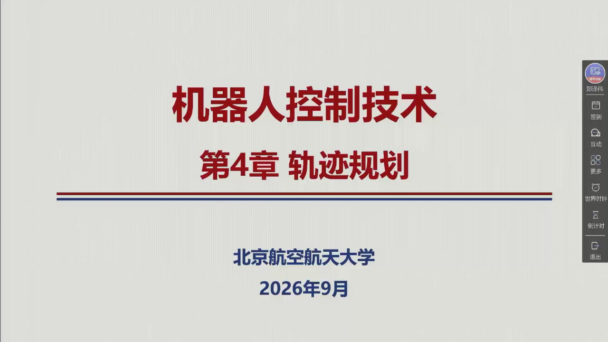
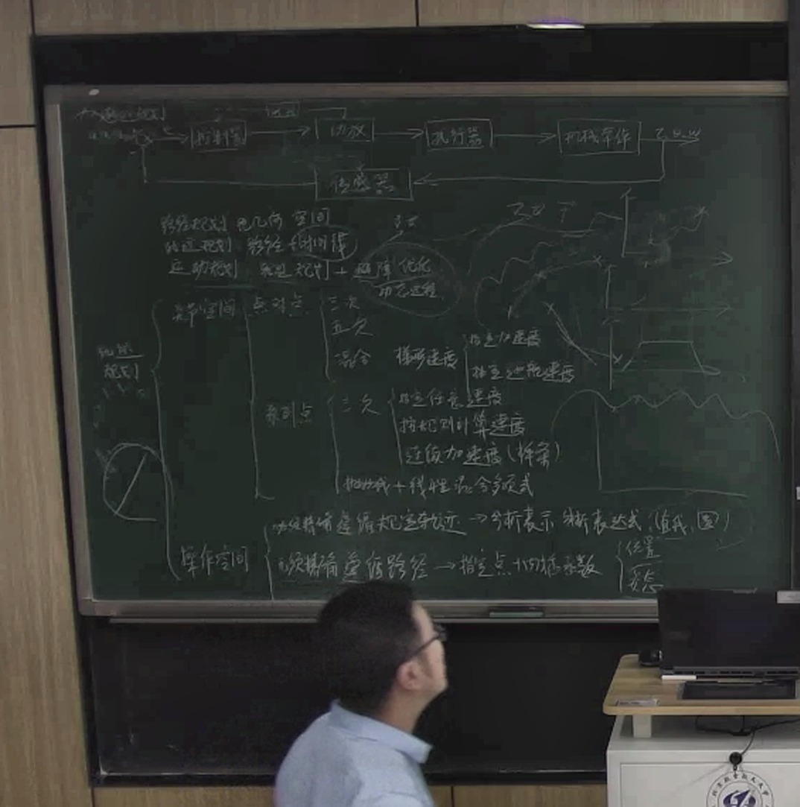

# 第四章 · 轨迹规划

本编依据 Siciliano 等《机器人学：建模、规划与控制》第 4 章整理扩充，**覆盖 §4.1–§4.3 全部六节**（含三个子节），并与**第 4 周录播全程对齐**（2026-09-28，2:29:00）。正文与课件、板书三者逐节对应：老师的**考点提示、重点指定、工程取舍**（「重点介绍混合梯形」@0:48:11、「主要是理解这个思路」@1:47:59）都已写入正文并标注时间点，幻灯片截图则随文嵌入。

## 本编信息（录播）

::: note 素材与生成方式
- **录播**：《机器人控制技术》第 4 周星期一 第 3–5 节（2026-09-28），时长 2:29:00，学院路校区新主楼 B228；平台会话 `sub_id=5869130`、`resource_guid=6758c35f2646425a8492e7afb5f7d554`；
- **板书**：与第 3 周一样，**整节课黑板上只有开课前预写的全章路线图一页**（15:00–141:40 逐点抽样比对，全程未擦改；板书转录见 raw 素材，照片见下）——下面的路线图正是照这一页还原的；
- **课件**：平台课件检测器共触发 250 帧，去重后 35 页；本编嵌入 **34 幅**（含封面、目录、作业页），每幅标注首现时刻；
- **开课补讲**：正式上课前约 5 分钟，补的是第三章的收尾内容（六维力传感器测得的量在不同坐标系间的转换、广义雅可比的对偶性）。老师对此明确「**咱们考试是没有这个**」（0:08:33），因此本编只作提及、不展开；
- **口述**：平台语音识别错字较多（「梯形→七行/提升/畸形」「抛物线→保护线」「多项式→图像式/动向式」「阶次→接触」「示教再现→视调技术」等，勘误页有对照表），本编引用时已按板书、课件与上下文逐处订正。
:::

## 全章路线图（板书，本页照片级还原）

老师开课前把整章写在了黑板上（课件首帧 0:21 之前就已写好）。左上是**闭环控制框图**，中上是**三个概念的分层**，中下是**知识树**，右侧是**第三章对偶性**（开课补讲、不考）：

$$\text{闭环控制}:\quad \text{给定值}\to\boxed{\text{控制器}}\to\boxed{\text{执行器}}\to\boxed{\text{机械臂}}\to\text{输出}\quad\circlearrowleft\ \boxed{\text{传感器}}$$

$$\text{概念分层}\begin{cases}\text{路径规划：纯几何空间}\\[0.6mm]\text{轨迹规划：路径 + 时间律}\\[0.6mm]\text{运动规划：轨迹规划 + 避障}\end{cases}$$

$$\text{轨迹规划}\begin{cases}
\text{关节空间}\begin{cases}
\text{点对点}\begin{cases}\text{三次}\\[0.4mm]\text{五次}\\[0.4mm]\text{混合}\to\text{梯形速度}\begin{cases}\text{指定加速度}\\[0.4mm]\text{指定巡航速度}\end{cases}\end{cases}\\[2mm]
\text{系列点}\begin{cases}\text{给定任意速度}\\[0.4mm]\text{按规则计算速度}\\[0.4mm]\text{连续加速度（样条）}\\[0.4mm]\text{抛物线 + 线性混合多项式}\end{cases}\end{cases}\\[3mm]
\text{操作空间}\begin{cases}\text{必须精确遵循轨迹}\Rightarrow\text{分析表示、解析表达式}\\[0.4mm]\text{必须遵循路径}\Rightarrow\text{指定点 + 内插函数}\end{cases}
\end{cases}$$

$$\text{右侧（第三章对偶性，不考）}:\quad v_e=J\dot q,\qquad \tau=J^{\mathrm T}F_e,\qquad v_1=J_1\dot q_1,\qquad F_1=J_1^{\mathrm T}F_2$$

**板书与教材、课件的结构完全一致**——这棵树就是本章的目录：**关节空间（点对点 / 系列点）是基础与主体，操作空间（路径基元 / 位置 / 指向）是推广**。

<figure>

<figcaption>第 4 周板书原貌（教师流 85:00 截取，本教程轻度增强）：左上闭环控制框图，中上三个概念，中下全章知识树，右侧第三章对偶性 $v_e=J\dot q$、$\tau=J^{\mathrm T}F_e$。整节课黑板未再擦改——老师全程只指点、不新写。</figcaption>
</figure>

## 六节一览

六节各有分工：下表先列出每节回答的核心问题与建议优先级，随后再逐条说明理由。

| 节 | 这一节回答的问题 | 优先级 |
|:--|:--|:--|
| [4.1 路径和轨迹](sec4-1.md) | 路径、轨迹、运动规划差在哪？ | 概念（必知） |
| [4.2.1 点对点运动](sec4-2-1.md) | 只有起点、终点、时间，怎么走？ | **核心（重点）** |
| [4.2.2 通过系列点的运动](sec4-2-2.md) | 要经过一串点，怎么走？ | 精读（动手） |
| [4.3.1 路径基元](sec4-3-1.md) | 直线、圆弧怎么解析地写出来？ | 精读（动手） |
| [4.3.2 位置](sec4-3-2.md) | 操作空间的直线/圆弧怎么带时间？ | 精读 |
| [4.3.3 指向](sec4-3-3.md) | 姿态怎么规划？ | 浏览（了解） |

**优先级说明（按老师的课堂权重，引号内为原话）**

- **核心 · 重点**（4.2.1）：三次多项式讲完后，老师明说「咱们五次（多项式）上会简单地介绍一下，然后**重点介绍混合梯形**」（0:48:11）。**梯形速度曲线（LSPB）** 既是本节的重点，也是全章工业落地时的重心；三次、五次多项式则属于「解方程」的基础练习。
- **精读 · 动手**（4.2.2）：样条是本章的理论高峰，但老师给的态度是**理解优先**：「实际过程中其实都有程序已经写好，包括已经商用的一些机械臂……**主要是理解这个思路**」（1:47:59）。因此四条路线的**选型判断**（各自适合什么场合）比手算更重要。
- **概念 · 必知**（4.1）：路径 / 轨迹 / 运动规划三者的分界是概念题的常见素材；老师同时强调「**即使在操作空间中进行规划，最后也要把它转到关节空间**」（0:37:39），这是本章的骨架。
- **精读 · 动手**（4.3.1、4.3.2）：圆弧的随体坐标系与圆心公式是**作业与考试的直接素材**；老师还点出「法向单位向量就是**向心加速度的方向**」（2:13:56）。
- **浏览 · 了解**（4.3.3）：姿态规划老师只给原理、「**不详细讲**」（2:26:03）——但要点仍须清楚：旋转矩阵为什么不能直接插值（正交性会被破坏），以及欧拉角法与角和轴法各自的思路是什么；细节可从简。
- **不考**：开课补讲的第三章对偶性、传感器坐标系变换（0:08:33）。

> **第一遍的验收标准**：能独立解三次 / 五次多项式系数、能写出梯形速度曲线的 $t_c$ 方程与两条约束、能说出样条为什么降维到三对角系统、能推圆弧的圆心公式——这四条就是本章的底线。

各节的**关键结论**与**典型陷阱**，都汇总在[全章总结](summary.md)中，可随时回查。

## 一条主线

> **点对点运动用「最少约束 + 一个性能指标」把轨迹锁死（三次多项式），工业上则换成峰值可控的梯形速度曲线。点一多，就把一整个高阶多项式拆成一串低阶多项式，再按「补什么条件」分化出四条路线（指定速度 / 计算速度 / 加速度连续 / 抛物线混合）。到了操作空间，先把几何路径解析化（参数、弧长、Frenet 标架），再用弧长时间律 $s(t)$ 把关节空间的所有武器搬过去。最后是姿态：单独规划，用欧拉角或角和轴把它化成一维问题。**（完整版见[全章总结](summary.md)）

::: method 怎么用这一编
- **对照录播**：每节标题后的括注是该节在录播中的时间区间；图注「课堂幻灯片 · mm:ss」标出课件首现时刻，可在原片定位；板书照片见上。
- **先看老师的取舍**：每节末尾的「考点 · 老师原话」框，把老师关于**考什么、重点是什么、工业上怎么选**的原话连同时间点一并列出——这些句子比公式更接近考试的边界。
- **动手验证**：三次 / 五次 / 梯形 / 样条的闭式解与三个作业题都已逐一数值验证，见 `tools/verify_ch04_traj.py`（`make verify`）。
:::
