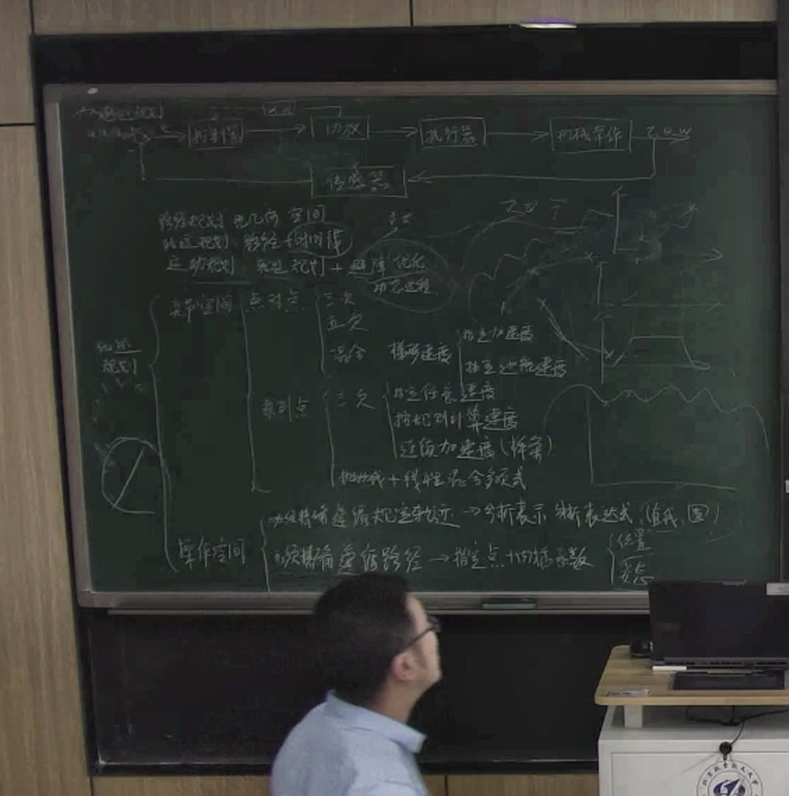

# 第四章 · 轨迹规划

## 从位姿与速度到时间律

第二章由关节变量 $\boldsymbol q$ 给出末端正运动学位姿 $T_e^b(\boldsymbol q)$，第三章通过几何雅可比与分析雅可比建立关节速度到末端速度的线性映射 $[\dot{\boldsymbol p}_e^{\mathrm T}\ \boldsymbol\omega_e^{\mathrm T}]^{\mathrm T}=J(\boldsymbol q)\dot{\boldsymbol q}$。进入实际控制任务——无论是让机械臂从桌面拾取工件并放置到目标位置，还是在卷首任务中移动螺丝刀对准螺栓——仅知道几何起点与终点还不够：系统还必须回答「各关节何时启动、途经各处有多快、何时停下，以及末端究竟沿什么几何曲线移动」。

本章把关节变量与末端位姿写成时间 $t$ 的光滑或分段光滑函数：

$$\boldsymbol q(t)=\begin{bmatrix}q_1(t)&\cdots&q_n(t)\end{bmatrix}^{\mathrm T},\qquad
\dot{\boldsymbol q}(t),\quad\ddot{\boldsymbol q}(t).$$

其中 $t\in[0,t_f]$ 为时间（$\mathrm s$），$q_j(t)$ 为第 $j$ 个关节在时刻 $t$ 的角位移（$\mathrm{rad}$）或线位移（$\mathrm m$），一、二阶导数分别为关节速度与加速度。**轨迹规划器**生成位置、速度与加速度参考时间序列，供底层伺服控制器跟踪；借助正运动学可同步还原末端实际路径，而即使每个关节各自按简单的点对点规律运动，非线性正运动学也会使末端走出的三维空间曲线偏离直线。

本章按「**问题区分 → 单轴时间律 → 多点插值 → 操作空间路径与指向**」四步展开：先在 [§4.1](sec4-1.md) 分清路径、轨迹与运动规划的界限；再在 [§4.2.1](sec4-2-1.md) 构造单关节三次、五次与梯形速度（LSPB）时间律，并在 [§4.2.2](sec4-2-2.md) 讨论经由系列路径点时的 Hermite、三次样条与抛物线混合法；最后在 [§4.3.1](sec4-3-1.md)–[§4.3.3](sec4-3-3.md) 把几何路径 $\boldsymbol p_e=\boldsymbol f(s)$ 与时间律 $s(t)$ 解耦，并解决欧拉角、固定轴角与单位四元数 SLERP 下的三维姿态规划问题。

读完后可在[两连杆第五关](../training/two-link.md#mission-path)检验多关节共用同一标量时间律时末端路径的非线性变形与奇异/零空间瞬间速度抵消现象；第五章将在此轨迹参考的基础上进一步校核电机与减速器的转速—力矩约束。

## 六节结构与优先级分级

| 小节 | 核心问题 | 优先级与课堂权重 |
|:--|:--|:--|
| [4.1 路径和轨迹](sec4-1.md) | 路径、轨迹、运动规划差在哪？规划器接口与两空间取舍 | **概念（必知）**：明确操作空间规划最终仍须经逆运动学转入关节空间执行（`0:37:39`） |
| [4.2.1 点对点运动](sec4-2-1.md) | 给定起终点与总时间 $t_f$，如何设计三次、五次与梯形时间律？ | **核心（重点）**：老师强调五次仅作简要介绍，**重点掌握混合梯形 LSPB**（`0:48:11`） |
| [4.2.2 通过系列点的运动](sec4-2-2.md) | 经过 $N$ 个路径点时如何确定接点导数、消除加速度跳变或削角过渡？ | **精读（动手）**：理解四条路线选型对比，样条重点理解从 $4(N+1)$ 降维到 $O(N)$ 三对角系统（`1:47:59`） |
| [4.3.1 路径基元](sec4-3-1.md) | 如何用弧长参数 $s$ 与 Frenet 标架解析写出空间直线与圆弧？ | **精读（动手）**：圆心投影公式 $\boldsymbol c=\boldsymbol d+(\boldsymbol\delta^{\mathrm T}\boldsymbol r)\boldsymbol r$ 与随体坐标系是作业/考题直接素材（`2:13:56`） |
| [4.3.2 位置](sec4-3-2.md) | 如何用 $\boldsymbol p_e=\boldsymbol f(s(t))$ 分解切向与向心加速度，并处理多段折线？ | **精读**：区分切向改大小、向心改方向（`2:18:00`）及高曲率限速条件 |
| [4.3.3 指向](sec4-3-3.md) | 为何不能直接插值旋转矩阵？如何用欧拉角、轴角与 SLERP 规划姿态？ | **浏览（了解）**：老师课堂点到为止（`2:26:03`），需掌握正交性破坏反例与降为一维的原理 |

> **首轮验收标准**：能够独立解三次与五次多项式系数；熟练写出对称梯形速度曲线（LSPB）的 $t_c$ 二次方程与加速度下界/巡航速度约束；能讲清三次样条为何引入 $2$ 个不指定位置的虚拟点并降维为三对角系统；能独立推导空间圆弧圆心公式、随体旋转矩阵与 Frenet 标架。其余考前边界与不考内容见[勘误与补注](errata.md#errata-4.3)。

## 核心符号与全章路线约定

| 符号 | 含义 | 单位 / 约束 | 首次出现 |
|:--|:--|:--|:--|
| $q_i,\ q_f,\ t_f$ | 单个关节初位置、终位置与总持续时间 | $\mathrm{rad}$ 或 $\mathrm m$；$t_f>0\,\mathrm s$ | [§4.2.1](sec4-2-1.md) |
| $\Delta q,\ u$ | 总位移 $\Delta q=q_f-q_i$ 与无量纲时间 $u=t/t_f\in[0,1]$ | $\mathrm{rad}$ 或 $\mathrm m$；无量纲 | [§4.2.1.2](sec4-2-1.md#sec-4.2.1.2) |
| $t_c,\ \dot q_c,\ \ddot q_c$ | 梯形速度曲线的加速段时长、巡航速度与常加速度 | $\mathrm s,\ \mathrm{rad/s},\ \mathrm{rad/s^2}$ | [§4.2.1.3](sec4-2-1.md#sec-4.2.1.3) |
| $\Pi_k(t),\ M_j$ | 分段插值第 $k$ 段三次多项式与接点 $t_j$ 处的二阶导（加速度） | $\mathrm{rad},\ \mathrm{rad/s^2}$ | [§4.2.2](sec4-2-2.md) |
| $\Delta t'_k,\ \delta_k$ | 路线④第 $k$ 个混合段窗口宽度及相对名义点 $q_k$ 的有符号偏离量 | $\mathrm s,\ \mathrm{rad}$ | [§4.2.2.4](sec4-2-2.md#sec-4.2.2.4) |
| $s,\ \boldsymbol t,\ \boldsymbol n,\ \boldsymbol b$ | 有向弧长参数与单位切向、法向、副法向 Frenet 标架 | $\mathrm m$；单位正交右手系 | [§4.3.1](sec4-3-1.md#sec-4.3.1) |
| $\boldsymbol c,\ \rho,\ R$ | 空间圆弧圆心、半径与随体坐标系列拼接旋转阵 $[\boldsymbol x'\ \boldsymbol y'\ \boldsymbol z']$ | $\mathrm m,\ \mathrm m,\ SO(3)$ | [§4.3.1.2](sec4-3-1.md#sec-4.3.1.2) |
| $\boldsymbol\varphi_e,\ (\boldsymbol r',\theta_f),\ Q$ | ZYZ 欧拉角向量、相对旋转固定轴角与单位四元数 | $\mathrm{rad},\ S^3$ | [§4.3.3](sec4-3-3.md) |

<figure>

<figcaption>课程板书全章路线图：顶部给出「给定值 → 控制器 → 执行器 → 机械臂 → 传感器反馈」伺服闭环框图；中部将轨迹规划拆为关节空间（点对点三次/五次/梯形、系列点指定速度/计算速度/样条/混合）与操作空间（路径基元、时间律、指向）。注：黑板右上角课前补讲的第三章传感器坐标转换与广义雅可比对偶性明确不在本章考试范围（见<a href="errata.md#errata-4.3">勘误 E4.3</a>）。</figcaption>
</figure>

各节核心定理、对比总结与自查清单集中汇总于[全章总结](summary.md)；所有定量算例与课后作业 [4.1 / 4.5 / 4.6](homework04.md) 均可对照数值脚本 `robot/tools/verify_ch04_traj.py` 独立复算，避免将名义节点时刻混同于中心混合后的实际运动区间。
