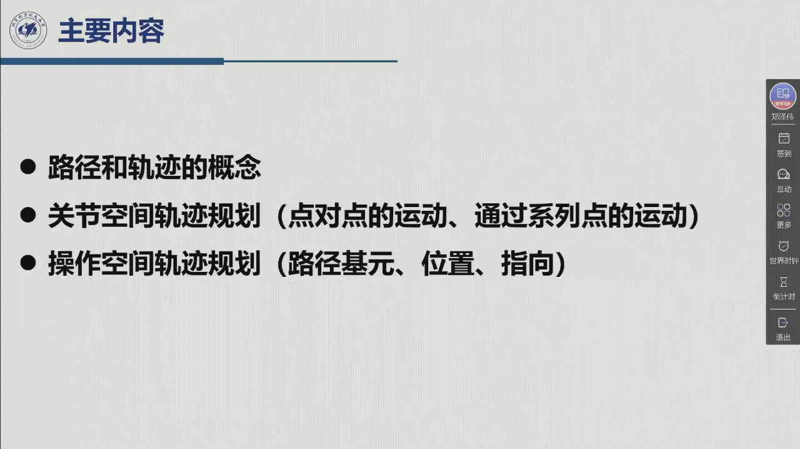
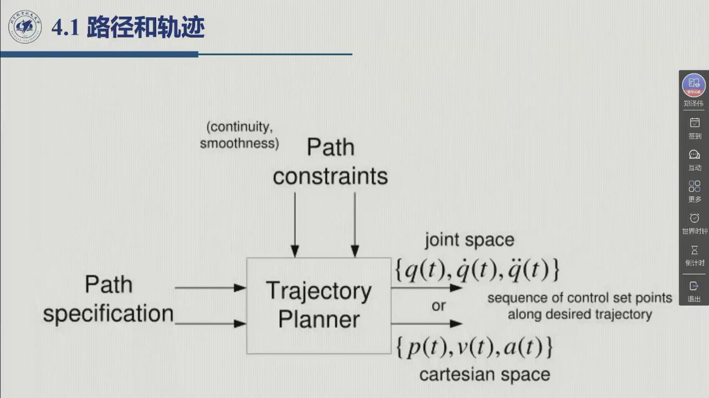

# 4.1 路径和轨迹

知道起点和终点，仍有许多种走法：可以走直线或绕行，也可以缓慢起步或全程匀速。控制器还需要知道每个时刻该到哪里。本章由此生成参考位置、速度和加速度，再检查机器人能否执行。课堂回看：0:08:47–0:39:00。

{{#include ../assets/figures/robot-trajectory.md}}

## 4.1.1 路径、轨迹和运动规划

任务层确定“把零件送到装配位”这样的目标，规划层安排走法与时间，伺服层再利用传感反馈追踪参考。因此规划轨迹给出的是期望运动；实际能跟到什么程度，还受误差与驱动能力影响。

::: def 定义 4.1.1 · 路径 path {#def-4.1.1}
路径是运动的几何描述，规定依次经过哪些构形或位姿。例如关节路径

$$q(s)=q_i+s(q_f-q_i),\qquad0\le s\le1$$

给出关节空间中的一条线段。这里 $s$ 是无量纲参数，没有规定一秒后走到哪里。
:::

::: def 定义 4.1.2 · 轨迹 trajectory {#def-4.1.2}
轨迹为运动安排时间。若在时长 $T$ 内选 $s(t)$，就得到 $q(t)=q(s(t))$。位置对时间的一、二阶导数分别是速度和加速度；需要时再约束加速度的导数，即加加速度（jerk）。
:::

::: def 定义 4.1.3 · 运动规划 motion planning {#def-4.1.3}
运动规划是在起终条件、障碍物及运动约束下寻找可行运动，也可进一步优化时间、长度或其他代价。它可离线完成，也可随环境变化在线重规划。本章主要处理路径或路径点已知后的时间安排。
:::

### 同一条路径，配两个时间律

令 $u=t/T$。取 $s_1=u$ 时，$\dot s_1=1/T$，所以运动段内匀速；若前后静止，端点速度会跳变。改取[三次时间律](../recall.md#time-law) $s_2=3u^2-2u^3$，有

$$\dot s_2=\frac{6u-6u^2}{T},\qquad\dot s_2(0)=\dot s_2(T)=0.$$

两个选择经过同样的关节构形，但到达各点的时刻和速度不同。由[链式法则](../recall.md#chain-rule)，$\dot q=(q_f-q_i)\dot s$。路径和时间律就是在这一步合成轨迹的。实际算法可以先后求它们，也可以同时求，三个术语并不是逐层包含的集合。

## 4.1.2 驱动限制与结构振动

::: thm 定理 4.1.A · 运动律的两类物理要求 {#thm-4.1.A}
规划应满足执行器和传动机构的力、力矩、速度及功率限制，并将结构振动控制在允许范围内。加速度需要驱动力；曲线在速度或加速度上突然变化，还可能激发柔性结构的振动。
:::

速度上限还受电压、传动和控制条件影响，力矩能力也常随速度及持续时间变化。本章先检查给定的关节速度、加速度上限，到第六章建立动力学后，再补充力矩验算。

连续性用 $C^k$ 表示：位置及前 $k$ 阶导数连续。把运动段接到静止段，差别最容易看出来：

| 时间律 | 端点衔接 | 仍可能发生的跳变 |
|:--|:--|:--|
| 静止起停三次 | 位置、速度连续 | 加速度可跳变 |
| 零端点速度、加速度的五次 | 位置、速度、加速度连续 | jerk可跳变 |
| 梯形速度 | 位置、速度连续 | 加速度在分段切换时跳变 |

更高连续性有助于减少某些振动激励，但不能仅凭光滑阶数保证没有共振，也不能保证同位移、同时间下所有峰值都更低。下一节会算出：五次的速度峰值就可能高于三次。

## 4.1.3 规划器需要哪些输入

<figure>
<svg class="figure-svg" viewBox="0 0 920 400" xmlns="http://www.w3.org/2000/svg" role="img" aria-labelledby="fig-41-t fig-41-d">
<title id="fig-41-t">轨迹规划器的接口：输入规范与约束，输出设定点序列</title>
<desc id="fig-41-d">左侧输入：路径规范（几何路径 / 路径点）与路径约束（连续性、平滑性、时间、速度加速度上下限）；中间是轨迹规划器；右侧输出两路——关节空间给出关节位置/速度/加速度向量序列，操作空间给出末端位置与指向的序列。</desc>
<defs>
<marker id="f41-m" markerWidth="9" markerHeight="9" refX="7" refY="3" orient="auto"><path d="M0,0 L7,3 L0,6 Z" fill="var(--muted)"/></marker>
</defs>
<rect x="40" y="70" width="250" height="130" rx="8" fill="none" stroke="var(--line-strong)" stroke-width="1.4"/>
<text class="diagram-text" x="165" y="96" text-anchor="middle">输入 · 路径规范</text>
<text class="diagram-note" x="60" y="122">几何路径（直线 / 圆弧 / 样条）</text>
<text class="diagram-note" x="60" y="146">路径点序列 $q_k$（或 $p_k$）</text>
<text class="diagram-note" x="60" y="170">路径约束：连续性 / 平滑性</text>
<text class="diagram-note" x="60" y="192">总时间 $t_f$、$v_{\max}$、$a_{\max}$</text>
<rect x="350" y="105" width="180" height="60" rx="10" fill="none" stroke="var(--fig-blue)" stroke-width="2"/>
<text class="diagram-text" x="440" y="142" text-anchor="middle">轨迹规划器</text>
<line x1="290" y1="135" x2="348" y2="135" stroke="var(--muted)" stroke-width="1.6" marker-end="url(#f41-m)"/>
<line x1="532" y1="135" x2="600" y2="135" stroke="var(--muted)" stroke-width="1.6" marker-end="url(#f41-m)"/>
<rect x="602" y="60" width="278" height="66" rx="8" fill="none" stroke="var(--line-strong)" stroke-width="1.4"/>
<text class="diagram-text" x="741" y="86" text-anchor="middle">关节空间输出</text>
<text class="diagram-note" x="622" y="110">$q(t),\ \dot q(t),\ \ddot q(t)$（$n$ 维向量序列）</text>
<rect x="602" y="150" width="278" height="66" rx="8" fill="none" stroke="var(--line-strong)" stroke-width="1.4"/>
<text class="diagram-text" x="741" y="176" text-anchor="middle">操作空间输出</text>
<text class="diagram-note" x="622" y="200">$p(t)$ 与指向（姿态）的序列</text>
<text class="diagram-text" x="460" y="258" text-anchor="middle">「输出是按时间顺序给出的位置、速度和加速度的值」（教材 §4.1）</text>
<text class="diagram-note" x="460" y="292" text-anchor="middle">规划在操作空间做 → 逆运动学 / 示教再现 → 关节变量序列 → 底层伺服</text>
<text class="diagram-text" x="460" y="336" text-anchor="middle" fill="var(--fig-gold)">关节空间的每一种方法，都可以推广到操作空间（0:20:12）</text>
<text class="diagram-text" x="460" y="368" text-anchor="middle">轨迹规划器接口（本教程绘）</text>
</svg>
<figcaption>轨迹规划器接收几何、时间及运动限制，生成参考位置及其导数。若参考在操作空间表达，可经逆运动学生成关节参考，也可交给后续任务空间控制器。</figcaption>
</figure>

::: method 轨迹规划算法的输入输出接口 {#method-4.1.A}
输入包括起终条件、中间点或几何路径，以及允许的时间、速度、加速度、力矩和碰撞约束。输出是随时间查询的参考位置及所需导数；也可以输出分段系数，由控制周期实时计算这些量。

关节参考 $q_d(t)$ 可直接供关节伺服使用。操作空间参考 $x_d(t)$ 可经连续选支的逆运动学转成关节参考，或供第七章的任务空间反馈使用。两种接口最终都要产生关节驱动输入。
:::

::: def 定义 4.1.4 · 常用的轨迹指定量 {#def-4.1.4}
常见输入有必须经过的中间位姿、连接这些位姿的直线或圆弧、总时长、端点速度和加速度，以及各段的运动限值。某处必须准确通过，与允许从附近过渡，是不同约束，需事先说明。
:::

用户可以提供解析路径、密集采样点，也可以只给少数参量。完整路径可以作为输入，是否与其他要求同时可行，则需通过求解和验证判断。

总时间也可作为输入，但过短时可能无解。有些接口改为接收最大速度、加速度的比例，再据此计算时长。无论怎样输入，最终轨迹都要检查关节、碰撞和动力学限制。

## 4.1.4 在哪个空间规划

关节空间容易直接表达关节行程和速度限制；操作空间容易直接表达工具的直线、圆弧或姿态要求。两个空间由非线性正运动学联系，因此关节插值一般不保持工具直线，工具直线也一般不对应关节直线。

例如两根1 m杆同时从 $q_i=(0,0)$ 走到 $q_f=(\pi/2,0)$。按关节直线插值时，第二关节不动，末端沿半径2 m的四分之一圆移动；它不会沿 $(2,0)$ 与 $(0,2)$ 之间的弦运动。这里“关节直线”描述的是构形，不是工具在工作台上留下的形状。

若任务要求沿焊缝走直线，可先把直线列为约束，再求连续关节解与时间安排。具体规划算法可以不同，但近奇点处的关节速度和冗余机构的内部构形仍需检查，见[第三章的逆解](../ch03/sec3-5.md)。

避障则需要检查整条机械臂。在构形空间中，把各连杆碰撞或自碰撞的 $q$ 标为禁区，就能寻找避开禁区的路径。只验证工具点远离障碍物，会漏掉肘部或其他连杆的碰撞。

::: think 检查理解
一台机器人末端要求走直线，第一版程序却让关节角分别匀速变化。它可能同时满足起终位姿和总时间，却为什么仍不满足任务？若改成工具直线插补，又为什么不能只检查工具点无碰撞？

::: sol 核对
起终位姿只约束两个时刻；关节插值经非线性正运动学后，中途末端通常走曲线。工具直线插补满足的是工具路径要求，其他连杆仍可能扫过障碍，需对整条构形路径做碰撞检查。
:::
:::
