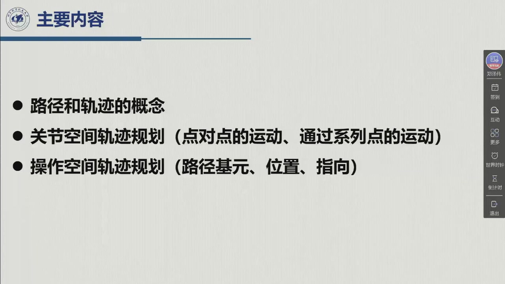
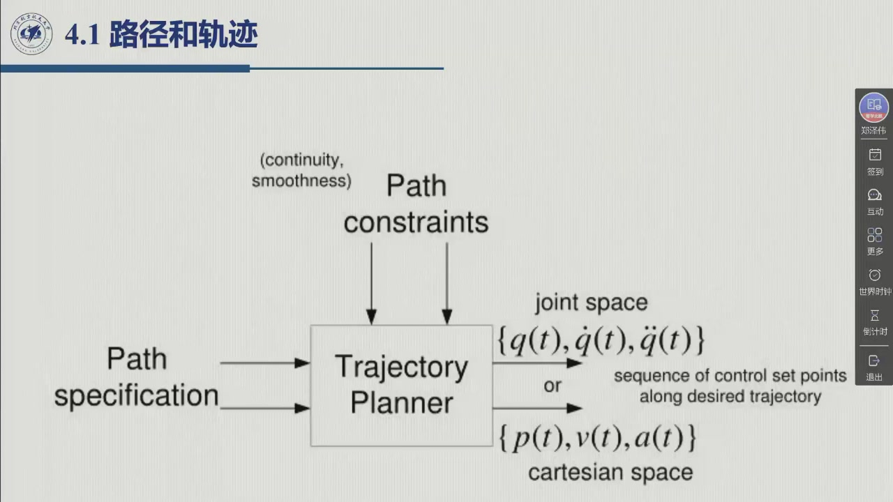

# 4.1 路径和轨迹

第二章给定关节变量 $\boldsymbol q$，可以计算末端位姿；第三章给定关节速度 $\dot{\boldsymbol q}$，可以计算末端速度。现在要让末端从桌面上的一点移到另一点：它沿直线走，还是先抬高再放下？选定路线后，又要用多长时间、经过各处时有多快？

前一个问题描述经过的几何路线，后一个问题还要安排时间。本节先区分这两类描述，再看它们如何为控制器提供参考。

{{#include ../assets/figures/robot-trajectory.md}}

## 4.1.1 三个概念：路径、轨迹、运动规划

同一条直线可以用 1 秒走完，也可以用 2 秒走完。两次经过的几何路线相同，经过各点的时刻和速度却不同。规划时要把路线和运动时间都交代清楚，控制器才能逐时跟踪。

老师在 0:09:03 画出底层闭环控制框图：给定值进入控制器，电机驱动机械臂，传感器把测得的状态反馈回来。他指出，后面学的控制主要针对底层伺服。要完成一个任务，还需要在此之前确定做什么、怎样运动：

| 层 | 干什么 | 本课程位置 |
|:--|:--|:--|
| 高层 · 任务层 | 把一个总任务拆成几个子任务 | 第 12 章（移动机器人运动规划） |
| 中层 · 轨迹规划层 | 为子任务设计运动轨迹 | **本章** |
| 底层 · 伺服层 | 跟踪给定的参考输入 | 原书第 8–10 章 |

轨迹规划器给伺服控制器提供参考输入。老师在 0:10:50 说：「轨迹规划主要是做什么工作呢？就是为底层的伺服控制提供一个参考输入。」控制器再根据反馈，使实际运动尽量跟上参考值。

先区分描述运动时要用的三个概念。教材按下面的口径组织本章（0:11:22）：

::: def 定义 4.1.1 · 路径 path {#def-4.1.1}
**路径**描述机械手在关节空间或操作空间中经过的点及其几何形状，不指定何时经过。例如末端沿桌面上一条直线移动，这条线段就是路径（0:11:45）。
:::

::: def 定义 4.1.2 · 轨迹 trajectory {#def-4.1.2}
**轨迹**在路径上加进时间安排。例如对同一条线段，指定从静止出发、2 秒后到达并停止，就还需要确定途中每个时刻的位置；对位置求导可得到速度和加速度。老师说：「我们既要设计这个轨迹纯的几何的量（一条曲线），同时要设计经过曲线上每一点的速度和加速度」（0:12:30）。

更高要求下，还可以考虑**加加速度**，即加速度对时间的导数；是否需要它取决于任务和规划代价（0:12:46）。
:::

::: def 定义 4.1.3 · 运动规划 motion planning {#def-4.1.3}
本课程用**运动规划**讨论更广的任务：除了生成轨迹，还考虑如何避开障碍物，以及在需要时按时间或损耗等指标优化（0:13:05）。是否涉及在线重规划和动力学，要看具体问题。
:::

本章先讨论路径与轨迹；避障和优化属于更广的运动规划问题。老师说明：「咱们第 11、12 章讲移动机器人的时候，就是运动规划讲得多一点，包括一些高级的运动规划算法」（0:13:47）。

## 4.1.2 运动律的两条硬约束

确定起点和终点后，还要检查所安排的运动能否由机械手实现。教材在这里提出执行器限制和结构振动两类约束（0:27:22、教材 §4.1）：

::: thm 定理 4.1.A · 运动律的两条硬约束 {#thm-4.1.A}
**（一）执行器施加到关节的广义力不得违反饱和限制。** 加速度最终由电机输出的力矩决定，而电机力矩有限；若设计的加速度过大、超过电机能提供的力矩，这个运动律**根本实现不了**。速度同理——最大速度受功率限制，「如果我们设计的速度过大，最后对电机的要求超过了它能提供的，设计也是失败的」（0:28:00）。

**（二）不得激发结构的典型谐振模式。** 控制信号本身含有频率成分，一般要避免它与**结构本身的固有频率**重叠；一旦重叠，就会激起结构的**共振**，而很大的振幅会损伤结构，甚至导致结构失效（0:28:33）。
:::

轨迹的连续程度会影响执行器的运动和结构振动。例如位置连续而速度突然跳变，意味着理想模型需要瞬时改变速度；因此通常至少要求速度连续。下表比较几种常见要求，具体是否满足力矩、速度和振动限制，还要结合机械手模型与运动时间检查。

| 要求 | 位置 | 速度 | 加速度 | 加加速度 | 本章例子 |
|:--|:--|:--|:--|:--|:--|
| 速度连续 | 连续 | 连续 | 可以跳变 | — | 梯形速度曲线 |
| 加速度连续 | 连续 | 连续 | 连续 | 可以跳变 | 零端点加速度的五次轨迹接静止段 |
| 加加速度连续 | 连续 | 连续 | 连续 | 连续 | 需要更高阶的连续性约束 |

老师在 0:29:16 强调，提高连续性要求可以让运动更柔和，但也会增加设计和计算成本。平滑程度本身不能保证峰值力矩或功率更小；比较不同轨迹时，还要给定运动时间、负载和具体约束。

## 4.1.3 轨迹规划器的接口：输入、输出与可指定的约束

把轨迹规划当成一个黑箱（教材图 4.0，课件 0:29:23 页）：

<figure>
<svg class="figure-svg" viewBox="0 0 920 400" xmlns="http://www.w3.org/2000/svg" role="img" aria-labelledby="fig-41-t fig-41-d">
<title id="fig-41-t">轨迹规划器的接口：输入规范与约束，输出设定点序列</title>
<desc id="fig-41-d">左侧输入：路径规范（几何路径 / 路径点）与路径约束（连续性、平滑性、时间、速度加速度上下限）；中间是轨迹规划器；右侧输出两路——关节空间给出关节位置/速度/加速度向量序列，操作空间给出末端位置与指向的序列。</desc>
<defs>
<marker id="f41-m" markerWidth="9" markerHeight="9" refX="7" refY="3" orient="auto"><path d="M0,0 L7,3 L0,6 Z" fill="var(--muted)"/></marker>
</defs>
<rect x="40" y="70" width="250" height="130" rx="8" fill="none" stroke="var(--line-strong)" stroke-width="1.4"/>
<text class="diagram-text" x="165" y="96" text-anchor="middle">输入 · 路径规范</text>
<text class="diagram-note" x="60" y="122">几何路径（直线 / 圆弧 / 样条）</text>
<text class="diagram-note" x="60" y="146">路径点序列 $q_k$（或 $p_k$）</text>
<text class="diagram-note" x="60" y="170">路径约束：连续性 / 平滑性</text>
<text class="diagram-note" x="60" y="192">总时间 $t_f$、$v_{\max}$、$a_{\max}$</text>
<rect x="350" y="105" width="180" height="60" rx="10" fill="none" stroke="var(--fig-blue)" stroke-width="2"/>
<text class="diagram-text" x="440" y="142" text-anchor="middle">轨迹规划器</text>
<line x1="290" y1="135" x2="348" y2="135" stroke="var(--muted)" stroke-width="1.6" marker-end="url(#f41-m)"/>
<line x1="532" y1="135" x2="600" y2="135" stroke="var(--muted)" stroke-width="1.6" marker-end="url(#f41-m)"/>
<rect x="602" y="60" width="278" height="66" rx="8" fill="none" stroke="var(--line-strong)" stroke-width="1.4"/>
<text class="diagram-text" x="741" y="86" text-anchor="middle">关节空间输出</text>
<text class="diagram-note" x="622" y="110">$q(t),\ \dot q(t),\ \ddot q(t)$（$n$ 维向量序列）</text>
<rect x="602" y="150" width="278" height="66" rx="8" fill="none" stroke="var(--line-strong)" stroke-width="1.4"/>
<text class="diagram-text" x="741" y="176" text-anchor="middle">操作空间输出</text>
<text class="diagram-note" x="622" y="200">$p(t)$ 与指向（姿态）的序列</text>
<text class="diagram-text" x="460" y="258" text-anchor="middle">「输出是按时间顺序给出的位置、速度和加速度的值」（教材 §4.1）</text>
<text class="diagram-note" x="460" y="292" text-anchor="middle">规划在操作空间做 → 逆运动学 / 示教再现 → 关节变量序列 → 底层伺服</text>
<text class="diagram-text" x="460" y="336" text-anchor="middle" fill="var(--fig-gold)">关节空间的每一种方法，都可以推广到操作空间（0:20:12）</text>
<text class="diagram-text" x="460" y="368" text-anchor="middle">轨迹规划器接口（本教程绘）</text>
</svg>
<figcaption>轨迹规划器的接口（本教程绘）：左边是用户能给的全部信息，右边是交给底层伺服的两条路。注意输出的三个量——**位置、速度、加速度**——这正是后面每一种方法都要画三张曲线图的原因。</figcaption>
</figure>

::: method 轨迹规划算法的输入输出接口（教材 §4.1） {#method-4.1.A}
**输入**：路径描述、路径约束，以及由机械手**动力学**施加的约束。

**输出**：按时间顺序给出的**位置、速度和加速度**值所构成的末端执行器轨迹（参考输入）。

**接口的另一半**：本章采用关节伺服，因此操作空间中的参考序列还要经逆运动学转换成关节变量时间序列。逆运动学可用于离线或在线规划；示教再现则可以直接记录关节变量（0:38:00）。
:::

**用户能指定多少？** 实际任务往往只给出有限的路径点和约束，其余时刻的位置由规划算法确定（0:32:44）。课件把用户可能给出的参量归为四类：

::: def 定义 4.1.4 · 用户可指定的轨迹参量（课件 0:32:44 页） {#def-4.1.4}
1. **极值点**：最大速度点、最大加速度点等；
2. **可能的中间点**：为避障等目的设定的中间位姿；
3. **插入点的几何基元**：两点之间用直线、圆弧还是抛物线连接；
4. **整个轨迹的时间**，以及对**特别感兴趣的点**指定的速度与加速度（例如接近人、接近目标处要慢；曲率大的路段要限制速度）。

其余各点的运动律，由规划算法**按约束反解**出来（0:35:00）。
:::

工业应用中，用户也可以不直接指定总时间 $t_f$，而是指定相对容许速度或加速度的百分比（如 30%、50%、80%），再由规划器计算时间。原因是时间给得太短，所需速度或加速度可能超过机械手的限制（0:33:48、教材 §4.2.1）；使用百分比仍需规划器检查其余约束。

## 4.1.4 关节空间还是操作空间

轨迹规划可以在两个空间里做，选择不是随意的（0:14:06、0:22:35）：

- **操作空间规划**：末端要沿直线移动或绕开障碍物时，可以直接用任务中的几何量描述路径。老师在 0:35:36 指出，单看关节变量不容易判断末端与障碍物的空间关系。
- **关节空间规划**：直接安排各关节的运动，适合不要求末端精确跟随某条几何曲线的任务。本章先讲这些方法，再把其中的时间律用于操作空间规划（0:15:03、0:20:12）。

正运动学通常是非线性的：关节空间中的直线路径，映射到操作空间后一般是曲线；操作空间中的直线路径，映射到关节空间后也一般不是直线（0:23:00）。避障同样可以转化为关节空间的约束；关键是检查整个机械臂与障碍物的关系，而不只是末端的位置。

**为什么不能只在操作空间做？** 有两个麻烦（0:36:12、教材 §4.1）：

1. **奇异位形邻域**：在奇异位形附近做逆运动学，求出的关节速度可能非常大（[3.5.2](../ch03/sec3-5.md#sec-3.5.2) 的伪逆/DLS 正是为此）；
2. **冗余自由度**：逆解有无穷多个解，难以直接求解。

如果任务不要求末端沿指定路径运动，可以考虑直接在关节空间指定路径，避开操作空间逆解带来的部分困难。若必须沿焊缝等指定路径运动，就应在规划中直接表达这条路径，并检查能否找到满足限制的关节运动。

本章讨论的实现方式是：操作空间规划 ⇒ 逆运动学 ⇒ 关节变量 ⇒ 关节伺服控制。老师在 0:37:39 强调：

> **即使在操作空间中规划，最后也要把它转到关节空间中，得到关节变量的值，才能实现对机械手的控制。**

这对应本章的关节伺服架构；后面学习操作空间控制时，还会看到其他控制方式。

::: think 考点 · 老师原话（录播时间点）

> **开课补讲不在考试范围。** 「这个在我之后研究的过程中可以注意一下，**咱们考试是没有这个**」（0:08:33）——上课前几分钟讲的内容是第三章的尾巴（六维力传感器测得的量在不同坐标系间的转换、广义雅可比的对偶性），老师明确**不考**，本编按此只作提及、不展开。

> **三个概念的区分是概念题素材。** 「路径规划就是我们只考虑它在空间中的几何形态……轨迹规划不仅包括纯的几何的路径，它也包括跟时间相关的，或者叫时间律」（0:11:45）；「运动规划……同时也要考虑到避障以及轨迹优化的问题」（0:13:19）。

> **关节空间是基础、占大部分篇幅。** 「关节空间的规划是**基础**……其实咱们**大部分篇幅**也是讲关节空间的规划」（0:15:00）；「关节空间中的算法其实都可以推广到操作空间」（0:20:12）。

> **本章骨架（连说三次）。** 「**即使在操作空间中进行规划，最后我们也要把它转到关节空间中**，得到关节变量的值，才能实现对机械手的控制」（0:37:39）。

> **工业上不让用户指定时间。** 「在工业的实际过程中，一般不让你指定时间……能给用户选择的就只能指定相对于最大容许速度或最大加速度的一个百分比」（0:57:49）。
:::

::: think 默写点 · 合上书再写（主动回忆）

不看正文与速查表，先把下面几条写出来，再展开核对；写不出来的，就说明这一节还没真正「拿走」。

1. 路径、轨迹、运动规划三个概念各比前一个多了什么？
2. 运动律的两条硬约束是什么？各自物理上限制的是哪个量？
3. 工业应用中为什么有时不让用户指定总时间 $t_f$？可以改为指定什么？
4. 本章为什么把操作空间规划的结果转成关节变量，再交给伺服控制？

::: sol 核对

路径描述几何形状；轨迹在路径上加入时间安排；本课程所说的运动规划还考虑避障及可能的优化。

（一）检查关节广义力是否超出执行器限制；（二）避免轨迹激发结构的典型谐振模式。是否满足限制要结合负载、动力学和结构特性判断。

给定时间过短，可能使速度或加速度超限。工业应用中也可指定相对容许速度、加速度的百分比，再由规划器确定时间并检查约束。

操作空间便于表达末端与环境的几何关系；本章采用关节伺服，因此需要把末端参考运动转换成关节参考运动。避障仍要检查机械臂整体，而非只检查末端。

:::

:::

## 4.1 小结与常见错误

- **本节问题**：路径描述几何形状，轨迹还指定时间；规划器按任务和机械手限制生成参考运动。
- **两个空间**：关节空间便于安排关节运动，操作空间便于描述末端路径；本章的关节伺服需要关节参考量。
- **规划器接口**：输入路径描述及约束，输出随时间变化的位置、速度和加速度参考值。

::: think 常见错误清单 · 自查三条
1. 把**路径**和**轨迹**当同义词——差一个**时间律**；写「轨迹」时必须能说出每点的速度或加速度从哪来。
2. 把本章的关节伺服架构误当作唯一的控制架构；本章将操作空间参考转换为关节参考，后面还会讨论操作空间控制。
3. 忘记检查速度与加速度：位置轨迹对时间求导可以得到它们，具体接口是否分别输出取决于规划与控制实现。
:::