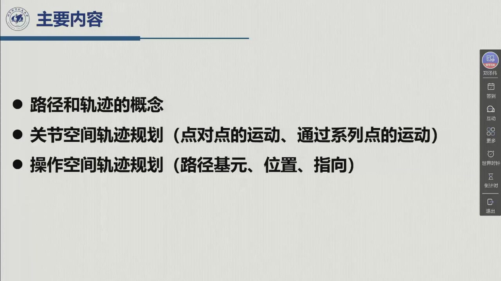
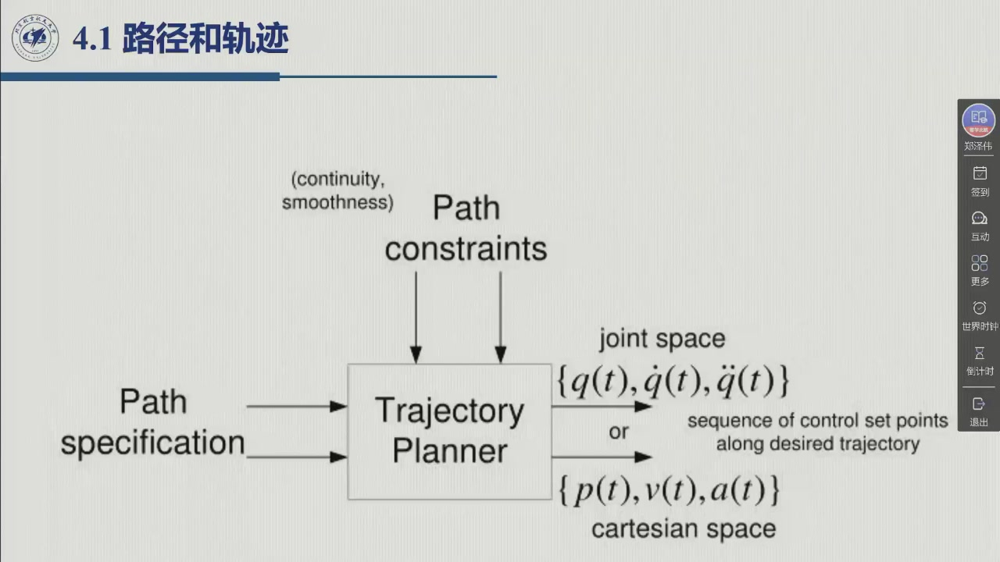

# 4.1 路径和轨迹

前三章解决的是「**到哪去**」：位姿运动学与雅可比把末端的位形和速度映射到关节。这一章解决「**怎么去**」：在时间轴上把起点和终点连成一条底层伺服跟得住的曲线。本节要做的第一步，是把三个常被混用的词分清楚——路径（纯几何）、轨迹（带时间律）、运动规划（再加避障与优化）。录播 0:08:47–0:39:00。

{{#include ../assets/figures/robot-trajectory.md}}

## 4.1.1 三个概念：路径、轨迹、运动规划

**先看这件事在整台机器人里处于哪一层。** 老师 0:09:03 先画了底层的闭环控制框图（给定值 → 误差 → 控制器 → 电机 → 传感器反馈），随后强调：这张图只管**底层的伺服控制**，「咱们后面学的八、九、十章控制其实也都是针对底层伺服控制」。但这只是最底下的一层——真正完成一个任务时，机器人是**分层**工作的：

| 层 | 干什么 | 本课程位置 |
|:--|:--|:--|
| 高层 · 任务层 | 把一个总任务拆成几个子任务 | 第 12 章（移动机器人运动规划） |
| 中层 · 轨迹规划层 | 子任务「怎么去」——设计轨迹 | **本章** |
| 底层 · 伺服层 | 跟踪给定的参考输入 | 第 8–10 章 |

轨迹规划在分层结构中的位置由此确定：**它是底层伺服的参考输入发生器**。老师 0:10:50：「轨迹规划主要是做什么工作呢？就是为底层的伺服控制提供一个参考输入。」换句话说，我们设计的每一个点，最后都要由底层伺服去跟踪。

**再看三个常被当成同义词的词。** 教材（意大利作者 Siciliano 等）特意把它们的界线划清，本章就按这个口径讲（0:11:22）：

::: def 定义 4.1.1 · 路径 path {#def-4.1.1}
**路径**表示在关节空间或操作空间中，机械手执行指定运动时**必须跟随的点的轨迹**。它是运动的**纯几何描述**——只回答「经过哪些点、连成什么形状」，不回答「何时经过、多快经过」。路径是一个**空间（几何）量**（0:11:45）。
:::

::: def 定义 4.1.2 · 轨迹 trajectory {#def-4.1.2}
**轨迹**是一条**指定了时间律**的路径——不仅包括纯几何的路径，还包括沿路径每一点的**速度与加速度**（时间律）。用老师的话：「我们既要设计这个轨迹纯的几何的量（一条曲线），同时要设计经过曲线上每一点的速度和加速度」（0:12:30）。

当控制提出更高要求时，轨迹还可以把**加加速度**（加速度对时间再求导）也包含进来；但这类规划对计算量和成本的要求更高，只在必要时才做（0:12:46）。
:::

::: def 定义 4.1.3 · 运动规划 motion planning {#def-4.1.3}
**运动规划**在轨迹规划之上再加**避障**与**轨迹优化**：不仅给出几何路径与时间律，还要考虑障碍物——设计出一条避开障碍的轨迹，并以**时间最短**或**损耗最小**为典型优化目标。它是一个**动态过程**：机器人整个运动过程中都在规划，因此还要考虑动力学（0:13:05）。
:::

三者的包含关系一句话就能记住：**路径 ⊂ 轨迹 ⊂ 运动规划**（各加一层：时间律、避障与优化）。老师也点明了章节分工：「咱们第 11、12 章讲移动机器人的时候，就是运动规划讲得多一点，包括一些高级的运动规划算法」（0:13:47）。

## 4.1.2 运动律的两条硬约束

机械手从初始位姿移动到最终位姿，**过渡过程由运动律表征**；而运动律不能随手画一条光滑曲线了事——它必须满足两条来自物理的硬约束（0:27:22、教材 §4.1）：

::: thm 定理 4.1.A · 运动律的两条硬约束 {#thm-4.1.A}
**（一）执行器施加到关节的广义力不得违反饱和限制。** 加速度最终由电机输出的力矩决定，而电机力矩有限；若设计的加速度过大、超过电机能提供的力矩，这个运动律**根本实现不了**。速度同理——最大速度受功率限制，「如果我们设计的速度过大，最后对电机的要求超过了它能提供的，设计也是失败的」（0:28:00）。

**（二）不得激发结构的典型谐振模式。** 控制信号本身含有频率成分，一般要避免它与**结构本身的固有频率**重叠；一旦重叠，就会激起结构的**共振**，而很大的振幅会损伤结构，甚至导致结构失效（0:28:33）。
:::

两条约束合起来，就得到工程上最常用的要求：**设计光滑的轨迹**。而「光滑到什么程度」，则是一个可选的档位（0:28:57）：

| 档位 | 位置 | 速度 | 加速度 | 加加速度 | 代价 |
|:--|:--|:--|:--|:--|:--|
| 低 | 平滑、连续 | 连续（不平滑） | **跳跃** | — | 最省算力，工业常用 |
| 中 | 平滑、连续 | 平滑、连续 | 连续 | 跳跃 | 需要样条 |
| 高 | 平滑、连续 | 平滑、连续 | 平滑、连续 | 连续 | 计算量与成本最高 |

老师的关键提醒：**要求的阶次越高，对电机（执行器）的要求反而越低**——因为曲线越柔和，力矩、功率的峰值越小；代价是计算量与成本上升（0:29:16）。这一权衡，也正对应着后面「三次 / 五次 / 梯形 / 样条」四种武器各自的适用场合。

## 4.1.3 轨迹规划器的接口：输入、输出与可指定的约束

把轨迹规划当成一个黑箱（教材图 4.0，课件 0:29:23 页）：

<figure>
<svg class="figure-svg" viewBox="0 0 920 400" xmlns="http://www.w3.org/2000/svg" role="img" aria-labelledby="fig-41-t fig-41-d">
<title id="fig-41-t">轨迹规划器的接口：输入规范与约束，输出设定点序列</title>
<desc id="fig-41-d">左侧输入：路径规范（几何路径 / 路径点）与路径约束（连续性、平滑性、时间、速度加速度上下限）；中间是轨迹规划器；右侧输出两路——关节空间给出关节位置/速度/加速度向量序列，操作空间给出末端位置与指向的序列。</desc>
<defs>
<marker id="f41-m" markerWidth="9" markerHeight="9" refX="7" refY="3" orient="auto"><path d="M0,0 L7,3 L0,6 Z" fill="var(--muted)"/></marker>
</defs>
<rect x="40" y="70" width="250" height="130" rx="8" fill="none" stroke="var(--line-strong)" stroke-width="1.4"/>
<text class="diagram-text" x="165" y="96" text-anchor="middle">输入 · 路径规范</text>
<text class="diagram-note" x="60" y="122">几何路径（直线 / 圆弧 / 样条）</text>
<text class="diagram-note" x="60" y="146">路径点序列 $q_k$（或 $p_k$）</text>
<text class="diagram-note" x="60" y="170">路径约束：连续性 / 平滑性</text>
<text class="diagram-note" x="60" y="192">总时间 $t_f$、$v_{\max}$、$a_{\max}$</text>
<rect x="350" y="105" width="180" height="60" rx="10" fill="none" stroke="var(--fig-blue)" stroke-width="2"/>
<text class="diagram-text" x="440" y="142" text-anchor="middle">轨迹规划器</text>
<line x1="290" y1="135" x2="348" y2="135" stroke="var(--muted)" stroke-width="1.6" marker-end="url(#f41-m)"/>
<line x1="532" y1="135" x2="600" y2="135" stroke="var(--muted)" stroke-width="1.6" marker-end="url(#f41-m)"/>
<rect x="602" y="60" width="278" height="66" rx="8" fill="none" stroke="var(--line-strong)" stroke-width="1.4"/>
<text class="diagram-text" x="741" y="86" text-anchor="middle">关节空间输出</text>
<text class="diagram-note" x="622" y="110">$q(t),\ \dot q(t),\ \ddot q(t)$（$n$ 维向量序列）</text>
<rect x="602" y="150" width="278" height="66" rx="8" fill="none" stroke="var(--line-strong)" stroke-width="1.4"/>
<text class="diagram-text" x="741" y="176" text-anchor="middle">操作空间输出</text>
<text class="diagram-note" x="622" y="200">$p(t)$ 与指向（姿态）的序列</text>
<text class="diagram-text" x="460" y="258" text-anchor="middle">「输出是按时间顺序给出的位置、速度和加速度的值」（教材 §4.1）</text>
<text class="diagram-note" x="460" y="292" text-anchor="middle">规划在操作空间做 → 逆运动学 / 示教再现 → 关节变量序列 → 底层伺服</text>
<text class="diagram-text" x="460" y="336" text-anchor="middle" fill="var(--fig-gold)">关节空间的每一种方法，都可以推广到操作空间（0:20:12）</text>
<text class="diagram-text" x="460" y="368" text-anchor="middle">轨迹规划器接口（本教程绘）</text>
</svg>
<figcaption>轨迹规划器的接口（本教程绘）：左边是用户能给的全部信息，右边是交给底层伺服的两条路。注意输出的三个量——**位置、速度、加速度**——这正是后面每一种方法都要画三张曲线图的原因。</figcaption>
</figure>

::: method 轨迹规划算法的输入输出接口（教材 §4.1） {#method-4.1.A}
**输入**：路径描述、路径约束，以及由机械手**动力学**施加的约束。

**输出**：按时间顺序给出的**位置、速度和加速度**值所构成的末端执行器轨迹（参考输入）。

**接口的另一半**：因为对机械手的控制行为是在**关节空间**中完成的，所以还要用适当的**逆运动学算法**，把操作空间中上述序列重构成关节变量的时间序列。若规划是**离线**的，用逆运动学算法；若规划通过**示教再现**技术（第 6 章）进行，则对关节变量**直接测量**（0:38:00）。
:::

**用户能指定多少？** 由于复杂性，几何轨迹**不可能由用户完全指定**——无法对运动过程中的每一个点都施加约束，能指定的只是少量参量（0:32:44）。课件把这些参量归为四类：

::: def 定义 4.1.4 · 用户可指定的轨迹参量（课件 0:32:44 页） {#def-4.1.4}
1. **极值点**：最大速度点、最大加速度点等；
2. **可能的中间点**：为避障等目的设定的中间位姿；
3. **插入点的几何基元**：两点之间用直线、圆弧还是抛物线连接；
4. **整个轨迹的时间**，以及对**特别感兴趣的点**指定的速度与加速度（例如接近人、接近目标处要慢；曲率大的路段要限制速度）。

其余各点的运动律，由规划算法**按约束反解**出来（0:35:00）。
:::

其中第 4 条在工业实际中有一条**反直觉的设计**（0:33:48、教材 §4.2.1）：**一般不让用户指定总时间 $t_f$**。原因很直接——时间给得太短，所需的速度和加速度就可能超过机械手的物理极限，设计必然失败。所以工业软件换了个提法，让用户指定**相对最大容许速度 / 最大加速度的百分比**（如最大速度的 30%、50%、80%）。这样就从源头避开了「运动周期太短 ⇒ 速度加速度过高」的失效。

## 4.1.4 关节空间还是操作空间

轨迹规划可以在两个空间里做，选择不是随意的（0:14:06、0:22:35）：

- **操作空间规划**：任务本身就是在操作空间中描述的（末端要走直线、要绕开某个障碍物），所以这里最直观。而**避障必须在操作空间做**——「在关节空间中，我们不知道障碍物在什么地方，很可能就撞上了」（0:35:36）。
- **关节空间规划**：控制是直接在关节上做的，所以关节空间的规划是**基础**。「其实咱们大部分篇幅也是讲关节空间的规划」（0:15:03）；而且**关节空间的方法都可以推广到操作空间**（0:20:12）。

两个空间之间隔着**正运动学的非线性**：关节空间里的一条直线，映射到操作空间就成了一条曲线；反过来，操作空间里的一条直线，落到关节空间里同样是曲线（0:23:00）。

**为什么不能只在操作空间做？** 有两个麻烦（0:36:12、教材 §4.1）：

1. **奇异位形邻域**：在奇异位形附近做逆运动学，求出的关节速度可能非常大（[3.5.2](../ch03/sec3-5.md#sec-3.5.2) 的伪逆/DLS 正是为此）；
2. **冗余自由度**：逆解有无穷多个解，难以直接求解。

此时**宁可在关节空间指定路径**——「可能比较明智的方法，是仍然根据数量减少的参量，在关节空间中指定路径」，再据此生成满足轨迹约束的关节变量时间序列。反过来，如果任务**必须**沿一条指定的几何路径运动（如焊接的直线焊缝），那就只能在操作空间规划，再经逆运动学落到关节空间。

**这条「来回」的路线贯穿全章**：操作空间规划 ⇒ 逆运动学 ⇒ 关节变量 ⇒ 控制（0:37:39）。老师连说了三次的那句话，值得记住：

> **即使在操作空间中规划，最后也要把它转到关节空间中，得到关节变量的值，才能实现对机械手的控制。**

::: think 考点 · 老师原话（录播时间点）

> **开课补讲不在考试范围。** 「这个在我之后研究的过程中可以注意一下，**咱们考试是没有这个**」（0:08:33）——上课前几分钟讲的内容是第三章的尾巴（六维力传感器测得的量在不同坐标系间的转换、广义雅可比的对偶性），老师明确**不考**，本编按此只作提及、不展开。

> **三个概念的区分是概念题素材。** 「路径规划就是我们只考虑它在空间中的几何形态……轨迹规划不仅包括纯的几何的路径，它也包括跟时间相关的，或者叫时间律」（0:11:45）；「运动规划……同时也要考虑到避障以及轨迹优化的问题」（0:13:19）。

> **关节空间是基础、占大部分篇幅。** 「关节空间的规划是**基础**……其实咱们**大部分篇幅**也是讲关节空间的规划」（0:15:00）；「关节空间中的算法其实都可以推广到操作空间」（0:20:12）。

> **本章骨架（连说三次）。** 「**即使在操作空间中进行规划，最后我们也要把它转到关节空间中**，得到关节变量的值，才能实现对机械手的控制」（0:37:39）。

> **工业上不让用户指定时间。** 「在工业的实际过程中，一般不让你指定时间……能给用户选择的就只能指定相对于最大容许速度或最大加速度的一个百分比」（0:57:49）。
:::

::: think 默写点 · 合上书再写（主动回忆）

不看正文与速查表，先把下面几条写出来，再展开核对；写不出来的，就说明这一节还没真正「拿走」。

1. 路径、轨迹、运动规划三个概念各比前一个多了什么？
2. 运动律的两条硬约束是什么？各自物理上限制的是哪个量？
3. 工业上为什么不让用户指定总时间 $t_f$？改成让用户指定什么？
4. 为什么「避障在操作空间、控制必须在关节空间」？

::: sol 核对

路径 = 纯几何；轨迹 = 路径 + 时间律（每点速度/加速度）；运动规划 = 轨迹 + 避障 + 优化（动态过程，含动力学）。

（一）关节广义力不违反**饱和限制**——加速度受电机力矩上限约束、速度受功率上限约束；（二）不激发结构的**典型谐振模式**——控制信号频率不得与结构固有频率重叠，否则共振损伤结构。

因为用户给的时间太短时，所需速度/加速度会超出机械手物理极限，设计必然失败。改成指定**相对最大容许速度 / 最大加速度的百分比**（30% / 50% / 80%）。

避障需要知道障碍物在操作空间中的位置，关节空间里障碍物的像难以计算；而底层伺服只能按关节变量驱动，所以规划结果必须经逆运动学（或示教再现）落回关节空间。

:::

:::

## 4.1 小结与常见错误

- **一条主线**：分层控制中，轨迹规划层为底层伺服生成参考输入 ⇒ 三个概念分层（路径 ⊂ 轨迹 ⊂ 运动规划）⇒ 运动律受两条物理约束（饱和、谐振）⇒ 用户只能指定少量参量，其余由算法反解 ⇒ 规划可在两个空间做，但**控制永远在关节空间**。
- **一个接口**：输入 = 路径描述 + 路径约束 + 动力学约束；输出 = 位置/速度/加速度的时间序列。
- **一句话**：「轨迹规划的目的，是生成运动控制系统的参考输入，以确保机械手完成规划的轨迹。」

::: think 常见错误清单 · 自查三条
1. 把**路径**和**轨迹**当同义词——差一个**时间律**；写「轨迹」时必须能说出每点的速度或加速度从哪来。
2. 以为可以在操作空间直接控制——操作空间只负责**规划**，落地必须经逆运动学转到关节变量（0:37:39 反复强调）。
3. 忘记输出的第三个量：轨迹规划不只给位置，**速度与加速度一起给**——后面每种方法都要画三张曲线，缺一张就说明没规划完。
:::