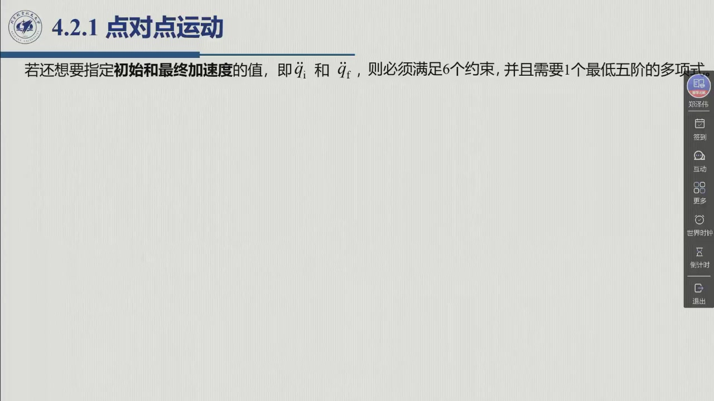
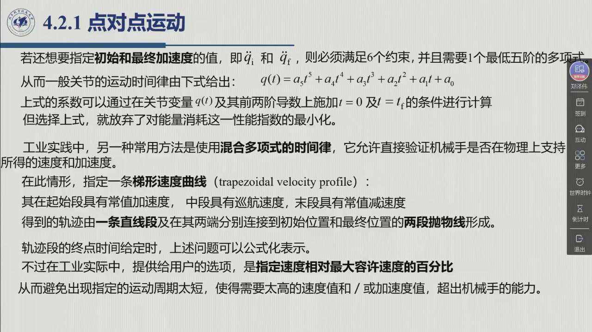
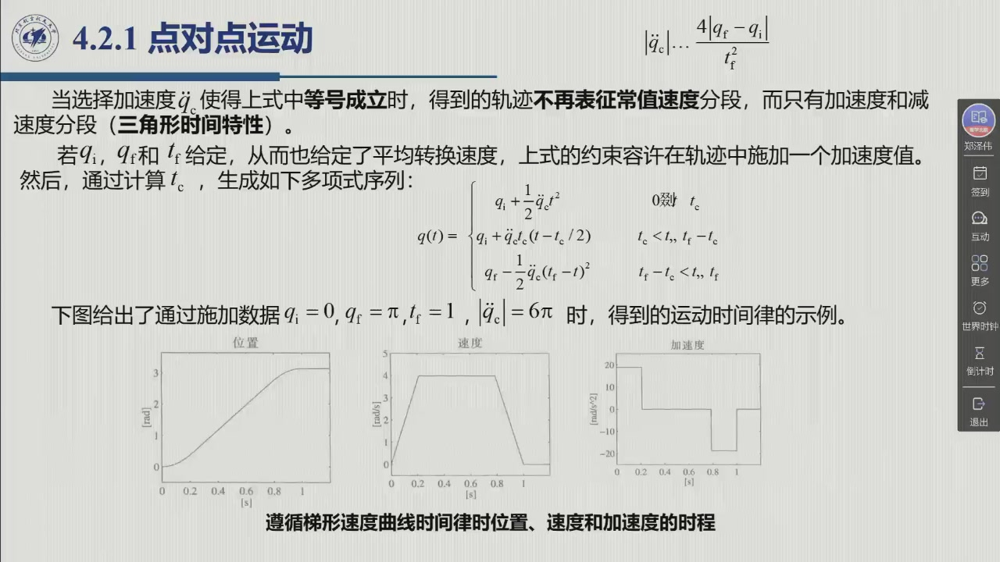
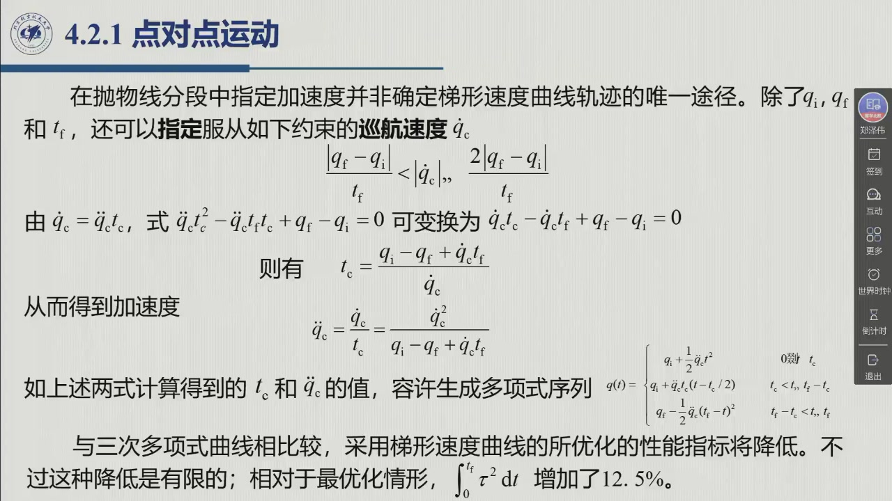

# 4.2.1 点对点运动

关节要在两秒内从起始角转到目标角，而且起步和结束时都静止。把位置画成一条直线，虽然能准时到达，却要求速度在起步时突然跳起来。要避免这个跳变，就得让位置曲线的斜率在两端都为零。

试着画一条满足这些要求的曲线。你很可能还能画出第二条：相同边界条件允许不同的中途运动。本节先用三次多项式满足位置、速度的四个条件，再增加端点加速度要求，最后学习可直接检查加速度与巡航速度的梯形剖面。教材还在常惯量等假设下比较平方力矩指标；这个最优性结论要连同假设一起读。录播 0:39:00–1:10:50。

## 4.2.1.0 从「无穷多解」到「唯一解」：为什么要三次多项式

设单个关节要在 $T=t_f>0$ 秒内从 $q_i$ 到达 $q_f$，并给定两端速度。这里暂不要求工具走某条指定空间曲线。若前后静止，两端速度取零。

多关节可分别求曲线，再用共同持续时间同步起停。各关节的位移和峰值仍可能不同，因此共同时间要按限制最紧的关节确定。下面先求单关节的系数，再将结果用于多关节。

只给两个位置端点，函数有无穷多条；再给两个速度端点后，仍有无穷多条一般函数。选择三次多项式，是把候选限制到四个系数的函数族，再由四条边界条件求解。至于某个解是否最优，还需另给动力学模型与代价，后面单独讨论。

::: thm 定理 4.2.A · 常惯量模型的最小平方力矩轨迹 {#thm-4.2.A}
在常惯量 $I>0$、忽略重力和摩擦的 $I\ddot q=\tau$ 模型中，固定总时间、起终位置与零起终速度，使 $\int_0^T\tau^2dt$ 最小的轨迹是后面求出的静止起停三次曲线。这里优化的是平方力矩，不能称为一般机械能最小；证明在五次插值之后的选读段。
:::

## 4.2.1.1 三次多项式：4 个约束定 4 个系数

::: def 定义 4.2.1 · 三次多项式时间律 {#def-4.2.1}
为确定一个关节运动，取**三次多项式**

$$q(t)=a_3t^3+a_2t^2+a_1t+a_0 \tag{4.1}$$

其导数为**抛物线形式的速度曲线**与**线性形式的加速度曲线**：

$$\dot q(t)=3a_3t^2+2a_2t+a_1,\qquad \ddot q(t)=6a_3t+2a_2 .$$

四个未知系数由两个位置值和两个速度值确定。先代 $t=0$，立即得到 $a_0=q_i$、$a_1=\dot q_i$；再代 $t=T=t_f$，得到其余两条方程：

$$a_0=q_i,\qquad a_1=\dot q_i,\qquad a_3t_f^3+a_2t_f^2+a_1t_f+a_0=q_f,\qquad 3a_3t_f^2+2a_2t_f+a_1=\dot q_f .$$
:::

把最后两个方程实际消一次元。记 $T=t_f$、$\Delta q=q_f-q_i$、$v_i=\dot q_i$、$v_f=\dot q_f$，再令 $D=\Delta q-v_iT$、$V=v_f-v_i$。剩下的方程为 $a_2T^2+a_3T^3=D$、$2a_2T+3a_3T^2=V$。第二式乘 $T$ 减第一式的两倍，得 $a_3T^3=VT-2D$；回代得到

$$a_2=\frac{3\Delta q}{T^2}-\frac{2v_i+v_f}{T},\qquad
 a_3=-\frac{2\Delta q}{T^3}+\frac{v_i+v_f}{T^2}.$$

这里 $q_i$ 的下标 i 表“初始”，不是第 i 个关节；以下一直只研究一个标量关节。R 关节用 rad，P 关节用 m，$a_j$ 的单位为关节单位除以 $\mathrm{s}^j$。静止起停时，引入[无量纲时间](../recall.md#time-law) $u=t/T$，可将任意位移压成一个形状：

$$q=q_i+\Delta q(3u^2-2u^3),\quad
\dot q=\frac{\Delta q}{T}(6u-6u^2),\quad
\ddot q=\frac{\Delta q}{T^2}(6-12u).$$

代入 $u=0,1$ 可以核对四个边界条件。这里能够唯一确定系数，依据是边界方程线性无关；只数方程与未知数，还不足以判断唯一性。

::: ex 例 4.2.B（原书图 4.1）· 0 → π 的三次轨迹 {#ex-4.2.B}
取 $q_i=0$，$q_f=\pi$，$t_f=1$，$\dot q_i=\dot q_f=0$。代入上式得

$$a_0=0,\quad a_1=0,\quad a_3+a_2=\pi,\quad 3a_3+2a_2=0
\;\Longrightarrow\;
a_2=3\pi,\ a_3=-2\pi,$$

即 $q(t)=-2\pi t^3+3\pi t^2$，$\dot q(t)=-6\pi t^2+6\pi t$，$\ddot q(t)=-12\pi t+6\pi$。

把运动段外接为静止。位置和速度在两端连续，但加速度从0跳到 $6\pi$，结束时又从 $-6\pi$ 跳回0。这里的“速度曲线有折点”具体指它的一阶导数不连续，而不是速度值发生跳跃。
:::

## 4.2.1.2 五次多项式：把加速度也管住

::: def 定义 4.2.2 · 五次多项式时间律 {#def-4.2.2}
如果还要**同时指定初始与最终的加速度**，约束就增加到 6 个，至少需要**五阶**多项式：

$$q(t)=a_5t^5+a_4t^4+a_3t^3+a_2t^2+a_1t+a_0 \tag{4.2}$$

与前一情形一样，系数由 $t=0$ 与 $t=t_f$ 处对 $q(t)$ 及其**前两阶导数**施加的条件解出：位置、速度、加速度的初终值一共给出 6 个方程，正好解 6 个系数。
:::

**把六个条件真正解出来。** 取静止起停，且端点加速度均为零，令 $q=q_i+\Delta q H(u)$、$u=t/T$。起点三个条件使 $H(u)=c_3u^3+c_4u^4+c_5u^5$；终点给出

$$c_3+c_4+c_5=1,\quad3c_3+4c_4+5c_5=0,\quad6c_3+12c_4+20c_5=0.$$

第二式减第一式三倍得 $c_4+2c_5=-3$；第三式减第二式两倍得 $4c_4+10c_5=0$。因此 $c_5=6,c_4=-15,c_3=10$，得到

$$H(u)=10u^3-15u^4+6u^5,\quad H'(u)=30u^2(1-u)^2,\quad H''(u)=60u(1-u)(1-2u).$$

位置、速度、加速度分别是 $q_i+\Delta qH$、$\Delta qH'/T$、$\Delta qH''/T^2$。例如 $q_i=0,q_f=1$ rad、$T=2$ s，半程 $u=1/2$ 给 $q=0.5$ rad、$\dot q=15/16$ rad/s、$\ddot q=0$；六个端点条件也都能直接代回。

**五次多项式改变的是边界要求**：原来的静止起停三次解通常不满足零端点加速度；增加这两个约束后，它已不是新问题的可行解。五次插值因此不继承原问题的平方力矩最优性，但不能笼统说「五次不能最优」——固定初终位置、速度、加速度时，最小化 $\int_0^{t_f}(q^{(3)}(t))^2\,dt$ 的解恰为五次。最优性必须同时说清模型、指标与约束。

**总时间怎样从限值反推？** 对固定静止起停形状，求导找极值可得：三次的速度峰值为 $3|\Delta q|/(2T)$、加速度峰值为 $6|\Delta q|/T^2$；五次分别为 $15|\Delta q|/(8T)$、$10\sqrt3|\Delta q|/(3T^2)$。五次的加速度极值在 $u=(3\pm\sqrt3)/6$，可代入 $H''$ 核对。给定上限 $v_{\max},a_{\max}>0$，三次至少要求

$$T\ge\max\left(\frac{3|\Delta q|}{2v_{\max}},\sqrt{\frac{6|\Delta q|}{a_{\max}}}\right).$$

五次的时长下界可用相应峰值系数求出。多关节采用同一形状时，先分别计算所需时间，再取最大值同步起停。这一步只保证速度、加速度满足限值，力矩还需用动力学核查。同位移、同时间下，五次的速度峰值高于三次，说明提高阶次不会自动降低全部峰值。

例如位移1 rad，速度上限0.5 rad/s，加速度上限1 rad/s²。三次要求 $T\ge\max(3,\sqrt6)=3$ s；五次要求 $T\ge\max(3.75,\sqrt{10\sqrt3/3})=3.75$ s。若都选3 s，三次速度峰值恰为0.5 rad/s，五次却是0.625 rad/s。端点更平滑的五次在这个时间下反而超速。

下面的梯形速度曲线直接给出加速度与巡航速度，采用的约束方式不同。

选读：为什么三次在常惯量模型下使平方力矩积分最小

在上述常惯量模型中，平方力矩代价为 $I^2\int_0^T\ddot q^2dt$。先将由边界条件确定的三次曲线作为候选，再与满足相同边界的所有可行曲线比较。

这里优化的未知量是一整条函数，称为泛函问题。不过验证这条三次解最优，只需积分分部。先按前面的四个边界条件得到三次候选 $q_*(t)$；任一其他可行曲线可写成 $q=q_*+h$，其中 $h(0)=h(T)=\dot h(0)=\dot h(T)=0$、$T=t_f>0$。平方加速度代价之差是

$$\int_0^T\ddot q^2dt-\int_0^T\ddot q_*^2dt
=2\int_0^T\ddot q_*\ddot h\,dt+\int_0^T\ddot h^2dt.$$

对交叉项两次积分分部：$\int\ddot q_*\ddot h=[\ddot q_*\dot h]_0^T-[q_*^{(3)}h]_0^T+\int q_*^{(4)}h=0$。边界项因 $h,\dot h$ 为零而消失，积分项因候选是三次而为零。因此代价差为 $\int\ddot h^2dt\ge0$；取等号要求 $h$ 为线性函数，再由边界得 $h\equiv0$。这证明了上述假设下的唯一最优性，没有把平方力矩误当成机械功。

## 4.2.1.3 梯形速度曲线（LSPB）：从面积求参数

::: def 定义 4.2.3 · 梯形速度曲线（LSPB，抛物线混合） {#def-4.2.3}
指定一条**梯形速度曲线**：起始段为**常值加速度**，中段维持**巡航速度**，末段为**常值减速度**。对速度积分得到位置轨迹：它由**一条直线段**和在其两端分别连接到初始位置与最终位置的**两段抛物线**组成，因此又称**抛物线混合**（linear segments with parabolic blends）。

下面讨论对称加减速，且位移 $\Delta q=q_f-q_i\ne0$。若位移为零且端点静止，直接取常值位置，无须求混合时间。

**两条标准假设**（教材 §4.2.1）：

- 初始速度与最终速度都为零；
- 两个常加速度分段的**时间长度相同**（因此两段加速度等量），轨迹在 $t_m=t_f/2$ 时刻关于**平均值点** $q_m=(q_f+q_i)/2$ **对称**。

对称设置让加速和减速共用一个混合时间 $t_c$。若设备的加、减速能力不同，可以另建非对称模型，不能继续直接套这组对称公式。
:::

**（a）情形一：指定加速度 $\ddot q_c$。** 抛物线分段与线性分段必须**速度衔接**（不许跳跃），也就是抛物线分段终点的速度要等于线性分段的常值速度（0:58:00）：

::: thm 定理 4.2.C · 指定加速度：$t_c$ 的二次方程与加速度下界 {#thm-4.2.C}
设 $q_c$ 为抛物线分段终点 $t_c$ 时刻的关节变量值——该段以常加速度 $\ddot q_c$ 从静止启动（$\dot q(0)=0$）加速到此，则

$$\ddot q_c t_c=\frac{q_m-q_c}{t_m-t_c} \tag{4.3}$$

其中 $t_m=t_f/2$、$q_m=(q_f+q_i)/2$，而

$$q_c=q_i+\tfrac12\ddot q_c t_c^2 . \tag{4.4}$$

也可以完全避开分段斜率：速度图下的面积就是位移，两个三角形加中间矩形给 $\Delta q=\dot q_c(T-t_c)=\ddot q_c t_c(T-t_c)$。整理得同一个关于 $t_c$ 的**二次方程**。这条面积式在没有巡航段的三角形极限仍适用；式 (4.3) 的斜率商在该极限须按极限理解。

$$\ddot q_c t_c^2-\ddot q_c t_f t_c+q_f-q_i=0 . \tag{4.5}$$

通常以 $\operatorname{sgn}\ddot q_c=\operatorname{sgn}(q_f-q_i)$ 指定 $\ddot q_c$；于是对给定的 $t_f,q_i,q_f$，取 $t_c\le t_f/2$ 的根

$$t_c=\frac{t_f}{2}-\frac12\sqrt{\frac{t_f^2\ddot q_c-4(q_f-q_i)}{\ddot q_c}} . \tag{4.6}$$

**加速度的下界**（根号内非负）为

$$|\ddot q_c|\ \ge\ \frac{4\,|q_f-q_i|}{t_f^2} . \tag{4.7}$$

当 (4.7) 取等号时，轨迹**不再有常值速度段**，只剩加速段与减速段——速度曲线退化为**三角形**（0:59:30）。$\ddot q_c$ 的正负由位移方向定：「终点位置和初始位置的差是正的，加速度取正的；是负的，加速度取负」（1:03:01）。
:::

确定 $t_c$ 后，生成如下的多项式序列（教材式 4.8）：

$$q(t)=\begin{cases}
q_i+\tfrac12\ddot q_c t^2, & 0\le t\le t_c\\[1mm]
q_i+\ddot q_c t_c\left(t-\dfrac{t_c}{2}\right), & t_c<t\le t_f-t_c\\[1mm]
q_f-\tfrac12\ddot q_c(t_f-t)^2, & t_f-t_c<t\le t_f
\end{cases} \tag{4.8}$$

**（b）情形二：指定巡航速度 $\dot q_c$。** 指定加速度并不是确定梯形速度曲线的唯一途径（1:06:46）——换个思路，也可以直接指定巡航速度：

::: def 定义 4.2.4 · 指定巡航速度 {#def-4.2.4}
除 $q_i,q_f,t_f$ 外，还可以指定**巡航速度** $\dot q_c$，它须服从

$$\frac{|q_f-q_i|}{t_f}<|\dot q_c|\le\frac{2|q_f-q_i|}{t_f} . \tag{4.9}$$

注意到 $\dot q_c=\ddot q_c t_c$，由 (4.5) 解出

$$t_c=\frac{q_i-q_f+\dot q_c t_f}{\dot q_c},\qquad
\ddot q_c=\frac{\dot q_c^2}{q_i-q_f+\dot q_c t_f} . \tag{4.10,4.11}$$

由此得到的 $t_c,\ddot q_c$ 同样代入 (4.8) 生成轨迹。

**两端取等号的几何含义**（1:07:12）：右边取等号相当于三角形（没有直线段），左边取等号相当于矩形（没有抛物线混合段）。但矩形在实际中不可能出现——「速度不可能在零时间内从零加速到某个速度」，所以**左边必须是严格不等号**。
:::

**代价是多少？** 教材给出的「增加 12.5%」需要带上条件：同样的静止起停、固定 $T=t_f$、常惯量模型中，**在对称 LSPB 家族内再选最小平方力矩的混合时间**，才能得到这个数字。

::: ex 例 4.2.D · 12.5% 从哪里来，什么时候不成立 {#ex-4.2.D}
记位移 $D=q_f-q_i\ne0$，$u=t_c/T\in(0,1/2]$。由速度图面积得
$D=a t_c(T-t_c)$，其中 $a$ 是带方向的加速度。比较 LSPB 与三次的平方力矩指标。

::: sol 推导与实算
LSPB 只有首尾两段有加速度，故

$$J_{\mathrm{LSPB}}=I^2\int_0^T\ddot q^2dt=2I^2a^2t_c
=\frac{2I^2D^2}{T^3u(1-u)^2}.$$

静止起停三次 $q=q_i+D(3(t/T)^2-2(t/T)^3)$ 的指标为
$J_{\mathrm{cubic}}=12I^2D^2/T^3$，所以

$$\frac{J_{\mathrm{LSPB}}}{J_{\mathrm{cubic}}}
=\frac{1}{6u(1-u)^2}.$$

分母中的 $u(1-u)^2$ 导数为 $(1-u)(1-3u)$，在 $u=1/3$ 处最大，比例为 $9/8$，即增加 12.5%。
取 $D=T=I=1$：$t_c=1/3$ 时 $a=4.5$、$v_c=1.5$、$J=13.5$，对照三次 $J=12$；
三角形极限 $t_c=1/2$ 时 $a=4$、$v_c=2$、$J=16$，增加的是 $33.3\%$。
**任意选择巡航速度或加速度后，代价通常不再是 12.5%。**
:::
:::

::: think 迁移练习 · 速度限制使最优混合时间不可用
仍取 $D=T=I=1$，要求 $v_c\le1.25$。在对称 LSPB 家族中，最小 $J$ 的 $u$、$a$、$J$ 各是多少？

::: sol 核对
$v_c=D/[T(1-u)]\le1.25$ 给出 $u\le0.2$；在此区间内 $J$ 随 $u$ 增大而减小，故取 $u=0.2$。
$a=1/[0.2(1-0.2)]=6.25$，$J=2a^2t_c=15.625$，比三次基准增加约 $30.21\%$。
若再要求 $a\le5$，该族中就没有可行轨迹，应增加总时间或改变规划条件，不能只套一个无约束的「最优」系数。
:::
:::

把三种时间律的位置、速度和加速度放在同一张图中，比较它们在端点与分段接点处的衔接：

<figure>
<svg class="figure-svg" viewBox="0 0 920 470" xmlns="http://www.w3.org/2000/svg" role="img" aria-labelledby="fig-421-t fig-421-d">
<title id="fig-421-t">三种点对点时间律：位置、速度、加速度的对比</title>
<desc id="fig-421-d">三列分别对应三次多项式、五次多项式、梯形速度曲线（LSPB）。每列自上而下画位置、速度、加速度。三次的速度是抛物线、加速度是线性且两端跳跃；五次的位置速度加速度都连续；LSPB 的速度是梯形、加速度分段常值（跳跃）但峰值可控。</desc>
<defs>
<marker id="f421-m" markerWidth="8" markerHeight="8" refX="6" refY="2.5" orient="auto"><path d="M0,0 L6,2.5 L0,5 Z" fill="var(--muted)"/></marker>
</defs>
<g stroke="var(--line)" stroke-width="1"><line x1="60" y1="120" x2="860" y2="120"/><line x1="60" y1="120" x2="60" y2="30" marker-end="url(#f421-m)"/></g>
<g stroke="var(--line)" stroke-width="1"><line x1="60" y1="250" x2="860" y2="250"/><line x1="60" y1="250" x2="60" y2="160" marker-end="url(#f421-m)"/></g>
<g stroke="var(--line)" stroke-width="1"><line x1="60" y1="380" x2="860" y2="380"/><line x1="60" y1="380" x2="60" y2="290" marker-end="url(#f421-m)"/></g>
<text class="diagram-text" x="34" y="76" text-anchor="middle">位置</text>
<text class="diagram-text" x="34" y="206" text-anchor="middle">速度</text>
<text class="diagram-text" x="34" y="336" text-anchor="middle">加速度</text>
<!-- cubic column -->
<path d="M90 120 C 150 118, 190 60, 250 36" fill="none" stroke="var(--fig-blue)" stroke-width="2.6"/>
<path d="M90 250 C 130 190, 210 190, 250 250" fill="none" stroke="var(--fig-blue)" stroke-width="2.6"/>
<path d="M90 320 L250 400" fill="none" stroke="var(--fig-blue)" stroke-width="2.6"/>
<circle cx="90" cy="320" r="3.5" fill="var(--fig-blue)"/><circle cx="250" cy="400" r="3.5" fill="var(--fig-blue)"/>
<text class="diagram-text" x="170" y="428" text-anchor="middle" fill="var(--fig-blue)">三次 (4.1)</text>
<text class="diagram-note" x="170" y="448" text-anchor="middle">加速度两端跳跃</text>
<!-- quintic column -->
<path d="M340 120 C 400 118, 440 60, 500 36" fill="none" stroke="var(--fig-green)" stroke-width="2.6"/>
<path d="M340 250 C 375 205, 465 205, 500 250" fill="none" stroke="var(--fig-green)" stroke-width="2.6"/>
<path d="M340 380 C 375 320, 465 320, 500 380" fill="none" stroke="var(--fig-green)" stroke-width="2.6"/>
<text class="diagram-text" x="420" y="428" text-anchor="middle" fill="var(--fig-green)">五次 (4.2)</text>
<text class="diagram-note" x="420" y="448" text-anchor="middle">位置、速度、加速度连续</text>
<!-- LSPB column -->
<path d="M590 120 C 620 100, 620 60, 660 48 L740 48 C 780 60, 780 100, 810 120" fill="none" stroke="var(--fig-gold)" stroke-width="2.6"/>
<path d="M590 250 L640 200 L760 200 L810 250" fill="none" stroke="var(--fig-gold)" stroke-width="2.6"/>
<path d="M590 330 L640 330 L640 300 L760 300 L760 330 L810 330" fill="none" stroke="var(--fig-gold)" stroke-width="2.6"/>
<text class="diagram-text" x="700" y="428" text-anchor="middle" fill="var(--fig-gold)">梯形速度 (4.8)</text>
<text class="diagram-note" x="700" y="448" text-anchor="middle">峰值可控，代价随混合时间变</text>
</svg>
<figcaption>三种点对点时间律的对比（本教程绘）：**边界条件与指标决定取舍**。三次在上述平方力矩模型中最优，但加速度两端跳跃；五次能指定初终加速度，零加速度端点可与静止段连续衔接；梯形速度曲线（LSPB）加速度分段常值、峰值可与速度及加速度上限直接比较。</figcaption>
</figure>

::: intuition 动手实验 · 同一段位移，三张速度剖面
先保持位移不变，把纸上的总时间缩短一半，写下你预计的速度与加速度峰值。再操作下面的控件，观察纵轴数值是否符合预测。

比较三次与静止起停、端点加速度为零的五次时间律时，注意它们的边界条件不同。三次接到静止段时加速度跳变；五次消除了这个跳变。LSPB 则在加速、巡航与减速段之间切换。观察完后关掉控件，自己画出三次时间律的速度与加速度形状，并说明两端接静止段时发生了什么。

:::

再做[两连杆第五关](../training/two-link.md#mission-path)：把同一个时间律用于两个关节，用正运动学检查末端中途经过的位置。下次复习先重算“总时间减半”，然后解释为什么关节空间的插值不保证末端走直线。

## 4.2.1 小结与常见错误

先给定边界条件，再选择时间律。三次可满足两端位置和速度，五次还能独立指定两端加速度。LSPB 用加速、巡航、减速三段组成速度曲线，可由速度图面积求混合时间。完成系数求解后，还要检查峰值与驱动限制；最优性结论只适用于明确的模型和代价。
