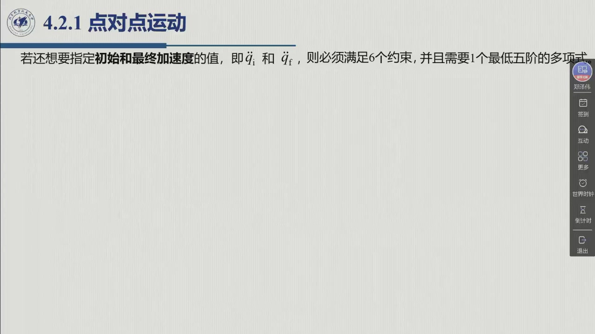
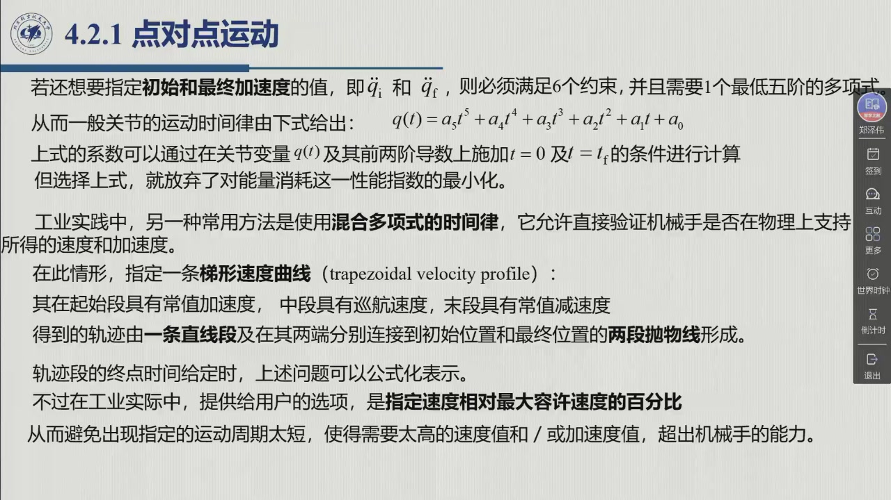
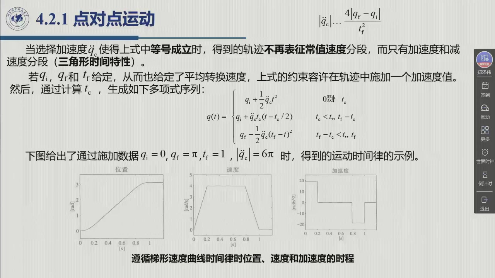
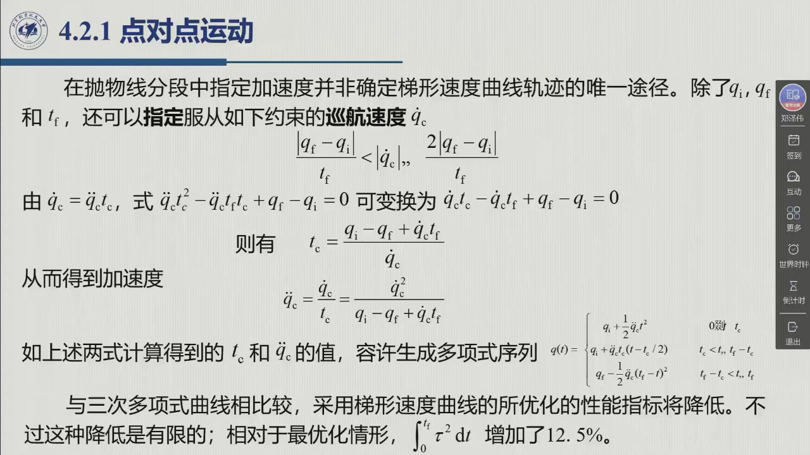

# 4.2.1 点对点运动

点对点（point-to-point）是约束最少的一类问题：首先规定**起点、终点和总时间**，静止起停还规定两端速度为零，中途怎么走不管。约束少 ⇒ 解无穷多 ⇒ 必须补一个**性能指标**，教材采用平方力矩指标——在常惯量、固定初终速度的模型下，最优解是三次多项式。工业上另有更省算力的做法：梯形速度曲线。本节完整推导的就是这两种方案，以及它们之间的折中。录播 0:39:00–1:10:50。

## 4.2.1.0 从「无穷多解」到「唯一解」：为什么要三次多项式

**问题的提法**（0:41:04、教材 §4.2.1）：机械手要在规定的 $t_f$ 时间内，把关节从初始位形 $q_i$ 移到终点位形 $q_f$；**不关心实际的末端执行器路径**，只要求在满足若干一般性要求的前提下，最优化某个性能指标。

**为什么可以只研究单关节。** $q$ 其实是 $n$ 个关节的向量 $(q_1,\dots,q_n)$；但对同一台机械手，「哪个关节它在用的过程中，时间都是一样的」——所有关节共享同一时间轴，规划方法也完全相同，因此单关节 $q(t)$ 的规划**完全可以推广到其他关节**（0:40:27）。以下不失一般性，只写单关节。

**无穷多解与优化指标。** 只知道 $q_i$、$q_f$ 和 $t_f$，「初始到终止怎么过去的，它是有很多方式的……它是有无数多个解法」（0:42:03）；还需明确速度等边界条件与优化指标，才能讨论唯一性。教材在此用作能耗代理的是**电机平方力矩积分最小**：

::: thm 定理 4.2.A · 最小能量解是三阶多项式（教材 §4.2.1） {#thm-4.2.A}
考虑一个绕定轴转动的刚体，转动惯量为 $I$，转动由电机力矩 $\tau$ 提供。令 $\dot q=\omega$，求解微分方程

$$I\dot\omega=\tau$$

并服从固定的起终速度 $\omega(0)=\omega(t_f)=0$，以及位移条件

$$\int_0^{t_f}\omega(t)\,\mathrm dt=q_f-q_i ,$$

使性能指标

$$\int_0^{t_f}\tau^2(t)\,\mathrm dt$$

最小化。其解的形式为

$$\omega(t)=at^2+bt+c .$$

即**速度是二阶多项式 ⇒ 位置是三阶（三次）多项式、加速度是线性函数**。

**适用边界**：这里 $I$ 为常数、忽略摩擦和重力，$\int\tau^2\,dt=I^2\int\ddot q^2\,dt$ 是平方力矩指标，并非一般意义上的机械功 $\int\tau\dot q\,dt$。三次轨迹也可用于更复杂机械手的插值，但不因此成为其真实动力学下的最优轨迹。若只固定位置而不约束端点速度，匀速运动就能令该指标为零，不能再推出通常的静止起停三次解。
:::

老师还补了一句方法论上的说明（0:44:23）：这个问题本身是个**泛函问题**（变分法 / 现代控制理论里的同类内容），所以「具体的求解过程我们就不介绍了，直接给结论」。

## 4.2.1.1 三次多项式：4 个约束定 4 个系数

::: def 定义 4.2.1 · 三次多项式时间律 {#def-4.2.1}
为确定一个关节运动，取**三次多项式**

$$q(t)=a_3t^3+a_2t^2+a_1t+a_0 \tag{4.1}$$

其导数为**抛物线形式的速度曲线**与**线性形式的加速度曲线**：

$$\dot q(t)=3a_3t^2+2a_2t+a_1,\qquad \ddot q(t)=6a_3t+2a_2 .$$

4 个系数需要 4 个约束。除初始与终点位置 $q_i$、$q_f$ 外，通常再利用初始与终点速度 $\dot q_i$、$\dot q_f$（一般设为 0）——「因为一般的初始肯定是从零开始加速，终止完成任务一般也是回到零的」（0:46:30）。解出下面这个方程组，4 个系数就都定了：

$$a_0=q_i,\qquad a_1=\dot q_i,\qquad a_3t_f^3+a_2t_f^2+a_1t_f+a_0=q_f,\qquad 3a_3t_f^2+2a_2t_f+a_1=\dot q_f .$$
:::

老师特别强调这类问题的**通用解法**（0:16:25）：整个过程都是「**解方程 / 待定系数法**」——根据任务找合适的约束（约束就是方程），再把多项式的系数解出来。方程多了就**超定**（想办法提高阶次或改解析式形式）；方程少了就**多解**（补上优化约束或工程约束，让未知数个数与方程个数相同）。

::: ex 例 4.2.B（原书图 4.1）· 0 → π 的三次轨迹 {#ex-4.2.B}
取 $q_i=0$，$q_f=\pi$，$t_f=1$，$\dot q_i=\dot q_f=0$。代入上式得

$$a_0=0,\quad a_1=0,\quad a_3+a_2=\pi,\quad 3a_3+2a_2=0
\;\Longrightarrow\;
a_2=3\pi,\ a_3=-2\pi,$$

即 $q(t)=-2\pi t^3+3\pi t^2$，$\dot q(t)=-6\pi t^2+6\pi t$，$\ddot q(t)=-12\pi t+6\pi$。

**读图要点**（老师 0:47:28 逐条点出）：位置平滑且连续；速度连续但**不平滑**——$t=0$ 与 $t=1$ 两处速度曲线各有一个折点；加速度在这两点上**跳跃**（从 0 跳到 $6\pi$，再从 $-6\pi$ 跳回 0）。这正是「位置/速度光滑、加速度有跳跃」那一档的典型代表。
:::

## 4.2.1.2 五次多项式：把加速度也管住

::: def 定义 4.2.2 · 五次多项式时间律 {#def-4.2.2}
如果还要**同时指定初始与最终的加速度**，约束就增加到 6 个，至少需要**五阶**多项式：

$$q(t)=a_5t^5+a_4t^4+a_3t^3+a_2t^2+a_1t+a_0 \tag{4.2}$$

与前一情形一样，系数由 $t=0$ 与 $t=t_f$ 处对 $q(t)$ 及其**前两阶导数**施加的条件解出：位置、速度、加速度的初终值一共给出 6 个方程，正好解 6 个系数。
:::

**五次多项式改变的是边界要求**：原来的静止起停三次解通常不满足零端点加速度；增加这两个约束后，它已不是新问题的可行解。五次插值因此不继承原问题的平方力矩最优性，但不能笼统说「五次不能最优」——固定初终位置、速度、加速度时，最小化 $\int_0^{t_f}(q^{(3)}(t))^2\,dt$ 的解恰为五次。最优性必须同时说清模型、指标与约束。

下面的梯形速度曲线（LSPB）直接给出加速度与巡航速度，适合逐项检查执行器限制；选择哪种时间律要由所需平滑性与限制决定。

## 4.2.1.3 梯形速度曲线（LSPB）：工业上最常用的折中

::: def 定义 4.2.3 · 梯形速度曲线（LSPB，抛物线混合） {#def-4.2.3}
指定一条**梯形速度曲线**：起始段为**常值加速度**，中段维持**巡航速度**，末段为**常值减速度**。对速度积分得到位置轨迹：它由**一条直线段**和在其两端分别连接到初始位置与最终位置的**两段抛物线**组成，因此又称**抛物线混合**（linear segments with parabolic blends）。

课件 0:56:47 把它类比电梯拖动：「先匀加速、再巡航、再匀减速，正好到零停下来」。

**两条标准假设**（教材 §4.2.1）：

- 初始速度与最终速度都为零；
- 两个常加速度分段的**时间长度相同**（因此两段加速度等量），轨迹在 $t_m=t_f/2$ 时刻关于**平均值点** $q_m=(q_f+q_i)/2$ **对称**。

老师解释了「为什么取相等」（0:59:48）：两段设成相等，可以**减少需要解的参数与方程**。实际过程中这种计算可能要做千万次以上，「你节省一点计算的时间，累积起来就非常多了」。
:::

**（a）情形一：指定加速度 $\ddot q_c$。** 抛物线分段与线性分段必须**速度衔接**（不许跳跃），也就是抛物线分段终点的速度要等于线性分段的常值速度（0:58:00）：

::: thm 定理 4.2.C · 指定加速度：$t_c$ 的二次方程与加速度下界 {#thm-4.2.C}
设 $q_c$ 为抛物线分段终点 $t_c$ 时刻的关节变量值——该段以常加速度 $\ddot q_c$ 从静止启动（$\dot q(0)=0$）加速到此，则

$$\ddot q_c t_c=\frac{q_m-q_c}{t_m-t_c} \tag{4.3}$$

其中 $t_m=t_f/2$、$q_m=(q_f+q_i)/2$，而

$$q_c=q_i+\tfrac12\ddot q_c t_c^2 . \tag{4.4}$$

合并 (4.3)(4.4) 得关于 $t_c$ 的**二次方程**

$$\ddot q_c t_c^2-\ddot q_c t_f t_c+q_f-q_i=0 . \tag{4.5}$$

通常以 $\operatorname{sgn}\ddot q_c=\operatorname{sgn}(q_f-q_i)$ 指定 $\ddot q_c$；于是对给定的 $t_f,q_i,q_f$，取 $t_c\le t_f/2$ 的根

$$t_c=\frac{t_f}{2}-\frac12\sqrt{\frac{t_f^2\ddot q_c-4(q_f-q_i)}{\ddot q_c}} . \tag{4.6}$$

**加速度的下界**（根号内非负）为

$$|\ddot q_c|\ \ge\ \frac{4\,|q_f-q_i|}{t_f^2} . \tag{4.7}$$

当 (4.7) 取等号时，轨迹**不再有常值速度段**，只剩加速段与减速段——速度曲线退化为**三角形**（0:59:30）。$\ddot q_c$ 的正负由位移方向定：「终点位置和初始位置的差是正的，加速度取正的；是负的，加速度取负」（1:03:01）。
:::

确定 $t_c$ 后，生成如下的多项式序列（教材式 4.8）：

$$q(t)=\begin{cases}
q_i+\tfrac12\ddot q_c t^2, & 0\le t\le t_c\\[1mm]
q_i+\ddot q_c t_c\left(t-\dfrac{t_c}{2}\right), & t_c<t\le t_f-t_c\\[1mm]
q_f-\tfrac12\ddot q_c(t_f-t)^2, & t_f-t_c<t\le t_f
\end{cases} \tag{4.8}$$

**（b）情形二：指定巡航速度 $\dot q_c$。** 指定加速度并不是确定梯形速度曲线的唯一途径（1:06:46）——换个思路，也可以直接指定巡航速度：

::: def 定义 4.2.4 · 指定巡航速度 {#def-4.2.4}
除 $q_i,q_f,t_f$ 外，还可以指定**巡航速度** $\dot q_c$，它须服从

$$\frac{|q_f-q_i|}{t_f}<|\dot q_c|\le\frac{2|q_f-q_i|}{t_f} . \tag{4.9}$$

注意到 $\dot q_c=\ddot q_c t_c$，由 (4.5) 解出

$$t_c=\frac{q_i-q_f+\dot q_c t_f}{\dot q_c},\qquad
\ddot q_c=\frac{\dot q_c^2}{q_i-q_f+\dot q_c t_f} . \tag{4.10,4.11}$$

由此得到的 $t_c,\ddot q_c$ 同样代入 (4.8) 生成轨迹。

**两端取等号的几何含义**（1:07:12）：右边取等号相当于三角形（没有直线段），左边取等号相当于矩形（没有抛物线混合段）。但矩形在实际中不可能出现——「速度不可能在零时间内从零加速到某个速度」，所以**左边必须是严格不等号**。
:::

**代价是多少？** 教材给出的「增加 12.5%」需要带上条件：同样的静止起停、固定 $T=t_f$、常惯量模型中，**在对称 LSPB 家族内再选最小平方力矩的混合时间**，才能得到这个数字。

::: ex 例 4.2.D · 12.5% 从哪里来，什么时候不成立 {#ex-4.2.D}
记位移 $D=q_f-q_i\ne0$，$u=t_c/T\in(0,1/2]$。由速度图面积得
$D=a t_c(T-t_c)$，其中 $a$ 是带方向的加速度。比较 LSPB 与三次的平方力矩指标。

::: sol 推导与实算
LSPB 只有首尾两段有加速度，故

$$J_{\mathrm{LSPB}}=I^2\int_0^T\ddot q^2dt=2I^2a^2t_c
=\frac{2I^2D^2}{T^3u(1-u)^2}.$$

静止起停三次 $q=q_i+D(3(t/T)^2-2(t/T)^3)$ 的指标为
$J_{\mathrm{cubic}}=12I^2D^2/T^3$，所以

$$\frac{J_{\mathrm{LSPB}}}{J_{\mathrm{cubic}}}
=\frac{1}{6u(1-u)^2}.$$

分母中的 $u(1-u)^2$ 导数为 $(1-u)(1-3u)$，在 $u=1/3$ 处最大，比例为 $9/8$，即增加 12.5%。
取 $D=T=I=1$：$t_c=1/3$ 时 $a=4.5$、$v_c=1.5$、$J=13.5$，对照三次 $J=12$；
三角形极限 $t_c=1/2$ 时 $a=4$、$v_c=2$、$J=16$，增加的是 $33.3\%$。
**任意选择巡航速度或加速度后，代价通常不再是 12.5%。**
:::
:::

::: think 迁移练习 · 速度限制使最优混合时间不可用
仍取 $D=T=I=1$，要求 $v_c\le1.25$。在对称 LSPB 家族中，最小 $J$ 的 $u$、$a$、$J$ 各是多少？

::: sol 核对
$v_c=D/[T(1-u)]\le1.25$ 给出 $u\le0.2$；在此区间内 $J$ 随 $u$ 增大而减小，故取 $u=0.2$。
$a=1/[0.2(1-0.2)]=6.25$，$J=2a^2t_c=15.625$，比三次基准增加约 $30.21\%$。
若再要求 $a\le5$，该族中就没有可行轨迹，应增加总时间或改变规划条件，不能只套一个无约束的「最优」系数。
:::
:::

把三种时间律放在一起对比，各自的「光滑档位」一目了然：

<figure>
<svg class="figure-svg" viewBox="0 0 920 470" xmlns="http://www.w3.org/2000/svg" role="img" aria-labelledby="fig-421-t fig-421-d">
<title id="fig-421-t">三种点对点时间律：位置、速度、加速度的对比</title>
<desc id="fig-421-d">三列分别对应三次多项式、五次多项式、梯形速度曲线（LSPB）。每列自上而下画位置、速度、加速度。三次的速度是抛物线、加速度是线性且两端跳跃；五次的位置速度加速度都连续；LSPB 的速度是梯形、加速度分段常值（跳跃）但峰值可控。</desc>
<defs>
<marker id="f421-m" markerWidth="8" markerHeight="8" refX="6" refY="2.5" orient="auto"><path d="M0,0 L6,2.5 L0,5 Z" fill="var(--muted)"/></marker>
</defs>
<g stroke="var(--line)" stroke-width="1"><line x1="60" y1="120" x2="860" y2="120"/><line x1="60" y1="120" x2="60" y2="30" marker-end="url(#f421-m)"/></g>
<g stroke="var(--line)" stroke-width="1"><line x1="60" y1="250" x2="860" y2="250"/><line x1="60" y1="250" x2="60" y2="160" marker-end="url(#f421-m)"/></g>
<g stroke="var(--line)" stroke-width="1"><line x1="60" y1="380" x2="860" y2="380"/><line x1="60" y1="380" x2="60" y2="290" marker-end="url(#f421-m)"/></g>
<text class="diagram-text" x="34" y="76" text-anchor="middle">位置</text>
<text class="diagram-text" x="34" y="206" text-anchor="middle">速度</text>
<text class="diagram-text" x="34" y="336" text-anchor="middle">加速度</text>
<!-- cubic column -->
<path d="M90 120 C 150 118, 190 60, 250 36" fill="none" stroke="var(--fig-blue)" stroke-width="2.6"/>
<path d="M90 250 C 130 190, 210 190, 250 250" fill="none" stroke="var(--fig-blue)" stroke-width="2.6"/>
<path d="M90 320 L250 400" fill="none" stroke="var(--fig-blue)" stroke-width="2.6"/>
<circle cx="90" cy="320" r="3.5" fill="var(--fig-blue)"/><circle cx="250" cy="400" r="3.5" fill="var(--fig-blue)"/>
<text class="diagram-text" x="170" y="428" text-anchor="middle" fill="var(--fig-blue)">三次 (4.1)</text>
<text class="diagram-note" x="170" y="448" text-anchor="middle">加速度两端跳跃</text>
<!-- quintic column -->
<path d="M340 120 C 400 118, 440 60, 500 36" fill="none" stroke="var(--fig-green)" stroke-width="2.6"/>
<path d="M340 250 C 375 205, 465 205, 500 250" fill="none" stroke="var(--fig-green)" stroke-width="2.6"/>
<path d="M340 380 C 375 320, 465 320, 500 380" fill="none" stroke="var(--fig-green)" stroke-width="2.6"/>
<text class="diagram-text" x="420" y="428" text-anchor="middle" fill="var(--fig-green)">五次 (4.2)</text>
<text class="diagram-note" x="420" y="448" text-anchor="middle">位置、速度、加速度连续</text>
<!-- LSPB column -->
<path d="M590 120 C 620 100, 620 60, 660 48 L740 48 C 780 60, 780 100, 810 120" fill="none" stroke="var(--fig-gold)" stroke-width="2.6"/>
<path d="M590 250 L640 200 L760 200 L810 250" fill="none" stroke="var(--fig-gold)" stroke-width="2.6"/>
<path d="M590 330 L640 330 L640 300 L760 300 L760 330 L810 330" fill="none" stroke="var(--fig-gold)" stroke-width="2.6"/>
<text class="diagram-text" x="700" y="428" text-anchor="middle" fill="var(--fig-gold)">梯形速度 (4.8)</text>
<text class="diagram-note" x="700" y="448" text-anchor="middle">峰值可控，代价随混合时间变</text>
</svg>
<figcaption>三种点对点时间律的对比（本教程绘）：**边界条件与指标决定取舍**。三次在上述平方力矩模型中最优，但加速度两端跳跃；五次能指定初终加速度，零加速度端点可与静止段连续衔接；梯形速度曲线（LSPB）加速度分段常值、峰值可与速度及加速度上限直接比较。</figcaption>
</figure>

::: think 考点 · 老师原话（录播时间点）

> **本节重心是梯形速度曲线，不是三次/五次。** 三次讲完时老师明说：「咱们五次（多项式）上会简单地介绍一下，然后**重点介绍混合梯形**」（0:48:11）。三次、五次是「解方程」的基础练习，**梯形速度曲线（LSPB）**才是工业与考试的重点。

> **一切归结为解方程。** 「整个都是**解方程、待定系数法**的过程——根据任务来找合适的约束，把三次或者五次多项式的系数解出来」（0:16:25）。

> **LSPB 的工程价值。** 「在工业上其实一般采用混合多项式……**允许直接验证机械手是否在物理上支持所得的速度和加速度**」（0:55:28）——这是它取代五次多项式的理由。

> **末端速度必须归零的物理原因。** 「如果不减为零的话，它还有惯性，它可能再往回走」（0:59:32）。

> **两段加速度取相等的动机是省算力。** 「为了简化计算……实际过程中我们的计算可能是千万次，你节省一点计算时间，累积起来就非常多了」（0:59:48）。

下面原话中的 12.5% 应按 [@ex-4.2.D] 的模型与族内最优混合时间理解。

> **12.5% 的取舍。** 「采用梯形速度曲线，性能指标增加了 12.5%，但是折中考虑它更简单、计算速度更快，最后也是可接受的」（1:10:14）。
:::

::: think 默写点 · 合上书再写（主动回忆）

不看正文与速查卡，先写出下面几条，再展开核对。写不出来就说明这一节还没「拿走」。

1. 写出三次多项式的四个约束方程。
2. 梯形速度曲线的两个「衔接条件」是什么？由此得到的 $t_c$ 方程是几次的？
3. 默写加速度下界 (4.7) 与巡航速度约束 (4.9)，并说明各自的等号对应什么形状。

::: sol 核对

$a_0=q_i$；$a_1=\dot q_i$；$a_3t_f^3+a_2t_f^2+a_1t_f+a_0=q_f$；$3a_3t_f^2+2a_2t_f+a_1=\dot q_f$。（$q(t)$ 在 $t=0,t_f$ 处取初终位置；$\dot q(t)$ 在两端取初终速度。）

衔接条件即 (4.3)：抛物线分段终点速度 $\ddot q_c t_c$ 等于线性分段常值速度 $(q_m-q_c)/(t_m-t_c)$；配合 (4.4) $q_c=q_i+\tfrac12\ddot q_c t_c^2$ 得到**关于 $t_c$ 的二次方程** (4.5)。

(4.7) $|\ddot q_c|\ge 4|q_f-q_i|/t_f^2$：等号 ⇒ 速度曲线是**三角形**（无常值速度段）。(4.9) $|q_f-q_i|/t_f<|\dot q_c|\le 2|q_f-q_i|/t_f$：右等号 ⇒ 三角形，左等号 ⇒ 矩形（实际不可能，故严格不等）。

:::

:::

::: intuition 动手实验 · 同一段位移，三张速度剖面
三次（最小能量）、五次（管住两端加速度）与 LSPB（匀加速—匀速—匀减速）解决的是同一个问题，代价却各不相同：三次的加速度在起停瞬间跳变；五次的加速度两端为零，但峰值更高；LSPB 把加速度压成方波，峰值可直接由 $\ddot q_{\max}$ 验证。切换运动律，拖动 $T$ 与巡航速度系数，比较三条曲线在端部的行为。

:::

## 4.2.1 小结与常见错误

- **一条主线**：点对点约束少 ⇒ 无穷多解 ⇒ 用最小能量指标锁死 ⇒ 三阶多项式（速度抛物线、加速度线性）；要管初终加速度 ⇒ 五次（6 约束，需另说明优化指标）；工业折中 ⇒ 梯形速度曲线（LSPB），峰值可直接由 $a_{\max},v_{\max}$ 验证，族内最优在上述模型下比三次多 12.5%。
- **两个可指定量**：LSPB 可以指定**加速度**（情形一，得到 $t_c$ 二次方程）或指定**巡航速度**（情形二，得到 (4.10)(4.11)）——二选一，都可以。
- **一句话**：「整个都是解方程、待定系数法的过程——根据任务找约束，把系数解出来。」

::: think 常见错误清单 · 自查三条
1. **约束数 ≠ 系数个数**：三次有 4 个系数，所以只能给 4 个条件；一旦任务要求指定初终**加速度**，三次就不够，必须升五次——不要硬凑。
2. **把 $t_c$ 当成半个总时间**：$t_c\le t_f/2$ 只是上界；三角形极限（$t_c=t_f/2$）才没有巡航段。
3. **忘方向**：$\ddot q_c$ 的符号必须与 $q_f-q_i$ 一致（$\operatorname{sgn}\ddot q_c=\operatorname{sgn}(q_f-q_i)$），否则 (4.6) 的根无意义。
:::
