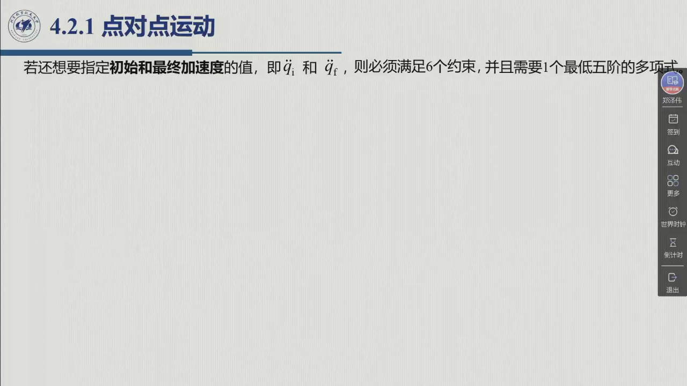
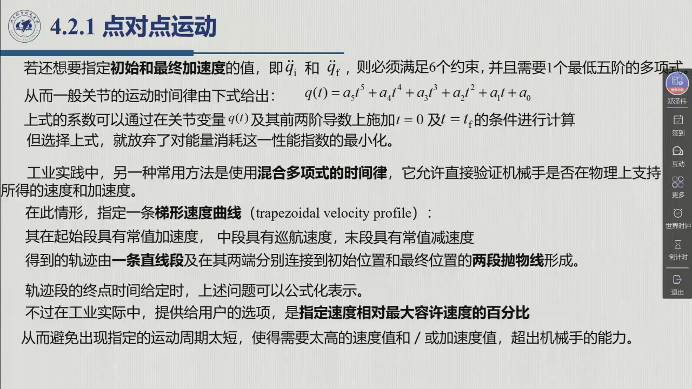
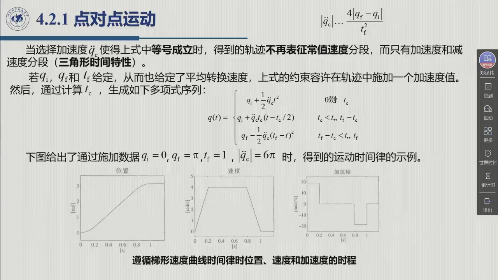
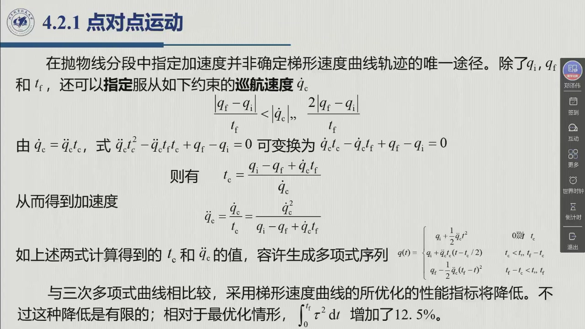

# 4.2.1 点对点运动

关节要在两秒内从起始角转到目标角，而且起步和结束时都静止。把位置画成一条直线，虽然能准时到达，却要求速度在起步时突然跳起来。要避免这个跳变，就得让位置曲线的斜率在两端都为零。

试着画一条满足这些要求的曲线，你很可能还能画出第二条：相同的端点位置与零速度允许不同的中途走法。先在 4 个未知数与 4 个约束的框架下解出三次多项式，再在需要同时管住端点加速度时升到五次，最后看工业上可以直接核对速度与加速度上限的梯形速度曲线（LSPB）。教材在常惯量无摩擦模型下比较平方力矩指标，这个最优性结论要连同它的模型与约束一起读。录播 0:39:00–1:10:50。

## 4.2.1.0 从「无穷多解」到「唯一解」：为什么要三次多项式

设单个关节要在给定时间 $t_f>0$ 秒内从初始位置 $q_i$ 到达目标位置 $q_f$，不要求末端工具走指定空间曲线。只定起终位置和总时间时，连接两点的曲线有无穷多条；即使再指定两端速度（前后静止时两端速度均为零），满足这四个条件的连续函数仍然有无穷多条。

多关节机械手可以分别用同一套公式求各关节曲线。所有关节在同一动作中共享同一时间轴（0:40:27），但各关节的位移和峰值通常不同，所以共同的 $t_f$ 要按限制最紧的关节确定。下面先求单个关节的时间函数，再将同一时长用于其余关节。

要从无穷多条候选曲线中选出唯一一条，通常有两条路：或者把曲线族限制到只有 4 个自由参数的多项式，靠 4 个边界条件解方程；或者另给动力学模型与性能指标，求使指标极小的函数。

::: thm 定理 4.2.A · 常惯量模型的最小平方力矩轨迹 {#thm-4.2.A}
对于绕定轴转动、转动惯量 $I>0$ 为常数、忽略重力与摩擦的关节模型 $I\ddot q=\tau$，固定总时间 $t_f$、起终位置 $q_i,q_f$ 以及零起终速度 $\dot q(0)=\dot q(t_f)=0$，使电机平方力矩积分 $\int_0^{t_f}\tau^2\,\mathrm dt$ 最小的轨迹，恰好是下面求出的静止起停三次多项式。这里优化的是平方力矩指标，与机械功 $\int\tau\dot q\,\mathrm dt$ 不同；把同一公式用于带重力、耦合和变惯量的多关节机械手时，它只是一条可行插值轨迹，不自动成为真实动力学下的最优解。证明见五次多项式之后的选读段。
:::

## 4.2.1.1 三次多项式：4 个约束定 4 个系数

::: def 定义 4.2.1 · 三次多项式时间律 {#def-4.2.1}
为确定一个关节运动，取**三次多项式**

$$q(t)=a_3t^3+a_2t^2+a_1t+a_0 \tag{4.1}$$

其导数为**抛物线形式的速度曲线**与**线性形式的加速度曲线**：

$$\dot q(t)=3a_3t^2+2a_2t+a_1,\qquad \ddot q(t)=6a_3t+2a_2 .$$

四个未知系数由初终时刻的位置和速度确定。先代 $t=0$，立即得到 $a_0=q_i$、$a_1=\dot q_i$；再代 $t=t_f$，得到其余两条方程：

$$a_0=q_i,\qquad a_1=\dot q_i,\qquad a_3t_f^3+a_2t_f^2+a_1t_f+a_0=q_f,\qquad 3a_3t_f^2+2a_2t_f+a_1=\dot q_f .$$
:::

把最后两个方程实际消一次元。记位移 $\Delta q=q_f-q_i$、初终速度 $v_i=\dot q_i$、$v_f=\dot q_f$，再令 $D=\Delta q-v_i t_f$、$V=v_f-v_i$，则后两式化为

$$a_2 t_f^2+a_3 t_f^3=D,\qquad 2a_2 t_f+3a_3 t_f^2=V.$$

第二式乘 $t_f$ 减去第一式的两倍，消去 $a_2$ 得 $a_3 t_f^3=V t_f-2D$；回代第一式得 $a_2 t_f^2=3D-V t_f$，把 $D,V$ 展开后即

$$a_2=\frac{3\Delta q}{t_f^2}-\frac{2v_i+v_f}{t_f},\qquad
 a_3=-\frac{2\Delta q}{t_f^3}+\frac{v_i+v_f}{t_f^2}.$$

这里 $q_i$ 的下标 $i$ 表示初始（initial），不是第 $i$ 个关节；本节一直在单关节的标量变量上推导。R 关节的 $q$ 用 rad，P 关节用 m，系数 $a_j$ 的单位相应为关节单位除以 $\mathrm{s}^j$。

这套步骤也是本章多项式规划的通用做法：先数清任务给出几条独立约束，再选系数个数恰好相等的多项式把系数解出来（0:16:25）；约束太多就提高阶次或改用分段函数，约束太少就补优化准则或工程要求。

静止起停时 $v_i=v_f=0$，引入[无量纲时间](../recall.md#time-law) $u=t/t_f$（$0\le u\le1$），可以把任意位移和时长压成同一组形状：

$$q=q_i+\Delta q(3u^2-2u^3),\quad
\dot q=\frac{\Delta q}{t_f}(6u-6u^2),\quad
\ddot q=\frac{\Delta q}{t_f^2}(6-12u).$$

代回 $u=0,1$ 即可核对四个边界条件。四个系数之所以唯一，是因为系数矩阵的行列式 $t_f^4\neq0$（$t_f>0$），方程组线性无关；只数方程与未知数个数还不足以保证唯一性。

::: ex 例 4.2.B（原书图 4.1）· 0 → π 的三次轨迹 {#ex-4.2.B}
取 $q_i=0$，$q_f=\pi$，$t_f=1$，$\dot q_i=\dot q_f=0$。代入上式得

$$a_0=0,\quad a_1=0,\quad a_3+a_2=\pi,\quad 3a_3+2a_2=0
\;\Longrightarrow\;
a_2=3\pi,\ a_3=-2\pi,$$

即 $q(t)=-2\pi t^3+3\pi t^2$，$\dot q(t)=-6\pi t^2+6\pi t$，$\ddot q(t)=-12\pi t+6\pi$。

若运动前后的时刻关节都保持静止，位置和速度在两端连续，但加速度在 $t=0$ 从 $0$ 跳到 $6\pi\ \mathrm{rad/s^2}$，在 $t=1\ \mathrm{s}$ 又从 $-6\pi\ \mathrm{rad/s^2}$ 跳回 $0$。速度曲线在两端点的斜率从 $0$ 突然变为 $\pm6\pi$，因此有折点（一阶导数不连续），但速度值本身并没有发生跳跃。
:::

## 4.2.1.2 五次多项式：把加速度也管住

::: def 定义 4.2.2 · 五次多项式时间律 {#def-4.2.2}
如果还要**同时指定初始与最终的加速度**，约束就增加到 6 个，至少需要**五阶**多项式：

$$q(t)=a_5t^5+a_4t^4+a_3t^3+a_2t^2+a_1t+a_0 \tag{4.2}$$

与前一情形一样，系数由 $t=0$ 与 $t=t_f$ 处对 $q(t)$ 及其**前两阶导数**施加的条件解出：位置、速度、加速度的初终值一共给出 6 个方程，正好解 6 个系数。
:::

**把六个条件真正解出来。** 取静止起停且端点加速度均为零：$q(0)=q_i$、$q(t_f)=q_f$、$\dot q(0)=\dot q(t_f)=0$、$\ddot q(0)=\ddot q(t_f)=0$。令 $q=q_i+\Delta q\,H(u)$、$u=t/t_f$。由 $t=0$ 处的三个条件得 $H(0)=H'(0)=H''(0)=0$，因此 $c_0=c_1=c_2=0$，$H(u)=c_3u^3+c_4u^4+c_5u^5$。再把 $u=1$ 代入 $H$、$H'$、$H''$，得到终点方程：

$$c_3+c_4+c_5=1,\quad3c_3+4c_4+5c_5=0,\quad6c_3+12c_4+20c_5=0.$$

第二式减第一式的 3 倍得 $c_4+2c_5=-3$；第三式减第二式的 2 倍得 $4c_4+10c_5=0$，即 $2c_4+5c_5=0$。用后式减去前式的 2 倍得 $c_5=6$，再依次回代得 $c_4=-15$、$c_3=10$，于是

$$H(u)=10u^3-15u^4+6u^5,\quad H'(u)=30u^2(1-u)^2,\quad H''(u)=60u(1-u)(1-2u).$$

位置、速度、加速度分别是 $q_i+\Delta q\,H$、$\Delta q\,H'/t_f$、$\Delta q\,H''/t_f^2$。例如取 $q_i=0$、$q_f=1\ \mathrm{rad}$、$t_f=2\ \mathrm{s}$，半程 $u=1/2$ 处得 $q=0.5\ \mathrm{rad}$、$\dot q=15/16\ \mathrm{rad/s}$、$\ddot q=0$；六个端点条件也能直接代回验证。

**五次多项式改换了边界条件**：静止起停的三次解在端点处 $\ddot q=\pm6\Delta q/t_f^2\ne0$，不再满足零端点加速度约束，所以它已经不在五次问题允许的曲线范围内。五次解因此不继承原问题的平方力矩最优性；在固定初终位置、速度、加速度的新边界下，最小化平方加加速度 $\int_0^{t_f}(q^{(3)}(t))^2\,\mathrm dt$ 的解恰为五次多项式。讨论最优性必须同时写明模型、代价指标与边界条件。

**怎样从速度、加速度上限反推总时间？** 对固定起停形状求导找极值：三次的速度峰值为 $3|\Delta q|/(2t_f)$（在 $u=1/2$ 取得）、加速度峰值为 $6|\Delta q|/t_f^2$（在端点取得）；五次的速度峰值为 $15|\Delta q|/(8t_f)$（在 $u=1/2$ 取得）、加速度峰值为 $10\sqrt3|\Delta q|/(3t_f^2)$（极值点由 $H'''(u)=60(1-6u+6u^2)=0$ 解出，即 $u=(3\pm\sqrt3)/6$，可代入 $H''$ 核对）。给定上限 $v_{\max},a_{\max}>0$，三次至少要求

$$t_f\ge\max\left(\frac{3|\Delta q|}{2v_{\max}},\sqrt{\frac{6|\Delta q|}{a_{\max}}}\right).$$

五次的时长下界同理为 $\max\!\big(15|\Delta q|/(8v_{\max}),\,\sqrt{10\sqrt3|\Delta q|/(3a_{\max})}\big)$。多关节同步起停时，先分别算出各关节的最小允许时间，再取最大值作为共同 $t_f$。

同位移、同时长下，五次的速度峰值 $1.875|\Delta q|/t_f$ 高于三次的 $1.5|\Delta q|/t_f$：提高多项式阶次虽然消除了端点加速度跳变，却不会自动压低速度峰值。例如位移 $\Delta q=1\ \mathrm{rad}$、$v_{\max}=0.5\ \mathrm{rad/s}$、$a_{\max}=1\ \mathrm{rad/s^2}$ 时，三次要求 $t_f\ge\max(3,\sqrt6)=3\ \mathrm{s}$，五次要求 $t_f\ge\max(3.75,\sqrt{10\sqrt3/3})\approx3.75\ \mathrm{s}$。若都选 $t_f=3\ \mathrm{s}$，三次速度峰值恰好达到上限 $0.5\ \mathrm{rad/s}$，五次却达到 $0.625\ \mathrm{rad/s}$，反而超速。当然，速度与加速度通过限值检查后，实际关节力矩仍须按第六章动力学核查。

三次和五次都需要先把时间选定，再求导检验速度与加速度峰值是否超限。下面介绍的梯形速度曲线直接以加速度或巡航速度作为输入参数，因此能把执行器上限直接放进设计方程。

选读：为什么三次在常惯量模型下使平方力矩积分最小

在上述常惯量模型中，平方力矩代价为 $I^2\int_0^{t_f}\ddot q^2\,\mathrm dt$。先把满足四条边界条件的三次曲线记作 $q_*(t)$，再将任意一条满足同样边界的可行曲线写成 $q=q_*+h$，其中差函数满足 $h(0)=h(t_f)=\dot h(0)=\dot h(t_f)=0$（$t_f>0$）。两条曲线的平方加速度积分之差为

$$\int_0^{t_f}\ddot q^2\,\mathrm dt-\int_0^{t_f}\ddot q_*^2\,\mathrm dt
=2\int_0^{t_f}\ddot q_*\ddot h\,\mathrm dt+\int_0^{t_f}\ddot h^2\,\mathrm dt.$$

对交叉项做两次分部积分：$\int_0^{t_f}\ddot q_*\ddot h\,\mathrm dt=[\ddot q_*\dot h]_0^{t_f}-[q_*^{(3)}h]_0^{t_f}+\int_0^{t_f}q_*^{(4)}h\,\mathrm dt$。前两项在端点因 $h,\dot h$ 为零而消失，第三项因三次多项式的四阶导数 $q_*^{(4)}\equiv0$ 而为零。因此代价差只剩 $\int_0^{t_f}\ddot h^2\,\mathrm dt\ge0$；取等号要求 $\ddot h\equiv0$（即 $h$ 为线性函数），再由端点边界得 $h\equiv0$。这证明了上述模型和边界条件下的唯一最优性。

## 4.2.1.3 梯形速度曲线（LSPB）：从面积求参数

::: def 定义 4.2.3 · 梯形速度曲线（LSPB，抛物线混合） {#def-4.2.3}
指定一条**梯形速度曲线**：起始段为**常值加速度**，中段维持**巡航速度**，末段为**常值减速度**。对速度积分得到位置轨迹：它由**一条直线段**和在其两端分别连接到初始位置与最终位置的**两段抛物线**组成，因此又称**抛物线混合**（linear segments with parabolic blends）。

下面讨论对称加减速，且位移 $\Delta q=q_f-q_i\ne0$。若位移为零且端点静止，直接取常值位置，无须求混合时间。

**两条标准假设**（教材 §4.2.1）：

- 初始速度与最终速度都为零（0:59:32 课堂指出，末端速度归零是为了避免惯性导致机械手继续冲过头或回弹）；
- 两个常加速度分段的**时间长度相同**（因此两段加速度等量），轨迹在 $t_m=t_f/2$ 时刻关于**平均值点** $q_m=(q_f+q_i)/2$ **对称**。

把加速和减速设为等长、共用同一个混合时间 $t_c$，可以减少需要求解的参数和方程；实际控制中这类计算会重复千万次以上，省下的运算量累积起来相当可观（0:59:48）。若设备的加、减速能力不同，则须另建非对称模型，用两个不同的混合时间分别求解。
:::

**（a）情形一：指定加速度 $\ddot q_c$。** 抛物线分段与线性分段必须**速度衔接**（不许跳跃），也就是抛物线分段终点的速度要等于线性分段的常值速度（0:58:00）：

::: thm 定理 4.2.C · 指定加速度：$t_c$ 的二次方程与加速度下界 {#thm-4.2.C}
设 $q_c$ 为抛物线分段终点 $t_c$ 时刻的关节变量值——该段以常加速度 $\ddot q_c$ 从静止启动（$\dot q(0)=0$）加速到此，则

$$\ddot q_c t_c=\frac{q_m-q_c}{t_m-t_c} \tag{4.3}$$

其中 $t_m=t_f/2$、$q_m=(q_f+q_i)/2$，而

$$q_c=q_i+\tfrac12\ddot q_c t_c^2 . \tag{4.4}$$

也可以完全避开分段斜率：速度图是一个底边为 $t_f$、上底为 $t_f-2t_c$、高为 $\dot q_c=\ddot q_c t_c$ 的梯形，其下的面积就是总位移 $\Delta q=q_f-q_i$：

$$\Delta q=\frac{(t_f-2t_c)+t_f}{2}\,\dot q_c=\dot q_c(t_f-t_c)=\ddot q_c t_c(t_f-t_c).$$

把左边移到右边，即得同一个关于 $t_c$ 的**二次方程**

$$\ddot q_c t_c^2-\ddot q_c t_f t_c+q_f-q_i=0 . \tag{4.5}$$

这条面积式在没有巡航段的三角形极限（$t_c=t_f/2$）下仍然直接成立；式 (4.3) 的斜率商在该极限下分母趋零，须按极限理解。

通常以 $\operatorname{sgn}\ddot q_c=\operatorname{sgn}(q_f-q_i)$ 指定 $\ddot q_c$。解方程 (4.5) 给出两个根 $\frac{t_f}{2}\pm\frac12\sqrt{\frac{t_f^2\ddot q_c-4(q_f-q_i)}{\ddot q_c}}$；两根之和为 $t_f$，分别对称位于 $t_f/2$ 两侧。因为梯形剖面包含加速、巡航、减速三段，加速段与减速段各占 $t_c$ 而互不重叠，必然要求 $2t_c\le t_f$，即 $t_c\le t_f/2$；若取正号根，在非退化情形下必有 $t_c>t_f/2$，导致 $t_m-t_c<0$、两段抛物线重叠而违背三段划分。因此舍去正号根，只取

$$t_c=\frac{t_f}{2}-\frac12\sqrt{\frac{t_f^2\ddot q_c-4(q_f-q_i)}{\ddot q_c}} . \tag{4.6}$$

**加速度的下界**（根号内非负）为

$$|\ddot q_c|\ \ge\ \frac{4\,|q_f-q_i|}{t_f^2} . \tag{4.7}$$

当 (4.7) 取等号时，轨迹**不再有常值速度段**，只剩加速段与减速段——速度曲线退化为**三角形**（0:59:30）。$\ddot q_c$ 的正负由位移方向定：「终点位置和初始位置的差是正的，加速度取正的；是负的，加速度取负」（1:03:01）。
:::

确定 $t_c$ 后，生成如下的多项式序列（教材式 4.8）：

$$q(t)=\begin{cases}
q_i+\tfrac12\ddot q_c t^2, & 0\le t\le t_c\\[1mm]
q_i+\ddot q_c t_c\left(t-\dfrac{t_c}{2}\right), & t_c<t\le t_f-t_c\\[1mm]
q_f-\tfrac12\ddot q_c(t_f-t)^2, & t_f-t_c<t\le t_f
\end{cases} \tag{4.8}$$

**（b）情形二：指定巡航速度 $\dot q_c$。** 指定加速度并不是确定梯形速度曲线的唯一途径（1:06:46）——换个思路，也可以直接指定巡航速度：

::: def 定义 4.2.4 · 指定巡航速度 {#def-4.2.4}
除 $q_i,q_f,t_f$ 外，还可以指定**巡航速度** $\dot q_c$，它须服从

$$\frac{|q_f-q_i|}{t_f}<|\dot q_c|\le\frac{2|q_f-q_i|}{t_f} . \tag{4.9}$$

注意到 $\dot q_c=\ddot q_c t_c$，由 (4.5) 解出

$$t_c=\frac{q_i-q_f+\dot q_c t_f}{\dot q_c},\qquad
\ddot q_c=\frac{\dot q_c^2}{q_i-q_f+\dot q_c t_f} . \tag{4.10,4.11}$$

由此得到的 $t_c,\ddot q_c$ 同样代入 (4.8) 生成轨迹。

**两端取等号的几何含义**（1:07:12）：右边取等号相当于三角形（没有直线段），左边取等号相当于矩形（没有抛物线混合段）。但矩形在实际中不可能出现——「速度不可能在零时间内从零加速到某个速度」，所以**左边必须是严格不等号**。
:::

**代价是多少？** 教材给出的平方力矩「增加 12.5%」（1:10:14）需要带上条件：在同样的静止起停、固定总时间 $t_f$、常惯量模型下，**在对称 LSPB 家族内再把混合时间 $t_c$ 选到平方力矩最小**，才会恰好高出 12.5%。

::: ex 例 4.2.D · 12.5% 从哪里来，什么时候不成立 {#ex-4.2.D}
记位移 $D=q_f-q_i\ne0$，令无量纲混合比 $u=t_c/t_f\in(0,1/2]$。由速度图面积得
$D=a t_c(t_f-t_c)$，其中 $a=\ddot q_c$ 是带方向的加速度，即 $a=D/[t_f^2 u(1-u)]$。比较 LSPB 与静止起停三次轨迹的平方力矩指标。

::: sol 推导与实算
LSPB 只有首尾两段长度为 $t_c$ 的区间有常值加速度 $\pm a$，中段加速度为零，故

$$J_{\mathrm{LSPB}}=I^2\int_0^{t_f}\ddot q^2\,\mathrm dt=2I^2a^2t_c
=2I^2\frac{D^2}{t_f^4 u^2(1-u)^2}\cdot t_f u
=\frac{2I^2D^2}{t_f^3 u(1-u)^2}.$$

静止起停三次轨迹 $q=q_i+D\big(3(t/t_f)^2-2(t/t_f)^3\big)$ 的加速度为 $\ddot q=6D(1-2t/t_f)/t_f^2$，积得 $J_{\mathrm{cubic}}=I^2\int_0^{t_f}\ddot q^2\,\mathrm dt=12I^2D^2/t_f^3$，两者的比值为

$$\frac{J_{\mathrm{LSPB}}}{J_{\mathrm{cubic}}}
=\frac{1}{6u(1-u)^2}.$$

分母中的 $u(1-u)^2$ 对 $u$ 求导得 $(1-u)(1-3u)$，在 $u=1/3$ 处取得极大值 $4/27$，最小比值为 $27/24=9/8$，即比三次高出 $1/8=12.5\%$。

取具体数值 $D=1\ \mathrm{rad}$、$t_f=1\ \mathrm{s}$、$I=1\ \mathrm{kg\cdot m^2}$：$t_c=1/3\ \mathrm{s}$ 时 $a=4.5\ \mathrm{rad/s^2}$、巡航速度 $v_c=1.5\ \mathrm{rad/s}$、$J=13.5$，对照三次 $J=12$ 恰好高 12.5%；取三角形极限 $t_c=1/2\ \mathrm{s}$ 时 $a=4\ \mathrm{rad/s^2}$、$v_c=2\ \mathrm{rad/s}$、$J=16$，高出三次 $33.3\%$。**任意给定巡航速度或加速度后，$u$ 通常不等于 $1/3$，代价也不再是 12.5%。**
:::
:::

::: think 迁移练习 · 速度限制使最优混合时间不可用
仍取 $D=1\ \mathrm{rad}$、$t_f=1\ \mathrm{s}$、$I=1\ \mathrm{kg\cdot m^2}$，要求巡航速度 $v_c\le1.25\ \mathrm{rad/s}$。在对称 LSPB 家族中，使 $J$ 最小的 $u$、$a$、$J$ 各是多少？

::: sol 核对
由面积式得 $v_c=D/[t_f(1-u)]\le1.25$，即 $1-u\ge0.8$、$u\le0.2$；在区间 $(0,0.2]$ 内分母 $u(1-u)^2$ 单调递增，$J$ 随 $u$ 增大而减小，故取端点 $u=0.2$（$t_c=0.2\ \mathrm{s}$）。
此时 $a=1/[0.2\times(1-0.2)]=6.25\ \mathrm{rad/s^2}$，$J=2a^2t_c=15.625$，比三次基准 $12$ 高出约 $30.21\%$。
若再要求 $a\le5\ \mathrm{rad/s^2}$，在 $D=1$、$t_f=1$ 下满足 $v_c\le1.25$ 的对称 LSPB 最小加速度已是 $6.25$，该族内无可行解，只能增大总时间 $t_f$ 或放宽速度限制，不能只套无约束最优比例 $u=1/3$。
:::
:::
把三种点对点时间律的位置、速度和加速度并排对比，就能看清边界条件和分段拼接带来的差别。工业中常用梯形速度曲线，正是因为它的速度与加速度峰值可以直接用来校核执行器能力（0:55:28），而在点对点三种方法里也是重点掌握的对象（0:48:11）。

<figure>
<svg class="figure-svg" viewBox="0 0 920 470" xmlns="http://www.w3.org/2000/svg" role="img" aria-labelledby="fig-421-t fig-421-d">
<title id="fig-421-t">三种点对点时间律：位置、速度、加速度的对比</title>
<desc id="fig-421-d">三列分别对应三次多项式、五次多项式、梯形速度曲线（LSPB）。每列自上而下画位置、速度、加速度。三次的速度是抛物线、加速度是线性且两端跳跃；五次的位置速度加速度都连续；LSPB 的速度是梯形、加速度分段常值（跳跃）但峰值可控。</desc>
<defs>
<marker id="f421-m" markerWidth="8" markerHeight="8" refX="6" refY="2.5" orient="auto"><path d="M0,0 L6,2.5 L0,5 Z" fill="var(--muted)"/></marker>
</defs>
<g stroke="var(--line)" stroke-width="1"><line x1="60" y1="120" x2="860" y2="120"/><line x1="60" y1="120" x2="60" y2="30" marker-end="url(#f421-m)"/></g>
<g stroke="var(--line)" stroke-width="1"><line x1="60" y1="250" x2="860" y2="250"/><line x1="60" y1="250" x2="60" y2="160" marker-end="url(#f421-m)"/></g>
<g stroke="var(--line)" stroke-width="1"><line x1="60" y1="380" x2="860" y2="380"/><line x1="60" y1="380" x2="60" y2="290" marker-end="url(#f421-m)"/></g>
<text class="diagram-text" x="34" y="76" text-anchor="middle">位置</text>
<text class="diagram-text" x="34" y="206" text-anchor="middle">速度</text>
<text class="diagram-text" x="34" y="336" text-anchor="middle">加速度</text>
<!-- cubic column -->
<path d="M90 120 C 150 118, 190 60, 250 36" fill="none" stroke="var(--fig-blue)" stroke-width="2.6"/>
<path d="M90 250 C 130 190, 210 190, 250 250" fill="none" stroke="var(--fig-blue)" stroke-width="2.6"/>
<path d="M90 320 L250 400" fill="none" stroke="var(--fig-blue)" stroke-width="2.6"/>
<circle cx="90" cy="320" r="3.5" fill="var(--fig-blue)"/><circle cx="250" cy="400" r="3.5" fill="var(--fig-blue)"/>
<text class="diagram-text" x="170" y="428" text-anchor="middle" fill="var(--fig-blue)">三次 (4.1)</text>
<text class="diagram-note" x="170" y="448" text-anchor="middle">加速度两端跳跃</text>
<!-- quintic column -->
<path d="M340 120 C 400 118, 440 60, 500 36" fill="none" stroke="var(--fig-green)" stroke-width="2.6"/>
<path d="M340 250 C 375 205, 465 205, 500 250" fill="none" stroke="var(--fig-green)" stroke-width="2.6"/>
<path d="M340 380 C 375 320, 465 320, 500 380" fill="none" stroke="var(--fig-green)" stroke-width="2.6"/>
<text class="diagram-text" x="420" y="428" text-anchor="middle" fill="var(--fig-green)">五次 (4.2)</text>
<text class="diagram-note" x="420" y="448" text-anchor="middle">位置、速度、加速度连续</text>
<!-- LSPB column -->
<path d="M590 120 C 620 100, 620 60, 660 48 L740 48 C 780 60, 780 100, 810 120" fill="none" stroke="var(--fig-gold)" stroke-width="2.6"/>
<path d="M590 250 L640 200 L760 200 L810 250" fill="none" stroke="var(--fig-gold)" stroke-width="2.6"/>
<path d="M590 330 L640 330 L640 300 L760 300 L760 330 L810 330" fill="none" stroke="var(--fig-gold)" stroke-width="2.6"/>
<text class="diagram-text" x="700" y="428" text-anchor="middle" fill="var(--fig-gold)">梯形速度 (4.8)</text>
<text class="diagram-note" x="700" y="448" text-anchor="middle">峰值可控，代价随混合时间变</text>
</svg>
<figcaption>三种点对点时间律的对比（本教程绘）：**边界条件与指标决定取舍**。三次在上述平方力矩模型中最优，但加速度两端跳跃；五次能指定初终加速度，零加速度端点可与静止段连续衔接；梯形速度曲线（LSPB）加速度分段常值、峰值可与速度及加速度上限直接比较。</figcaption>
</figure>

::: think 默写点 · 合上书再写（主动回忆）

不看正文，先自己写出下面三条，再展开核对。

1. 写出三次多项式的四个约束方程。
2. 梯形速度曲线的两个衔接条件是什么？由此得到的 $t_c$ 方程是几次的？
3. 默写加速度下界 (4.7) 与巡航速度约束 (4.9)，并说明各自的等号对应什么形状。

::: sol 核对

$a_0=q_i$；$a_1=\dot q_i$；$a_3t_f^3+a_2t_f^2+a_1t_f+a_0=q_f$；$3a_3t_f^2+2a_2t_f+a_1=\dot q_f$。（$q(t)$ 在 $t=0,t_f$ 处取初终位置；$\dot q(t)$ 在两端取初终速度。）

衔接条件即 (4.3)：抛物线分段终点速度 $\ddot q_c t_c$ 等于线性分段常值速度 $(q_m-q_c)/(t_m-t_c)$；配合 (4.4) $q_c=q_i+\tfrac12\ddot q_c t_c^2$ 得到**关于 $t_c$ 的二次方程** (4.5)。

(4.7) $|\ddot q_c|\ge 4|q_f-q_i|/t_f^2$：等号 ⇒ 速度曲线是**三角形**（无常值速度段）。(4.9) $|q_f-q_i|/t_f<|\dot q_c|\le 2|q_f-q_i|/t_f$：右等号 ⇒ 三角形，左等号 ⇒ 矩形（实际不可能，故严格不等）。

:::
:::

::: intuition 动手实验 · 同一段位移，三张速度剖面
先保持位移不变，把纸上的总时间缩短一半，写下你预计的速度与加速度峰值。再操作下面的控件，观察纵轴数值是否符合预测。

比较三次与静止起停、端点加速度为零的五次时间律时，注意它们的边界条件不同。三次接到静止段时加速度跳变；五次消除了这个跳变。LSPB 则在加速、巡航与减速段之间切换。观察完后关掉控件，自己画出三次时间律的速度与加速度形状，并说明两端接静止段时发生了什么。

:::

再做[两连杆第五关](../training/two-link.md#mission-path)：把同一个时间律用于两个关节，用正运动学检查末端中途经过的位置。下次复习先重算“总时间减半”，然后解释为什么关节空间的插值不保证末端走直线；下一节把问题从两个端点扩展到经过 $N$ 个中间点。

## 4.2.1 小结与常见错误

先给定边界条件，再选择时间律：三次满足两端位置和速度四个条件（在常惯量、固定静止起停边界下使平方力矩积分最小）；五次额外满足两端加速度共六个条件；梯形速度曲线（LSPB）由加速、巡航、减速三段组成，可直接用速度图面积求出混合时间 $t_c$ 并检验 $\dot q_c$ 与 $\ddot q_c$ 是否超过驱动上限，在对称族内最优 $t_c/t_f=1/3$ 时平方力矩比三次多 12.5%。

::: think 常见错误清单 · 自查三条
1. **约束数 ≠ 系数个数**：三次有 4 个系数，只能满足两端位置与速度 4 个条件；任务要求同时指定初终**加速度**时必须升到五次。
2. **把 $t_c$ 当成半个总时间**：$t_c\le t_f/2$ 只是对称三段的上界；只有三角形极限（$t_c=t_f/2$）才没有巡航段。
3. **忘掉加速度符号**：$\ddot q_c$ 的符号必须与位移 $q_f-q_i$ 一致（$\operatorname{sgn}\ddot q_c=\operatorname{sgn}(q_f-q_i)$），否则 (4.6) 的根无意义。
:::
