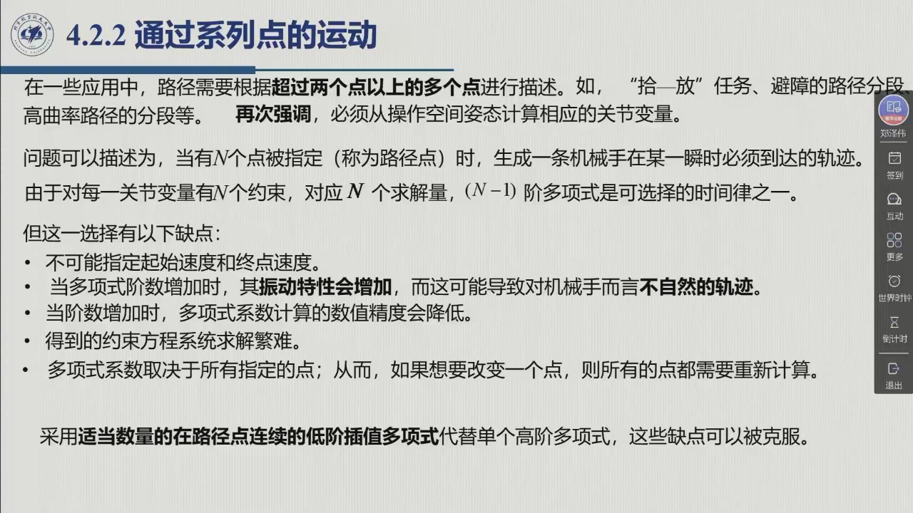
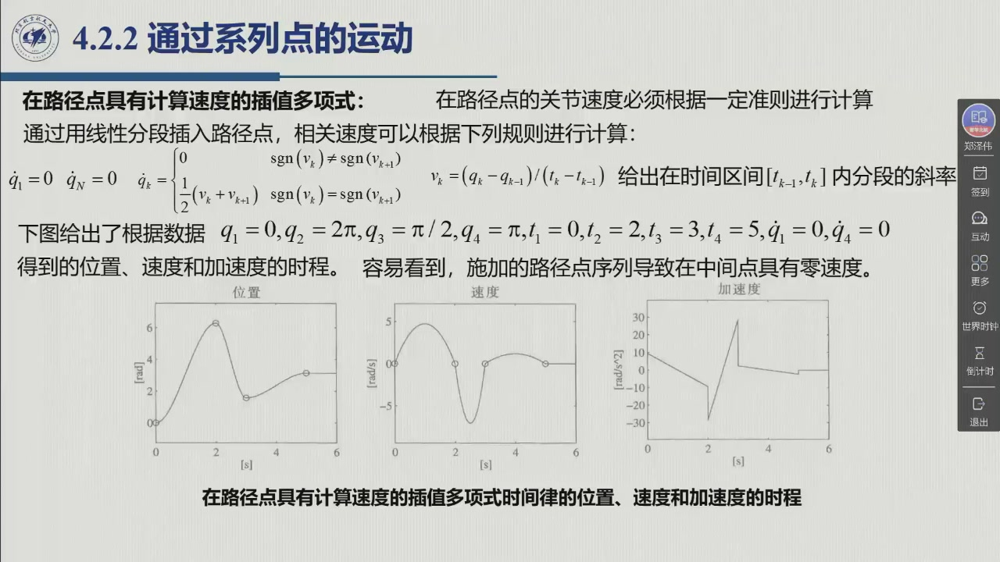
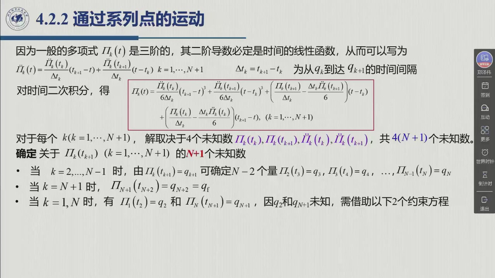
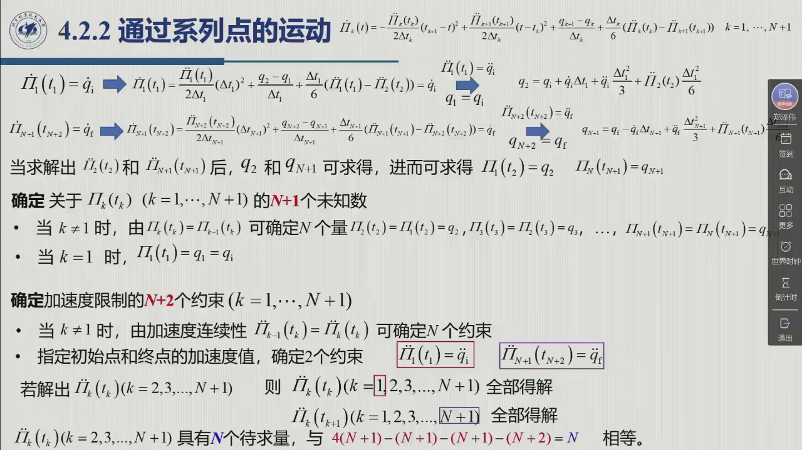
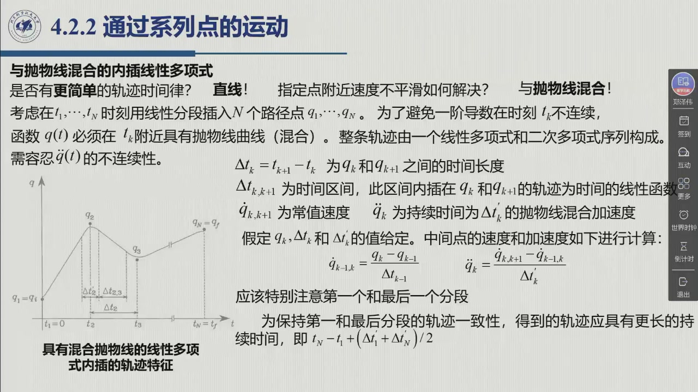
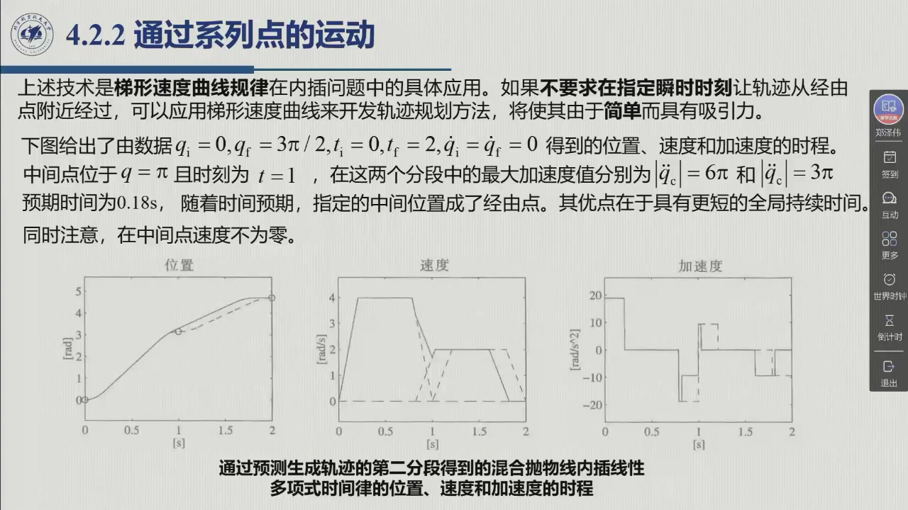

# 4.2.2 通过系列点的运动

上一节只规定关节从起点到终点的运动。现在假设它还要在指定时刻经过中间点：例如 $t=0,1,2\,\mathrm s$ 时分别到达 $q_1,q_2,q_3$。可以沿用点对点方法，分别构造第一段 $\Pi_1(t)$ 和第二段 $\Pi_2(t)$，再把它们拼成整条轨迹 $q(t)$。两段都要到达 $q_2$；若还希望经过时速度不跳变，就要让第一段末速度等于第二段初速度。本节讨论如何确定这些接点条件，以及允许不精确经过中间点时能怎样简化运动。录播 1:10:50–1:57:28。

$$q(t)=\begin{cases}\Pi_1(t),&0\le t\le1,\\\Pi_2(t),&1<t\le2.\end{cases}$$

这里 $\Pi_k$ 是第 $k$ 段位置函数，不是第 $k$ 个关节。中间点 $t=1$ 处的速度连续条件是 $\dot\Pi_1(1)=\dot\Pi_2(1)$：左边是第一段的末速度，右边是第二段的初速度。

## 4.2.2.0 问题与「一个高阶多项式」的五个缺点

一般地，给定 $N$ 个路径点 $q_k$ 及到达时刻 $t_k$，要找一条依次通过它们的关节轨迹。$k$ 是点的编号，不是关节编号。若各时刻互不相同，一个次数至多为 $N-1$ 的多项式就可以满足这 $N$ 个位置条件（1:11:44–1:12:25）。但只用一个多项式有以下局限：

::: method 为什么不用单个高阶多项式（教材 §4.2.2 的五条） {#method-4.2.A}
1. **端点速度不能再独立指定**：$N$ 个位置条件已确定了次数至多为 $N-1$ 的插值多项式。
2. 阶数高时，插值可能在点之间出现较大振荡，使运动不自然。老师在 1:13:13 用高阶多项式的形状说明了这一风险；高阶并不意味着每条曲线都必然振荡。
3. 方程组可能病态，计算出的系数对数据和舍入误差敏感。
4. 点很多时，求解整个方程组的代价增加。
5. 一处路径点改变可能影响整条曲线的系数（1:14:57）。

可以改用分段低阶多项式。每段用三次式时，两端位置确定后还可指定两个端点速度，从而让相邻段的速度接上（1:15:34）。
:::

::: def 定义 4.2.5 · 通过系列点的插值问题 {#def-4.2.5}
对单个关节，把 $N$ 个点之间的运动分成 $N-1$ 段，第 $k$ 段用三次多项式 $\Pi_k(t)$ 描述，$t_k\le t\le t_{k+1}$。整条 $q(t)$ 就是这些分段拼成的函数。要求 $q(t_k)=q_k$，其中 $q_1=q_i,\ t_1=0,\ q_N=q_f,\ t_N=t_f$；还要求相邻段在每个中间点速度相等，使 $q(t)$ 和 $\dot q(t)$ 连续。
:::

每段三次多项式有四个系数，两端位置给出两个条件，剩下的自由度还要靠速度或段间连续性确定。前两种方法先给每个路径点确定速度，再逐段求解；样条则用加速度连续条件联立各段。第四种方法改用直线和抛物线，并允许从中间点附近经过。

::: method 四条路线（课件 1:15:33 页、老师 0:17:22） {#method-4.2.B}
| 路线 | 怎样确定运动 | 接点处的性质 | 出处 |
|:--|:--|:--|:--|
| ① 指定速度 | 用户给出路径点及其速度 | 位置、速度连续 | [4.2.2.1](#sec-4.2.2.1) |
| ② 计算速度 | 根据相邻两段的平均速度选取路径点速度 | 位置、速度连续 | [4.2.2.2](#sec-4.2.2.2) |
| ③ 三次样条 | 联立各段，使速度与加速度连续 | 位置、速度、加速度连续 | [4.2.2.3](#sec-4.2.2.3) |
| ④ 线性段与抛物线混合 | 在线性段交接处加入过渡段 | 位置、速度连续；中间点通常只从附近经过 | [4.2.2.4](#sec-4.2.2.4) |

前两种方法不保证接点处加速度连续；第三种把加速度连续也列为条件（0:19:08）。
:::

## 4.2.2.1 路线①：在路径点指定速度

::: method 路径点指定速度的插值多项式 {#method-4.2.C}
在连接 $q_k$ 与 $q_{k+1}$ 的一般多项式 $\Pi_k(t)$ 上，施加下列条件：

$$\Pi_k(t_k)=q_k,\qquad \Pi_k(t_{k+1})=q_{k+1},\qquad \dot\Pi_k(t_k)=\dot q_k,\qquad \dot\Pi_k(t_{k+1})=\dot q_{k+1},$$

得到 $N-1$ 个关于「四个未知系数」的四方程系统，**每个系统都可以单独求解，不必与其他系统联立**（1:19:47）。通常的做法是把轨迹的**起始速度和终点速度设为零**（$\dot q_1=\dot q_N=0$），再通过

$$\dot\Pi_k(t_{k+1})=\dot\Pi_{k+1}(t_{k+1}),\qquad k=1,\dots,N-2$$

确保路径点处速度的连续性。老师强调这条式子**不能写反**（1:20:25）：「一定要保证**左端点的速度和右端点的速度相等**——左侧多项式的右端点速度等于右侧多项式的左端点速度，这样速度才能连续」。
:::

::: ex 例 4.2.E（原书图 4.5）· 指定速度下的超调 {#ex-4.2.E}
取 $q_1=0,\ q_2=2\pi,\ q_3=\pi/2,\ q_4=\pi$，$t_1=0,\ t_2=2,\ t_3=3,\ t_4=5$，并指定 $\dot q_1=0,\ \dot q_2=\pi,\ \dot q_3=-\pi,\ \dot q_4=0$。结果是：位置平滑且连续，速度连续但**不平滑**（加速度有跳跃）。

**关键观察**（1:21:40）：中间点 $q_2=2\pi$ 处的**速度不为零**（被指定为 $\pi$），于是轨迹会**超调**——「这点可能超过 $2\pi$ 的值，然后再往回来」。速度由用户自由指定，代价则是可能出现过冲。
:::

## 4.2.2.2 路线②：按规则计算速度

换一条思路：不指定速度，而是把路径点速度**算**出来，这样就能避免路线①中指定速度的任意性（1:22:25）。最常用的规则用的是**线性分段的斜率**：

::: method 线性分段斜率定速度（教材式 4.12） {#method-4.2.D}
令 $v_k=\dfrac{q_k-q_{k-1}}{t_k-t_{k-1}}$ 为时间区间 $[t_{k-1},t_k]$ 内分段的斜率，则

$$\dot q_1=0,\qquad
\dot q_k=\begin{cases}0, & \operatorname{sgn}(v_k)\neq\operatorname{sgn}(v_{k+1})\\[1mm] \dfrac{v_k+v_{k+1}}{2}, & \operatorname{sgn}(v_k)=\operatorname{sgn}(v_{k+1})\end{cases}\qquad
\dot q_N=0. \tag{4.12}$$

即：**前后两段斜率异号**（该点是极值点，路径在此折返）⇒ 该点速度取 **0**；**同号**（路径继续朝一个方向走）⇒ 取两段斜率的**平均**。全部速度确定之后，插值多项式的求解与路线①完全相同。
:::

::: ex 例 4.2.F（原书图 4.6）· 中间点零速度 {#ex-4.2.F}
用与 [@ex-4.2.E] 相同的路径点数据，但速度改为按 (4.12) 计算。结果是：**这组路径点使中间点处的速度为零**——在 $q_2=2\pi$ 处斜率由正转负，两段异号 ⇒ 速度取 0，于是**不再超调**，「到这点的情况下它就是 $2\pi$ 的，没有到高，到 $2\pi$ 就往回返」（1:23:55）。
:::

## 4.2.2.3 路线③：三次样条（加速度连续）

前两种方法让相邻段在路径点处的位置和速度相等，但两侧加速度仍可能不同。如果需要消除加速度的跳变，就把两侧加速度相等也写成条件（1:24:12）。这样各段不再能只凭各自端点速度独立求解，需要一起确定。

::: def 定义 4.2.6 · 三次样条 spline {#def-4.2.6}
本节的三次样条由分段三次多项式构成：它经过指定路径点，在每个中间点的位置、速度和加速度均连续。还需给首末两端选择边界条件，例如指定端点速度，才能确定整条曲线。

满足的方程（$k=2,\dots,N-1$）为

$$\Pi_{k-1}(t_k)=q_k,\qquad \Pi_{k-1}(t_k)=\Pi_k(t_k),\qquad \dot\Pi_{k-1}(t_k)=\dot\Pi_k(t_k),\qquad \ddot\Pi_{k-1}(t_k)=\ddot\Pi_k(t_k).$$

这样的三次多项式序列称为**样条**，表示「插入一个给定点序列以确保函数及其导数连续性的光滑函数」（1:47:34）。
:::

::: thm 定理 4.2.G · 方程计数与两个虚拟点 {#thm-4.2.G}
**为什么教材引入虚拟点？** 这里除了指定各路径点的位置，还同时指定首末两端的速度和加速度。$N-1$ 段三次多项式共有 $4(N-1)$ 个系数。每个中间点给出两个过点条件、一个速度连续条件和一个加速度连续条件，共 $4(N-2)$ 个；两端的位置、速度、加速度共给出 6 个条件，总计 $4N-2$ 个，比系数多 2 个。

若任务只指定端点速度或只指定端点加速度，则可采用相应边界条件的普通三次样条，不一定需要虚拟点。教材这里希望保留两端的速度和加速度条件，给出三种处理方式：

1. 第一段和最后一段改用四次多项式，各多一个系数；
2. 只要求在部分时间内保持轨迹一致，作工程近似；
3. 在首末段各增加一个**虚拟点**。虚拟点的时刻放在相应区间内，位置不预先指定；在这些点只要求位置、速度、加速度连续，因此增加分段的同时保留了调整轨迹的自由度。

加入两点后共有 $N+1$ 段，未知系数为 $4(N+1)$ 个。原有中间点给出 $4(N-2)$ 个方程，两端给出 6 个，两个虚拟点各给出 3 个连续性方程，合计也是 $4(N+1)$ 个（1:29:55）。方程数相等说明数量配平；是否有唯一解还取决于所选时刻及方程组的系数矩阵。
:::

**降维：从 $4(N+1)$ 个未知数到 $N$ 个。** 直接解 $4(N+1)$ 个方程「对计算要求比较苛刻，即使是对较小的 $N$」（教材 §4.2.2）。教材的做法，是利用三次多项式的二阶导数必为时间的线性函数：

::: thm 定理 4.2.H · 降维与三对角系统 {#thm-4.2.H}
**第一步：写出二阶导数。** 对一般多项式 $\Pi_k(t)$（$k=1,\dots,N+1$），

$$\ddot\Pi_k(t)=\frac{\ddot\Pi_k(t_k)}{\Delta t_k}(t_{k+1}-t)+\frac{\ddot\Pi_k(t_{k+1})}{\Delta t_k}(t-t_k),\qquad \Delta t_k=t_{k+1}-t_k . \tag{4.26}$$

这里 $\Delta t_k$ 是第 $k$ 段的时长。三次位置的二阶导数是一次函数，所以段内加速度是两端加速度的线性插值：代入 $t=t_k$ 或 $t=t_{k+1}$，分别回到对应端点的加速度。对它积分两次，再利用两端位置，就能用两端位置和加速度表示该段位置。

**第二步：利用已知位置与连续性消元。** 各段共用接点的位置和加速度；真实路径点的位置已知，虚拟点位置可以继续消去。教材由此把 $4(N+1)$ 个系数化为 $N$ 个接点加速度未知数。

**第三步：用速度连续性建立方程。** 先取一段长度为 $h$ 的时间区间，设两端位置为 $q_L,q_R$，加速度为 $M_L,M_R$。将线性加速度积分，并利用两端位置确定积分常数，得到两端速度

$$v_L=\frac{q_R-q_L}{h}-\frac{h}{6}(2M_L+M_R),\qquad v_R=\frac{q_R-q_L}{h}+\frac{h}{6}(M_L+2M_R).$$

令 $M_j$ 为某个接点的加速度，$h_{j-1},h_j$ 为该点左右两段时长。把左段末速度与右段初速度相等，得到

$$\frac{h_{j-1}}6M_{j-1}+\frac{h_{j-1}+h_j}3M_j+\frac{h_j}6M_{j+1}=\frac{q_{j+1}-q_j}{h_j}-\frac{q_j-q_{j-1}}{h_{j-1}}.$$

右边是两段平均速度之差；左边只涉及当前点及左右相邻点的加速度。边界和虚拟点按教材条件处理后，所有接点方程可写成（1:44:02）

$$A\,\big[\ddot\Pi_2(t_2)\ \cdots\ \ddot\Pi_{N+1}(t_{N+1})\big]^{\mathrm T}=b . \tag{4.28}$$

其中 $b$ 包含已知位置及端点条件；教材所用时刻和边界条件下 $A$ 为非奇异矩阵，具有**三对角带结构**：

$$A=\begin{bmatrix}
a_{11}&a_{12}&&\mathbf 0\\
a_{21}&a_{22}&a_{23}&\\
&\ddots&\ddots&\ddots\\
&&a_{N-1,N-1}&a_{N-1,N}\\
\mathbf 0&&a_{N,N-1}&a_{NN}
\end{bmatrix},$$

这大大简化了求解（见习题 4.4）：前向计算 + 后向计算即可。**关键性质**：$A$ **对所有关节都一样**——因为它只依赖指定的时间间隔 $\Delta t_k$，而所有关节的时间间隔相同（1:46:35）；唯一随关节变化的只有右端项 $b$（它与关节角度相关）。
:::

::: note 逐项读法 · 三对角阵的每个位置装了什么 {#note-4.2.2.A}
对照上面的接点方程，矩阵中每一行都来自一个速度连续条件：

| 位置 | 来自哪里 |
|:--|:--|
| 对角元 | 接点加速度的系数，由左右两段时长共同决定 |
| 相邻的非对角元 | 左右相邻接点加速度的系数，分别由对应段的时长决定 |
| 其他位置 | 该方程不涉及更远的接点，所以为零 |

于是「$A$ 对所有关节都一样」就有了确切含义：$A$ 的每一格都只是时间间隔的函数，**与关节角度无关**；随关节变化的全部信息都压在右端项 $b$ 里。若各关节的 $\Delta t_k$ 不同，则每个关节都要重解一套 $A$——那正是本节「所有关节共用同一组时间刻度」这一设计要避开的情形。
:::

<figure>
<svg class="figure-svg" viewBox="0 0 920 400" xmlns="http://www.w3.org/2000/svg" role="img" aria-labelledby="fig-422-t fig-422-d">
<title id="fig-422-t">样条降维：从 4(N+1) 个未知数到 N 个未知数的三对角系统</title>
<desc id="fig-422-d">上方一行表示原始系统 4(N+1) 个未知数；中间箭头标出三步消元：位置指定值与连续性、加速度连续性、虚拟点位置表达；下方是最终的 N×N 三对角矩阵 A 与右端向量 b，并注明 A 只依赖时间间隔、对所有关节相同。</desc>
<defs>
<marker id="f422-m" markerWidth="9" markerHeight="9" refX="7" refY="3" orient="auto"><path d="M0,0 L7,3 L0,6 Z" fill="var(--muted)"/></marker>
</defs>
<rect x="60" y="30" width="800" height="46" rx="8" fill="none" stroke="var(--line-strong)" stroke-width="1.4"/>
<text class="diagram-text" x="460" y="60" text-anchor="middle">原始：$N+1$ 个三次多项式 ⇒ $4(N+1)$ 个未知系数</text>
<line x1="460" y1="76" x2="460" y2="112" stroke="var(--muted)" stroke-width="1.6" marker-end="url(#f422-m)"/>
<text class="diagram-note" x="480" y="100">位置指定值 (4.13) + 位置连续性 + 加速度连续性 ⇒ 降到 $2(N+1)$ ⇒ $N$</text>
<line x1="460" y1="118" x2="460" y2="152" stroke="var(--muted)" stroke-width="1.6" marker-end="url(#f422-m)"/>
<text class="diagram-note" x="480" y="142">虚拟点位置 $q_2,q_{N+1}$ 用 $\Pi_1,\Pi_{N+1}$ 表达后消去</text>
<line x1="460" y1="158" x2="460" y2="192" stroke="var(--muted)" stroke-width="1.6" marker-end="url(#f422-m)"/>
<text class="diagram-note" x="480" y="182">最后用速度连续性（唯一未用条件）补 $N$ 个方程 (4.28)</text>
<!-- tridiagonal matrix -->
<g stroke="var(--line-strong)" stroke-width="1.1">
<rect x="150" y="212" width="230" height="150" fill="none"/>
<line x1="150" y1="242" x2="380" y2="242"/><line x1="150" y1="272" x2="380" y2="272"/>
<line x1="150" y1="302" x2="380" y2="302"/><line x1="150" y1="332" x2="380" y2="332"/>
<line x1="196" y1="212" x2="196" y2="362"/><line x1="242" y1="212" x2="242" y2="362"/>
<line x1="288" y1="212" x2="288" y2="362"/><line x1="334" y1="212" x2="334" y2="362"/>
</g>
<g fill="var(--fig-blue)">
<rect x="152" y="214" width="42" height="26"/><rect x="198" y="214" width="42" height="26"/>
<rect x="198" y="244" width="42" height="26"/><rect x="244" y="244" width="42" height="26"/><rect x="288" y="244" width="42" height="26"/>
<rect x="288" y="274" width="42" height="26"/><rect x="290" y="304" width="42" height="26"/><rect x="336" y="304" width="42" height="26"/>
<rect x="288" y="334" width="42" height="26"/><rect x="336" y="334" width="42" height="26"/>
</g>
<text class="diagram-text" x="265" y="384" text-anchor="middle">$A$：三对角带，$N\times N$</text>
<text class="diagram-text" x="470" y="290">$A\,\boldsymbol\Pi=b$</text>
<text class="diagram-text" x="560" y="250">$A$ 只依赖 $\Delta t_k$</text>
<text class="diagram-note" x="560" y="278">⇒ 所有关节共用同一个 $A$（1:46:35）</text>
<text class="diagram-text" x="560" y="316">$b$ 与关节角度相关</text>
<text class="diagram-note" x="560" y="344">⇒ 换关节只换右端项</text>
</svg>
<figcaption>样条降维（本教程绘）：把 $4(N+1)$ 个未知数的巨型系统，靠「位置指定值 + 位置/加速度连续性 + 虚拟点表达」压到 $N$ 个未知数，再用最后剩下的**速度连续性**写成三对角系统 (4.28)。$A$ 与关节无关这一点，是多关节实现时最大的算力红利。</figcaption>
</figure>

::: ex 例 4.2.I（原书图 4.7）· 两组虚拟点的对比 {#ex-4.2.I}
数据 $q_1=0,\ q_3=2\pi,\ q_4=\pi/2,\ q_6=\pi$，$t_1=0,\ t_3=2,\ t_4=3,\ t_6=5$，$\dot q_1=\dot q_6=0$。分别取两组虚拟点时刻：$t_2=0.5,\ t_5=4.5$（实线）与 $t_2=1.5,\ t_5=3.5$（虚线）。

**读图要点**（1:48:16）：加速度是**连续**的（线性、无跳跃）；第二组虚拟点更接近两个中间点的时刻，得到的**加速度值更大**——「因为它离这个点近，在很短的时间内就需要完成从这点到这点的过渡，所以加速度和速度值就会比较大」（1:49:09）。此时速度曲线也平滑了，代价是计算量更高。
:::

## 4.2.2.4 路线④：与抛物线混合的内插线性多项式

最后一条路线采用最简化的做法：用**线性分段**插值 $N$ 个路径点，只在路径点附近用**抛物线**过渡，以免速度跳跃（1:50:13）。这样整条轨迹就由「线性多项式 + 二次多项式」交替拼接而成——代价是**容忍加速度的不连续**。

::: def 定义 4.2.7 · 抛物线混合的线性内插 {#def-4.2.7}
令 $\Delta t_k=t_k-t_{k-1}$ 为 $q_{k-1}$ 与 $q_k$ 之间的时间长度；$\Delta t'_k$ 为抛物线混合段的时间长度；$q_{k-1,k}$ 为连接 $q_{k-1}$ 与 $q_k$ 的**常值速度**（即线性段斜率）；$\ddot q_k$ 为 $q_k$ 处持续时间为 $\Delta t'_k$ 的抛物线混合加速度。假定 $q_k,\Delta t_k,\Delta t'_k$ 已给定，则中间点的速度与加速度为

$$q_{k-1,k}=\frac{q_k-q_{k-1}}{\Delta t_k},\qquad
\ddot q_k=\frac{q_{k,k+1}-q_{k-1,k}}{\Delta t'_k}. \tag{4.29,4.30}$$

**这里有两个必须注意的点**：

1. **首末两段要加长。** 为了让轨迹与第一段、最后一段至少在部分时间内保持一致，轨迹应有更长的持续时间
   $$t_N-t_1+\frac{\Delta t'_1+\Delta t'_N}{2},$$
   也就是说，首段向左、末段向右各延伸半个混合时间（1:53:10）。
2. **轨迹不经过路径点。** $q(t)$ **不达到**路径点 $q_k$ 中的任何一个，而是从其**附近经过**——此时把路径点称为**经由点**（via point）更合适。混合加速度越大，通路与经由点越接近（教材 §4.2.2）。
:::

::: ex 例 4.2.J（原书图 4.9）· 混合时间越短，越贴近经由点 {#ex-4.2.J}
数据 $q_1=0,\ q_2=2\pi,\ q_3=\pi/2,\ q_4=\pi$，$t_1=0,\ t_2=2,\ t_3=3,\ t_4=5$，$\dot q_1=\dot q_4=0$。对 $k=1,\dots,4$ 分别取 $\Delta t'_k=0.2$（实线）与 $\Delta t'_k=0.6$（虚线）。

**读图要点**（1:54:38）：第一种情形（$\Delta t'_k=0.2$）下 $q(t)$ 的通路**更接近经由点**，但以**更高的加速度**为代价——「在更短的时间内完成从一个速度到另一个速度的过渡，就需要更大的加速度」。
:::

**工业上为什么选它？** 「采用梯形速度曲线是比较简单的、比较通用的方式，在工业上其实是比较常用的」——**当不要求轨迹恰在指定瞬时从经由点附近经过时**，用梯形速度曲线开发轨迹规划算法就很有吸引力，因为它足够简单（1:55:22）。

::: ex 例 4.2.K（原书图 4.10）· 用「时间超前」省掉一次停顿 {#ex-4.2.K}
只有一个中间点的情形：数据 $q_i=0,\ q_f=3\pi/2$，$t_i=0,\ t_f=2$，中间点位于 $q=\pi$、时刻 $t=1$。

**保守做法**：把运动分成两段，每段各生成一条梯形速度曲线。机械手关节**肯定到达中间点**，但「在继续朝向最终点运动之前，它会被强迫停在那里」——加速、匀速、减速到零、停住、再重新加速（1:56:21）。这段位移和时间的浪费相当明显。

**灵活做法**：用速度（或位置）的和作参考，在**第一分段结束之前**就开始产生第二分段——也就是引入**时间超前**。这样关节**仍到达最终点**，但**不再保证在指定时刻穿越中间点**（$\pi$ 点于是成了经由点），全局持续时间更短；代价是中间点的速度不为零。两个分段的最大加速度分别为 $|\ddot q_1|=6\pi$ 与 $|\ddot q_2|=3\pi$，预期时间 $0.18$（教材 §4.2.2）。

**推广到多段**（2:20:27）：时间超前量按递归关系 $\Delta t_j=\Delta t_{j-1}+\delta t_j$ 估计——它等于前一分段已产生的时间超前，加上当前分段开始的时间超前（教材式 4.50）。老师提醒：**这种规划没有考虑速度连续性**，实际中要加抛线段做平滑过渡，或做提前预判规划。
:::

::: think 考点 · 老师原话（录播时间点）

> **样条是本节的理论重点，但「主要理解思路」。** 「实际过程中其实都有程序已经写好，包括已经商用的一些机械臂，这种规划都是有的……**主要是理解这个思路**」（1:47:59）。

> **降维是样条的关键一步。** 「这个方程系统很大的……对很小的一个机械臂的计算量都是非常大的，所以需要一些技巧的方法——**怎么对未知数或者整个方程系统进行降维**」（1:30:25）。

> **$A$ 与关节无关是最大红利。** 「$A$ 是一个非奇异的系数矩阵，具有三角带的结构。**对于所有的关节 $A$ 都是一样的**，因为它只依赖于指定的时间间隔……你只要把某一个关节的 $A$ 计算出来了，其他所有关节的 $A$ 都是一样的」（1:46:37）。

> **工业上用梯形速度曲线。** 「采用梯形速度曲线是比较简单、比较通用的方式，在工业上其实是比较常用的」（1:55:22）——前提是不要求指定瞬时时刻经过经由点。

> **多段混合要加预判。** 「实际过程中对于多线段分段，一般是采用这种方法（时间超前）来进行规划的……**但是要写代码还是需要仔细**」（2:21:59）。
:::

::: think 默写点 · 合上书再写（主动回忆）

不看正文与速查卡，先写出下面几条，再展开核对。写不出来就说明这一节还没「拿走」。

1. 说出高阶插值多项式的五个缺点（至少四条）。
2. 写出路线②的速度计算规则 (4.12)。
3. 教材同时指定两端的位置、速度和加速度时，样条的方程与未知数各有多少？两个虚拟点补在哪里？
4. 写出 (4.29)(4.30)，并说明为什么叫「经由点」而不是「路径点」。

::: sol 核对

① 不能再独立指定首末速度；② 可能振荡；③ 可能病态；④ 方程系统变大；⑤ 改变一个点可能影响所有系数。

$\dot q_1=0$；$\operatorname{sgn}(v_k)\ne\operatorname{sgn}(v_{k+1})\Rightarrow\dot q_k=0$；同号 $\Rightarrow\dot q_k=(v_k+v_{k+1})/2$；$\dot q_N=0$，其中 $v_k=(q_k-q_{k-1})/(t_k-t_{k-1})$。

中间点 $4(N-2)$、极值点 6，共 $4N-2$；未知数 $4(N-1)$；**多 2 个**（即初始与最终加速度这两个任意条件）。引入两个虚拟点后变成 $N+1$ 个三次多项式：$4(N+1)$ 方程对 $4(N+1)$ 未知数，配平。

$q_{k-1,k}=(q_k-q_{k-1})/\Delta t_k$；$\ddot q_k=(q_{k,k+1}-q_{k-1,k})/\Delta t'_k$。因为抛物线混合段让轨迹**从路径点附近经过而非到达**，中间点的位置被「削角」，故改称经由点。

:::

:::

## 4.2.2 小结与常见错误

- **一条主线**：把经过多个点的运动分段；指定或计算接点速度，可以逐段求三次式；再要求加速度连续，就要联立求样条。另一种办法是用抛物线连接线性段，允许从经由点附近经过。
- **一个计数**：教材同时指定两端速度和加速度，原系统多两个条件；加入两个虚拟点后方程数与未知数配平，再利用连续性降为三对角系统。
- **与点对点的关系**：每段仍有起点和终点，但相邻段的接点条件决定了整条运动是否连续。

::: think 常见错误清单 · 自查三条
1. **把样条当成「光滑的插值」就完事**——它的定义性特征是**加速度连续**；只保证速度连续的是路线①②，不是样条。
2. **虚拟点当成真实路径点**：虚拟点**不指定位置**，只施加连续性约束；一旦给它们赋位置值，系统又变超定。
3. **经由点 = 路径点**：抛物线混合下 $q(t)$ 不到达路径点，只从附近经过；「混合加速度越大越贴近」是反直觉但正确的关系。
:::
