# 4.2.2 通过系列点的运动

抓取物体时，机械臂可能需要先抬起、移过工作台，再下降到放置点。规划因此增加了中间点约束。本节为每段建立低次多项式，依次讨论节点速度由谁指定、怎样保证加速度连续，以及允许偏离中间点时如何过渡。录播对应1:10:50–1:57:28。

## 4.2.2.0 为什么采用分段低次插值

给定严格递增的时刻 $t_1<\cdots<t_N$ 和对应关节位置 $q_1,\ldots,q_N$。仅按位置插值，可以用一个次数不超过 $N-1$ 的多项式，但节点之间的走向与导数仍需检查。我们更希望每段保持低次，再明确接点要连续到哪一阶。

::: method 为什么改用分段低次插值 {#method-4.2.A}
全局多项式的系数依赖全部节点；改一个点通常会改变整条曲线。用幂基在尺度不当时求系数，还可能遇到数值病态，节点之间也可能出现较大的摆动。高次数本身并不直接等于振荡次数，需看具体数据、基函数与求解方法。

分段三次把每段压到四个系数，恰好能独立指定该段的两端位置和速度。已知所有节点速度时，各段可以分别求解；若还要求加速度连续，节点速度或加速度便需一起联立求出。
:::

::: def 定义 4.2.5 · 通过系列点的插值问题 {#def-4.2.5}
对单个关节变量，寻求一个由 $N-1$ 个**连续且具有连续一阶导数**的三阶多项式 $\Pi_k(t)$（$k=1,\dots,N-1$）首尾相接而成的函数 $q(t)$。当 $t=t_k$（$k=1,\dots,N$）时 $q(t_k)=q_k$，且 $q_1=q_i,\ t_1=0,\ q_N=q_f,\ t_N=t_f$。序列 $q_k$ 给出 $t=t_k$ 时刻描述期望轨迹的**路径点**。
:::

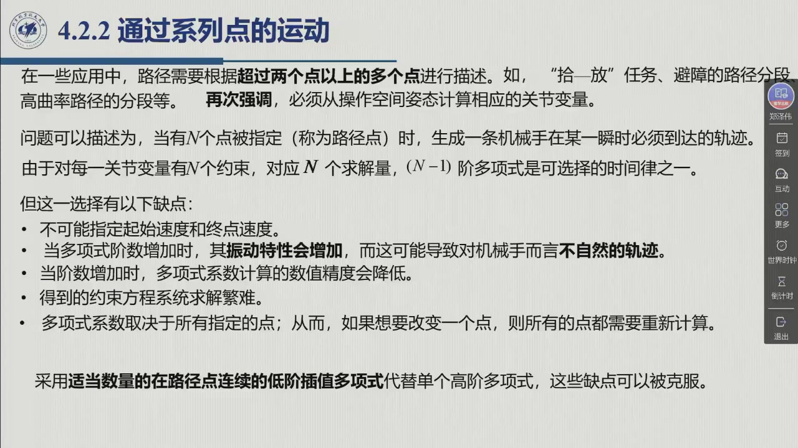

每段三次多项式有4个系数，两端位置只给出2个条件，还需补充2个方程。下面四种方法的区别，就在这些条件怎样选取、相邻段怎样衔接：

::: method 四种接点处理方式 {#method-4.2.B}
| 方法 | 怎样确定接点 | 一般保证 |
|:--|:--|:--|
| [指定速度](#sec-4.2.2.1) | 用户给每个节点速度 | 位置、速度连续 |
| [估计速度](#sec-4.2.2.2) | 由相邻平均斜率给节点速度 | 位置、速度连续 |
| [三次样条](#sec-4.2.2.3) | 联立求使左右加速度相等的解 | 位置、速度、加速度连续 |
| [抛物线混合](#sec-4.2.2.4) | 以常加速度连接相邻线性段 | 速度连续，通常允许偏离中间点 |

$C^1$ 表示位置和一阶导数连续，$C^2$ 再要求二阶导数连续。给节点赋一个共同速度值只能直接保证 $C^1$，不能因此推断加速度也相等。
:::

## 4.2.2.1 路线①：在路径点指定速度

::: method 路径点指定速度的插值多项式 {#method-4.2.C}
在连接 $q_k$ 与 $q_{k+1}$ 的一般多项式 $\Pi_k(t)$ 上，施加下列条件：

$$\Pi_k(t_k)=q_k,\qquad \Pi_k(t_{k+1})=q_{k+1},\qquad \dot\Pi_k(t_k)=\dot q_k,\qquad \dot\Pi_k(t_{k+1})=\dot q_{k+1},$$

得到 $N-1$ 个关于「四个未知系数」的四方程系统，**每个系统都可以单独求解，不必与其他系统联立**（1:19:47）。通常的做法是把轨迹的**起始速度和终点速度设为零**（$\dot q_1=\dot q_N=0$），再通过

$$\dot\Pi_k(t_{k+1})=\dot\Pi_{k+1}(t_{k+1}),\qquad k=1,\dots,N-2$$

这条式子在同一个时刻比较左右两段：左段取自己的终点，右段取自己的起点。采用局部时间时，两边的代入值分别是前段时长和0。
:::

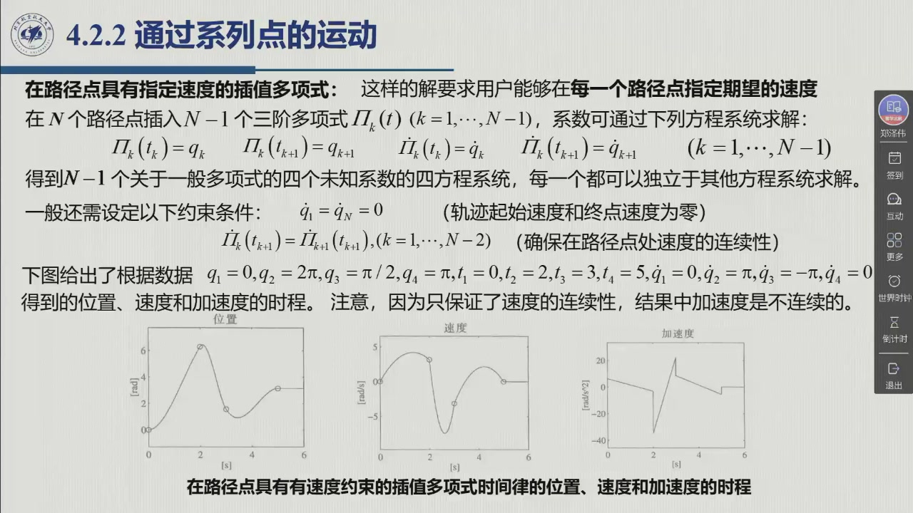

::: ex 例 4.2.E（原书图 4.5）· 指定速度下的超调 {#ex-4.2.E}
取 $q_1=0,\ q_2=2\pi,\ q_3=\pi/2,\ q_4=\pi$，$t_1=0,\ t_2=2,\ t_3=3,\ t_4=5$，并指定 $\dot q_1=0,\ \dot q_2=\pi,\ \dot q_3=-\pi,\ \dot q_4=0$。结果是：位置平滑且连续，速度连续但**不平滑**（加速度有跳跃）。

**关键观察**（1:21:40）：中间点 $q_2=2\pi$ 处的**速度不为零**（被指定为 $\pi$），于是轨迹会**超调**——「这点可能超过 $2\pi$ 的值，然后再往回来」。速度由用户自由指定，代价则是可能出现过冲。
:::

## 4.2.2.2 路线②：按规则计算速度

若用户不希望逐点给速度，可以用前后平均斜率估计：折返时让速度归零，同向时取相邻斜率平均。这是一条简单规则，不是约束单调性与峰值的通用算法。

::: method 线性分段斜率定速度（教材式 4.12） {#method-4.2.D}
令 $v_k=\dfrac{q_k-q_{k-1}}{t_k-t_{k-1}}$ 为时间区间 $[t_{k-1},t_k]$ 内分段的斜率，则

$$\dot q_1=0,\qquad
\dot q_k=\begin{cases}0, & \operatorname{sgn}(v_k)\neq\operatorname{sgn}(v_{k+1})\\[1mm] \dfrac{v_k+v_{k+1}}{2}, & \operatorname{sgn}(v_k)=\operatorname{sgn}(v_{k+1})\end{cases}\qquad
\dot q_N=0. \tag{4.12}$$

即：**前后两段斜率异号**（该点是极值点，路径在此折返）⇒ 该点速度取 **0**；**同号**（路径继续朝一个方向走）⇒ 取两段斜率的**平均**。全部速度确定之后，插值多项式的求解与路线①完全相同。
:::

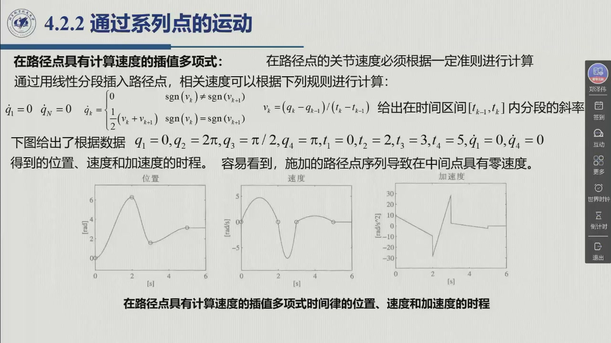

::: ex 例 4.2.F · 算出中间点速度 {#ex-4.2.F}
沿用 [@ex-4.2.E] 的点和时刻，三段平均斜率分别是 $\pi,-3\pi/2,\pi/4$ rad/s。两个内部节点都发生方向反转，按式(4.12)得到节点速度 $(0,0,0,0)$，每段成为静止起停三次曲线，这组数据不再超调。

对一般同向数据，算术平均并不保证单调。可用上一节的三次系数求出每段导数，再检查区间内是否变号；有无超调必须由实际曲线判断。
:::

## 4.2.2.3 路线③：三次样条（加速度连续）

前两条路线共用节点速度，能够保证速度值连续，但左右加速度仍可能不同（1:24:12）。如果还要求加速度连续，就需把相邻段的条件联立起来，构造三次样条。

::: def 定义 4.2.6 · 三次样条 {#def-4.2.6}
本节的三次样条由 $N-1$ 段三次多项式组成，在每个内部节点满足位置、速度、加速度连续。位置插值给 $2(N-1)$ 条条件，内部速度和加速度连续各给 $N-2$ 条，合计 $4N-6$ 条；全部系数有 $4N-4$ 个，因此还需两条端点条件。

常用选择是给首末速度，或给首末加速度。不是把首末位置、速度、加速度全部任意指定给同一组普通三次样条。下面先推导普通样条，再讨论增加虚拟点的扩展。
:::

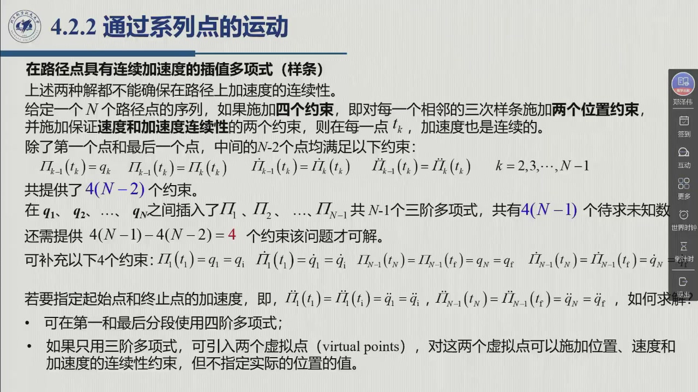

::: thm 定理 4.2.G · 普通样条与扩展端点条件 {#thm-4.2.G}
普通 $C^2$ 三次样条还需两条端点条件。若首末速度和加速度都任意给定，则比系数多两条约束，一般超定。可加入两个时刻已定、位置未知的虚拟点来扩展；具体方程计数在后面的选读段。标准样条并不必须插入虚拟点。
:::

每段三次曲线的加速度都是一次函数。下面据此用节点位置和加速度表示各段，再用接点速度连续的条件联立求解。

::: thm 定理 4.2.H · 从二阶导数推到具体三对角方程 {#thm-4.2.H}
先解决没有虚拟点的标准三次样条，便能看清矩阵每个数从哪里来。给定严格递增时刻 $t_1<\cdots<t_N$、位置 $q_1,\ldots,q_N$，记 $h_k=t_{k+1}-t_k>0$、节点加速度 $m_k=\ddot q(t_k)$。这里 $m_k$ 是加速度，**不是质量**；$h_k$ 是时间段长度，也不是动力学中的负载向量。旧概念可查[分段三次与连续性](../recall.md#spline)。

**第一步：线性插值加速度。** 每段是三次，二阶导数为一次，因此

$$\ddot\Pi_k(t)=m_k\frac{t_{k+1}-t}{h_k}+m_{k+1}\frac{t-t_k}{h_k}.\tag{4.26}$$

先代 $t=t_k$，左权重为1、右权重为0；再代 $t=t_{k+1}$，结果为 $m_{k+1}$。这两次回代能检查插值权重是否写反。

**第二步：两次积分，并用位置边界定常数。** 三次项二阶求导恰好恢复上一式；再用两端位置定剩余线性项，得到

$$\begin{aligned}
\Pi_k(t)={}&\frac{m_k(t_{k+1}-t)^3}{6h_k}
+\frac{m_{k+1}(t-t_k)^3}{6h_k}\\
&+\left(q_k-\frac{m_kh_k^2}{6}\right)\frac{t_{k+1}-t}{h_k}
+\left(q_{k+1}-\frac{m_{k+1}h_k^2}{6}\right)\frac{t-t_k}{h_k}.
\end{aligned}\tag{4.27}$$

例如代 $t=t_k$，第一项为 $m_kh_k^2/6$，与第三项中的负项抵消，只剩 $q_k$。两端位置与两端加速度的四个条件都已满足。

**第三步：把速度连续写成方程。** 记 $d_k=(q_{k+1}-q_k)/h_k$ 为该段平均速度。对上式求一阶导，并分别代两端：

$$\dot\Pi_k(t_k)=d_k-\frac{h_k}{6}(2m_k+m_{k+1}),\qquad
\dot\Pi_k(t_{k+1})=d_k+\frac{h_k}{6}(m_k+2m_{k+1}).$$

在内部节点 $t_k$，令左段的右端速度等于右段的左端速度，再乘6、移项：

$$\boxed{h_{k-1}m_{k-1}+2(h_{k-1}+h_k)m_k+h_km_{k+1}
=6(d_k-d_{k-1}),\quad k=2,\ldots,N-1.}\tag{4.28a}$$

每个方程只涉及 $m_{k-1},m_k,m_{k+1}$，所以系数矩阵三对角。若各关节共用相同时刻，$h_k$ 相同，矩阵可复用；右边的 $d_k$ 随关节位置改变。

**第四步：补两个边界条件。** 常见选择是自然样条 $m_1=m_N=0$；或指定首末速度 $v_1,v_N$，将刚算出的端点速度式移项：

$$2h_1m_1+h_1m_2=6(d_1-v_1),\qquad
h_{N-1}m_{N-1}+2h_{N-1}m_N=6(v_N-d_{N-1}).\tag{4.28b}$$

两种边界选其一，不能把首末速度、加速度都任意加给同一组普通三次样条。在 $h_k>0$ 时，上述自然或指定速度系统可解；指定速度的完整矩阵对角元严格大于非对角元绝对值之和，因此非奇异。自然样条消去给定端点后，内部系统同样严格对角占优。
:::

::: ex 跟算 · 三个点就能算出一条完整样条 {#ex-4.2.spline-small}
取时刻 $(0,1,2)$ s，位置 $(0,1,0)$ rad，首末加速度设为0。内部只有 $m_2$ 未知，式 (4.28a) 给 $4m_2=6(-1-1)$，故 $m_2=-3$ rad/s²。代回得到

$$q(t)=\begin{cases}\tfrac32t-\tfrac12t^3,&0\le t\le1,\\
\tfrac32(2-t)-\tfrac12(2-t)^3,&1\le t\le2.
\end{cases}$$

接点左右都给位置1、速度0、加速度−3；起终速度分别为1.5与−1.5 rad/s。自然样条保证的是零端点加速度，不自动保证静止起停。若任务要求静止，用 (4.28b) 重算：解为 $(m_1,m_2,m_3)=(6,-6,6)$，两段分别变为 $3t^2-2t^3$ 与 $3(2-t)^2-2(2-t)^3$，中点加速度同为−6。
:::

选读：同时给端点速度和加速度时的虚拟点方案

### 虚拟点为什么出现，怎样进入同一套方程

若连首末加速度也任意给定，条件总数增为 $4N-2$，比原来的系数多两条。通常会超定；特殊兼容数据仍可能有解，但不能指望任意边界都恰好兼容。

一种处理是加入两个指定时刻、位置未知的虚拟点。此时分段数变为 $N+1$，有 $4(N+1)$ 个系数。原内部实点各给四条条件，两个虚拟点各只给位置、速度、加速度连续的三条条件，首末给六条，共为

$$4(N-2)+2\times3+6=4(N+1).$$

条件数与未知数相等后，仍须检查系数矩阵是否非奇异。虚拟点时刻会改变矩阵，不能忽略；也可以改用提高首末段次数或放松部分边界要求等方案。

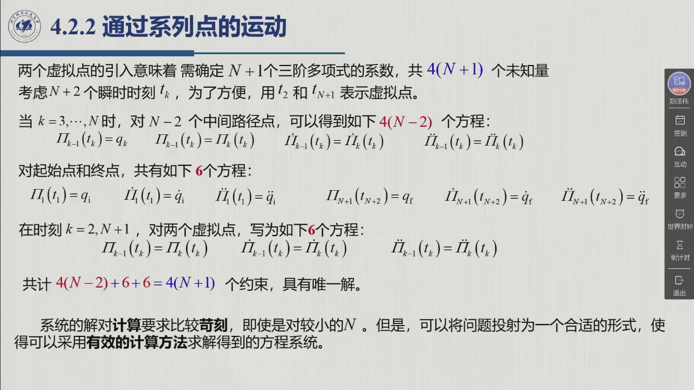

虚拟点的位置参与求解，因此不要再给它们添加独立的位置指定值。

扩充后的各段仍使用(4.27)，未知量包括节点加速度和两个虚拟点位置。在内部节点列(4.28a)，首末列(4.28b)，再加入给定的首末加速度，就得到完整线性方程组。消去两个虚拟位置后，才是教材(4.28)的缩减系统；上面的 $m_k$ 方程用于普通样条，若不修改边界行，不能直接视为这个缩减系统。

解出后逐节点核对位置、左右速度与左右加速度。修改虚拟点时刻会改变时间间隔和求解矩阵，需重新计算。

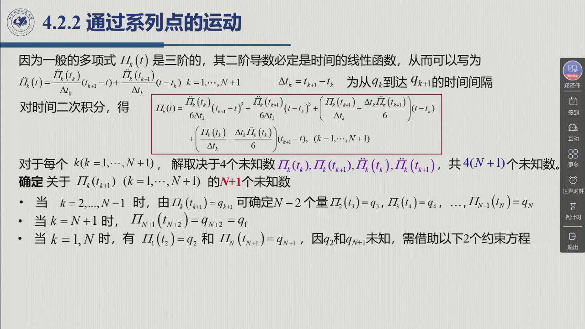

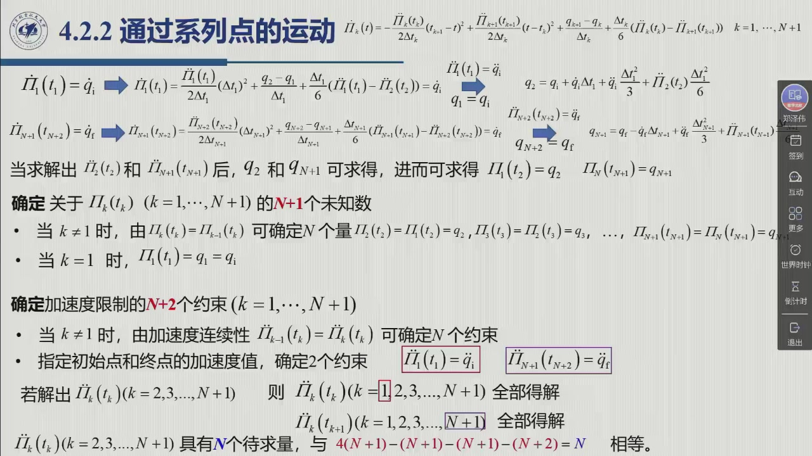

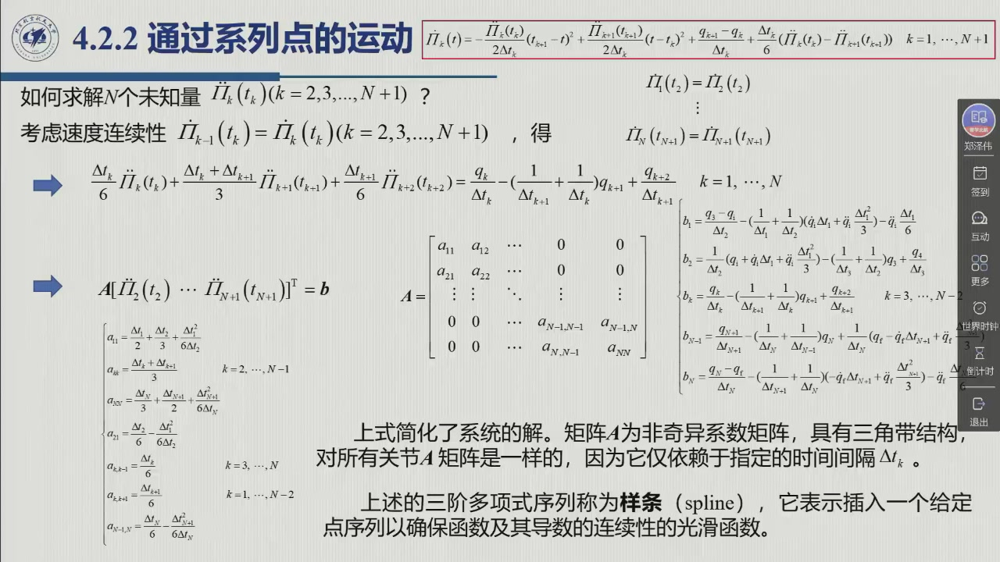

<figure>
<svg class="figure-svg" viewBox="0 0 920 400" xmlns="http://www.w3.org/2000/svg" role="img" aria-labelledby="fig-422-t fig-422-d">
<title id="fig-422-t">样条降维：从 4(N+1) 个未知数到 N 个未知数的三对角系统</title>
<desc id="fig-422-d">上方一行表示原始系统 4(N+1) 个未知数；中间箭头标出三步消元：位置指定值与连续性、加速度连续性、虚拟点位置表达；下方是最终的 N×N 三对角矩阵 A 与右端向量 b，并注明 A 只依赖时间间隔、对所有关节相同。</desc>
<defs>
<marker id="f422-m" markerWidth="9" markerHeight="9" refX="7" refY="3" orient="auto"><path d="M0,0 L7,3 L0,6 Z" fill="var(--muted)"/></marker>
</defs>
<rect x="60" y="30" width="800" height="46" rx="8" fill="none" stroke="var(--line-strong)" stroke-width="1.4"/>
<text class="diagram-text" x="460" y="60" text-anchor="middle">原始：$N+1$ 个三次多项式 ⇒ $4(N+1)$ 个未知系数</text>
<line x1="460" y1="76" x2="460" y2="112" stroke="var(--muted)" stroke-width="1.6" marker-end="url(#f422-m)"/>
<text class="diagram-note" x="480" y="100">位置指定值 (4.13) + 位置连续性 + 加速度连续性 ⇒ 降到 $2(N+1)$ ⇒ $N$</text>
<line x1="460" y1="118" x2="460" y2="152" stroke="var(--muted)" stroke-width="1.6" marker-end="url(#f422-m)"/>
<text class="diagram-note" x="480" y="142">虚拟点位置 $q_2,q_{N+1}$ 用 $\Pi_1,\Pi_{N+1}$ 表达后消去</text>
<line x1="460" y1="158" x2="460" y2="192" stroke="var(--muted)" stroke-width="1.6" marker-end="url(#f422-m)"/>
<text class="diagram-note" x="480" y="182">最后用速度连续性（唯一未用条件）补 $N$ 个方程 (4.28)</text>
<!-- tridiagonal matrix -->
<g stroke="var(--line-strong)" stroke-width="1.1">
<rect x="150" y="212" width="230" height="150" fill="none"/>
<line x1="150" y1="242" x2="380" y2="242"/><line x1="150" y1="272" x2="380" y2="272"/>
<line x1="150" y1="302" x2="380" y2="302"/><line x1="150" y1="332" x2="380" y2="332"/>
<line x1="196" y1="212" x2="196" y2="362"/><line x1="242" y1="212" x2="242" y2="362"/>
<line x1="288" y1="212" x2="288" y2="362"/><line x1="334" y1="212" x2="334" y2="362"/>
</g>
<g fill="var(--fig-blue)">
<rect x="152" y="214" width="42" height="26"/><rect x="198" y="214" width="42" height="26"/>
<rect x="198" y="244" width="42" height="26"/><rect x="244" y="244" width="42" height="26"/><rect x="288" y="244" width="42" height="26"/>
<rect x="288" y="274" width="42" height="26"/><rect x="290" y="304" width="42" height="26"/><rect x="336" y="304" width="42" height="26"/>
<rect x="288" y="334" width="42" height="26"/><rect x="336" y="334" width="42" height="26"/>
</g>
<text class="diagram-text" x="265" y="384" text-anchor="middle">$A$：三对角带，$N\times N$</text>
<text class="diagram-text" x="470" y="290">$A\,\boldsymbol\Pi=b$</text>
<text class="diagram-text" x="560" y="250">$A$ 只依赖 $\Delta t_k$</text>
<text class="diagram-note" x="560" y="278">⇒ 所有关节共用同一个 $A$（1:46:35）</text>
<text class="diagram-text" x="560" y="316">$b$ 与关节角度相关</text>
<text class="diagram-note" x="560" y="344">⇒ 换关节只换右端项</text>
</svg>
<figcaption>同一组节点时刻下，各关节可复用样条系数矩阵；不同关节的节点位置改变右端向量。这里展示的是带虚拟点的扩展方案，普通样条可直接使用上面的节点加速度方程。</figcaption>
</figure>

::: ex 例 4.2.I（原书图 4.7）· 两组虚拟点的对比 {#ex-4.2.I}
为把方程闭合，取首末速度、加速度均为零。给定 $q_1=0,q_3=2\pi,q_4=\pi/2,q_6=\pi$，对应时刻 $t_1=0,t_3=2,t_4=3,t_6=5$ s。比较两组虚拟点时刻：$(t_2,t_5)=(0.5,4.5)$ s和 $(1.5,3.5)$ s；两处位置由方程求出。

**读图要点**（1:48:16）：加速度是**连续**的（线性、无跳跃）；第二组虚拟点更接近两个中间点的时刻，得到的**加速度值更大**——「因为它离这个点近，在很短的时间内就需要完成从这点到这点的过渡，所以加速度和速度值就会比较大」（1:49:09）。此时速度曲线也平滑了，代价是计算量更高。
:::

## 4.2.2.4 路线④：与抛物线混合的内插线性多项式

最后一种方法先用线性分段插值 $N$ 个路径点，再在接点附近加入抛物线过渡，使速度连续（1:50:13）。整条轨迹由线性段与二次段交替拼接，加速度则允许在切换处不连续。

::: def 定义 4.2.7 · 抛物线混合的线性内插 {#def-4.2.7}
令 $\Delta t_k=t_k-t_{k-1}$ 为 $q_{k-1}$ 与 $q_k$ 之间的时间长度；$\Delta t'_k$ 为抛物线混合段的时间长度；$q_{k-1,k}$ 为连接 $q_{k-1}$ 与 $q_k$ 的**常值速度**（即线性段斜率）；$\ddot q_k$ 为 $q_k$ 处持续时间为 $\Delta t'_k$ 的抛物线混合加速度。假定 $q_k,\Delta t_k,\Delta t'_k$ 已给定，则中间点的速度与加速度为

$$q_{k-1,k}=\frac{q_k-q_{k-1}}{\Delta t_k},\qquad
\ddot q_k=\frac{q_{k,k+1}-q_{k-1,k}}{\Delta t'_k}. \tag{4.29,4.30}$$

**这里有两个必须注意的点**：

1. **首末两段要加长。** 为了让轨迹与第一段、最后一段至少在部分时间内保持一致，轨迹应有更长的持续时间
   $$t_N-t_1+\frac{\Delta t'_1+\Delta t'_N}{2},$$
   也就是说，首段向左、末段向右各延伸半个混合时间（1:53:10）。
2. **中间点一般不再严格通过。** 混合段通常从折线节点附近经过，因此这些节点称为经由点。没有方向或速度变化等特殊情况下也可能恰好通过，不能说任何点都绝不达到。
:::

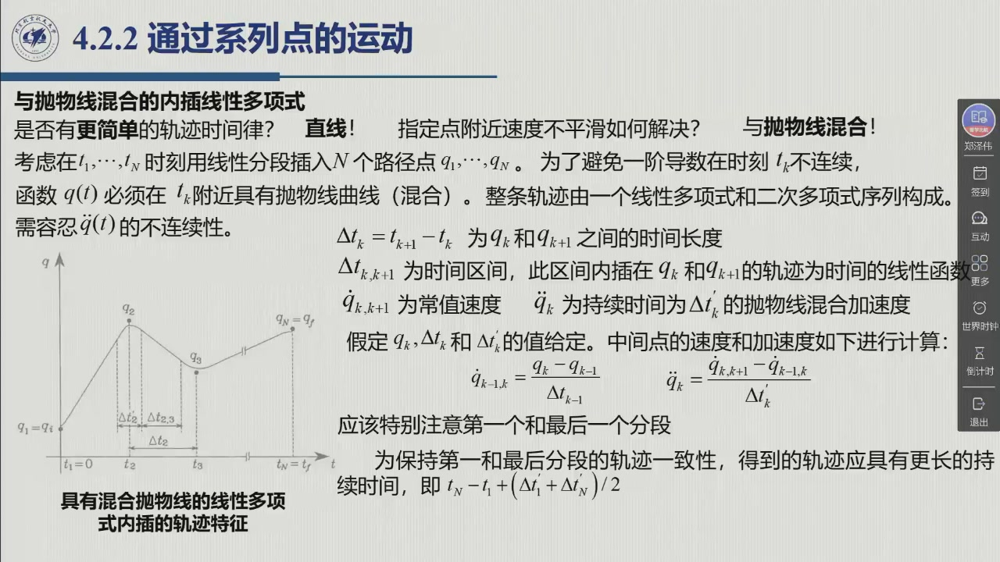

::: ex 例 4.2.J（原书图 4.9）· 混合时间越短，越贴近经由点 {#ex-4.2.J}
数据 $q_1=0,\ q_2=2\pi,\ q_3=\pi/2,\ q_4=\pi$，$t_1=0,\ t_2=2,\ t_3=3,\ t_4=5$，$\dot q_1=\dot q_4=0$。对 $k=1,\dots,4$ 分别取 $\Delta t'_k=0.2$（实线）与 $\Delta t'_k=0.6$（虚线）。

**读图要点**（1:54:38）：第一种情形（$\Delta t'_k=0.2$）下 $q(t)$ 的通路**更接近经由点**，但以**更高的加速度**为代价——「在更短的时间内完成从一个速度到另一个速度的过渡，就需要更大的加速度」。
:::

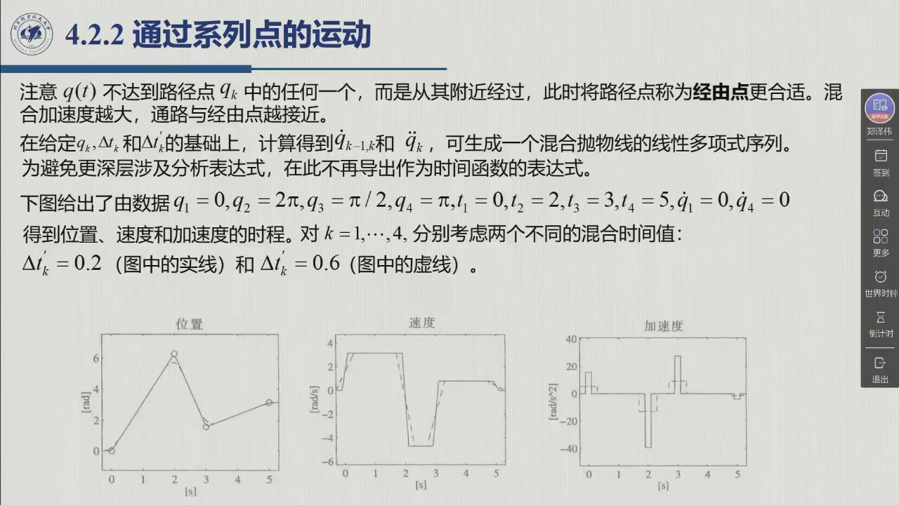

这种构造适用于允许偏离中间点、希望用简单分段表达式生成参考的任务。装配点或检测点若要求准确通过，就必须保留这条约束，不能直接改为只从附近经过的经由点。

::: ex 例 4.2.K（原书图 4.10）· 用「时间超前」省掉一次停顿 {#ex-4.2.K}
只有一个中间点的情形：数据 $q_i=0,\ q_f=3\pi/2$，$t_i=0,\ t_f=2$，中间点位于 $q=\pi$、时刻 $t=1$。

先独立生成两个静止起停LSPB增量：第一段位移 $\pi$、时长1 s、加速度幅值 $6\pi$；第二段位移 $\pi/2$、时长1 s、加速度幅值 $3\pi$。两段由面积方程得到相同的 $t_c=(1-1/\sqrt3)/2\approx0.2113$ s。

若按顺序执行，在1 s到 $\pi$ 并停住，再用1 s到最终点。若把第二个**位移增量**提前0.18 s启动，合成位置应为第一增量与第二增量之和；不能把两个都带绝对起点的曲线直接相加。

到原中间时刻1 s，第一段已完成，第二段仍在加速，位移为 $\tfrac12(3\pi)(0.18)^2=0.0486\pi$。所以合成位置是 $1.0486\pi$，已不是指定的 $\pi$。最终在1.82 s到达 $3\pi/2$，节约时间的代价是放松中间点时刻约束。

每个截断增量若都具有连续速度且端点速度为零，叠加后速度连续；仍需重算重叠阶段的总速度、总加速度和碰撞条件。更一般的几何混合见[§4.3.2](sec4-3-2.md#sec-4.3.2.3)。
:::

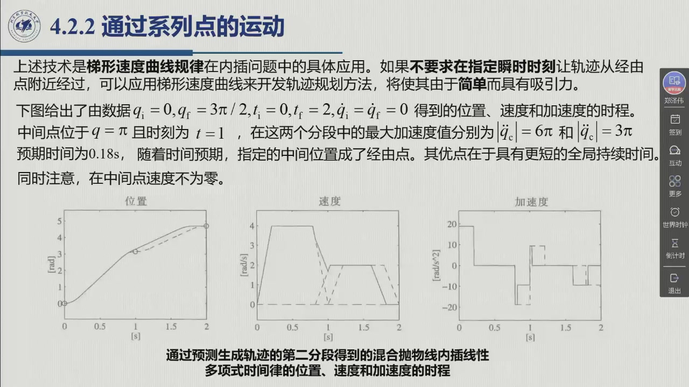

## 4.2.2 小结与常见错误

分段三次用节点位置和速度确定每段；要求接点加速度相同后，会得到相邻节点加速度的联立方程。三对角结构来自每条速度连续方程只涉及三个相邻节点。普通样条的两条端点条件与教材增加虚拟点的做法须区分；抛物线混合则允许轨迹从中间点附近经过。
