# 4.2.2 通过系列点的运动

实际任务很少只从一点走到另一点：拾取—放置要经过提起、放下两个中间点，避障要在障碍物周围加密路径点，高曲率路段也要多设点。点对点的方法因此不够用了，问题升级为「**经过 $N$ 个指定点**」。最直接的解法（用一个 $N-1$ 阶多项式穿过所有点）有五个致命缺点，于是逼出四条修正路线——指定速度、计算速度、三次样条、抛物线混合。录播 1:10:50–1:57:28。

## 4.2.2.0 问题与「一个高阶多项式」的五个缺点

**问题的提法**（1:11:44、教材 §4.2.2）：当 $N$ 个点被指定（称为**路径点** path points）时，要生成的轨迹要求机械手在指定的各个瞬时依次通过它们。每个关节变量因此都有 $N$ 个约束，于是很自然地会想到用**一个 $(N-1)$ 阶多项式**一次穿过全部 $N$ 个点——「这其实是最简单的，或者最不需要思考就可以想到的」（1:12:25）。

::: method 为什么不用单个高阶多项式（教材 §4.2.2 的五条） {#method-4.2.A}
1. **不可能指定起始速度和终点速度**——所有自由度都被「过点」用光了；
2. **阶数增加时振动特性增加**，可能导致机械手产生**不自然的轨迹**。老师 1:13:13 的直观解释：一个 10 阶多项式经过 10 个点，其导数有 9 个极值点，「实际运动过程中就是从起点到终点，但它是有震荡的」；
3. **阶数增加时，系数计算的数值精度降低**——方程系统的矩阵维度变大，数值求解的精度随之下降；
4. **约束方程系统求解繁难**——方程系统一大，就要耗费大量计算资源；
5. **系数取决于所有指定的点**——「只要其中某一个点变了，所有的量都得重新算，我之前耗费多少资源计算出的结果都需要重新计算」（1:14:57）。

**出路**：不再用单个高阶多项式，而改用一组适当数量、在路径点处彼此连续的低阶插值多项式；**最低阶数是三次**——三次多项式在满足两端位置约束后还剩两个自由度，正好可以用来施加**速度的连续性**（1:15:34）。
:::

::: def 定义 4.2.5 · 通过系列点的插值问题 {#def-4.2.5}
对单个关节变量，寻求一个由 $N-1$ 个**连续且具有连续一阶导数**的三阶多项式 $\Pi_k(t)$（$k=1,\dots,N-1$）首尾相接而成的函数 $q(t)$。当 $t=t_k$（$k=1,\dots,N$）时 $q(t_k)=q_k$，且 $q_1=q_i,\ t_1=0,\ q_N=q_f,\ t_N=t_f$。序列 $q_k$ 给出 $t=t_k$ 时刻描述期望轨迹的**路径点**。
:::

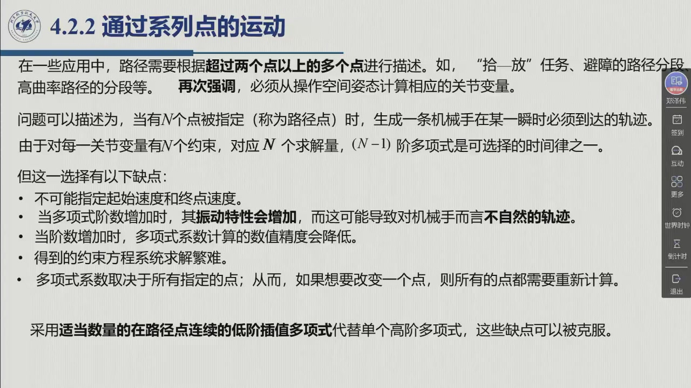

每一段三次多项式有 4 个系数，位置的两个端点值已经给出，**还需要两个方程**才能把它们全部定住。补这两个方程的方式不同，就分出四条路线：

::: method 四条修正路线（课件 1:15:33 页、老师 0:17:22） {#method-4.2.B}
| 路线 | 补的两个约束 | 保证的连续性 | 出处 |
|:--|:--|:--|:--|
| ① 在路径点**指定**速度 | 用户给出 $q_k$ 与 $\dot q_k$ | 位置、速度连续 | [4.2.2.1](#sec-4.2.2.1) |
| ② 按规则**计算**速度 | 用相邻分段斜率定 $\dot q_k$ | 位置、速度连续 | [4.2.2.2](#sec-4.2.2.2) |
| ③ 要求**加速度连续**（样条） | 速度连续 + 加速度连续 | 位置、速度、**加速度**连续 | [4.2.2.3](#sec-4.2.2.3) |
| ④ **低于三阶**的多项式 + 抛物线混合 | 用梯形速度曲线的做法 | 位置、速度连续（加速度跳跃） | [4.2.2.4](#sec-4.2.2.4) |

**小结**：前两条路线「可以保证位置的平滑性和连续性、保证速度的连续性，但是**不能保证速度的平滑性**——加速度是有跳跃的」；只有样条能保证加速度连续（0:19:08）。
:::

## 4.2.2.1 路线①：在路径点指定速度

::: method 路径点指定速度的插值多项式 {#method-4.2.C}
在连接 $q_k$ 与 $q_{k+1}$ 的一般多项式 $\Pi_k(t)$ 上，施加下列条件：

$$\Pi_k(t_k)=q_k,\qquad \Pi_k(t_{k+1})=q_{k+1},\qquad \dot\Pi_k(t_k)=\dot q_k,\qquad \dot\Pi_k(t_{k+1})=\dot q_{k+1},$$

得到 $N-1$ 个关于「四个未知系数」的四方程系统，**每个系统都可以单独求解，不必与其他系统联立**（1:19:47）。通常的做法是把轨迹的**起始速度和终点速度设为零**（$\dot q_1=\dot q_N=0$），再通过

$$\dot\Pi_k(t_{k+1})=\dot\Pi_{k+1}(t_{k+1}),\qquad k=1,\dots,N-2$$

确保路径点处速度的连续性。老师强调这条式子**不能写反**（1:20:25）：「一定要保证**左端点的速度和右端点的速度相等**——左侧多项式的右端点速度等于右侧多项式的左端点速度，这样速度才能连续」。
:::

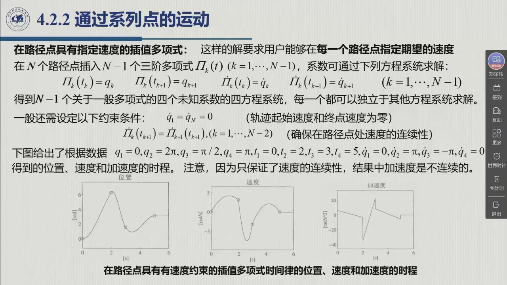

::: ex 例 4.2.E（原书图 4.5）· 指定速度下的超调 {#ex-4.2.E}
取 $q_1=0,\ q_2=2\pi,\ q_3=\pi/2,\ q_4=\pi$，$t_1=0,\ t_2=2,\ t_3=3,\ t_4=5$，并指定 $\dot q_1=0,\ \dot q_2=\pi,\ \dot q_3=-\pi,\ \dot q_4=0$。结果是：位置平滑且连续，速度连续但**不平滑**（加速度有跳跃）。

**关键观察**（1:21:40）：中间点 $q_2=2\pi$ 处的**速度不为零**（被指定为 $\pi$），于是轨迹会**超调**——「这点可能超过 $2\pi$ 的值，然后再往回来」。速度由用户自由指定，代价则是可能出现过冲。
:::

## 4.2.2.2 路线②：按规则计算速度

换一条思路：不指定速度，而是把路径点速度**算**出来，这样就能避免路线①中指定速度的任意性（1:22:25）。最常用的规则用的是**线性分段的斜率**：

::: method 线性分段斜率定速度（教材式 4.12） {#method-4.2.D}
令 $v_k=\dfrac{q_k-q_{k-1}}{t_k-t_{k-1}}$ 为时间区间 $[t_{k-1},t_k]$ 内分段的斜率，则

$$\dot q_1=0,\qquad
\dot q_k=\begin{cases}0, & \operatorname{sgn}(v_k)\neq\operatorname{sgn}(v_{k+1})\\[1mm] \dfrac{v_k+v_{k+1}}{2}, & \operatorname{sgn}(v_k)=\operatorname{sgn}(v_{k+1})\end{cases}\qquad
\dot q_N=0. \tag{4.12}$$

即：**前后两段斜率异号**（该点是极值点，路径在此折返）⇒ 该点速度取 **0**；**同号**（路径继续朝一个方向走）⇒ 取两段斜率的**平均**。全部速度确定之后，插值多项式的求解与路线①完全相同。
:::

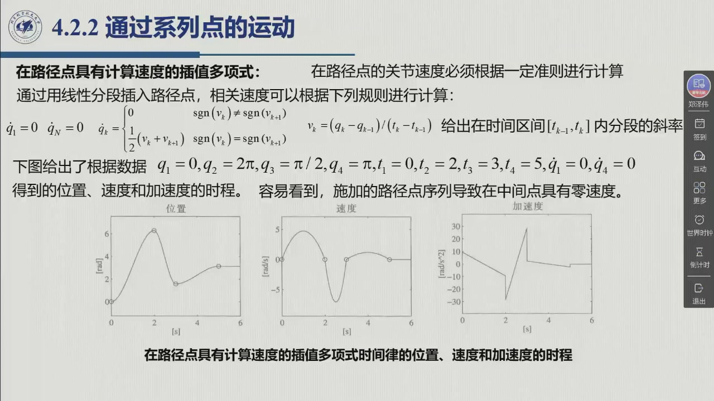

::: ex 例 4.2.F（原书图 4.6）· 中间点零速度 {#ex-4.2.F}
用与 [@ex-4.2.E] 相同的路径点数据，但速度改为按 (4.12) 计算。结果是：**这组路径点使中间点处的速度为零**——在 $q_2=2\pi$ 处斜率由正转负，两段异号 ⇒ 速度取 0，于是**不再超调**，「到这点的情况下它就是 $2\pi$ 的，没有到高，到 $2\pi$ 就往回返」（1:23:55）。
:::

## 4.2.2.3 路线③：三次样条（加速度连续）

前两条路线都无法保证**加速度**的连续性（1:24:12）。如果连速度也要平滑，加速度就必须连续——把这一层要求补上，就得到**样条**。

::: def 定义 4.2.6 · 三次样条 spline {#def-4.2.6}
给定一个由 $N$ 个路径点构成的序列，若对每一对相邻的三次多项式施加**两个位置约束**，并施加保证**速度连续性**与**加速度连续性**的两个约束，则除首末两点（其速度、加速度由边界条件指定）之外，在每一个路径点 $t_k$ 上加速度也是连续的。

满足的方程（$k=2,\dots,N-1$）为

$$\Pi_{k-1}(t_k)=q_k,\qquad \Pi_{k-1}(t_k)=\Pi_k(t_k),\qquad \dot\Pi_{k-1}(t_k)=\dot\Pi_k(t_k),\qquad \ddot\Pi_{k-1}(t_k)=\ddot\Pi_k(t_k).$$

这样的三次多项式序列称为**样条**，表示「插入一个给定点序列以确保函数及其导数连续性的光滑函数」（1:47:34）。
:::

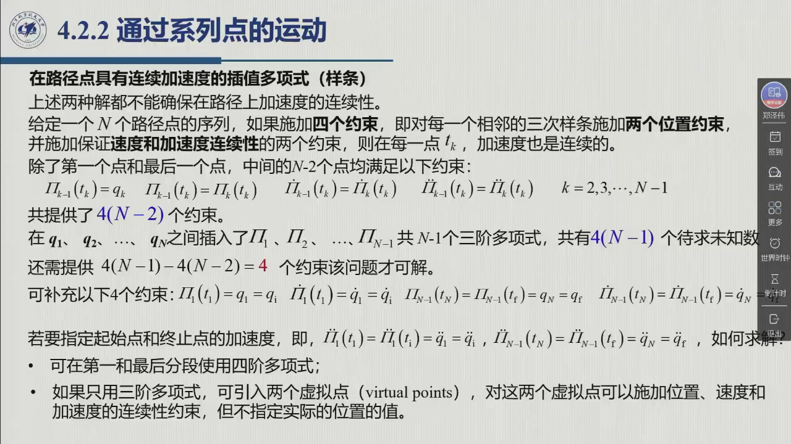

::: thm 定理 4.2.G · 方程计数与两个虚拟点 {#thm-4.2.G}
**先把方程数一数，问题就来了。** 中间点贡献 $4(N-2)$ 个方程，极值点贡献 6 个方程，共 $4N-2$ 个；而 $N-1$ 个三次多项式只有 $4(N-1)$ 个未知系数——**方程比未知数多 2**，系统不能直接求解（教材 §4.2.2）。多出来的这两个，正是「初始与最终**加速度**」这两个可以任意指定的条件。

**三种出路**：

1. 让第一段和最后一段改用**四阶多项式**（5 个系数容纳 5 个约束）——但算法通常要求各段形式一致，不理想；
2. 只要求在**部分时间**内保持轨迹一致（工程近似）；
3. **引入两个虚拟点**（virtual points）：对它们施加位置、速度和加速度的**连续性约束**，但**不指定其实际位置**。由于位置约束只考虑连续性，虚拟点定位在何处无关紧要。

把两个虚拟点引入之后，要确定的是 $N+1$ 个三次多项式，即 $4(N+1)$ 个未知数；相应地有：$k=3,\dots,N$ 的中间点 $4(N-2)$ 个方程、起始点与终点的 6 个方程、两个虚拟点的 6 个方程，合计 $4(N+1)$ 个方程——**未知数与方程数相等，解存在且唯一**（1:29:55）。
:::

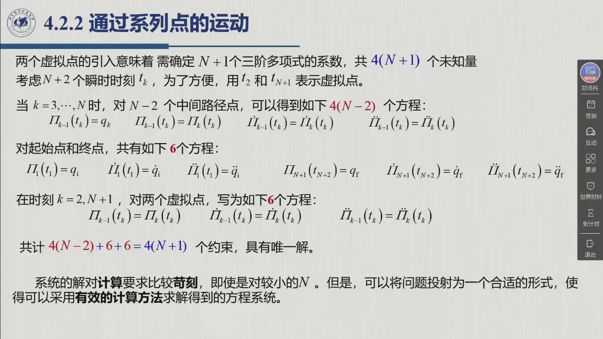

**降维：从 $4(N+1)$ 个未知数到 $N$ 个。** 直接解 $4(N+1)$ 个方程「对计算要求比较苛刻，即使是对较小的 $N$」（教材 §4.2.2）。教材的做法，是利用三次多项式的二阶导数必为时间的线性函数：

::: thm 定理 4.2.H · 降维与三对角系统 {#thm-4.2.H}
**第一步：写出二阶导数。** 对一般多项式 $\Pi_k(t)$（$k=1,\dots,N+1$），

$$\ddot\Pi_k(t)=\frac{\ddot\Pi_k(t_{k+1})}{\Delta t_k}(t_{k+1}-t)+\frac{\ddot\Pi_k(t_k)}{\Delta t_k}(t-t_k),\qquad \Delta t_k=t_{k+1}-t_k . \tag{4.26}$$

对时间**两次积分**，就得到 $\Pi_k(t)$ 只取决于 **4 个未知数**：$\ddot\Pi_k(t_k),\ \ddot\Pi_k(t_{k+1}),\ \Pi_k(t_k),\ \Pi_k(t_{k+1})$。

**第二步：逐层消元。** 借助 (4.13) 的 $N$ 个位置指定值，再加上位置连续性与加速度连续性，把未知数从 $4(N+1)$ 降到 $2(N+1)$，再降到 $N$；被消掉的 $q_2$、$q_{N+1}$ 是虚拟点位置，可以用 $\Pi_1(t_1)$、$\Pi_{N+1}(t_{N+2})$ 表达。

**第三步：用速度连续性补齐。** 到这一步唯一没用上的条件是**速度连续性**（1:44:02）：左侧多项式右端点的速度等于右侧多项式左端点的速度，$k=1,\dots,N$，恰给出 $N$ 个方程：

$$A\,\big[\ddot\Pi_2(t_2)\ \cdots\ \ddot\Pi_{N+1}(t_{N+1})\big]^{\mathrm T}=b \tag{4.28}$$

其中 $b$ 为已知项，$A$ 为**非奇异**系数矩阵，解存在且唯一。**$A$ 具有三对角带结构**

$$A=\begin{bmatrix}
a_{11}&a_{12}&&\mathbf 0\\
a_{21}&a_{22}&a_{23}&\\
&\ddots&\ddots&\ddots\\
&&a_{N-1,N-1}&a_{N-1,N}\\
\mathbf 0&&a_{N,N-1}&a_{NN}
\end{bmatrix},$$

这大大简化了求解（见习题 4.4）：前向计算 + 后向计算即可。**关键性质**：$A$ **对所有关节都一样**——因为它只依赖指定的时间间隔 $\Delta t_k$，而所有关节的时间间隔相同（1:46:35）；唯一随关节变化的只有右端项 $b$（它与关节角度相关）。
:::

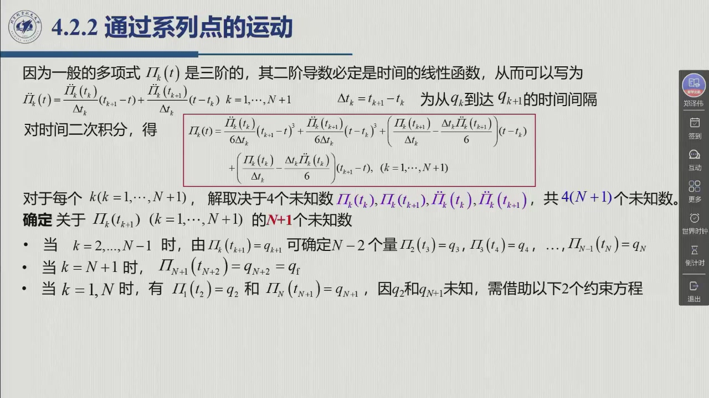

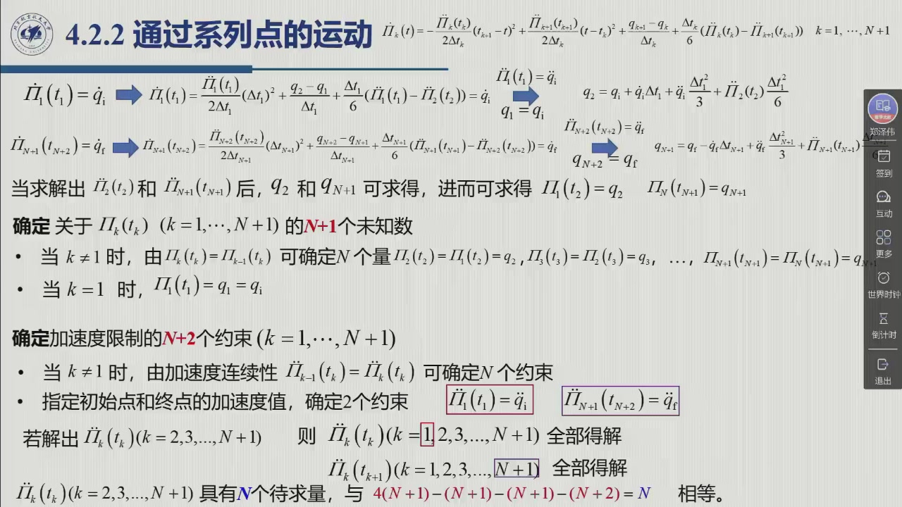

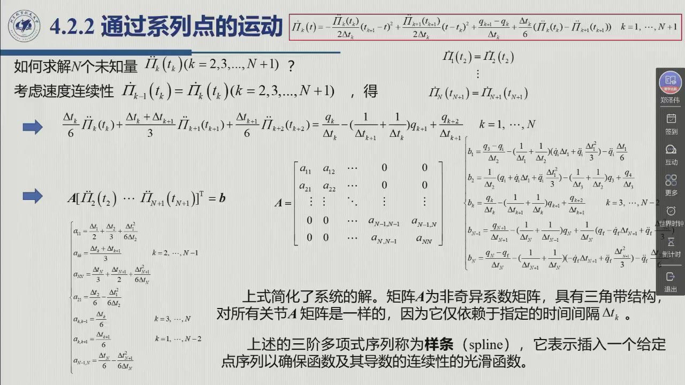

<figure>
<svg class="figure-svg" viewBox="0 0 920 400" xmlns="http://www.w3.org/2000/svg" role="img" aria-labelledby="fig-422-t fig-422-d">
<title id="fig-422-t">样条降维：从 4(N+1) 个未知数到 N 个未知数的三对角系统</title>
<desc id="fig-422-d">上方一行表示原始系统 4(N+1) 个未知数；中间箭头标出三步消元：位置指定值与连续性、加速度连续性、虚拟点位置表达；下方是最终的 N×N 三对角矩阵 A 与右端向量 b，并注明 A 只依赖时间间隔、对所有关节相同。</desc>
<defs>
<marker id="f422-m" markerWidth="9" markerHeight="9" refX="7" refY="3" orient="auto"><path d="M0,0 L7,3 L0,6 Z" fill="var(--muted)"/></marker>
</defs>
<rect x="60" y="30" width="800" height="46" rx="8" fill="none" stroke="var(--line-strong)" stroke-width="1.4"/>
<text class="diagram-text" x="460" y="60" text-anchor="middle">原始：$N+1$ 个三次多项式 ⇒ $4(N+1)$ 个未知系数</text>
<line x1="460" y1="76" x2="460" y2="112" stroke="var(--muted)" stroke-width="1.6" marker-end="url(#f422-m)"/>
<text class="diagram-note" x="480" y="100">位置指定值 (4.13) + 位置连续性 + 加速度连续性 ⇒ 降到 $2(N+1)$ ⇒ $N$</text>
<line x1="460" y1="118" x2="460" y2="152" stroke="var(--muted)" stroke-width="1.6" marker-end="url(#f422-m)"/>
<text class="diagram-note" x="480" y="142">虚拟点位置 $q_2,q_{N+1}$ 用 $\Pi_1,\Pi_{N+1}$ 表达后消去</text>
<line x1="460" y1="158" x2="460" y2="192" stroke="var(--muted)" stroke-width="1.6" marker-end="url(#f422-m)"/>
<text class="diagram-note" x="480" y="182">最后用速度连续性（唯一未用条件）补 $N$ 个方程 (4.28)</text>
<!-- tridiagonal matrix -->
<g stroke="var(--line-strong)" stroke-width="1.1">
<rect x="150" y="212" width="230" height="150" fill="none"/>
<line x1="150" y1="242" x2="380" y2="242"/><line x1="150" y1="272" x2="380" y2="272"/>
<line x1="150" y1="302" x2="380" y2="302"/><line x1="150" y1="332" x2="380" y2="332"/>
<line x1="196" y1="212" x2="196" y2="362"/><line x1="242" y1="212" x2="242" y2="362"/>
<line x1="288" y1="212" x2="288" y2="362"/><line x1="334" y1="212" x2="334" y2="362"/>
</g>
<g fill="var(--fig-blue)">
<rect x="152" y="214" width="42" height="26"/><rect x="198" y="214" width="42" height="26"/>
<rect x="198" y="244" width="42" height="26"/><rect x="244" y="244" width="42" height="26"/><rect x="288" y="244" width="42" height="26"/>
<rect x="288" y="274" width="42" height="26"/><rect x="290" y="304" width="42" height="26"/><rect x="336" y="304" width="42" height="26"/>
<rect x="288" y="334" width="42" height="26"/><rect x="336" y="334" width="42" height="26"/>
</g>
<text class="diagram-text" x="265" y="384" text-anchor="middle">$A$：三对角带，$N\times N$</text>
<text class="diagram-text" x="470" y="290">$A\,\boldsymbol\Pi=b$</text>
<text class="diagram-text" x="560" y="250">$A$ 只依赖 $\Delta t_k$</text>
<text class="diagram-note" x="560" y="278">⇒ 所有关节共用同一个 $A$（1:46:35）</text>
<text class="diagram-text" x="560" y="316">$b$ 与关节角度相关</text>
<text class="diagram-note" x="560" y="344">⇒ 换关节只换右端项</text>
</svg>
<figcaption>样条降维（本教程绘）：把 $4(N+1)$ 个未知数的巨型系统，靠「位置指定值 + 位置/加速度连续性 + 虚拟点表达」压到 $N$ 个未知数，再用最后剩下的**速度连续性**写成三对角系统 (4.28)。$A$ 与关节无关这一点，是多关节实现时最大的算力红利。</figcaption>
</figure>

::: ex 例 4.2.I（原书图 4.7）· 两组虚拟点的对比 {#ex-4.2.I}
数据 $q_1=0,\ q_3=2\pi,\ q_4=\pi/2,\ q_6=\pi$，$t_1=0,\ t_3=2,\ t_4=3,\ t_6=5$，$\dot q_1=\dot q_6=0$。分别取两组虚拟点时刻：$t_2=0.5,\ t_5=4.5$（实线）与 $t_2=1.5,\ t_5=3.5$（虚线）。

**读图要点**（1:48:16）：加速度是**连续**的（线性、无跳跃）；第二组虚拟点更接近两个中间点的时刻，得到的**加速度值更大**——「因为它离这个点近，在很短的时间内就需要完成从这点到这点的过渡，所以加速度和速度值就会比较大」（1:49:09）。此时速度曲线也平滑了，代价是计算量更高。
:::

## 4.2.2.4 路线④：与抛物线混合的内插线性多项式

最后一条路线采用最简化的做法：用**线性分段**插值 $N$ 个路径点，只在路径点附近用**抛物线**过渡，以免速度跳跃（1:50:13）。这样整条轨迹就由「线性多项式 + 二次多项式」交替拼接而成——代价是**容忍加速度的不连续**。

::: def 定义 4.2.7 · 抛物线混合的线性内插 {#def-4.2.7}
令 $\Delta t_k=t_k-t_{k-1}$ 为 $q_{k-1}$ 与 $q_k$ 之间的时间长度；$\Delta t'_k$ 为抛物线混合段的时间长度；$q_{k-1,k}$ 为连接 $q_{k-1}$ 与 $q_k$ 的**常值速度**（即线性段斜率）；$\ddot q_k$ 为 $q_k$ 处持续时间为 $\Delta t'_k$ 的抛物线混合加速度。假定 $q_k,\Delta t_k,\Delta t'_k$ 已给定，则中间点的速度与加速度为

$$q_{k-1,k}=\frac{q_k-q_{k-1}}{\Delta t_k},\qquad
\ddot q_k=\frac{q_{k,k+1}-q_{k-1,k}}{\Delta t'_k}. \tag{4.29,4.30}$$

**这里有两个必须注意的点**：

1. **首末两段要加长。** 为了让轨迹与第一段、最后一段至少在部分时间内保持一致，轨迹应有更长的持续时间
   $$t_N-t_1+\frac{\Delta t'_1+\Delta t'_N}{2},$$
   也就是说，首段向左、末段向右各延伸半个混合时间（1:53:10）。
2. **轨迹不经过路径点。** $q(t)$ **不达到**路径点 $q_k$ 中的任何一个，而是从其**附近经过**——此时把路径点称为**经由点**（via point）更合适。混合加速度越大，通路与经由点越接近（教材 §4.2.2）。
:::

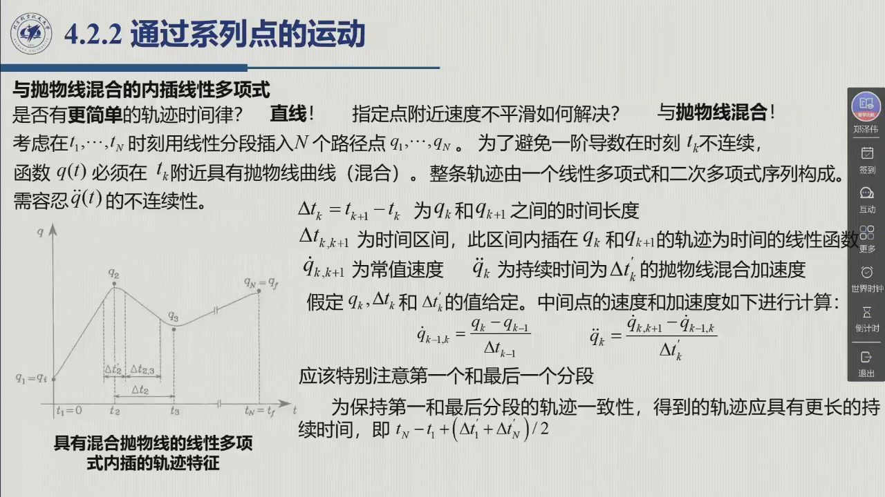

::: ex 例 4.2.J（原书图 4.9）· 混合时间越短，越贴近经由点 {#ex-4.2.J}
数据 $q_1=0,\ q_2=2\pi,\ q_3=\pi/2,\ q_4=\pi$，$t_1=0,\ t_2=2,\ t_3=3,\ t_4=5$，$\dot q_1=\dot q_4=0$。对 $k=1,\dots,4$ 分别取 $\Delta t'_k=0.2$（实线）与 $\Delta t'_k=0.6$（虚线）。

**读图要点**（1:54:38）：第一种情形（$\Delta t'_k=0.2$）下 $q(t)$ 的通路**更接近经由点**，但以**更高的加速度**为代价——「在更短的时间内完成从一个速度到另一个速度的过渡，就需要更大的加速度」。
:::

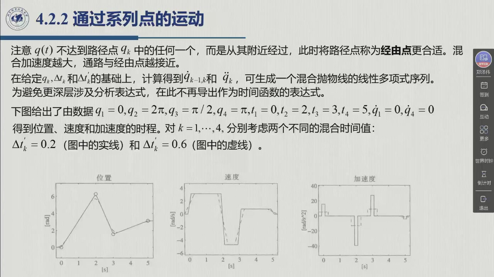

**工业上为什么选它？** 「采用梯形速度曲线是比较简单的、比较通用的方式，在工业上其实是比较常用的」——**当不要求轨迹恰在指定瞬时从经由点附近经过时**，用梯形速度曲线开发轨迹规划算法就很有吸引力，因为它足够简单（1:55:22）。

::: ex 例 4.2.K（原书图 4.10）· 用「时间超前」省掉一次停顿 {#ex-4.2.K}
只有一个中间点的情形：数据 $q_i=0,\ q_f=3\pi/2$，$t_i=0,\ t_f=2$，中间点位于 $q=\pi$、时刻 $t=1$。

**保守做法**：把运动分成两段，每段各生成一条梯形速度曲线。机械手关节**肯定到达中间点**，但「在继续朝向最终点运动之前，它会被强迫停在那里」——加速、匀速、减速到零、停住、再重新加速（1:56:21）。这段位移和时间的浪费相当明显。

**灵活做法**：用速度（或位置）的和作参考，在**第一分段结束之前**就开始产生第二分段——也就是引入**时间超前**。这样关节**仍到达最终点**，但**不再保证在指定时刻穿越中间点**（$\pi$ 点于是成了经由点），全局持续时间更短；代价是中间点的速度不为零。两个分段的最大加速度分别为 $|\ddot q_1|=6\pi$ 与 $|\ddot q_2|=3\pi$，预期时间 $0.18$（教材 §4.2.2）。

**推广到多段**（2:20:27）：时间超前量按递归关系 $\Delta t_j=\Delta t_{j-1}+\delta t_j$ 估计——它等于前一分段已产生的时间超前，加上当前分段开始的时间超前（教材式 4.50）。老师提醒：**这种规划没有考虑速度连续性**，实际中要加抛线段做平滑过渡，或做提前预判规划。
:::

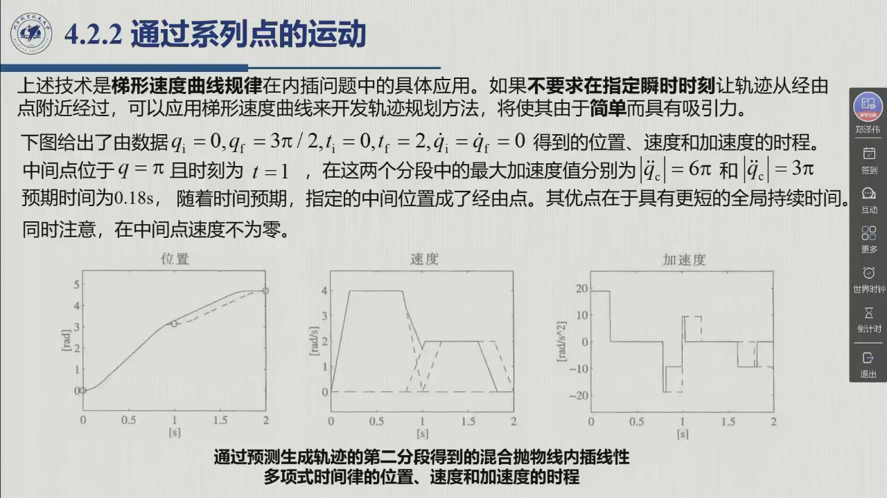

::: think 考点 · 老师原话（录播时间点）

> **样条是本节的理论重点，但「主要理解思路」。** 「实际过程中其实都有程序已经写好，包括已经商用的一些机械臂，这种规划都是有的……**主要是理解这个思路**」（1:47:59）。

> **降维是样条的关键一步。** 「这个方程系统很大的……对很小的一个机械臂的计算量都是非常大的，所以需要一些技巧的方法——**怎么对未知数或者整个方程系统进行降维**」（1:30:25）。

> **$A$ 与关节无关是最大红利。** 「$A$ 是一个非奇异的系数矩阵，具有三角带的结构。**对于所有的关节 $A$ 都是一样的**，因为它只依赖于指定的时间间隔……你只要把某一个关节的 $A$ 计算出来了，其他所有关节的 $A$ 都是一样的」（1:46:37）。

> **工业上用梯形速度曲线。** 「采用梯形速度曲线是比较简单、比较通用的方式，在工业上其实是比较常用的」（1:55:22）——前提是不要求指定瞬时时刻经过经由点。

> **多段混合要加预判。** 「实际过程中对于多线段分段，一般是采用这种方法（时间超前）来进行规划的……**但是要写代码还是需要仔细**」（2:21:59）。
:::

::: think 默写点 · 合上书再写（主动回忆）

不看正文与速查卡，先写出下面几条，再展开核对。写不出来就说明这一节还没「拿走」。

1. 说出高阶插值多项式的五个缺点（至少四条）。
2. 写出路线②的速度计算规则 (4.12)。
3. 样条的方程计数：中间点几个、极值点几个、未知数几个？差多少？两个虚拟点补在哪里？
4. 写出 (4.29)(4.30)，并说明为什么叫「经由点」而不是「路径点」。

::: sol 核对

① 不能指定首末速度；② 阶数高 ⇒ 振动/不自然轨迹；③ 数值精度降低；④ 方程系统求解繁难；⑤ 系数依赖全部点，改一点全重算。

$\dot q_1=0$；$\operatorname{sgn}(v_k)\ne\operatorname{sgn}(v_{k+1})\Rightarrow\dot q_k=0$；同号 $\Rightarrow\dot q_k=(v_k+v_{k+1})/2$；$\dot q_N=0$，其中 $v_k=(q_k-q_{k-1})/(t_k-t_{k-1})$。

中间点 $4(N-2)$、极值点 6，共 $4N-2$；未知数 $4(N-1)$；**多 2 个**（即初始与最终加速度这两个任意条件）。引入两个虚拟点后变成 $N+1$ 个三次多项式：$4(N+1)$ 方程对 $4(N+1)$ 未知数，配平。

$q_{k-1,k}=(q_k-q_{k-1})/\Delta t_k$；$\ddot q_k=(q_{k,k+1}-q_{k-1,k})/\Delta t'_k$。因为抛物线混合段让轨迹**从路径点附近经过而非到达**，中间点的位置被「削角」，故改称经由点。

:::

:::

## 4.2.2 小结与常见错误

- **一条主线**：$N$ 个点 ⇒ 单个 $(N-1)$ 阶多项式不可用（五个缺点）⇒ 改用 $N-1$ 段三次多项式 ⇒ 每段差 2 个方程 ⇒ 四条补法（指定速度 [@method-4.2.C] / 计算速度 [@method-4.2.D] / 样条 / 抛物线混合）。
- **一个计数**：样条 $4N-2$ vs $4(N-1)$ 差 2 ⇒ 虚拟点 ⇒ $4(N+1)$ 配平 ⇒ 降维到 $N$ ⇒ 三对角 $A\ddot\Pi=b$，$A$ 与关节无关。
- **一句话**：「通过系列点的运动，本质上是**在每一段上重复点对点的方法**，再补上段与段之间的连续性条件。」

::: think 常见错误清单 · 自查三条
1. **把样条当成「光滑的插值」就完事**——它的定义性特征是**加速度连续**；只保证速度连续的是路线①②，不是样条。
2. **虚拟点当成真实路径点**：虚拟点**不指定位置**，只施加连续性约束；一旦给它们赋位置值，系统又变超定。
3. **经由点 = 路径点**：抛物线混合下 $q(t)$ 不到达路径点，只从附近经过；「混合加速度越大越贴近」是反直觉但正确的关系。
:::
