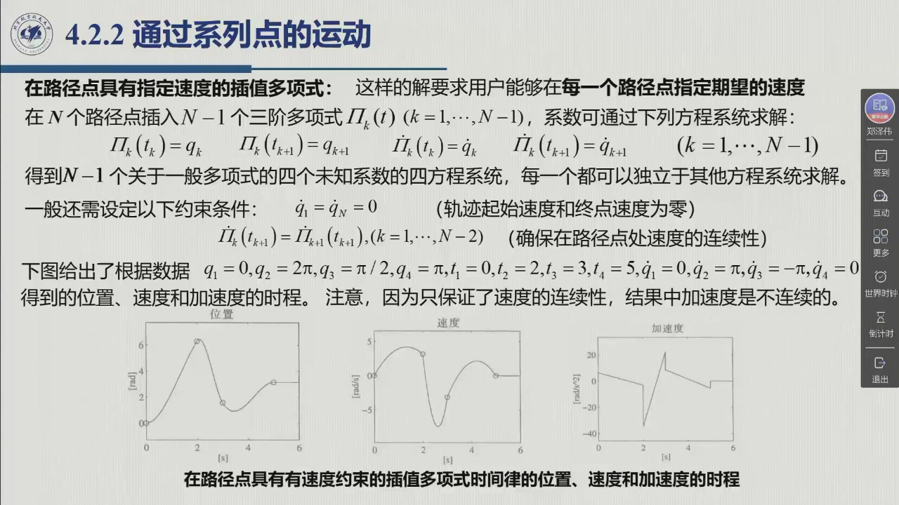
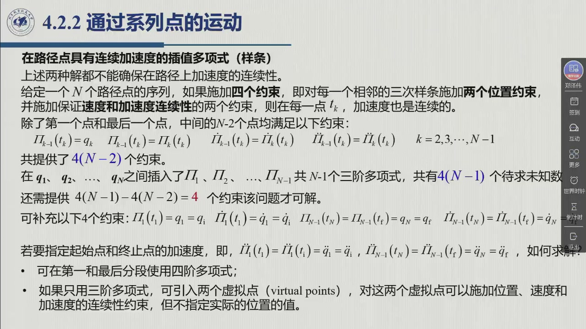
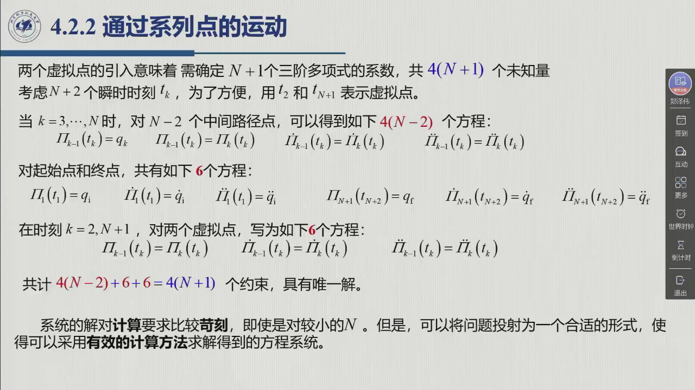
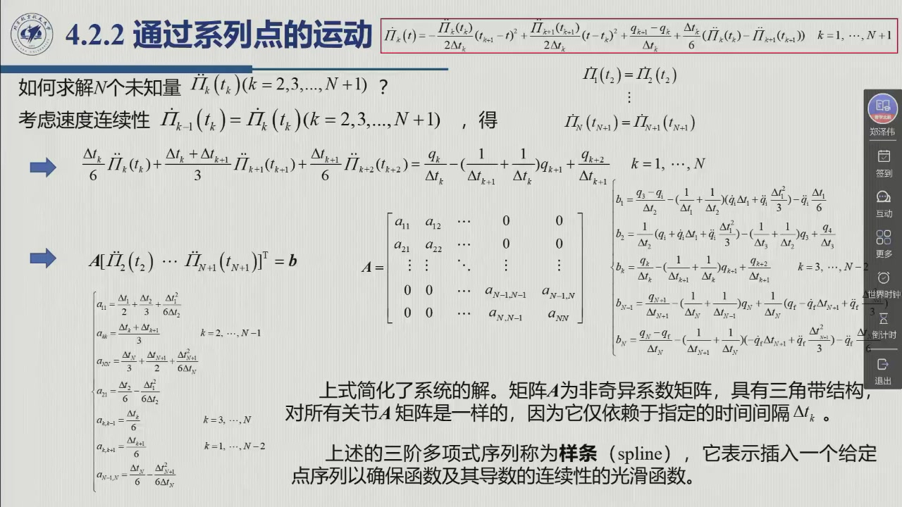
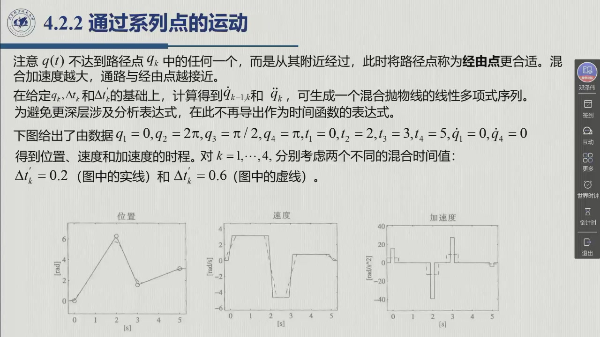

# 4.2.2 通过系列点的运动

抓取物体时，机械臂往往需要先抬起、绕过工作台再下降到放置点，中间必须经过一系列指定位置。用一个高次多项式穿过全部点会带来自由度耗尽、数值病态和修改一点就重算整条曲线的问题，因此工程上改为每段用低阶多项式拼接。本节依次看四条拼接路线怎样把接点速度和加速度衔接起来。录播对应 1:10:50–1:57:28。

## 4.2.2.0 为什么采用分段低次插值

给定严格递增的时刻 $t_1<\cdots<t_N$ 和对应关节位置 $q_1,\ldots,q_N$（共 $N$ 个路径点，1:11:44）。最直接的想法是用单个次数不超过 $N-1$ 的全局多项式一次穿过所有点，但这套做法有五个麻烦（1:12:25–1:14:57）：

::: method 为什么改用分段低次插值 {#method-4.2.A}
1. **无法独立指定起终速度**：$N$ 个过点条件正好用光 $N-1$ 次多项式的全部 $N$ 个系数。
2. **节点间容易摆动**：例如用 9 次或 10 次多项式过十几个点，高阶导数在节点间可能出现剧烈振荡（1:13:13），实际摆动程度取决于数据、基函数和节点分布。
3. **数值精度下降**：次数一高，幂基矩阵条件数迅速恶化。
4. **方程规模大**：求解高阶线性系统的计算成本随 $N$ 迅速上升。
5. **局部修改牵动全局**：系数依赖全部路径点，只要改动一个中间点，整条曲线的系数都要重算（1:14:57）。

改用分段三次插值，就把每段压回只有 4 个系数的多项式：两端位置已经占去 2 个条件，每段恰好还留出 2 个自由度用来控制速度或加速度的连续性（1:15:34）。
:::

::: def 定义 4.2.5 · 通过系列点的插值问题 {#def-4.2.5}
对单个关节变量，寻求由 $N-1$ 段连续且一阶导数连续的三次多项式 $\Pi_k(t)$（$k=1,\dots,N-1$）首尾相接而成的函数 $q(t)$。在指定时刻 $t_k$（$k=1,\dots,N$）满足 $q(t_k)=q_k$，其中 $q_1=q_i$、$t_1=0$、$q_N=q_f$、$t_N=t_f$，序列 $q_k$ 称为**路径点**。
:::

每段三次多项式有 4 个系数，两端位置只用掉 2 个条件，还差 2 个方程。四条接点处理路线的差别，就在这 2 个条件怎样补上、相邻段怎样衔接（课件 1:15:33、0:17:22）：

::: method 四种接点处理方式 {#method-4.2.B}
| 路线 | 怎样确定接点 | 保证的连续性 | 入口 |
|:--|:--|:--|:--|
| ① 指定速度 | 用户直接给出每个节点速度 $\dot q_k$ | 位置、速度连续（$C^1$） | [4.2.2.1](#sec-4.2.2.1) |
| ② 计算速度 | 按相邻分段斜率规则定 $\dot q_k$ | 位置、速度连续（$C^1$） | [4.2.2.2](#sec-4.2.2.2) |
| ③ 三次样条 | 联立求解使左右二阶导数相等 | 位置、速度、加速度连续（$C^2$） | [4.2.2.3](#sec-4.2.2.3) |
| ④ 抛物线混合 | 线性段之间以常加速度抛物线过渡 | 速度连续，通常允许偏离中间点 | [4.2.2.4](#sec-4.2.2.4) |

$C^1$ 表示位置和一阶导数（速度）连续，$C^2$ 再要求二阶导数（加速度）连续（0:19:08）。前两条路线在节点处只令左右速度相等，不约束左右二阶导数，因此加速度在节点处仍可能跳跃。
:::

## 4.2.2.1 路线①：在路径点指定速度

::: method 路径点指定速度的插值多项式 {#method-4.2.C}
在连接 $q_k$ 与 $q_{k+1}$ 的一般多项式 $\Pi_k(t)$ 上，施加下列条件：

$$\Pi_k(t_k)=q_k,\qquad \Pi_k(t_{k+1})=q_{k+1},\qquad \dot\Pi_k(t_k)=\dot q_k,\qquad \dot\Pi_k(t_{k+1})=\dot q_{k+1},$$

得到 $N-1$ 个关于「四个未知系数」的四方程系统，**每个系统都可以单独求解，不必与其他系统联立**（1:19:47）。通常的做法是把轨迹的**起始速度和终点速度设为零**（$\dot q_1=\dot q_N=0$），再通过

$$\dot\Pi_k(t_{k+1})=\dot\Pi_{k+1}(t_{k+1}),\qquad k=1,\dots,N-2$$

这条衔接式把左侧多项式的右端点速度与右侧多项式的左端点速度在同一个时刻 $t_{k+1}$ 设为相等（1:20:25）；如果每段改用局部时间 $\tau\in[0,t_{k+1}-t_k]$，左段代入前段时长 $t_{k+1}-t_k$，右段代入 $0$。
:::

::: ex 例 4.2.E（原书图 4.5）· 指定速度下的超调 {#ex-4.2.E}
取 $q_1=0,\ q_2=2\pi,\ q_3=\pi/2,\ q_4=\pi$，$t_1=0,\ t_2=2,\ t_3=3,\ t_4=5\ \mathrm{s}$，并指定 $\dot q_1=0,\ \dot q_2=\pi,\ \dot q_3=-\pi,\ \dot q_4=0\ \mathrm{rad/s}$。由于每段只用自己的两端位置与速度，三段多项式可以各自独立求得。结果位置和速度全程连续，加速度则在内部节点跳跃。

在节点 $q_2=2\pi$ 处路径本来要折返，但人为指定了正速度 $\dot q_2=\pi$，轨迹冲过 $2\pi$ 之后才回头往下走，产生**超调**（1:21:40：「这点可能超过 $2\pi$ 的值，然后再往回来」）。自由指定速度的代价就是容易在折返点出现过冲。
:::

## 4.2.2.2 路线②：按规则计算速度

如果不希望手动给每个中间点赋速度，可以从相邻路径点连线的斜率自动算出节点速度（1:22:25）：折返点让速度归零以贴近极值，同向段取前后斜率平均以顺滑通过。这是一条局部启发规则，一般数据下是否单调仍须画出来或求导检查。

::: method 线性分段斜率定速度（教材式 4.12） {#method-4.2.D}
令 $v_k=\dfrac{q_k-q_{k-1}}{t_k-t_{k-1}}$ 为时间区间 $[t_{k-1},t_k]$ 内的线性平均斜率，则

$$\dot q_1=0,\qquad
\dot q_k=\begin{cases}0, & \operatorname{sgn}(v_k)\neq\operatorname{sgn}(v_{k+1})\\[1mm] \dfrac{v_k+v_{k+1}}{2}, & \operatorname{sgn}(v_k)=\operatorname{sgn}(v_{k+1})\end{cases}\qquad
\dot q_N=0. \tag{4.12}$$

前后两段斜率异号表示路径在此折返，速度设为 $0$；同号表示继续同向推进，取相邻斜率的平均值。全部节点速度算出之后，每段三次多项式的求解与路线①完全相同。
:::

::: ex 例 4.2.F（原书图 4.6）· 算出中间点速度 {#ex-4.2.F}
沿用 [@ex-4.2.E] 的四个路径点和时刻，三段平均斜率分别是

$$v_2=\frac{2\pi-0}{2-0}=\pi,\qquad
v_3=\frac{\pi/2-2\pi}{3-2}=-\frac{3\pi}{2},\qquad
v_4=\frac{\pi-\pi/2}{5-3}=\frac{\pi}{4}\ \mathrm{rad/s}.$$

节点 $q_2$ 处斜率由正转负、$q_3$ 处由负转正，两个内部节点都发生方向反转。按式 (4.12) 得到节点速度 $(0,0,0,0)$，每段退化为静止起停的三次曲线，轨迹到 $2\pi$ 就停住往回走（1:23:55），消除了 [@ex-4.2.E] 的超调。

对斜率同号的上升或下降数据，取算术平均不自动保证分段单调无超调。求得各段三次系数后，仍需对导数 $\dot\Pi_k(t)$ 检查区间内是否变号。
:::

## 4.2.2.3 路线③：三次样条（加速度连续）

前两条路线在节点处只要求速度相等，左右两段的加速度一般并不相等（1:24:12）。如果想把速度曲线也磨平，就必须要求内部节点的左右二阶导数相等，由此把各段联立成一个方程组——这就是**三次样条**。

本节先看**主线做法**：标准 $C^2$ 三次样条。它用 $N-1$ 段三次多项式穿过 $N$ 个实路径点，未知系数共 $4(N-1)$ 个，条件有插值与内部连续性共 $4N-6$ 条，因此**恰好差 2 条端点条件**——工程上最常用的是**自然边界**（给首末加速度 $m_1=m_N=0$）或**夹持边界**（给首末速度 $v_1,v_N$）。教材另有一种**扩展方案**（见后面选读段）：当任务同时把首末速度和首末加速度都任意给定（4 条端点条件）时，普通样条会超定两条方程，教材靠插入两个位置未知的**虚拟点**补足未知数（1:28:21）。两套方程服务的边界问题不同，先学透普通样条的推导，再看虚拟点扩展。

::: def 定义 4.2.6 · 三次样条 spline {#def-4.2.6}
由 $N-1$ 段三次多项式 $\Pi_k(t)$（$k=1,\dots,N-1$）组成的函数，在每个内部节点 $t_k$（$k=2,\dots,N-1$）同时满足位置插值、位置连续、速度连续与加速度连续：

$$\Pi_{k-1}(t_k)=q_k,\qquad \Pi_{k-1}(t_k)=\Pi_k(t_k),\qquad \dot\Pi_{k-1}(t_k)=\dot\Pi_k(t_k),\qquad \ddot\Pi_{k-1}(t_k)=\ddot\Pi_k(t_k),$$

再加上首尾两端的插值条件 $\Pi_1(t_1)=q_1$、$\Pi_{N-1}(t_N)=q_N$。以上共计 $2(N-1)+2(N-2)=4N-6$ 条方程；全部系数有 $4(N-1)=4N-4$ 个，因此还须由端点补给 2 条边界条件。
:::

::: thm 定理 4.2.G · 普通样条与虚拟点扩展的适用范围 {#thm-4.2.G}
- **标准三次样条（主线）**：在首末只需选定 2 条端点条件——或者指定首末速度（夹持样条），或者指定首末加速度（自然样条常取零）——未知数与方程数同为 $4N-4$，可直接求解。
- **虚拟点扩展（同时给定首末速度与加速度时使用）**：若首末位置之外还要把首末速度和首末加速度 4 个值同时任意给定，方程总数变为 $(4N-6)+4=4N-2$，比普通样条多出 2 条方程。此时可改用首末段升四阶，或在首末附近插入两个**时刻已定、位置未知**的虚拟点，把段数扩成 $N+1$（$4(N+1)$ 个系数），方程数配平为 $4(N+1)$（1:29:55），具体见后面选读段。
:::

直接用每段的四个幂基系数联立，方程维度有 $4(N-1)$，手算和程序都偏笨重（1:30:25）。利用“三次曲线的二阶导数是线性函数”这一结构，可以把全部段先用节点位置 $q_k$ 和节点加速度 $m_k$ 写出来，再靠速度连续消成只含 $N$ 个未知数的三对角方程组。

::: thm 定理 4.2.H · 从二阶导数推到标准三次样条的三对角方程 {#thm-4.2.H}
给定严格递增时刻 $t_1<\cdots<t_N$ 与节点位置 $q_1,\ldots,q_N$，记时间段长度 $h_k=t_{k+1}-t_k>0$、节点加速度 $m_k=\ddot q(t_k)$。这里 $m_k$ 是加速度，不是质量；$h_k$ 是时间步长，也不是动力学里的力向量。概念回顾见[分段三次与连续性](../recall.md#spline)。

**第一步：线性插值加速度。** 每段 $\Pi_k(t)$ 是三次多项式，其二阶导数 $\ddot\Pi_k(t)$ 在 $[t_k,t_{k+1}]$ 上是一次函数，由两端值 $m_k,m_{k+1}$ 唯一确定：

$$\ddot\Pi_k(t)=m_k\frac{t_{k+1}-t}{h_k}+m_{k+1}\frac{t-t_k}{h_k}.\tag{4.26}$$

代回 $t=t_k$ 得 $m_k\cdot1+m_{k+1}\cdot0=m_k$，代回 $t=t_{k+1}$ 得 $m_{k+1}$，借此可随手检查权重是否写反。

**第二步：两次积分，并用位置边界定常数。** 对 (4.26) 积分两次时，$(t_{k+1}-t)$ 积两次得 $+\frac{(t_{k+1}-t)^3}{6}$、$(t-t_k)$ 积两次得 $+\frac{(t-t_k)^3}{6}$，再补上一次积分常数 $C_1(t_{k+1}-t)+C_2(t-t_k)$。代入 $t=t_k$ 要求 $\Pi_k(t_k)=q_k$，得 $\frac{m_k h_k^2}{6}+C_1 h_k=q_k$，即 $C_1=\frac{q_k}{h_k}-\frac{m_k h_k}{6}$；代入 $t=t_{k+1}$ 同样得 $C_2=\frac{q_{k+1}}{h_k}-\frac{m_{k+1}h_k}{6}$。整理即得

$$\begin{aligned}
\Pi_k(t)={}&\frac{m_k(t_{k+1}-t)^3}{6h_k}
+\frac{m_{k+1}(t-t_k)^3}{6h_k}\\
&+\left(q_k-\frac{m_kh_k^2}{6}\right)\frac{t_{k+1}-t}{h_k}
+\left(q_{k+1}-\frac{m_{k+1}h_k^2}{6}\right)\frac{t-t_k}{h_k}.
\end{aligned}\tag{4.27}$$

因为相邻两段在内部节点 $t_k$ 共用同一个位置 $q_k$ 和加速度 $m_k$，式 (4.27) 已经自动满足位置插值、位置连续与加速度连续，只剩**速度连续**还没使用（1:44:02）。

**第三步：把速度连续写成三对角方程。** 记第 $k$ 段平均斜率 $d_k=(q_{k+1}-q_k)/h_k$。对 (4.27) 求一阶导（注意 $(t_{k+1}-t)^3$ 求导带负号）：

$$\dot\Pi_k(t)=-\frac{m_k(t_{k+1}-t)^2}{2h_k}+\frac{m_{k+1}(t-t_k)^2}{2h_k}+\frac{q_{k+1}-q_k}{h_k}-\frac{(m_{k+1}-m_k)h_k}{6}.$$

分别代入左端点 $t=t_k$ 和右端点 $t=t_{k+1}$，合并系数得

$$\dot\Pi_k(t_k)=d_k-\frac{h_k}{6}(2m_k+m_{k+1}),\qquad
\dot\Pi_k(t_{k+1})=d_k+\frac{h_k}{6}(m_k+2m_{k+1}).$$

在内部节点 $t_k$（$k=2,\ldots,N-1$），令左段右端速度 $\dot\Pi_{k-1}(t_k)$ 等于右段左端速度 $\dot\Pi_k(t_k)$：

$$d_{k-1}+\frac{h_{k-1}}{6}(m_{k-1}+2m_k)=d_k-\frac{h_k}{6}(2m_k+m_{k+1}).$$

两边同乘 6 并把未知量 $m$ 移到左侧、已知斜率差移到右侧，即得标准三次样条的内部方程：

$$\boxed{h_{k-1}m_{k-1}+2(h_{k-1}+h_k)m_k+h_km_{k+1}
=6(d_k-d_{k-1}),\quad k=2,\ldots,N-1.}\tag{4.28a}$$

第 $k$ 条方程只涉及相邻三个加速度 $m_{k-1},m_k,m_{k+1}$（不相邻段从不同时出现），因此系数矩阵呈**三对角带结构**，可用前向消元加后向回代的 Thomas 算法在线性复杂度内求解。多关节共用同一组节点时刻时，时间间隔 $h_k$ 相同，整张系数矩阵完全复用（1:46:35），换关节只需更换右端向量 $6(d_k-d_{k-1})$。

**第四步：补两条端点条件闭合方程。** 常用选法二选一：
- **自然样条**：直接令首末加速度 $m_1=m_N=0$，方程 (4.28a) 退化为关于 $m_2,\dots,m_{N-1}$ 的 $(N-2)\times(N-2)$ 系统；
- **指定首末速度（夹持样条）**：给出 $\dot\Pi_1(t_1)=v_1$、$\dot\Pi_{N-1}(t_N)=v_N$，把上面导出的端点速度式移项乘 6，得到首末两行：

$$2h_1m_1+h_1m_2=6(d_1-v_1),\qquad
h_{N-1}m_{N-1}+2h_{N-1}m_N=6(v_N-d_{N-1}).\tag{4.28b}$$

只要 $h_k>0$，自然样条和夹持样条的矩阵每一行对角元都严格大于同行的非对角元绝对值之和（例如内部行 $2(h_{k-1}+h_k)>h_{k-1}+h_k$），满足严格对角占优，因此系数矩阵一定非奇异，解存在且唯一。
:::

::: ex 跟算 · 三个点就能算出一条完整样条 {#ex-4.2.spline-small}
取时刻 $(0,1,2)$ s，位置 $(0,1,0)$ rad，首末加速度设为0。内部只有 $m_2$ 未知，式 (4.28a) 给 $4m_2=6(-1-1)$，故 $m_2=-3$ rad/s²。代回得到

$$q(t)=\begin{cases}\tfrac32t-\tfrac12t^3,&0\le t\le1,\\
\tfrac32(2-t)-\tfrac12(2-t)^3,&1\le t\le2.
\end{cases}$$

接点左右都给位置1、速度0、加速度−3；起终速度分别为1.5与−1.5 rad/s。自然样条保证的是零端点加速度，不自动保证静止起停。若任务要求静止，用 (4.28b) 重算：解为 $(m_1,m_2,m_3)=(6,-6,6)$，两段分别变为 $3t^2-2t^3$ 与 $3(2-t)^2-2(2-t)^3$，中点加速度同为−6。
:::

选读：同时指定首末速度和加速度时，教材的虚拟点扩展方案

### 什么时候用虚拟点，它与上面主线方程的区别

如果任务不仅给定 $N$ 个实路径点和首末速度 $v_1,v_N$，还**同时任意指定**了首末加速度 $\ddot q(t_1),\ddot q(t_N)$，总条件数变成 $4N-2$，普通 $N-1$ 段样条的 $4(N-1)$ 个系数就会超定 2 条（除特殊兼容数据外一般无解）。

教材 §4.2.2 给出了一种统一保持全部分段为三次的**虚拟点**做法：在首段和末段内部各插入一个时刻已定、位置未知的虚拟点（1:28:21），把总节点按新时刻重新编号为 $t_1<t_2<\cdots<t_{N+2}$，其中 $t_2$ 和 $t_{N+1}$ 是两个虚拟点，其余 $N$ 个为实路径点（教材记这 $N$ 个位置指定条件为式 (4.13)，原内部节点连续性为 (4.14)–(4.16)，首末全约束为 (4.17)–(4.22)，虚拟点连续性为 (4.23)–(4.25)）。分段数增至 $N+1$，共有 $4(N+1)$ 个未知系数。方程总数为：原 $N-2$ 个内部实点各给 4 条、2 个虚拟点各只给 $C^0,C^1,C^2$ 共 3 条（位置不指定，由求解反定）、首末两点各给 3 条，合计

$$4(N-2)+2\times3+6=4(N+1),$$

正好与未知数个数相等（1:29:55）。也可以不用虚拟点而把首末段改为四阶多项式，或放松端点加速度要求退回上面的标准样条。

将式 (4.26)(4.27) 写到这 $N+1$ 段上：两个虚拟位置 $q_2,q_{N+1}$ 并不是给定已知数，先把它们用首末速度和加速度条件消去，再用 $N$ 个内部节点（含两个虚拟点）的速度连续性联立，才得到教材式 (4.28) 记作 $A[\ddot\Pi_2(t_2)\ \cdots\ \ddot\Pi_{N+1}(t_{N+1})]^{\mathrm T}=b$ 的 $N\times N$ 三对角缩减系统。**注意区分**：上面的 (4.28a)(4.28b) 是**无虚拟点标准样条**的直接方程；而带虚拟点的缩减系统 (4.28) 的首行与末行因为消去了未知的 $q_2,q_{N+1}$，系数与右端项均与 (4.28b) 不同，两者不能不改边界行就直接混用。调整虚拟点时刻 $t_2,t_{N+1}$ 会改变步长 $h_k$ 与矩阵 $A$，必须重新求解。

<figure>
<svg class="figure-svg" viewBox="0 0 920 400" xmlns="http://www.w3.org/2000/svg" role="img" aria-labelledby="fig-422-t fig-422-d">
<title id="fig-422-t">样条降维：从 4(N+1) 个未知数到 N 个未知数的三对角系统</title>
<desc id="fig-422-d">上方一行表示虚拟点扩展的原始系统 4(N+1) 个未知数；中间箭头标出三步消元：N 个实点位置指定与连续性、加速度连续性与端点加速度、虚拟点位置表达；下方是最终的 N×N 三对角矩阵 A 与右端向量 b，并注明 A 只依赖时间间隔、对所有关节相同。</desc>
<defs>
<marker id="f422-m" markerWidth="9" markerHeight="9" refX="7" refY="3" orient="auto"><path d="M0,0 L7,3 L0,6 Z" fill="var(--muted)"/></marker>
</defs>
<rect x="60" y="30" width="800" height="46" rx="8" fill="none" stroke="var(--line-strong)" stroke-width="1.4"/>
<text class="diagram-text" x="460" y="60" text-anchor="middle">扩展方案：$N+1$ 个三次多项式 ⇒ $4(N+1)$ 个未知系数</text>
<line x1="460" y1="76" x2="460" y2="112" stroke="var(--muted)" stroke-width="1.6" marker-end="url(#f422-m)"/>
<text class="diagram-note" x="480" y="100">实点位置指定（教材式 4.13）+ 位置与加速度连续 ⇒ 降到 $2(N+1)$ ⇒ $N+2$</text>
<line x1="460" y1="118" x2="460" y2="152" stroke="var(--muted)" stroke-width="1.6" marker-end="url(#f422-m)"/>
<text class="diagram-note" x="480" y="142">虚拟点位置 $q_2,q_{N+1}$ 由首末速度式表达并消去 ⇒ 剩 $N$ 个加速度</text>
<line x1="460" y1="158" x2="460" y2="192" stroke="var(--muted)" stroke-width="1.6" marker-end="url(#f422-m)"/>
<text class="diagram-note" x="480" y="182">最后用其余 $N$ 个内部节点速度连续性写出三对角系统 (4.28)</text>
<g stroke="var(--line-strong)" stroke-width="1.1">
<rect x="150" y="212" width="230" height="150" fill="none"/>
<line x1="150" y1="242" x2="380" y2="242"/><line x1="150" y1="272" x2="380" y2="272"/>
<line x1="150" y1="302" x2="380" y2="302"/><line x1="150" y1="332" x2="380" y2="332"/>
<line x1="196" y1="212" x2="196" y2="362"/><line x1="242" y1="212" x2="242" y2="362"/>
<line x1="288" y1="212" x2="288" y2="362"/><line x1="334" y1="212" x2="334" y2="362"/>
</g>
<g fill="var(--fig-blue)">
<rect x="152" y="214" width="42" height="26"/><rect x="198" y="214" width="42" height="26"/>
<rect x="198" y="244" width="42" height="26"/><rect x="244" y="244" width="42" height="26"/><rect x="288" y="244" width="42" height="26"/>
<rect x="288" y="274" width="42" height="26"/><rect x="290" y="304" width="42" height="26"/><rect x="336" y="304" width="42" height="26"/>
<rect x="288" y="334" width="42" height="26"/><rect x="336" y="334" width="42" height="26"/>
</g>
<text class="diagram-text" x="265" y="384" text-anchor="middle">$A$：三对角带，$N\times N$</text>
<text class="diagram-text" x="470" y="290">$A\,\boldsymbol\Pi=b$</text>
<text class="diagram-text" x="560" y="250">$A$ 只依赖 $\Delta t_k$</text>
<text class="diagram-note" x="560" y="278">⇒ 所有关节共用同一个 $A$（1:46:35）</text>
<text class="diagram-text" x="560" y="316">$b$ 与关节角度相关</text>
<text class="diagram-note" x="560" y="344">⇒ 换关节只换右端项</text>
</svg>
<figcaption>同一组节点时刻下，各关节可复用样条系数矩阵；不同关节的节点位置改变右端向量。这里展示的是带虚拟点的扩展方案，普通样条可直接使用上面的节点加速度方程。</figcaption>
</figure>

::: ex 例 4.2.I（原书图 4.7）· 两组虚拟点的对比 {#ex-4.2.I}
为把方程闭合，取首末速度、加速度均为零。给定 $q_1=0,q_3=2\pi,q_4=\pi/2,q_6=\pi$，对应时刻 $t_1=0,t_3=2,t_4=3,t_6=5$ s。比较两组虚拟点时刻：$(t_2,t_5)=(0.5,4.5)$ s和 $(1.5,3.5)$ s；两处位置由方程求出。

**读图要点**（1:48:16）：加速度是**连续**的（线性、无跳跃）；第二组虚拟点更接近两个中间点的时刻，得到的**加速度值更大**——「因为它离这个点近，在很短的时间内就需要完成从这点到这点的过渡，所以加速度和速度值就会比较大」（1:49:09）。此时速度曲线也平滑了，代价是计算量更高。
:::

## 4.2.2.4 路线④：与抛物线混合的内插线性多项式

前三条路线每段都是三次多项式，需要解系数或联立三对角系统。如果任务只要求轨迹**从中间点附近顺滑掠过**而不必精确命中，工程上常用更简单的路线④：先用直线段把 $N$ 个路径点连起来，再在每个拐角附近加入短时抛物线混合段，把速度折角磨平（1:50:13）。这样整条轨迹由线性段与二次抛物线段交替构成，计算量极小，代价是加速度在切换处分段跳跃。

::: def 定义 4.2.7 · 抛物线混合的线性内插 {#def-4.2.7}
令 $\Delta t_k=t_k-t_{k-1}$ 为节点 $q_{k-1}$ 与 $q_k$ 之间的名义时间间隔，$\Delta t'_k$ 为在 $q_k$ 处施加的抛物线混合时长，$q_{k-1,k}$ 为连接 $q_{k-1}$ 与 $q_k$ 的直线段常值速度，$\ddot q_k$ 为该处抛物线混合段的常值加速度。给定 $q_k,\Delta t_k,\Delta t'_k$ 后，各段速度与混合加速度分别为

$$q_{k-1,k}=\frac{q_k-q_{k-1}}{\Delta t_k},\qquad
\ddot q_k=\frac{q_{k,k+1}-q_{k-1,k}}{\Delta t'_k}. \tag{4.29,4.30}$$

这里有两点与前三条路线不同：

1. **总持续时间须首尾延伸。** 为使轨迹至少在部分时间内保持在首段与末段直线上，总时间需要拉长为
   $$t_N-t_1+\frac{\Delta t'_1+\Delta t'_N}{2},$$
   也就是首段向左、末段向右各延伸半个混合时间（1:53:10）。
2. **中间点变成经由点（via point）。** 抛物线混合在到达节点前提前转向，轨迹通常从节点附近削角掠过而不严格通过它，只有前后两段速度恰好相等（无需转弯）时才会在该点贴回原折线。混合时间 $\Delta t'_k$ 越短，加速度越大，曲线越贴近经由点。
:::

::: ex 例 4.2.J（原书图 4.9）· 混合时间越短，越贴近经由点 {#ex-4.2.J}
沿用数据 $q_1=0,\ q_2=2\pi,\ q_3=\pi/2,\ q_4=\pi$，$t_1=0,\ t_2=2,\ t_3=3,\ t_4=5\ \mathrm{s}$，$\dot q_1=\dot q_4=0$。对 $k=1,\dots,4$ 分别取 $\Delta t'_k=0.2\ \mathrm{s}$ 与 $\Delta t'_k=0.6\ \mathrm{s}$。

用 $\Delta t'_k=0.2\ \mathrm{s}$ 时，切换窗口窄、需要的加速度 $\ddot q_k$ 更高，轨迹在节点附近的削角更小、更贴近经由点（1:54:38：「在更短的时间内完成从一个速度到另一个速度的过渡，就需要更大的加速度」）；取 $\Delta t'_k=0.6\ \mathrm{s}$ 时加速度平缓，偏离经由点的幅度也更大。
:::

当任务只要求从经由点附近经过（不要求在指定时刻准确落在节点上）时，工业上常采用这种梯形速度混合做法，因为分段公式简单、计算很快（1:55:22）。但若是抓取、装配或检测这类必须严格到达的点，就必须保留严格通过约束，不能直接替换成经由点。

::: ex 例 4.2.K（原书图 4.10）· 用「时间超前」省掉一次停顿 {#ex-4.2.K}
考察只有一个中间点的两段运动：从 $q_i=0$ 经 $q(1)=\pi$ 到 $q_f=3\pi/2$，总名义时长 $t_f=2\ \mathrm{s}$。

先用 4.2.1 的公式独立生成两段静止起停 LSPB **位移增量**：第一段位移 $\pi$、时长 $1\ \mathrm{s}$、加速度幅值 $6\pi$，由 $6\pi t_c(1-t_c)=\pi$ 解得 $t_c=(1-1/\sqrt3)/2\approx0.2113\ \mathrm{s}$；第二段位移 $\pi/2$、时长 $1\ \mathrm{s}$、加速度幅值 $3\pi$，得到相同的 $t_c\approx0.2113\ \mathrm{s}$。

如果按顺序等第一段在 $t=1\ \mathrm{s}$ 完全停在 $\pi$ 后再启动第二段，中间会白白减速归零再加速（1:56:21）。把第二个**位移增量**提前 $0.18\ \mathrm{s}$ 启动（即在 $t=0.82\ \mathrm{s}$ 开始叠加第二段的位移增量；注意只能叠加位移增量，不能把带绝对起点 $\pi$ 的位置曲线直接相加），则在原定中间时刻 $t=1\ \mathrm{s}$ 时，第一段刚好贡献 $\pi$，第二段已加速行进 $0.18\ \mathrm{s}$，位移增量为 $\tfrac12(3\pi)(0.18)^2=0.0486\pi$。合成位置变为 $1.0486\pi$（不再是 $\pi$），但总耗时缩短为 $1.82\ \mathrm{s}$ 且全程不停顿。

因为两段增量各自在起点与终点速度连续且归零，叠加后的总速度仍然连续，只是重叠区间的总速度、总加速度峰值和路径偏离必须重新核算。多段递归时间超前 $\Delta t_j=\Delta t_{j-1}+\delta t_j$ 的一般框架与工程提醒（2:20:27、2:21:59）见[§4.3.2](sec4-3-2.md#sec-4.3.2.3)。
:::

课堂对本节的取舍很清楚：多关节共用时间刻度时样条系数矩阵 $A$ 可复用是重点思路，商用机械臂通常已内置样条求解程序，「主要是理解这个思路」（1:47:59），工程现场最常用的是带时间超前预判的梯形速度混合（1:55:22、2:21:59）。

::: think 默写点 · 合上书再写（主动回忆）

不看正文，先自己写出下面四条，再展开核对。

1. 说出全局高次插值多项式的五个缺点（至少四条）。
2. 写出路线②的速度计算规则 (4.12)。
3. 普通三次样条还缺几条端点条件？什么情况下才会出现 $4N-2$ 超定并需要引入两个虚拟点？
4. 写出 (4.29)(4.30)，并说明为什么叫「经由点」而不是「路径点」。

::: sol 核对

① 不能指定首末速度；② 阶数高易产生振荡；③ 幂基条件数差、数值精度低；④ 高阶方程求解代价高；⑤ 系数依赖全部点，改一点全重算。

$\dot q_1=0$；$\operatorname{sgn}(v_k)\ne\operatorname{sgn}(v_{k+1})\Rightarrow\dot q_k=0$；同号 $\Rightarrow\dot q_k=(v_k+v_{k+1})/2$；$\dot q_N=0$，其中 $v_k=(q_k-q_{k-1})/(t_k-t_{k-1})$。

普通 $N-1$ 段样条有 $4N-4$ 个系数、内部条件加两端位置共 $4N-6$ 条，缺 2 条端点条件（取自然边界或夹持边界即可求解）；只有把首末速度与首末加速度全部任意给定时才多出 2 条成为 $4N-2$，此时才引入两个位置未知的虚拟点配平为 $4(N+1)$。

$q_{k-1,k}=(q_k-q_{k-1})/\Delta t_k$；$\ddot q_k=(q_{k,k+1}-q_{k-1,k})/\Delta t'_k$。抛物线混合段通常从路径点附近削角掠过而非严格达到，故改称经由点。

:::
:::

## 4.2.2 小结与常见错误

经过 $N$ 个路径点时，用 $N-1$ 段三次多项式取代单个高次多项式：已知节点位置后，每段还差 2 个条件，分别对应指定速度、斜率平均定速度（仅 $C^1$）、联立求解加速度连续的三次样条（$C^2$）以及允许偏离经由点的抛物线混合。样条的连续二阶导数在分段积分后消成相邻三点的三对角方程组，多关节共用时刻表时可复用系数矩阵。下一节离开关节角，先在操作空间里把末端要走的直线和圆弧用弧长参数写出来。

::: think 常见错误清单 · 自查三条
1. **把样条当成普通 $C^1$ 光滑插值**：三次样条的核心要求是内部节点**加速度连续**（$C^2$）；路线①②只保证速度连续，不是样条。
2. **把虚拟点当成必选项或指定它的位置**：标准自然/夹持样条不需要虚拟点；只有同时指定首末速度与加速度时才加入虚拟点，且虚拟点位置必须留作未知数，不能再额外赋值。
3. **混淆经由点与路径点**：抛物线混合通常从中间点附近掠过，混合时间 $\Delta t'_k$ 越短越贴近节点、所需加速度越大。
:::
