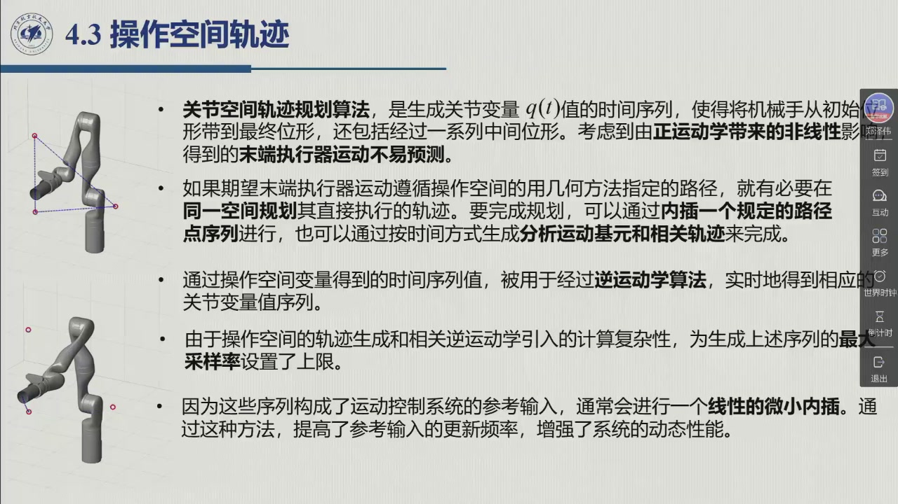
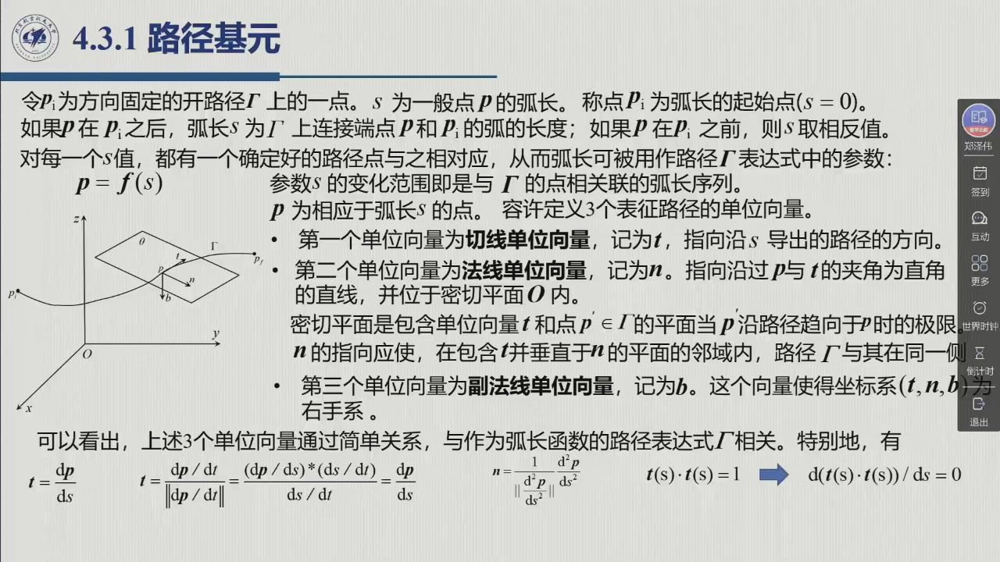
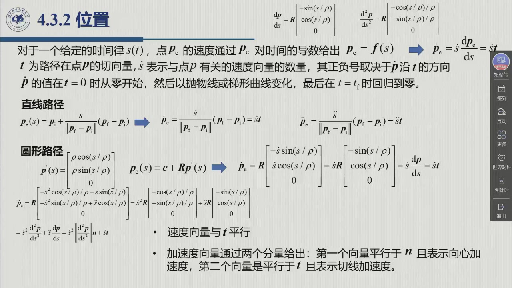

# 4.3.1 路径基元

焊缝或切割任务常规定工具必须沿空间直线或圆弧运动。只给关节空间的起终角做插值，末端经过非线性正运动学后一般走不出要求的直线或圆弧，因此这类路径必须直接在操作空间表示（2:00:00）。本节先把三维路径写成一般参数函数，再统一改用走过的几何弧长作为参数，求出描述局部切向与向心方向的 Frenet 标架，最后写出直线和圆弧的解析表达式，为下一节安排沿路径的时间律做准备。课堂回看：1:57:28–2:14:03。

## 4.3.0 先确定几何，再安排时间

操作空间规划按路径要求有两种方式（教材 §4.3）：

::: method 操作空间轨迹的两种生成方式 {#method-4.3.A}
1. **插值一组位姿路径点**：不要求严格走某条几何曲线时，直接给出 $N$ 个末端位姿点，用 [4.2.2](sec4-2-2.md) 的分段方法连接位置分量，再单独处理姿态（见 [§4.3.3](sec4-3-3.md)）。
2. **路径基元 + 时间律**：要求严格遵循直线、圆弧等解析形状时，先把几何路径写为参数表达式，再在路径上安排一维标量时间律。
:::

在操作空间生成参考后，底层仍须经逆运动学算成关节驱动目标，运算量远大于直接规划关节角。因此规划器的更新采样率有上限，不能设得过高以免算力跟不上（2:00:02）；实际落地时常以较低频率规划操作空间参考，再在送入底层伺服前对相邻参考点做线性微小内插，既省算力又提高控制输入更新率。这种加密插值不增加新几何信息，采用分段线性内插时仍须检查节点处导数跳变是否满足速度与加速度接口限制。

## 4.3.1 一般参数怎样变成弧长

设半径 $\rho=0.5\ \mathrm{m}$ 的圆用转角 $\sigma$（$\mathrm{rad}$）表示为 $f(\sigma)=(\rho\cos\sigma,\rho\sin\sigma,0)^{\mathrm T}$。参数 $\sigma$ 均匀增加 $\Delta\sigma=1\ \mathrm{rad}$ 时，工具实际走过的空间距离是 $\rho\Delta\sigma=0.5\ \mathrm{m}$，一般参数的变化量不直接等于走过的距离。如果换用走过的距离即**弧长** $s$（$\mathrm{m}$）作参数，那么每当 $s$ 增大 $\Delta s$，工具沿路径恰好前进 $\Delta s$ 米，沿路径的速率就是 $|\dot s|$。

::: def 定义 4.3.1 · 路径的参数表示与弧长参数化 {#def-4.3.1}
用连续向量函数 $p=f(\sigma)\in\mathbb R^3$ 表示空间路径，参数 $\sigma\in[\sigma_i,\sigma_f]$ 增大时规定路径的正方向；当 $f(\sigma_f)=f(\sigma_i)$ 时为闭合路径，否则为开路径。

在分段光滑且速度向量 $f'(\sigma)\ne\mathbf 0$ 的区间内，选参考起点 $\sigma_0$，定义**有向弧长**（单位 $\mathrm{m}$）：

$$s(\sigma)=\int_{\sigma_0}^{\sigma}\|f'(u)\|\,\mathrm du.$$

由微积分基本定理得 $\mathrm ds/\mathrm d\sigma=\|f'(\sigma)\|>0$，因此 $s(\sigma)$ 严格单调递增，局部可反解 $\sigma(s)$，从而把同一条几何曲线改写成以弧长 $s$ 为参数的**自然参数化** $p=p(s)$。闭合路径绕行多圈后位置重复，弧长仍可继续累计。
:::

::: thm 定理 4.3.A · Frenet标架 {#thm-4.3.A}
对足够光滑的弧长参数化路径 $p(s)$，取一阶导数得切向单位向量 $t$；在曲率 $\kappa=\|\mathrm d^2p/\mathrm ds^2\|>0$ 处，由二阶导数归一化得主法向 $n$，再叉乘得副法向 $b$：

$$t=\frac{\mathrm dp}{\mathrm ds},\qquad
n=\frac{\mathrm d^2p/\mathrm ds^2}{\|\mathrm d^2p/\mathrm ds^2\|},\qquad
b=t\times n.\tag{4.33}$$

$t,n,b$ 构成随路径点移动的右手正交标架，曲率 $\kappa$ 的单位为 $\mathrm{m}^{-1}$。曲率为零（如直线）时 $\mathrm d^2p/\mathrm ds^2=\mathbf 0$，法向与副法向无法由式 (4.33) 唯一确定。
:::

::: proof 为什么 $t$ 一定是单位向量，且 $n$ 与 $t$ 垂直
由[链式法则](../recall.md#chain-rule)与 $\mathrm ds/\mathrm d\sigma=\|f'(\sigma)\|>0$，

$$t=\frac{\mathrm dp}{\mathrm ds}=\frac{\mathrm dp/\mathrm d\sigma}{\mathrm ds/\mathrm d\sigma}
=\frac{f'(\sigma)}{\|f'(\sigma)\|},$$

因此必有 $\|t\|=1$，即 $t^{\mathrm T}t=1$（2:06:38）。再把恒等式 $t^{\mathrm T}t=1$ 两边对弧长 $s$ 求导，得

$$\frac{\mathrm d}{\mathrm ds}(t^{\mathrm T}t)=2t^{\mathrm T}\frac{\mathrm dt}{\mathrm ds}=0\quad\Longrightarrow\quad t^{\mathrm T}\frac{\mathrm d^2p}{\mathrm ds^2}=0.$$

所以 $\mathrm d^2p/\mathrm ds^2$ 必定正交于切向量 $t$。在 $\mathrm d^2p/\mathrm ds^2\ne\mathbf 0$ 处将其归一化，即得垂直于 $t$ 且指向曲线凹侧（向心加速度方向，2:13:56）的单位主法向 $n$。
:::

这里切向量符号 $t$ 与表示时间的变量同名，使用时由上下文区分：$p(s)$ 的导数是对弧长 $s$，沿路径运动的速度则是 $\dot p=\frac{\mathrm dp}{\mathrm ds}\dot s=\dot s\,t$，速率为 $|\dot s|$。即使机器人停在路径上速率为零，几何切向量 $t=\mathrm dp/\mathrm ds$ 仍由曲线自身定义，无须用 $\dot p/\|\dot p\|$ 除零计算。

### 4.3.1.1 直线路径

::: def 定义 4.3.2 · 直线路径 {#def-4.3.2}
设起点 $p_l$ 与终点 $p_f$ 不重合，线段总长 $L=\|p_f-p_l\|>0$。从 $p_l$ 指向 $p_f$ 的单位方向向量为 $u=(p_f-p_l)/L$，线段按弧长参数化为

$$p(s)=p_l+su=p_l+\frac{s}{\|p_f-p_l\|}(p_f-p_l),\qquad 0\le s\le L.\tag{4.34}$$

其中 $p(0)=p_l$、$p(L)=p_f$。对 $s$ 求一阶与二阶导数：

$$\frac{\mathrm dp}{\mathrm ds}=u,\qquad\frac{\mathrm d^2p}{\mathrm ds^2}=\mathbf 0.\tag{4.35,4.36}$$

直线的单位切向恒为 $u$，曲率处处为零，因此直线没有向心加速度方向（2:10:01），式 (4.33) 无法定义唯一的法向 $n$ 与副法向 $b$；任务若要求沿直线控制工具绕切轴的滚转姿态，必须另外给定参考方向。当 $p_f=p_l$（$L=0$）时路径退化为一个静止点，保持 $p(s)\equiv p_l$ 即可。
:::

### 4.3.1.2 圆形路径

::: def 定义 4.3.3 · 圆形路径 {#def-4.3.3}
如果在经过圆心且与圆所在平面重合的局部坐标系里写圆弧，位置表达式只是平面三角函数 $(\rho\cos\alpha,\rho\sin\alpha,0)^{\mathrm T}$（2:10:32）。因此构造空间圆弧只需两步：先由给定条件算出圆心和半径，建立固定的随体圆平面坐标系；再把圆平面里的表达式通过旋转矩阵 $R$ 变回基坐标系。

给定基坐标系下的三个几何量：圆轴单位方向 $r$、圆轴上任意一点 $d$，以及圆弧起点 $p_l$。令 $\delta=p_l-d$；因为圆轴过点 $d$ 沿单位方向 $r$，把 $\delta$ 沿 $r$ 正交投影，就得到过 $p_l$ 且垂直于圆轴的垂足，也就是圆心：

$$c=d+(\delta^{\mathrm T}r)r.\tag{4.37}$$

验证 $(p_l-c)^{\mathrm T}r=(\delta-(\delta^{\mathrm T}r)r)^{\mathrm T}r=\delta^{\mathrm T}r-(\delta^{\mathrm T}r)(r^{\mathrm T}r)=0$，可见向量 $p_l-c$ 确实垂直于圆轴，其长度就是圆半径 $\rho=\|p_l-c\|$。由勾股定理得 $\rho^2=\|\delta\|^2-(\delta^{\mathrm T}r)^2$；只要起点 $p_l$ 不落在圆轴上，即 $|\delta^{\mathrm T}r|<\|\delta\|$，就有 $\rho>0$（不退化为一点）。

以圆心 $c$ 为原点建立固定随体坐标系 $o'\!-\!x'y'z'$：

$$x'=\frac{p_l-c}{\rho},\qquad z'=r,\qquad y'=z'\times x',\qquad R=[\,x'\ y'\ z'\,].$$

其中旋转矩阵 $R$ 的三列是随体坐标轴在基坐标系中的单位方向表示（按[§2.2.2](../ch02/sec2-2.md)约定，左乘 $R$ 即把局部坐标换算到基坐标系）。从起点 $p_l$（即 $s=0$）沿右手正方向绕 $z'$ 轴转过圆心角 $\alpha=s/\rho$，圆平面内坐标 $p'(s)$ 与基坐标系坐标 $p(s)$ 分别为

$$p'(s)=\begin{bmatrix}\rho\cos(s/\rho)\\\rho\sin(s/\rho)\\0\end{bmatrix},\qquad
p(s)=c+Rp'(s).\tag{4.38,4.39}$$

整条圆弧上圆心 $c$ 与随体旋转矩阵 $R$ 都是常值，随路径点旋转的是 Frenet 标架。
:::

因为 $c$ 和 $R$ 不随弧长 $s$ 变化，对式 (4.39) 求弧长导数时只需对 $p'(s)$ 求导；$s/\rho$ 的导数 $1/\rho$ 先与外面的 $\rho$ 抵消一次，求二阶导数时再出现一次 $1/\rho$：

$$\frac{\mathrm dp}{\mathrm ds}=R\begin{bmatrix}-\sin(s/\rho)\\\cos(s/\rho)\\0\end{bmatrix},\qquad
\frac{\mathrm d^2p}{\mathrm ds^2}=R\begin{bmatrix}-\cos(s/\rho)/\rho\\-\sin(s/\rho)/\rho\\0\end{bmatrix}.\tag{4.40,4.41}$$

因为 $R$ 正交，$\|\mathrm dp/\mathrm ds\|=\sqrt{\sin^2(s/\rho)+\cos^2(s/\rho)}=1$，确为单位切向；二阶导数恰为 $-R[\cos(s/\rho),\sin(s/\rho),0]^{\mathrm T}/\rho=-\frac{1}{\rho}\frac{p(s)-c}{\rho}$，模为曲率 $1/\rho$、方向始终指向圆心 $c$，归一化后就是单位法向 $n$。
<figure>
<svg class="figure-svg" viewBox="0 0 920 420" xmlns="http://www.w3.org/2000/svg" role="img" aria-labelledby="fig-431-t fig-431-d">
<title id="fig-431-t">Frenet 标架与圆弧的三要素</title>
<desc id="fig-431-d">左图：一条空间曲线，切向 t 沿路径方向、法向 n 指向凹侧（向心加速度方向）、副法向 b = t × n 构成右手系。右图：圆弧由轴向量 r、轴上点 d、圆上点 p_l 定义，δ = p_l − d，圆心 c = d + (δ^T r)r，半径 ρ = |p_l − c|；随体坐标系的 z′ 沿 r、x′ 沿 p_l − c。</desc>
<defs>
<marker id="f431-m" markerWidth="9" markerHeight="9" refX="7" refY="3" orient="auto"><path d="M0,0 L7,3 L0,6 Z" fill="var(--muted)"/></marker>
<marker id="f431-b" markerWidth="8" markerHeight="8" refX="6" refY="2.5" orient="auto"><path d="M0,0 L6,2.5 L0,5 Z" fill="var(--fig-blue)"/></marker>
<marker id="f431-g" markerWidth="8" markerHeight="8" refX="6" refY="2.5" orient="auto"><path d="M0,0 L6,2.5 L0,5 Z" fill="var(--fig-green)"/></marker>
<marker id="f431-o" markerWidth="8" markerHeight="8" refX="6" refY="2.5" orient="auto"><path d="M0,0 L6,2.5 L0,5 Z" fill="var(--fig-gold)"/></marker>
</defs>
<text class="diagram-text" x="230" y="30" text-anchor="middle">Frenet 标架（任意曲线）</text>
<path d="M70 300 C 150 180, 250 330, 380 190" fill="none" stroke="var(--line-strong)" stroke-width="2.4"/>
<circle cx="250" cy="272" r="4.5" fill="var(--accent)"/>
<line x1="250" y1="272" x2="352" y2="236" stroke="var(--fig-blue)" stroke-width="2.4" marker-end="url(#f431-b)"/>
<line x1="250" y1="272" x2="266" y2="188" stroke="var(--fig-green)" stroke-width="2.4" marker-end="url(#f431-g)"/>
<line x1="250" y1="272" x2="188" y2="230" stroke="var(--fig-gold)" stroke-width="2.4" marker-end="url(#f431-o)"/>
<text class="diagram-text" fill="var(--fig-blue)" x="360" y="232">$t=\mathrm dp/\mathrm ds$</text>
<text class="diagram-text" fill="var(--fig-green)" x="274" y="182">$n$（指向凹侧 = 向心加速度方向）</text>
<text class="diagram-text" fill="var(--fig-gold)" x="150" y="226">$b=t\times n$</text>
<text class="diagram-note" x="230" y="356" text-anchor="middle">$(t,n,b)$ 右手系：随曲线走的局部坐标架</text>
<text class="diagram-note" x="230" y="382" text-anchor="middle">直线退化：$\mathrm d^2p/\mathrm ds^2=0$ ⇒ $n$ 无法定义</text>
<!-- circle -->
<text class="diagram-text" x="690" y="30" text-anchor="middle">圆弧三要素与随体坐标系</text>
<ellipse cx="690" cy="240" rx="150" ry="86" fill="none" stroke="var(--line-strong)" stroke-width="2.2"/>
<circle cx="690" cy="240" r="4" fill="var(--accent)"/>
<line x1="690" y1="240" x2="840" y2="240" stroke="var(--line)" stroke-width="1.4"/>
<line x1="690" y1="240" x2="840" y2="240" stroke="var(--line-strong)" stroke-width="2.2" marker-end="url(#f431-m)"/>
<text class="diagram-text" x="852" y="244">$x'$</text>
<line x1="690" y1="240" x2="690" y2="140" stroke="var(--line-strong)" stroke-width="2.2" marker-end="url(#f431-m)"/>
<text class="diagram-text" x="700" y="132">$z'$（沿 $r$）</text>
<circle cx="840" cy="240" r="4.5" fill="var(--accent)"/>
<text class="diagram-text" x="852" y="266">$p_l$</text>
<circle cx="690" cy="154" r="4" fill="var(--accent)"/>
<text class="diagram-text" x="700" y="166">$d$（轴上点）</text>
<text class="diagram-note" x="690" y="200" text-anchor="middle">圆心 $c$</text>
<line x1="690" y1="240" x2="690" y2="154" stroke="var(--line)" stroke-width="1.2" stroke-dasharray="5 4"/>
<text class="diagram-note" x="742" y="196">$\delta=p_l-d$</text>
<text class="diagram-note" x="752" y="322">$\rho=\|p_l-c\|$</text>
<line x1="690" y1="240" x2="833" y2="219" stroke="var(--line)" stroke-width="1.2" stroke-dasharray="5 4"/>
<text class="diagram-text" x="690" y="392" text-anchor="middle">$c=d+(\delta^{\mathrm T}r)\,r$，$\ |\delta^{\mathrm T}r|<\| \delta\|$</text>
</svg>
<figcaption>左图的Frenet标架随路径点变化，需曲率非零才能确定法向；右图先把起点投影到圆轴上求圆心，再建立固定的圆平面坐标系。</figcaption>
</figure>

### 跟算：圆心不一定就是给定的轴上点

取轴上点 $d=(0,0,1)\ \mathrm{m}$、圆轴方向 $r=(0,0,1)$、圆上起点 $p_l=(2,0,3)\ \mathrm{m}$。先算 $\delta=p_l-d=(2,0,2)\ \mathrm{m}$，投影 $\delta^{\mathrm T}r=2\ \mathrm{m}$；检验 $|\delta^{\mathrm T}r|=2<\|\delta\|=\sqrt8\ \mathrm{m}$，圆不退化。由此得到圆心与半径：

$$c=(0,0,1)+2\,(0,0,1)=(0,0,3)\ \mathrm{m},\qquad
\rho=\|p_l-c\|=\|(2,0,0)\|=2\ \mathrm{m}.$$

进一步得 $x'=(1,0,0)^{\mathrm T}$、$z'=(0,0,1)^{\mathrm T}$、$y'=z'\times x'=(0,1,0)^{\mathrm T}$，故此例恰好有 $R=I$。走过弧长 $s=\pi\ \mathrm{m}$ 时，转角 $s/\rho=\pi/2\ \mathrm{rad}$，代回 (4.39)–(4.41) 得：位置 $p(\pi)=(0,2,3)\ \mathrm{m}$，单位切向 $t=(-1,0,0)^{\mathrm T}$，二阶弧长导数 $\mathrm d^2p/\mathrm ds^2=(0,-1/2,0)^{\mathrm T}\ \mathrm{m^{-1}}$（指向圆心，模等于曲率 $1/2\ \mathrm{m^{-1}}$），归一化后的单位法向 $n=(0,-1,0)^{\mathrm T}$。

::: think 默写点 · 合上书再写（主动回忆）

不看正文，先自己写出下面三条，再展开核对。

1. 写出 Frenet 标架三个单位向量与弧长 $s$ 的关系 (4.33)，并说明 $n$ 的几何含义。
2. 写出直线路径的 $p(s)$ 与 $\mathrm d^2p/\mathrm ds^2$；直线为什么不能唯一定义 $(t,n,b)$？
3. 写出圆心投影公式 $c=d+(\delta^{\mathrm T}r)r$ 与不退化条件。

::: sol 核对

$t=\mathrm dp/\mathrm ds$，$n=\dfrac{\mathrm d^2p/\mathrm ds^2}{\|\mathrm d^2p/\mathrm ds^2\|}$，$b=t\times n$。$n$ 指向曲线凹侧，即向心加速度方向（由 $t^{\mathrm T}t=1$ 求导即得 $\mathrm d^2p/\mathrm ds^2\perp t$）。

$p(s)=p_l+\dfrac{s}{\|p_f-p_l\|}(p_f-p_l)$，$\dfrac{\mathrm d^2p}{\mathrm ds^2}=\mathbf 0$。二阶导数为零导致法向无定义，因此 $(t,n,b)$ 不唯一。

$c=d+(\delta^{\mathrm T}r)r$（$\delta=p_l-d$），不退化条件为 $|\delta^{\mathrm T}r|<\|\delta\|$（否则起点在圆轴上，$\rho=0$）。

:::
:::

## 4.3.1 小结与常见错误

在操作空间规划精确路径时，先把曲线用走过的弧长 $s$ 参数化，切向量 $t=\mathrm dp/\mathrm ds$ 自动为单位向量，曲率非零处二阶导数给出指向凹侧的主法向 $n$。直线切向恒定而曲率为零，Frenet 标架退化；圆弧则先用投影公式 $c=d+(\delta^{\mathrm T}r)r$ 定出圆心和随体坐标阵 $R$，再把平面三角函数表达式变回基坐标系。下一节为这里的 $s$ 配上时间律 $s(t)$，求出末端位置的速度与加速度。

::: think 常见错误清单 · 自查三条
1. **把一般参数 $\sigma$ 当成弧长**：一般参数下 $\|f'(\sigma)\|\ne1$，切向必须除以 $\|f'(\sigma)\|$；只有弧长参数化才直接有 $t=\mathrm dp/\mathrm ds$。
2. **跳过圆的退化检查**：使用圆心公式前必须核对 $|\delta^{\mathrm T}r|<\|\delta\|$，否则 $\rho=0$ 无法构造 $x'$。
3. **把 $R$ 的列与行写反**：随体坐标系三轴在基系中的列向量构成 $R=[\,x'\ y'\ z'\,]$，这样 $c+Rp'(s)$ 才是基系位置。
:::
