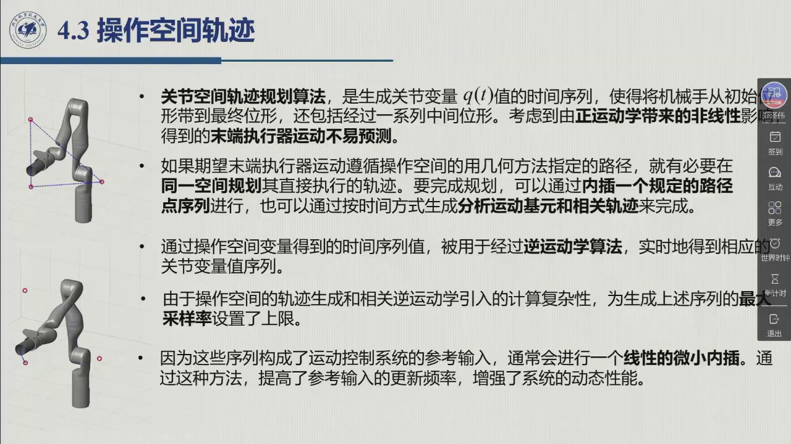
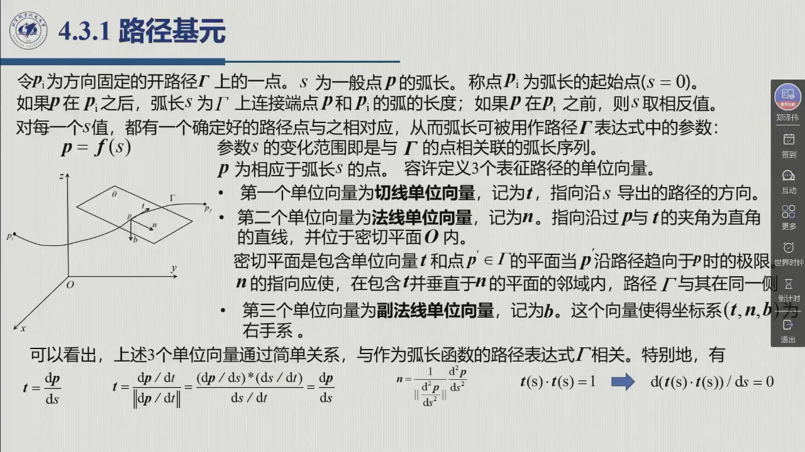
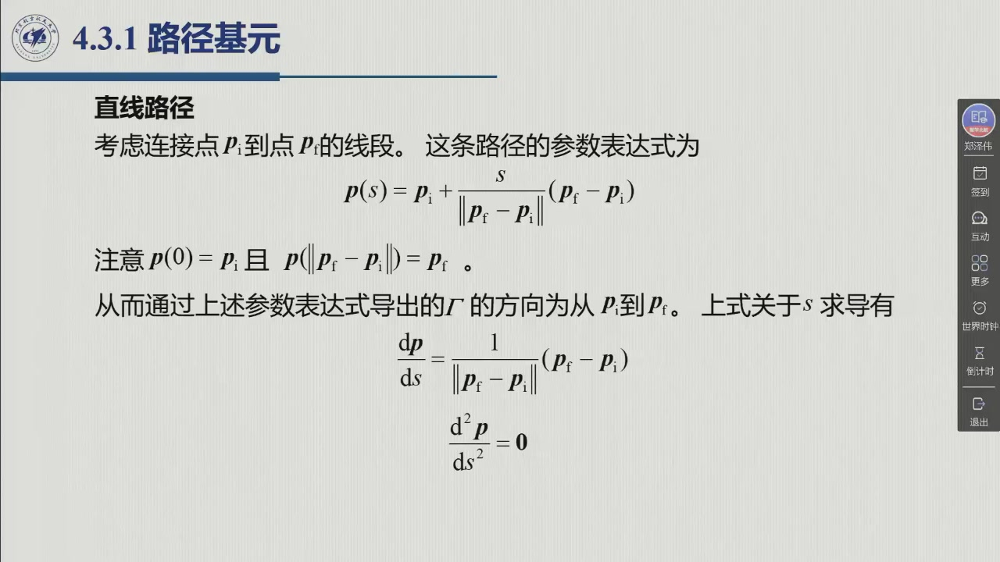
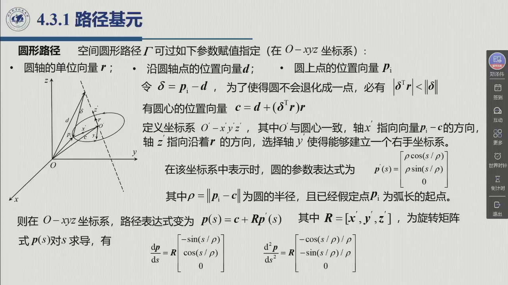

# 4.3.1 路径基元

关节空间的算法回答的是「关节怎么动」；从这一节开始，问题换成操作空间的问法：「**末端要沿一条给定的几何曲线走**」。几何曲线得先能被解析地写出来——这类基本曲线就是路径基元。本节先把任意路径参数化（参数 $\sigma$ 与弧长 $s$），再引入随曲线走的三个单位向量（切向 / 法向 / 副法向），最后落实到两种最常用的基元：直线与圆弧。录播 1:57:28–2:14:03。

<aside class="lesson-brief" aria-label="4.3.1 学习简报">

PREREQUISITE<strong>你需要先会</strong>
齐次变换与旋转矩阵 $T=[R\ P;0\ 1]$（[@def-2.7.1]）；旋转矩阵的列 = 坐标轴的单位向量（[@def-2.2.2]）；向量求导与复合函数求导。

TARGET<strong>本节要建立</strong>
操作空间规划的两种方式；路径的参数表示 $p=f(\sigma)$ 与弧长参数化 $p=f(s)$；Frenet 标架 $(t,n,b)$ 及其与 $s$ 的关系 (4.33)；直线路径 (4.34)–(4.36) 与圆弧路径 (4.37)–(4.41) 的完整推导。

CHECKPOINT<strong>学完的标准</strong>
能说出为什么圆弧要在「随体坐标系」里写方程最简单；能独立推出圆心公式 $c=d+(\delta^{\mathrm T}r)r$；能默写直线与圆弧的 $dp/ds$、$d^2p/ds^2$，并指出圆弧法向向量指向圆心。

</aside>

## 4.3.0 为什么要在操作空间里规划

关节空间的轨迹规划算法生成 $q(t)$ 的时间序列，把机械手从初始位形带到最终位形（沿途经过一系列中间位形）。但**正运动学是非线性的**，末端执行器的运动**不易预测**（2:00:00）。所以，如果希望末端遵循在操作空间中用几何方法指定的路径，就必须**在同一空间**中规划：

::: method 操作空间轨迹的两种生成方式（教材 §4.3） {#method-4.3.A}
1. **内插一个规定的路径点序列**：不需要精确遵循路径时，只需指定 $N$ 个点 $x_k$（$x_e$ 是六维量：3 位置 + 3 姿态），点与点之间用光滑内插函数过渡（把 [4.2.2](sec4-2-2.md) 的方法逐分量套用）；
2. **按时间生成分析运动基元**：需要精确遵循路径时，则要把路径**解析地**表示出来，并分别定义**运动基元**（表达路径的几何特性）与**时间基元**（表达路径自身的时间律）。
:::

**落地时还有两个工程要点**（2:00:00、教材 §4.3）：

- **采样率上限**：操作空间的轨迹生成与逆运动学计算叠加在一起，运算量非常大，因此要给生成序列的**最大采样率**设一个上限——采样率不能太大，否则「太大的话计算就计算不过来了」；
- **线性微小内插**：实际做法是：规划时采样率不高，但把它输入底层伺服控制系统时先做一次**线性微小内插**——在相邻两点之间再插一个点。这样**提高了参考输入的更新频率**，「对于增强系统的动态性能是有关键的」。

## 4.3.1 路径的参数表示与弧长

::: def 定义 4.3.1 · 路径的参数表示与弧长参数化 {#def-4.3.1}
令 $p$ 为 $(3\times1)$ 向量，$f(\sigma)$ 为定义在区间 $[\sigma_i,\sigma_f]$ 上的连续向量函数。考虑方程

$$p=f(\sigma). \tag{4.31}$$

随着 $\sigma$ 在区间上变化，$p$ 的取值序列称为**空间路径**，$\sigma$ 称为**参数**。$\sigma$ 增大时，$p$ 沿给定方向在路径上移动，该方向称为由 (4.31) 导出的路径方向。若终点与起点重合，即 $p(\sigma_f)=p(\sigma_i)$，路径是**闭的**；否则是**开的**。

**弧长参数化**：令 $p_l$ 为方向固定的开路径 $\Gamma$ 上的一点，$s$ 为一般点 $p$ 的**弧长**。若 $p$ 在 $p_l$ 之后，$s$ 为 $\Gamma$ 上连接 $p$ 与 $p_l$ 的弧的长度；若 $p$ 在 $p_l$ 之前，$s$ 取相反值。$p_l$ 称为弧长的起点（$s=0$）。于是每个 $s$ 都对应着唯一的路径点，弧长也就可以充当路径的参数：

$$p=f(s). \tag{4.32}$$

一般路径用参数 $\sigma$ 表示即可；**弧长 $s$ 则是更「自然」的参数**——它把参数增量与几何长度绑在一起，后面规划时间律 $s(t)$ 时正要以它为落脚点。
:::

::: thm 定理 4.3.A · Frenet 标架：三个单位向量与弧长的关系 {#thm-4.3.A}
除特殊情形外，路径上相应于弧长 $s$ 的点 $p$ 处，可以定义 3 个表征路径的**单位向量**：它们所在的直线只由路径几何决定，而向量的正负指向还取决于路径方向：

- **切线单位向量** $t$：指向沿 $s$ 导出的路径方向；
- **法线单位向量** $n$：沿过 $p$ 且与 $t$ 垂直的直线，位于**密切平面**（$p'\to p$ 时包含 $t$ 与 $p'$ 的平面所趋于的极限平面）内；它的正负指向由「使路径 $\Gamma$ 位于 $n$ 的同一侧」确定；
- **副法线单位向量** $b$：与前两者一起使 $(t,n,b)$ 构成右手系。

三者与路径表达式之间有如下简单关系：

$$t=\frac{\mathrm dp}{\mathrm ds},\qquad
n=\frac{\dfrac{\mathrm d^2p}{\mathrm ds^2}}{\left\|\dfrac{\mathrm d^2p}{\mathrm ds^2}\right\|},\qquad
b=t\times n. \tag{4.33}$$
:::

::: proof 证明的两个关键落点（老师课堂口述，2:06:38–2:08:08）
**① $t=\mathrm dp/\mathrm ds$ 为什么是切向单位向量。** 从物理直觉迁移过来：速度方向的单位向量就是「速度除以速度的模长」，

$$\frac{\dot p}{\|\dot p\|}=\frac{\dfrac{\mathrm dp}{\mathrm ds}\dot s}{\left\|\dfrac{\mathrm dp}{\mathrm ds}\right\|\,\dot s}=\frac{\mathrm dp/\mathrm ds}{\|\mathrm dp/\mathrm ds\|},$$

而 $\mathrm ds/\mathrm dt=\dot s$ 只是一个标量，可以约掉——于是 $\mathrm dp/\mathrm ds$ 本身就是单位向量（弧长参数化下切向量自动归一），方向也与速度一致。

**② $n$ 为什么是 $\mathrm d^2p/\mathrm ds^2$ 的方向。** $t$ 是单位向量，故 $t^{\mathrm T}t=1$；两边对 $s$ 求导，得 $t^{\mathrm T}\dfrac{\mathrm dt}{\mathrm ds}=0$——这说明 $\dfrac{\mathrm dt}{\mathrm ds}=\dfrac{\mathrm d^2p}{\mathrm ds^2}$ 与 $t$ **正交**。于是取它的方向、再除以自身的模长，就得到单位向量 $n$。**几何含义**：$n$ 指向曲线凹侧，也就是**向心加速度的方向**（2:14:00）。
:::

### 4.3.1.1 直线路径

::: def 定义 4.3.2 · 直线路径 {#def-4.3.2}
考虑连接 $p_l$ 与 $p_f$ 的线段，路径的参数表达式为

$$p(s)=p_l+\frac{s}{\|p_f-p_l\|}\,(p_f-p_l). \tag{4.34}$$

注意 $p(0)=p_l$、$p(\|p_f-p_l\|)=p_f$，可见由 (4.34) 导出的路径方向正是从 $p_l$ 指向 $p_f$。对 $s$ 求导：

$$\frac{\mathrm dp}{\mathrm ds}=\frac{1}{\|p_f-p_l\|}(p_f-p_l), \tag{4.35}$$

$$\frac{\mathrm d^2p}{\mathrm ds^2}=\mathbf 0. \tag{4.36}$$

**退化提示**：二阶导数为零，法线方向便无从定义——**直线路径上不能唯一地定义坐标系 $(t,n,b)$**（2:10:01）。这不是推导出了错，而是直线作为路径基元的固有性质。
:::

### 4.3.1.2 圆形路径

圆比直线复杂，但有一条捷径：「如果在经过它自己圆心、然后有一个面跟圆弧面重合的坐标系里表示，这个角是非常简单的」——这用的其实就是初中平面几何的知识（2:10:32）。

::: def 定义 4.3.3 · 圆形路径 {#def-4.3.3}
**参数**：圆轴的单位向量 $r$、圆轴上一点的位置向量 $d$、圆上一点的位置向量 $p_l$（图 4.12）。令

$$\delta=p_l-d .$$

为使 $p_l$ 不在轴上（即圆不退化成一点），必有

$$|\delta^{\mathrm T}r|<\| \delta\| .$$

在此情形下，**圆心的位置向量**为

$$c=d+(\delta^{\mathrm T}r)\,r . \tag{4.37}$$

**随体坐标系** $o'\!-\!x'y'z'$：原点 $o'$ 与圆心重合；轴 $z'$ 沿 $r$ 方向；轴 $x'$ 沿向量 $p_l-c$ 的方向；轴 $y'$ 按右手系选取。在参考坐标系中，圆的参数表达式为

$$p'(s)=\begin{bmatrix}\rho\cos(s/\rho)\\ \rho\sin(s/\rho)\\ 0\end{bmatrix},\qquad \rho=\|p_l-c\| \tag{4.38}$$

（已假定 $p_l$ 为弧长的起点）。换到一般参考坐标系 $o\!-\!xyz$：

$$p(s)=c+R\,p'(s),\qquad R=[\,x'\ \ y'\ \ z'\,] \tag{4.39}$$

其中 $R$ 为坐标系 $o'\!-\!x'y'z'$ 相对 $o\!-\!xyz$ 的旋转矩阵（其列为各轴单位向量在 $o\!-\!xyz$ 中的表示）。对 $s$ 求导：

$$\frac{\mathrm dp}{\mathrm ds}=R\begin{bmatrix}-\sin(s/\rho)\\ \ \ \cos(s/\rho)\\ 0\end{bmatrix},\qquad
\frac{\mathrm d^2p}{\mathrm ds^2}=R\begin{bmatrix}-\cos(s/\rho)/\rho\\ -\sin(s/\rho)/\rho\\ 0\end{bmatrix}. \tag{4.40,4.41}$$
:::

<figure>
<svg class="figure-svg" viewBox="0 0 920 420" xmlns="http://www.w3.org/2000/svg" role="img" aria-labelledby="fig-431-t fig-431-d">
<title id="fig-431-t">Frenet 标架与圆弧的三要素</title>
<desc id="fig-431-d">左图：一条空间曲线，切向 t 沿路径方向、法向 n 指向凹侧（向心加速度方向）、副法向 b = t × n 构成右手系。右图：圆弧由轴向量 r、轴上点 d、圆上点 p_l 定义，δ = p_l − d，圆心 c = d + (δ^T r)r，半径 ρ = |p_l − c|；随体坐标系的 z′ 沿 r、x′ 沿 p_l − c。</desc>
<defs>
<marker id="f431-m" markerWidth="9" markerHeight="9" refX="7" refY="3" orient="auto"><path d="M0,0 L7,3 L0,6 Z" fill="var(--muted)"/></marker>
<marker id="f431-b" markerWidth="8" markerHeight="8" refX="6" refY="2.5" orient="auto"><path d="M0,0 L6,2.5 L0,5 Z" fill="var(--fig-blue)"/></marker>
<marker id="f431-g" markerWidth="8" markerHeight="8" refX="6" refY="2.5" orient="auto"><path d="M0,0 L6,2.5 L0,5 Z" fill="var(--fig-green)"/></marker>
<marker id="f431-o" markerWidth="8" markerHeight="8" refX="6" refY="2.5" orient="auto"><path d="M0,0 L6,2.5 L0,5 Z" fill="var(--fig-gold)"/></marker>
</defs>
<text class="diagram-text" x="230" y="30" text-anchor="middle">Frenet 标架（任意曲线）</text>
<path d="M70 300 C 150 180, 250 330, 380 190" fill="none" stroke="var(--line-strong)" stroke-width="2.4"/>
<circle cx="250" cy="272" r="4.5" fill="var(--accent)"/>
<line x1="250" y1="272" x2="352" y2="236" stroke="var(--fig-blue)" stroke-width="2.4" marker-end="url(#f431-b)"/>
<line x1="250" y1="272" x2="266" y2="188" stroke="var(--fig-green)" stroke-width="2.4" marker-end="url(#f431-g)"/>
<line x1="250" y1="272" x2="188" y2="230" stroke="var(--fig-gold)" stroke-width="2.4" marker-end="url(#f431-o)"/>
<text class="diagram-text" fill="var(--fig-blue)" x="360" y="232">$t=\mathrm dp/\mathrm ds$</text>
<text class="diagram-text" fill="var(--fig-green)" x="274" y="182">$n$（指向凹侧 = 向心加速度方向）</text>
<text class="diagram-text" fill="var(--fig-gold)" x="150" y="226">$b=t\times n$</text>
<text class="diagram-note" x="230" y="356" text-anchor="middle">$(t,n,b)$ 右手系：随曲线走的局部坐标架</text>
<text class="diagram-note" x="230" y="382" text-anchor="middle">直线退化：$\mathrm d^2p/\mathrm ds^2=0$ ⇒ $n$ 无法定义</text>
<!-- circle -->
<text class="diagram-text" x="690" y="30" text-anchor="middle">圆弧三要素与随体坐标系</text>
<ellipse cx="690" cy="240" rx="150" ry="86" fill="none" stroke="var(--line-strong)" stroke-width="2.2"/>
<circle cx="690" cy="240" r="4" fill="var(--accent)"/>
<line x1="690" y1="240" x2="840" y2="240" stroke="var(--line)" stroke-width="1.4"/>
<line x1="690" y1="240" x2="840" y2="240" stroke="var(--line-strong)" stroke-width="2.2" marker-end="url(#f431-m)"/>
<text class="diagram-text" x="852" y="244">$x'$</text>
<line x1="690" y1="240" x2="690" y2="140" stroke="var(--line-strong)" stroke-width="2.2" marker-end="url(#f431-m)"/>
<text class="diagram-text" x="700" y="132">$z'$（沿 $r$）</text>
<circle cx="840" cy="240" r="4.5" fill="var(--accent)"/>
<text class="diagram-text" x="852" y="266">$p_l$</text>
<circle cx="690" cy="154" r="4" fill="var(--accent)"/>
<text class="diagram-text" x="700" y="166">$d$（轴上点）</text>
<text class="diagram-note" x="690" y="200" text-anchor="middle">圆心 $c$</text>
<line x1="690" y1="240" x2="690" y2="154" stroke="var(--line)" stroke-width="1.2" stroke-dasharray="5 4"/>
<text class="diagram-note" x="742" y="196">$\delta=p_l-d$</text>
<text class="diagram-note" x="752" y="322">$\rho=\|p_l-c\|$</text>
<line x1="690" y1="240" x2="833" y2="219" stroke="var(--line)" stroke-width="1.2" stroke-dasharray="5 4"/>
<text class="diagram-text" x="690" y="392" text-anchor="middle">$c=d+(\delta^{\mathrm T}r)\,r$，$\ |\delta^{\mathrm T}r|<\| \delta\|$</text>
</svg>
<figcaption>Frenet 标架与圆弧三要素（本教程绘）：左图的 $t,n,b$ 是后面所有操作空间轨迹的局部坐标架；右图的 $c=d+(\delta^{\mathrm T}r)r$ 把「圆心在哪」变成一次投影——圆心就是轴上点 $d$ 沿轴方向「挪」到与 $p_l$ 垂直的位置。</figcaption>
</figure>

::: think 考点 · 老师原话（录播时间点）

> **圆弧要在随体坐标系里写。** 「我们表示这个圆弧，如果在经过它自己圆心、然后有一个面跟圆弧面重合的坐标系里表示这个角是非常简单的——这是咱们初中平面几何就知道的知识」（2:10:32）。**考试/作业里推圆弧轨迹，第一步就是把随体坐标系建出来。**

> **法向向量就是向心加速度方向。** 「二阶对 $s$ 求二阶导数，就是法向单位向量，或者是**向心加速度的方向**，它一定是沿着半径的一条线」（2:13:56）。

> **直线是退化情形。** 「因为法线方向的向量是零，证明这个直线它是没有向心加速度的方向……这种情况下就**不能唯一地来定义这个坐标系**」（2:10:01）。

> **采样率与线性内插。** 「实际应用过程中有一个最大采样率的限制……输入给底层伺服控制系统的时候，我们可以进行一个**微小的线性内插**，相当于提高了底层控制参考输入的更新频率，这对于增强系统的动态性能是有关键的」（2:00:02）。
:::

::: think 默写点 · 合上书再写（主动回忆）

先不翻正文与速查表，凭记忆写出下面几条，再展开核对。写不出来，就说明这一节还没真正「拿走」。

1. 写出 Frenet 标架三个单位向量与 $s$ 的关系 (4.33)，并说明 $n$ 的几何含义。
2. 写出直线路径的 $p(s)$ 与 $d^2p/ds^2$；直线为什么不能唯一定义 $(t,n,b)$？
3. 写出圆心公式 $c=d+(\delta^{\mathrm T}r)r$ 与退化条件。

::: sol 核对

$t=\mathrm dp/\mathrm ds$；$n=\dfrac{\mathrm d^2p/\mathrm ds^2}{\|\mathrm d^2p/\mathrm ds^2\|}$；$b=t\times n$。$n$ 指向曲线凹侧，即**向心加速度方向**（$t^{\mathrm T}t=1$ 求导 ⇒ $\mathrm d^2p/\mathrm ds^2\perp t$）。

$p(s)=p_l+\dfrac{s}{\|p_f-p_l\|}(p_f-p_l)$；$\dfrac{\mathrm d^2p}{\mathrm ds^2}=\mathbf 0$。二阶导为零 ⇒ 法线方向无定义 ⇒ 坐标系 $(t,n,b)$ 不唯一。

$c=d+(\delta^{\mathrm T}r)r$，其中 $\delta=p_l-d$；退化条件 $|\delta^{\mathrm T}r|<\| \delta\|$（否则 $p_l$ 落在轴上，圆退化为一点）。

:::

:::

## 4.3.1 小结与常见错误

- **一条主线**：操作空间规划要先有**解析路径**（[@method-4.3.A] 的两条生成方式）⇒ 路径参数化（$\sigma$ 或弧长 $s$）⇒ Frenet 标架 $(t,n,b)$ ⇒ 两种最常用基元：直线（退化、无 $n$）与圆弧（随体坐标系 + 圆心投影公式）。
- **一个技巧**：圆弧的圆心 = 轴上点沿轴方向投影到过 $p_l$ 的垂面——$c=d+(\delta^{\mathrm T}r)r$。
- **一句话**：「一般路径用参数 $\sigma$ 就够了；一旦要规划时间律，就换到弧长 $s$——因为 $s$ 的增量就是走过的几何长度。」

::: think 常见错误清单 · 自查三条
1. **把参数 $\sigma$ 当弧长**：一般参数下 $\|\mathrm dp/\mathrm d\sigma\|\ne1$，$t$ 必须再归一化；只有弧长参数化才有 $t=\mathrm dp/\mathrm ds$。
2. **忘了退化条件**：算圆弧前先检查 $|\delta^{\mathrm T}r|<\| \delta\|$，否则圆心公式给出的「圆」是一个点。
3. **$R$ 的列写错**：$R=[x'\ y'\ z']$ 是**随体坐标系三轴在基系中的表示**，不是把基系轴写进随体系——[2.2.2](../ch02/sec2-2.md) 的上下标约定在这里最容易翻车。
:::
