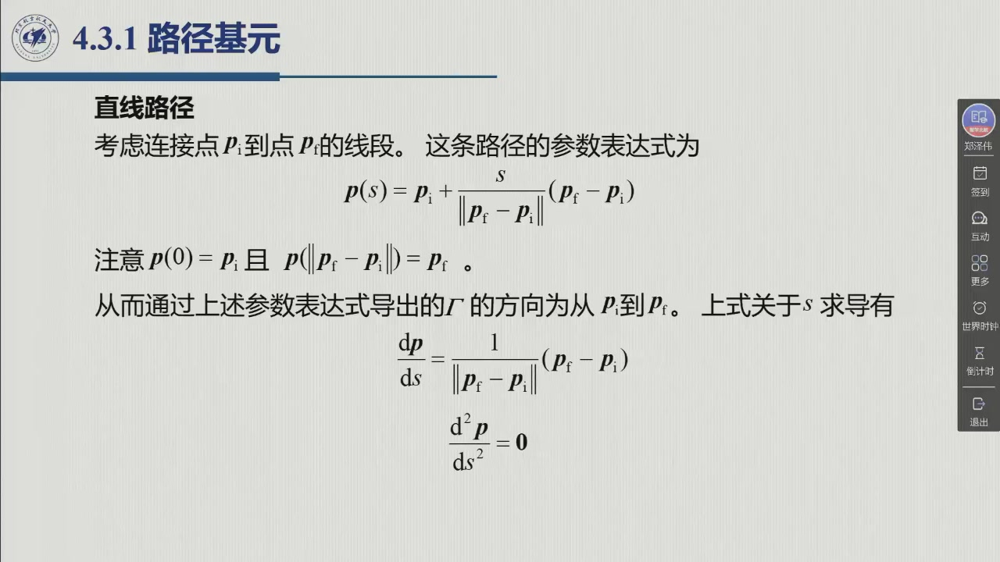
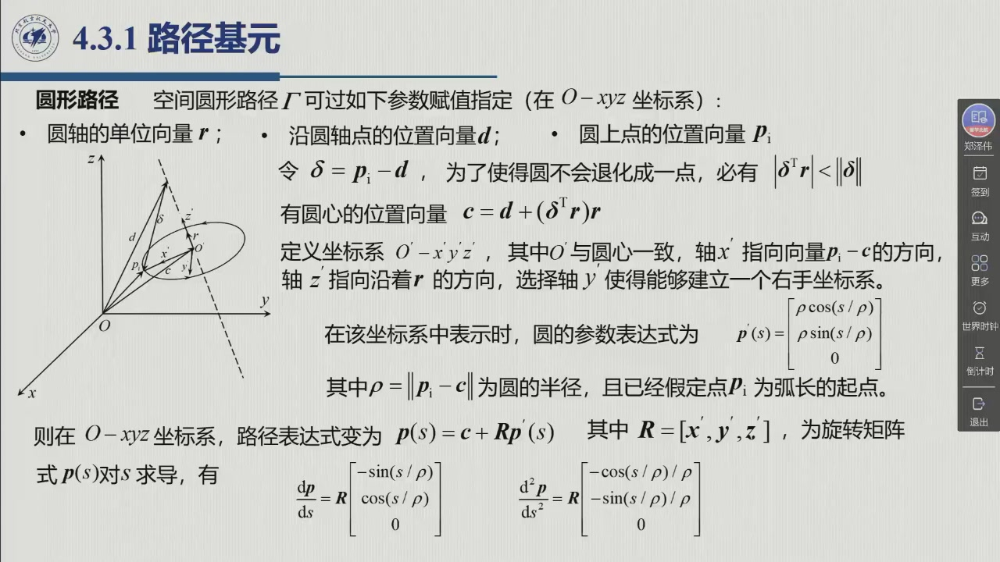

# 4.3.1 路径基元

上一节安排各关节随时间的运动；本节换一个任务：让末端沿指定的直线或圆弧移动。先描述末端经过的几何路径，再在 [4.3.2](sec4-3-2.md) 安排它什么时候到达路径上的各点。为此需要一个表示路径上位置的参数，以及描述方向的切向和法向。录播 1:57:28–2:14:03。

## 4.3.0 为什么要在操作空间里规划

关节空间规划先生成各关节的 $q(t)$，再由正运动学算出末端的位置。由于正运动学通常是非线性的，即使关节轨迹简单，末端经过的路径也不一定是期望的直线或圆弧（2:00:00）。如果任务指定了末端路径，可以先在操作空间描述它，再求相应的关节运动：

::: method 操作空间轨迹的两种生成方式（教材 §4.3） {#method-4.3.A}
1. **内插一个规定的路径点序列**：不需要精确遵循路径时，只需指定 $N$ 个点 $x_k$（$x_e$ 是六维量：3 位置 + 3 姿态），点与点之间用光滑内插函数过渡（把 [4.2.2](sec4-2-2.md) 的方法逐分量套用）；
2. **按时间生成分析运动基元**：需要精确遵循路径时，则要把路径**解析地**表示出来，并分别定义**运动基元**（表达路径的几何特性）与**时间基元**（表达路径自身的时间律）。
:::

**落地时还有两个工程要点**（2:00:00、教材 §4.3）：

- **采样率上限**：操作空间的轨迹生成与逆运动学计算叠加在一起，运算量非常大，因此要给生成序列的**最大采样率**设一个上限——采样率不能太大，否则「太大的话计算就计算不过来了」；
- **线性微小内插**：实际做法是：规划时采样率不高，但把它输入底层伺服控制系统时先做一次**线性微小内插**——在相邻两点之间再插一个点。这样**提高了参考输入的更新频率**，「对于增强系统的动态性能是有关键的」。

## 4.3.1 路径的参数表示与弧长

先看一条 2 米长的直线。若用 $\sigma$ 表示走完整条线段的比例，$\sigma$ 从 0 变到 1；若用 $s$ 表示从起点走过的距离，$s$ 从 0 变到 2 米。同一个位置既可以说成 $\sigma=1/2$，也可以说成 $s=1\,\mathrm m$。这两个参数描述的是同一条线，取值方式不同。

::: def 定义 4.3.1 · 路径的参数表示与弧长参数化 {#def-4.3.1}
令 $p$ 为参考坐标系中表示位置的 $3\times1$ 向量，$f(\sigma)$ 为定义在区间 $[\sigma_i,\sigma_f]$ 上的连续向量函数。$\sigma$ 是沿路径变化的标量参数；它可以是比例，也可以是角度或其他量。路径写成

$$p=f(\sigma). \tag{4.31}$$

随着 $\sigma$ 在区间上变化，$p$ 的取值序列称为**空间路径**，$\sigma$ 称为**参数**。$\sigma$ 增大时，$p$ 沿给定方向在路径上移动，该方向称为由 (4.31) 导出的路径方向。若终点与起点重合，即 $p(\sigma_f)=p(\sigma_i)$，路径是**闭的**；否则是**开的**。

**弧长参数化**：在路径上选一点 $p_l$ 作为起点，令 $s=0$。沿指定方向从 $p_l$ 到一般点 $p$ 的路径长度记为 $s$；反方向则取负值，单位是长度单位。用弧长作参数，路径写成

$$p=f(s). \tag{4.32}$$

弧长直接表示沿路径走了多远。下一节给它指定时间函数 $s(t)$，就能从几何路径得到位置随时间的变化。
:::

路径上的切向量指明前进方向；走圆弧时，还需要一个指向弯曲内侧的方向来描述向心加速度。对于足够光滑且曲率非零的路径，可以在每一点建立三个单位向量（Frenet 标架）：

::: thm 定理 4.3.A · Frenet 标架：三个单位向量与弧长的关系 {#thm-4.3.A}
$\boldsymbol t$ 是沿路径正方向的**切向单位向量**；粗体与表示时间的 $t$ 区别。$n$ 是指向曲线弯曲内侧的**法向单位向量**，$b$ 是使 $(\boldsymbol t,n,b)$ 构成右手系的**副法向单位向量**。三者都在所选参考坐标系中表示。

法线位于密切平面内；密切平面可以理解为由路径在该点的切线和邻近路径点确定的平面的极限。

三者与路径表达式之间有如下简单关系：

$$\boldsymbol t=\frac{\mathrm dp}{\mathrm ds},\qquad
n=\frac{\dfrac{\mathrm d^2p}{\mathrm ds^2}}{\left\|\dfrac{\mathrm d^2p}{\mathrm ds^2}\right\|},\qquad
b=\boldsymbol t\times n. \tag{4.33}$$
:::

::: proof 切向与法向为什么这样计算（老师课堂口述，2:06:38–2:08:08）
弧长增加 $\Delta s$ 时，位置变化的方向趋向切线；按弧长参数化的光滑曲线满足 $\|\mathrm dp/\mathrm ds\|=1$，所以 $\mathrm dp/\mathrm ds$ 是单位切向量。若 $\dot s>0$，实际速度 $\dot p=(\mathrm dp/\mathrm ds)\dot s$ 与它同向；反向运动时方向相反。

因为 $\boldsymbol t^{\mathrm T}\boldsymbol t=1$，对 $s$ 求导得到 $\boldsymbol t^{\mathrm T}\mathrm d\boldsymbol t/\mathrm ds=0$。因此 $\mathrm d^2p/\mathrm ds^2=\mathrm d\boldsymbol t/\mathrm ds$ 垂直于切向量；它非零时，除以其模长得到法向单位向量 $n$。圆弧上 $n$ 指向圆心，也就是向心加速度的方向（2:14:00）。
:::

### 4.3.1.1 直线路径

::: def 定义 4.3.2 · 直线路径 {#def-4.3.2}
考虑连接 $p_l$ 与 $p_f$ 的线段，路径的参数表达式为

$$p(s)=p_l+\frac{s}{\|p_f-p_l\|}\,(p_f-p_l). \tag{4.34}$$

注意 $p(0)=p_l$、$p(\|p_f-p_l\|)=p_f$，可见由 (4.34) 导出的路径方向正是从 $p_l$ 指向 $p_f$。对 $s$ 求导：

$$\frac{\mathrm dp}{\mathrm ds}=\frac{1}{\|p_f-p_l\|}(p_f-p_l), \tag{4.35}$$

$$\frac{\mathrm d^2p}{\mathrm ds^2}=\mathbf 0. \tag{4.36}$$

**退化提示**：二阶导数为零，法线方向便无从定义，因此直线上不能唯一地定义标架 $(\boldsymbol t,n,b)$（2:10:01）。
:::

### 4.3.1.2 圆形路径

圆比直线复杂，但有一条捷径：「如果在经过它自己圆心、然后有一个面跟圆弧面重合的坐标系里表示，这个角是非常简单的」——这用的其实就是初中平面几何的知识（2:10:32）。

::: def 定义 4.3.3 · 圆形路径 {#def-4.3.3}
**参数**：圆轴的单位向量 $r$、圆轴上一点的位置向量 $d$、圆上一点的位置向量 $p_l$（图 4.12）。令

$$\delta=p_l-d .$$

为使 $p_l$ 不在轴上（即圆不退化成一点），必有

$$|\delta^{\mathrm T}r|<\| \delta\| .$$

从轴上点 $d$ 出发，$\delta=p_l-d$ 指向圆上的点。将 $\delta$ 投影到单位轴向量 $r$ 上，得到沿轴方向的位移 $(\delta^{\mathrm T}r)r$；加回 $d$ 就得到圆心：

$$c=d+(\delta^{\mathrm T}r)\,r . \tag{4.37}$$

建立圆心处的坐标系 $o'\!-\!x'y'z'$：轴 $z'$ 沿 $r$，轴 $x'$ 沿 $p_l-c$，轴 $y'$ 按右手系选取。下面的 $p'(s)$ 是位置在该坐标系中的表示，撇号表示坐标系，不表示求导。圆的参数式为

$$p'(s)=\begin{bmatrix}\rho\cos(s/\rho)\\ \rho\sin(s/\rho)\\ 0\end{bmatrix},\qquad \rho=\|p_l-c\| \tag{4.38}$$

（已假定 $p_l$ 为弧长的起点）。换到一般参考坐标系 $o\!-\!xyz$：

$$p(s)=c+R\,p'(s),\qquad R=[\,x'\ \ y'\ \ z'\,] \tag{4.39}$$

其中 $R$ 为坐标系 $o'\!-\!x'y'z'$ 相对 $o\!-\!xyz$ 的旋转矩阵（其列为各轴单位向量在 $o\!-\!xyz$ 中的表示）。对 $s$ 求导：

$$\frac{\mathrm dp}{\mathrm ds}=R\begin{bmatrix}-\sin(s/\rho)\\ \ \ \cos(s/\rho)\\ 0\end{bmatrix},\qquad
\frac{\mathrm d^2p}{\mathrm ds^2}=R\begin{bmatrix}-\cos(s/\rho)/\rho\\ -\sin(s/\rho)/\rho\\ 0\end{bmatrix}. \tag{4.40,4.41}$$
:::

<figure>
<svg class="figure-svg" viewBox="0 0 920 420" xmlns="http://www.w3.org/2000/svg" role="img" aria-labelledby="fig-431-t fig-431-d">
<title id="fig-431-t">Frenet 标架与圆弧的三要素</title>
<desc id="fig-431-d">左图：一条空间曲线，切向 t 沿路径方向、法向 n 指向凹侧（向心加速度方向）、副法向 b = t × n 构成右手系。右图：圆弧由轴向量 r、轴上点 d、圆上点 p_l 定义，δ = p_l − d，圆心 c = d + (δ^T r)r，半径 ρ = |p_l − c|；随体坐标系的 z′ 沿 r、x′ 沿 p_l − c。</desc>
<defs>
<marker id="f431-m" markerWidth="9" markerHeight="9" refX="7" refY="3" orient="auto"><path d="M0,0 L7,3 L0,6 Z" fill="var(--muted)"/></marker>
<marker id="f431-b" markerWidth="8" markerHeight="8" refX="6" refY="2.5" orient="auto"><path d="M0,0 L6,2.5 L0,5 Z" fill="var(--fig-blue)"/></marker>
<marker id="f431-g" markerWidth="8" markerHeight="8" refX="6" refY="2.5" orient="auto"><path d="M0,0 L6,2.5 L0,5 Z" fill="var(--fig-green)"/></marker>
<marker id="f431-o" markerWidth="8" markerHeight="8" refX="6" refY="2.5" orient="auto"><path d="M0,0 L6,2.5 L0,5 Z" fill="var(--fig-gold)"/></marker>
</defs>
<text class="diagram-text" x="230" y="30" text-anchor="middle">Frenet 标架（任意曲线）</text>
<path d="M70 300 C 150 180, 250 330, 380 190" fill="none" stroke="var(--line-strong)" stroke-width="2.4"/>
<circle cx="250" cy="272" r="4.5" fill="var(--accent)"/>
<line x1="250" y1="272" x2="352" y2="236" stroke="var(--fig-blue)" stroke-width="2.4" marker-end="url(#f431-b)"/>
<line x1="250" y1="272" x2="266" y2="188" stroke="var(--fig-green)" stroke-width="2.4" marker-end="url(#f431-g)"/>
<line x1="250" y1="272" x2="188" y2="230" stroke="var(--fig-gold)" stroke-width="2.4" marker-end="url(#f431-o)"/>
<text class="diagram-text" fill="var(--fig-blue)" x="360" y="232">$\boldsymbol t=\mathrm dp/\mathrm ds$</text>
<text class="diagram-text" fill="var(--fig-green)" x="274" y="182">$n$（指向凹侧 = 向心加速度方向）</text>
<text class="diagram-text" fill="var(--fig-gold)" x="150" y="226">$b=\boldsymbol t\times n$</text>
<text class="diagram-note" x="230" y="356" text-anchor="middle">$(\boldsymbol t,n,b)$ 右手系：随曲线走的局部坐标架</text>
<text class="diagram-note" x="230" y="382" text-anchor="middle">直线退化：$\mathrm d^2p/\mathrm ds^2=0$ ⇒ $n$ 无法定义</text>
<!-- circle -->
<text class="diagram-text" x="690" y="30" text-anchor="middle">圆弧三要素与随体坐标系</text>
<ellipse cx="690" cy="240" rx="150" ry="86" fill="none" stroke="var(--line-strong)" stroke-width="2.2"/>
<circle cx="690" cy="240" r="4" fill="var(--accent)"/>
<line x1="690" y1="240" x2="840" y2="240" stroke="var(--line)" stroke-width="1.4"/>
<line x1="690" y1="240" x2="840" y2="240" stroke="var(--line-strong)" stroke-width="2.2" marker-end="url(#f431-m)"/>
<text class="diagram-text" x="852" y="244">$x'$</text>
<line x1="690" y1="240" x2="690" y2="140" stroke="var(--line-strong)" stroke-width="2.2" marker-end="url(#f431-m)"/>
<text class="diagram-text" x="700" y="132">$z'$（沿 $r$）</text>
<circle cx="840" cy="240" r="4.5" fill="var(--accent)"/>
<text class="diagram-text" x="852" y="266">$p_l$</text>
<circle cx="690" cy="154" r="4" fill="var(--accent)"/>
<text class="diagram-text" x="700" y="166">$d$（轴上点）</text>
<text class="diagram-note" x="690" y="200" text-anchor="middle">圆心 $c$</text>
<line x1="690" y1="240" x2="690" y2="154" stroke="var(--line)" stroke-width="1.2" stroke-dasharray="5 4"/>
<text class="diagram-note" x="742" y="196">$\delta=p_l-d$</text>
<text class="diagram-note" x="752" y="322">$\rho=\|p_l-c\|$</text>
<line x1="690" y1="240" x2="833" y2="219" stroke="var(--line)" stroke-width="1.2" stroke-dasharray="5 4"/>
<text class="diagram-text" x="690" y="392" text-anchor="middle">$c=d+(\delta^{\mathrm T}r)\,r$，$\ |\delta^{\mathrm T}r|<\| \delta\|$</text>
</svg>
<figcaption>Frenet 标架与圆弧三要素（本教程绘）：左图的 $\boldsymbol t,n,b$ 描述曲线在该点的方向；右图的圆心 $c=d+(\delta^{\mathrm T}r)r$ 由轴向投影得到。曲率为零的直线不能唯一定义法向。</figcaption>
</figure>

::: think 考点 · 老师原话（录播时间点）

> **圆弧要在随体坐标系里写。** 「我们表示这个圆弧，如果在经过它自己圆心、然后有一个面跟圆弧面重合的坐标系里表示这个角是非常简单的——这是咱们初中平面几何就知道的知识」（2:10:32）。**考试/作业里推圆弧轨迹，第一步就是把随体坐标系建出来。**

> **法向向量就是向心加速度方向。** 「二阶对 $s$ 求二阶导数，就是法向单位向量，或者是**向心加速度的方向**，它一定是沿着半径的一条线」（2:13:56）。

> **直线是退化情形。** 「因为法线方向的向量是零，证明这个直线它是没有向心加速度的方向……这种情况下就**不能唯一地来定义这个坐标系**」（2:10:01）。

> **采样率与线性内插。** 「实际应用过程中有一个最大采样率的限制……输入给底层伺服控制系统的时候，我们可以进行一个**微小的线性内插**，相当于提高了底层控制参考输入的更新频率，这对于增强系统的动态性能是有关键的」（2:00:02）。
:::

::: think 默写点 · 合上书再写（主动回忆）

先不翻正文与速查表，凭记忆写出下面几条，再展开核对。写不出来，就说明这一节还没真正「拿走」。

1. 写出 Frenet 标架三个单位向量与 $s$ 的关系 (4.33)，并说明 $n$ 的几何含义。
2. 写出直线路径的 $p(s)$ 与 $d^2p/ds^2$；直线为什么不能唯一定义 $(\boldsymbol t,n,b)$？
3. 写出圆心公式 $c=d+(\delta^{\mathrm T}r)r$ 与退化条件。

::: sol 核对

$\boldsymbol t=\mathrm dp/\mathrm ds$；$n=\dfrac{\mathrm d^2p/\mathrm ds^2}{\|\mathrm d^2p/\mathrm ds^2\|}$；$b=\boldsymbol t\times n$。$n$ 指向曲线凹侧，即向心加速度方向（$\boldsymbol t^{\mathrm T}\boldsymbol t=1$ 求导 ⇒ $\mathrm d^2p/\mathrm ds^2\perp\boldsymbol t$）。

$p(s)=p_l+\dfrac{s}{\|p_f-p_l\|}(p_f-p_l)$；$\dfrac{\mathrm d^2p}{\mathrm ds^2}=\mathbf 0$。二阶导为零 ⇒ 法线方向无定义 ⇒ 标架 $(\boldsymbol t,n,b)$ 不唯一。

$c=d+(\delta^{\mathrm T}r)r$，其中 $\delta=p_l-d$；退化条件 $|\delta^{\mathrm T}r|<\| \delta\|$（否则 $p_l$ 落在轴上，圆退化为一点）。

:::

:::

## 4.3.1 小结与常见错误

- **一条主线**：路径参数化（$\sigma$ 或弧长 $s$）⇒ Frenet 标架 $(\boldsymbol t,n,b)$ ⇒ 直线与圆弧两种路径基元。操作空间也可通过插值指定的路径点生成轨迹（[@method-4.3.A]）。
- **一个技巧**：圆弧的圆心 = 轴上点沿轴方向投影到过 $p_l$ 的垂面——$c=d+(\delta^{\mathrm T}r)r$。
- **一句话**：一般路径可以用参数 $\sigma$ 描述；选弧长 $s$ 作参数时，参数增量直接表示沿路径走过的长度。

::: think 常见错误清单 · 自查三条
1. **把参数 $\sigma$ 当弧长**：一般参数下 $\|\mathrm dp/\mathrm d\sigma\|\ne1$，需归一化才能得到单位切向量；弧长参数化时 $\boldsymbol t=\mathrm dp/\mathrm ds$。
2. **忘了退化条件**：算圆弧前先检查 $|\delta^{\mathrm T}r|<\| \delta\|$，否则圆心公式给出的「圆」是一个点。
3. **$R$ 的列写错**：$R=[x'\ y'\ z']$ 是**随体坐标系三轴在基系中的表示**，不是把基系轴写进随体系——[2.2.2](../ch02/sec2-2.md) 的上下标约定在这里最容易翻车。
:::
