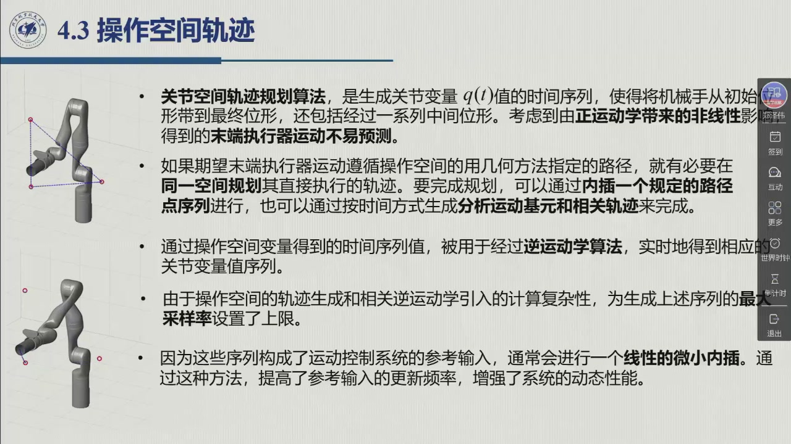
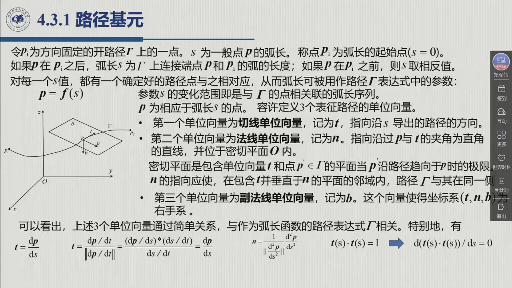
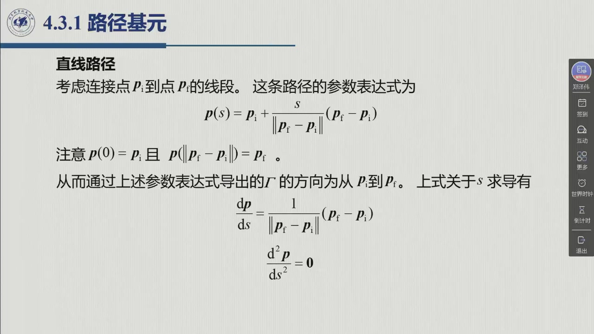
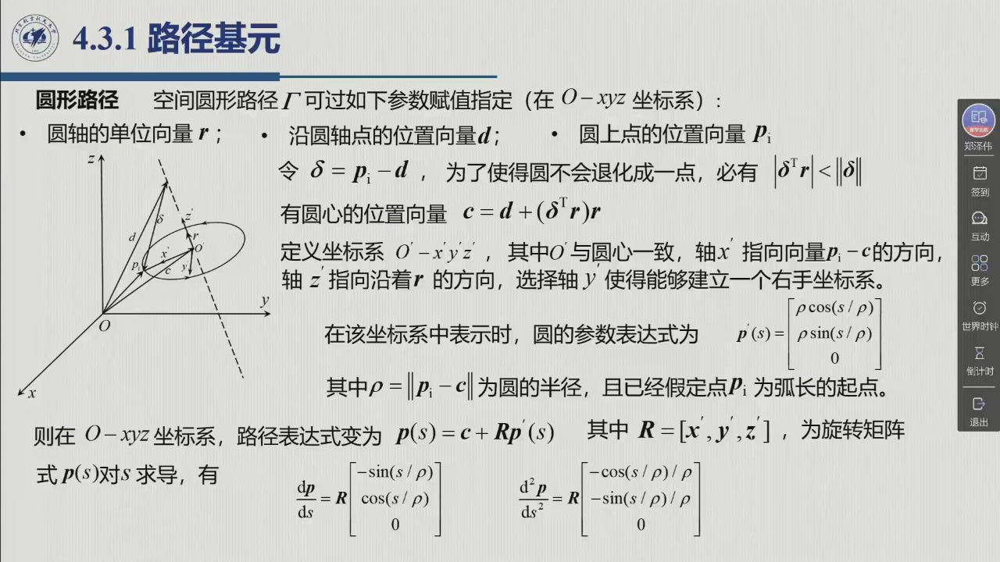
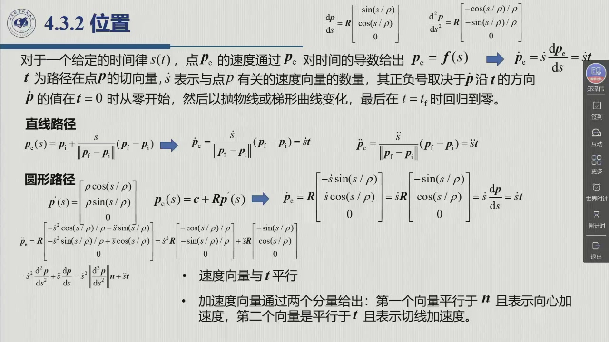

# 4.3.1 路径基元

焊缝可以规定工具必须走直线或圆弧。仅给关节起终值，通常不能保持这种几何要求。本节先写工具点的路径，再把几何参数换成弧长，为下一节安排运动时间做准备。课堂回看：1:57:28–2:14:03。

## 4.3.0 先确定几何，再安排时间

::: method 操作空间轨迹的两种生成方式 {#method-4.3.A}
若只规定一组中间位姿，可用分段函数连接它们，但需检查节点之间的实际走向。若要求遵循指定路径，则先给出这条路径的解析或数值表示，再给沿路径的时间律。

位置的三个分量可直接插值。姿态还受旋转约束，不能把矩阵九个元素随意当作独立位置分量；其构造见[§4.3.3](sec4-3-3.md)。
:::

规划和逆运动学都需要计算时间。规划参考更新较慢时，底层可在相邻参考点之间插值，按较快的控制周期读取目标。这只能加密参考，不会增加原路径的信息；若用线性插值，节点处还可能出现导数跳变，需继续检查速度和加速度是否符合接口要求。

## 4.3.1 一般参数怎样变成弧长

::: def 定义 4.3.1 · 路径的参数表示与弧长参数化 {#def-4.3.1}
用向量函数 $p=f(\sigma)\in\mathbb R^3$ 表示路径，$\sigma$ 在给定区间内增大时规定路径正方向。参数本身可以是角度、无量纲比例或其他量，不必等于走过的距离。

在光滑且 $f'(\sigma)\ne0$ 的区间，选起始参数 $\sigma_0$，定义

$$s(\sigma)=\int_{\sigma_0}^{\sigma}\|f'(u)\|\,du.$$

$s$ 是沿路径从参考点起算的有向弧长，用m。于是 $ds/d\sigma=\|f'(\sigma)\|>0$，局部可反解 $\sigma(s)$，并把同一条曲线写成 $p=p(s)$。闭合路径绕一圈后位置可重复，弧长仍能继续累计。
:::

例如半径 $\rho$ 的圆先用转角 $\sigma$ 表示，走过长度就是 $s=\rho\sigma$。这里 $\sigma$ 的数值按rad计算，$s$ 按m计算；两者相差一个半径，不能直接混用。

::: thm 定理 4.3.A · Frenet标架 {#thm-4.3.A}
对于足够光滑的弧长路径，切向量为 $t=dp/ds$。在曲率 $\kappa=\|d^2p/ds^2\|>0$ 处，定义

$$t=\frac{dp}{ds},\qquad
n=\frac{d^2p/ds^2}{\|d^2p/ds^2\|},\qquad
b=t\times n.\tag{4.33}$$

$t,n,b$ 分别是单位切向、主法向和副法向，构成右手正交标架。曲率用 $\mathrm m^{-1}$；直线或曲率为零处，不能用上式唯一确定 $n,b$。
:::

::: proof 为什么切向是单位向量，法向与它垂直
由[链式法则](../recall.md#chain-rule)，

$$\frac{dp}{ds}=\frac{dp/d\sigma}{ds/d\sigma}
=\frac{f'(\sigma)}{\|f'(\sigma)\|},$$

所以 $t^{\mathrm T}t=1$。再对 $s$ 求导，得 $2t^{\mathrm T}dt/ds=0$，即 $d^2p/ds^2$ 与 $t$ 正交。曲率非零时，将这个变化方向归一化，就得到 $n$。
:::

这里 $t$ 表示切向量，时间则是 $s(t)$ 的自变量。沿路径运动时，速度为 $\dot p=t\dot s$，速率为 $|\dot s|$。机器人停下时，路径的几何切向仍可存在，可直接由路径求导得到，无须除以零速率。

### 4.3.1.1 直线路径

::: def 定义 4.3.2 · 直线路径 {#def-4.3.2}
设起终点不同，$L=\|p_f-p_l\|>0$。从 $p_l$ 指向 $p_f$ 的单位方向为 $u=(p_f-p_l)/L$，用弧长表示线段：

$$p(s)=p_l+su=p_l+\frac{s}{\|p_f-p_l\|}(p_f-p_l),\quad0\le s\le L.\tag{4.34}$$

因此

$$\frac{dp}{ds}=u,\qquad\frac{d^2p}{ds^2}=0.\tag{4.35,4.36}$$

切向固定、曲率为零。如果还需要沿直线定义工具方向，必须另外指定，不能指望直线本身提供唯一法向。若 $L=0$，位置保持不变，无须归一化零向量。
:::

### 4.3.1.2 圆形路径

::: def 定义 4.3.3 · 圆形路径 {#def-4.3.3}
给定圆轴的单位方向 $r$、轴上一点 $d$，以及圆上的起点 $p_l$。所有向量都用同一基系分量。令 $\delta=p_l-d$，将它沿轴投影，就得到圆心：

$$c=d+(\delta^{\mathrm T}r)r.\tag{4.37}$$

剩余向量 $p_l-c$ 与轴垂直，是起始半径。取 $\rho=\|p_l-c\|>0$，再建立固定的圆平面坐标系：

$$x'=\frac{p_l-c}{\rho},\qquad z'=r,\qquad y'=z'\times x',\qquad R=[x'\ y'\ z'].$$

圆心是原点，$x'$ 指向起点，$z'$ 沿圆轴。按此右手方向行进，圆平面内的位置和基系位置分别为

$$p'(s)=\begin{bmatrix}\rho\cos(s/\rho)\\\rho\sin(s/\rho)\\0\end{bmatrix},\qquad
p(s)=c+Rp'(s).\tag{4.38,4.39}$$

$R$ 和 $c$ 在这条圆路径中均为常量，随路径点运动的Frenet标架则会改变。若起点落在圆轴上，$\rho=0$，圆退化为一点；等价检查是 $|\delta^{\mathrm T}r|<\|\delta\|$。
:::

对 $s$ 求导时，$s/\rho$ 的导数为 $1/\rho$，先与位置式前面的 $\rho$ 抵消一次：

$$\frac{dp}{ds}=R\begin{bmatrix}-\sin(s/\rho)\\\cos(s/\rho)\\0\end{bmatrix},\qquad
\frac{d^2p}{ds^2}=R\begin{bmatrix}-\cos(s/\rho)/\rho\\-\sin(s/\rho)/\rho\\0\end{bmatrix}.\tag{4.40,4.41}$$

一阶弧长导数的模为1，给出单位切向；二阶弧长导数指向圆心，模为 $1/\rho$。将后者归一化，才得到单位法向。

<figure>
<svg class="figure-svg" viewBox="0 0 920 420" xmlns="http://www.w3.org/2000/svg" role="img" aria-labelledby="fig-431-t fig-431-d">
<title id="fig-431-t">Frenet 标架与圆弧的三要素</title>
<desc id="fig-431-d">左图：一条空间曲线，切向 t 沿路径方向、法向 n 指向凹侧（向心加速度方向）、副法向 b = t × n 构成右手系。右图：圆弧由轴向量 r、轴上点 d、圆上点 p_l 定义，δ = p_l − d，圆心 c = d + (δ^T r)r，半径 ρ = |p_l − c|；随体坐标系的 z′ 沿 r、x′ 沿 p_l − c。</desc>
<defs>
<marker id="f431-m" markerWidth="9" markerHeight="9" refX="7" refY="3" orient="auto"><path d="M0,0 L7,3 L0,6 Z" fill="var(--muted)"/></marker>
<marker id="f431-b" markerWidth="8" markerHeight="8" refX="6" refY="2.5" orient="auto"><path d="M0,0 L6,2.5 L0,5 Z" fill="var(--fig-blue)"/></marker>
<marker id="f431-g" markerWidth="8" markerHeight="8" refX="6" refY="2.5" orient="auto"><path d="M0,0 L6,2.5 L0,5 Z" fill="var(--fig-green)"/></marker>
<marker id="f431-o" markerWidth="8" markerHeight="8" refX="6" refY="2.5" orient="auto"><path d="M0,0 L6,2.5 L0,5 Z" fill="var(--fig-gold)"/></marker>
</defs>
<text class="diagram-text" x="230" y="30" text-anchor="middle">Frenet 标架（任意曲线）</text>
<path d="M70 300 C 150 180, 250 330, 380 190" fill="none" stroke="var(--line-strong)" stroke-width="2.4"/>
<circle cx="250" cy="272" r="4.5" fill="var(--accent)"/>
<line x1="250" y1="272" x2="352" y2="236" stroke="var(--fig-blue)" stroke-width="2.4" marker-end="url(#f431-b)"/>
<line x1="250" y1="272" x2="266" y2="188" stroke="var(--fig-green)" stroke-width="2.4" marker-end="url(#f431-g)"/>
<line x1="250" y1="272" x2="188" y2="230" stroke="var(--fig-gold)" stroke-width="2.4" marker-end="url(#f431-o)"/>
<text class="diagram-text" fill="var(--fig-blue)" x="360" y="232">$t=\mathrm dp/\mathrm ds$</text>
<text class="diagram-text" fill="var(--fig-green)" x="274" y="182">$n$（指向凹侧 = 向心加速度方向）</text>
<text class="diagram-text" fill="var(--fig-gold)" x="150" y="226">$b=t\times n$</text>
<text class="diagram-note" x="230" y="356" text-anchor="middle">$(t,n,b)$ 右手系：随曲线走的局部坐标架</text>
<text class="diagram-note" x="230" y="382" text-anchor="middle">直线退化：$\mathrm d^2p/\mathrm ds^2=0$ ⇒ $n$ 无法定义</text>
<!-- circle -->
<text class="diagram-text" x="690" y="30" text-anchor="middle">圆弧三要素与随体坐标系</text>
<ellipse cx="690" cy="240" rx="150" ry="86" fill="none" stroke="var(--line-strong)" stroke-width="2.2"/>
<circle cx="690" cy="240" r="4" fill="var(--accent)"/>
<line x1="690" y1="240" x2="840" y2="240" stroke="var(--line)" stroke-width="1.4"/>
<line x1="690" y1="240" x2="840" y2="240" stroke="var(--line-strong)" stroke-width="2.2" marker-end="url(#f431-m)"/>
<text class="diagram-text" x="852" y="244">$x'$</text>
<line x1="690" y1="240" x2="690" y2="140" stroke="var(--line-strong)" stroke-width="2.2" marker-end="url(#f431-m)"/>
<text class="diagram-text" x="700" y="132">$z'$（沿 $r$）</text>
<circle cx="840" cy="240" r="4.5" fill="var(--accent)"/>
<text class="diagram-text" x="852" y="266">$p_l$</text>
<circle cx="690" cy="154" r="4" fill="var(--accent)"/>
<text class="diagram-text" x="700" y="166">$d$（轴上点）</text>
<text class="diagram-note" x="690" y="200" text-anchor="middle">圆心 $c$</text>
<line x1="690" y1="240" x2="690" y2="154" stroke="var(--line)" stroke-width="1.2" stroke-dasharray="5 4"/>
<text class="diagram-note" x="742" y="196">$\delta=p_l-d$</text>
<text class="diagram-note" x="752" y="322">$\rho=\|p_l-c\|$</text>
<line x1="690" y1="240" x2="833" y2="219" stroke="var(--line)" stroke-width="1.2" stroke-dasharray="5 4"/>
<text class="diagram-text" x="690" y="392" text-anchor="middle">$c=d+(\delta^{\mathrm T}r)\,r$，$\ |\delta^{\mathrm T}r|<\| \delta\|$</text>
</svg>
<figcaption>左图的Frenet标架随路径点变化，需曲率非零才能确定法向；右图先把起点投影到圆轴上求圆心，再建立固定的圆平面坐标系。</figcaption>
</figure>

### 跟算：圆心不一定就是给定的轴上点

取 $d=(0,0,1)$ m、$r=(0,0,1)$、$p_l=(2,0,3)$ m。由 $\delta=(2,0,2)$ m 得 $c=(0,0,3)$ m、$\rho=2$ m，且此例 $R=I$。

走过 $s=\pi$ m时，角度为 $s/\rho=\pi/2$ rad，位置为 $(0,2,3)$ m。切向为 $(-1,0,0)$，二阶弧长导数为 $(0,-1/2,0)$ $\mathrm m^{-1}$，法向为 $(0,-1,0)$。切向给出行进方向，二阶弧长导数给出这个方向随弧长的变化，法向则是该变化的归一化方向。切向与法向均为单位向量，二阶弧长导数还带有曲率量纲。

