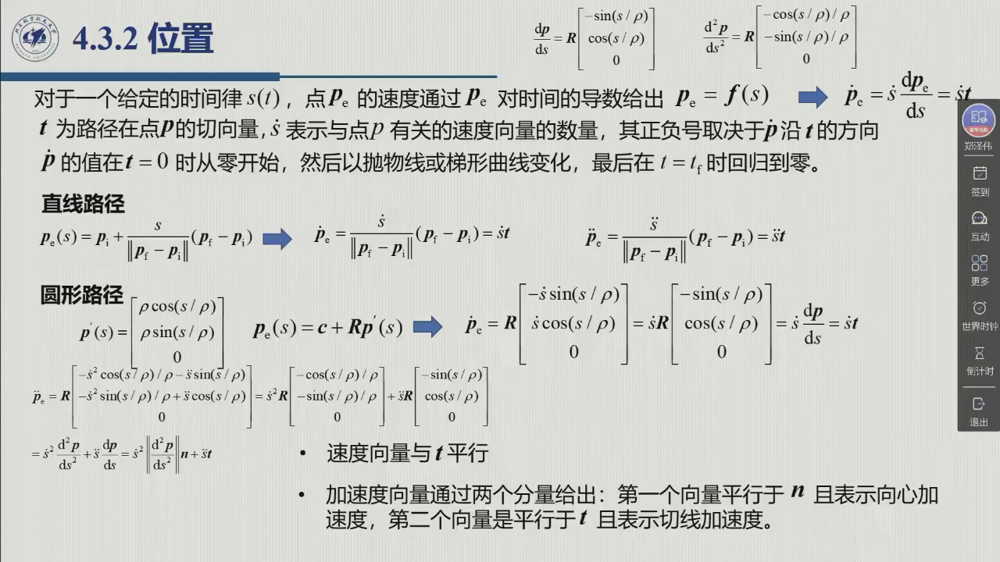
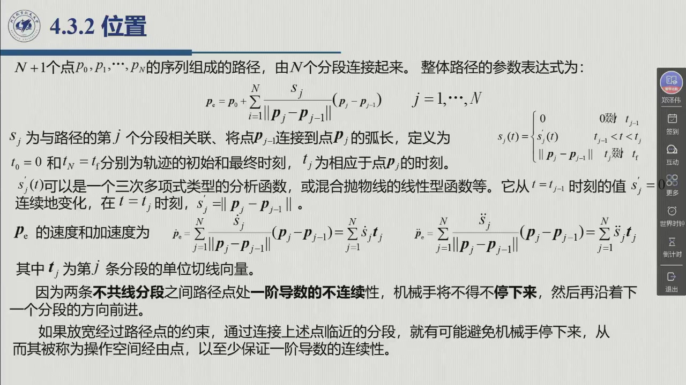
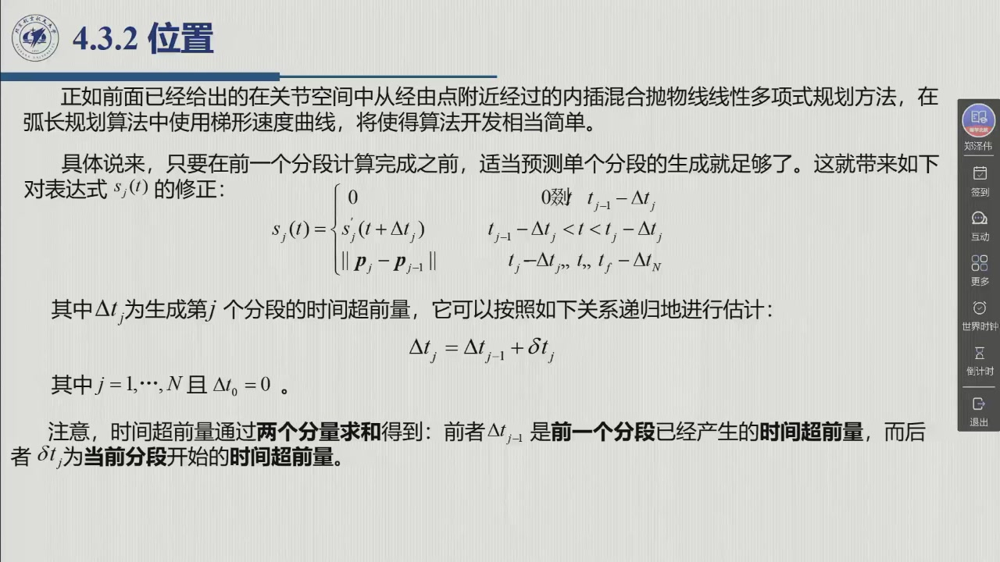

# 4.3.2 位置

几何路径有了（[4.3.1](sec4-3-1.md)），接下来给它配上**时间律**。操作空间的诀窍，是把「位置对时间的依赖」拆成两段：几何归几何（$p=f(s)$），时间归时间（$s(t)$）——而 $s(t)$ 只是一个标量函数，关节空间的全部武器恰好都能**原样搬用**。于是「末端沿直线/圆弧走」就变成「先定路径、再定一个标量函数 $s(t)$」。录播 2:14:03–2:22:28。

<aside class="lesson-brief" aria-label="4.3.2 学习简报">

PREREQUISITE<strong>你需要先会</strong>
弧长参数化与 Frenet 标架（[@def-4.3.1]、[@thm-4.3.A]）；直线与圆弧的 $dp/ds$、$d^2p/ds^2$（[@def-4.3.2]、[@def-4.3.3]）；关节空间的三次与梯形速度曲线（[@def-4.2.1]、[@def-4.2.3]）。

TARGET<strong>本节要建立</strong>
操作空间位置轨迹的分解 $p_e=f(s),\ s=s(t)$；$\dot p_e=\dot s\,t$ 与「$\dot s$ = 速度向量的模」；直线与圆弧的速度 / 加速度 (4.42)–(4.45)（含**向心 + 切向**分解）；多段路径 (4.46) 与经由点、时间超前 (4.50)。

CHECKPOINT<strong>学完的标准</strong>
能说明为什么 $s(t)$ 可以直接用关节空间的方法；能写出直线与圆弧的速度、加速度表达式并指出哪一项是向心加速度；能解释多段路径为什么要在路径点「削角」，以及时间超前递归 $\Delta t_j=\Delta t_{j-1}+\delta t_j$ 的含义。

</aside>

## 4.3.2.1 把位置轨迹拆成「几何 × 时间」

令 $x_e$ 为操作空间中机械手末端执行器位姿变量的向量。生成一条操作空间轨迹，意味着确定这样一个函数 $x_e(t)$：它要在时间 $t_f$ 内、遵从特定的运动时间律，把末端执行器坐标系沿给定路径从初始位姿带到最终位姿。**先考虑位置，再考虑方向**（2:14:07）。

::: def 定义 4.3.4 · 操作空间位置轨迹与弧长时间律 {#def-4.3.4}
令 $p_e=f(s)$ 为路径 $\Gamma$ 作为**弧长** $s$ 的函数的参数表达式（$(3\times1)$ 向量）；末端执行器坐标系的原点在时间 $t_f$ 内从 $p_i$ 移动到 $p_f$。为简单起见，假设弧长的起点为 $p_i$，且 $\Gamma$ 上导出的指向为从 $p_i$ 到 $p_f$。于是弧长的值从 $t=0$ 时的 $s=0$，变到 $t=t_f$ 时的 $s=s_f$（路径长度）。

沿路径的**时间律由函数 $s(t)$ 描述**。要找 $s(t)$ 的解析表达式，**上述针对关节轨迹的生成技术全部可以使用**——特别地，可以把三次多项式或混合抛物线的线性分段序列直接选作 $s(t)$（2:15:53）。

点 $p_e$ 的速度由 $p_e$ 对时间求导给出：

$$\dot p_e=\frac{\mathrm dp_e}{\mathrm ds}\,\dot s=\dot s\,t ,$$

其中 $t$ 为路径在点 $p$ 的**切向量**。因此 $\dot s$ 表示与点 $p$ 有关的速度向量的**数量（模）**，其正负号取决于 $p$ 沿 $t$ 的方向。$\dot s$ 从 $t=0$ 时的零值开始，按抛物线或梯形曲线变化，到 $t=t_f$ 时再回归到零。
:::

这一步是整个操作空间规划的关键简化（2:16:14）：**几何由路径确定，时间律由 $s(t)$ 确定**——两者解耦：路径只决定形状，$s(t)$ 只决定沿路径走多快。$\dot p_e$ 始终沿切向 $t$，这也「不违背咱们学习的规律」（2:16:41）。下面把这套分解用到两种最基本的路径上：直线与圆弧。

## 4.3.2.2 直线与圆弧：速度与加速度

::: thm 定理 4.3.B · 直线路径与圆弧路径的速度 / 加速度 {#thm-4.3.B}
**直线路径。** 参数表达式为 (4.34)。由复合函数求导法则：

$$\dot p_e=\dot s\,\frac{p_f-p_i}{\|p_f-p_i\|}=\dot s\,t, \tag{4.42}$$

$$\ddot p_e=\ddot s\,\frac{p_f-p_i}{\|p_f-p_i\|}=\ddot s\,t . \tag{4.43}$$

对直线，**速度与加速度都沿直线方向**，它们的模分别由 $\dot s$、$\ddot s$ 给出。

**圆弧路径。** 由 (4.40)(4.41) 求导得：

$$\dot p_e=R\begin{bmatrix}-\dot s\sin(s/\rho)\\[0.6mm] \ \ \dot s\cos(s/\rho)\\[0.6mm] 0\end{bmatrix}, \tag{4.44}$$

$$\ddot p_e=R\begin{bmatrix}-\dot s^2\cos(s/\rho)/\rho-\ddot s\sin(s/\rho)\\[0.6mm] -\dot s^2\sin(s/\rho)/\rho+\ddot s\cos(s/\rho)\\[0.6mm] 0\end{bmatrix}. \tag{4.45}$$

速度向量**与 $t$ 平行**；加速度向量则分成**两个分量**：平行于 $n$ 的是**向心加速度**（$\dot s^2/\rho$），平行于 $t$ 的是**切向加速度**（$\ddot s$）。
:::

::: ex 例 4.3.C · 圆弧上加速度的两个分量（老师 2:18:00 口述分解） {#ex-4.3.C}
把 (4.45) 按 Frenet 标架分解，含义就清楚了：

$$\ddot p_e=\underbrace{\frac{\dot s^2}{\rho}\,n}_{\text{向心：只改方向}}+\underbrace{\ddot s\,t}_{\text{切向：只改大小}} .$$

老师 2:18:14 的原话：「一部分加速度是沿着切线方向的加速度，它是**改变速度的大小**；另一部分是沿着半径的方向，也就是**向心加速度的方向**……向心加速度只改变速度的方向，而切向加速度改变速度的大小。」

**工程含义**：圆弧路段的 $\dot s$ 不能取太大——向心加速度按 $\dot s^2/\rho$ 增长，曲率半径 $\rho$ 越小，允许的 $\dot s$ 就越小。这正是 [4.1](sec4-1.md#sec-4.1.3) 说的「对曲率比较大的轨迹部分要对速度进行特殊设定」的定量依据。
:::

## 4.3.2.3 多段路径、经由点与时间超前

实际任务中的路径，往往不是单条直线或单段圆弧，而是若干分段首尾相接。先把这种**多段路径**写成统一的参数表达式。

::: def 定义 4.3.5 · 多段路径的参数表达式与经由点 {#def-4.3.5}
考虑由 $N+1$ 个点 $p_0,p_1,\dots,p_N$ 的序列组成的路径，相邻两点由 $N$ 个分段连接。一个切实可行的整体路径参数表达式为

$$p_e=p_0+\sum_{j=1}^{N}\frac{s_j}{\|p_j-p_{j-1}\|}\,(p_j-p_{j-1}), \tag{4.46}$$

其中 $s_j$ 为与第 $j$ 个分段相关联、将 $p_{j-1}$ 连接到 $p_j$ 的弧长：

$$s_j(t)=\begin{cases}
0, & 0\le t\le t_{j-1}\\
s'_j(t), & t_{j-1}<t<t_j\\
\|p_j-p_{j-1}\|, & t_j\le t\le t_f
\end{cases} \tag{4.47}$$

$t_0=0$、$t_N=t_f$ 分别为轨迹的初始与最终时刻。$s'_j(t)$ 可以是三次多项式型的分析函数，也可以是混合抛物线的线性型函数——**它从 $t=t_{j-1}$ 时刻的 $s'_j=0$ 连续变化，在 $t=t_j$ 时刻取 $s_j=\|p_j-p_{j-1}\|$**。对 (4.46) 微分得

$$\dot p_e=\sum_{j=1}^{N}\dot s_j\,t_j,\qquad \ddot p_e=\sum_{j=1}^{N}\ddot s_j\,t_j , \tag{4.48,4.49}$$

其中 $t_j$ 为第 $j$ 条分段的单位切线向量。

**问题与「经由点」。** 因为两条**不共线**分段之间，路径点处一阶导数不连续，机械手将**不得不停下来**，然后再沿下一个分段的方向前进（2:20:27）。如果在通过这些路径点时允许一个**松弛的约束条件**，把路径点附近的分段连接起来，就有可能避免机械手停下来——这样的点称为操作空间**经由点**（via point），至少保证一阶导数的连续性。
:::

经由点解决了路径点处的停顿问题。但分段还要一段一段地生成：如果每一段都等前一段算完再开始，整体时间就会被拖长。下面的**时间超前**正是为这件事引入的。

::: thm 定理 4.3.D · 时间超前（教材式 4.50） {#thm-4.3.D}
在弧长规划算法中使用梯形速度曲线时，**只要适当预测单个分段的生成、赶在前一个分段的计算完成之前，就足够了**。这带来对 (4.47) 的修正：

$$s'_j(t)=\begin{cases}
0, & 0\le t\le t_{j-1}-\Delta t_j\\
s_j(t+\Delta t_j), & t_{j-1}-\Delta t_j<t\le t_j-\Delta t_j\\
\|p_j-p_{j-1}\|, & t_j-\Delta t_j<t\le t_f-\Delta t_N
\end{cases} \tag{4.50}$$

其中 $\Delta t_j$ 为生成第 $j$ 个分段的时间**超前量**，按如下关系**递归**估计：

$$\Delta t_j=\Delta t_{j-1}+\delta t_j,\qquad j=1,\dots,N,\quad \Delta t_0=0 .$$

注意超前量由两个分量求和得到：$\Delta t_{j-1}$ 是前一个分段已经产生的时间超前量，$\delta t_j$ 为当前分段开始的时间超前量（2:21:04）。
:::

老师对这一步的**坦白提醒**（2:20:27）：「咱们这个规划没有考虑**速度连续性**，就是从一段到另一段，它是不是平滑过渡的（不是）……实际过程中还需要加一个抛线段来进行平滑过渡，或者进行提前的规划。」具体做法就是上一节讲过的：**前一个梯形速度曲线还没走完，就要过渡到下一个梯形速度曲线**，为此引入超前量 $\Delta t_j$ 来做预测。「原理也是比较简单的，但是要写代码还是需要仔细」（2:22:09）。

::: think 考点 · 老师原话（录播时间点）

> **几何与时间解耦，是本节的骨架。** 「这样 $s$ 的运动律就通过 $s$ 来确定了，然后几何是通过路径来确定的」（2:16:18）——**位置规划 = 路径（几何）+ $s(t)$（时间律）**。

> **圆弧加速度必须会分解。** 「一部分加速度是沿着切线方向的加速度，它是改变速度的大小；另一部分是沿着半径的方向，也就是向心加速度的方向……向心加速度只改变速度的方向，而切向加速度改变速度的大小」（2:18:00）。

> **多段路径会「停」在路径点。** 「因为两条不共线分段之间路径点处一阶导数的不连续性，机械手将不得不停下来，然后再沿着下一个分段的方向前进」（2:20:00）——这是**经由点**与**时间超前**要解决的问题。

> **别把它当成直线插补。** 「无需精确遵循路径时，我们可以插入一些路径点，点和点之间可以内插一个函数」（2:18:57）——直线段 + 抛物线混合，与关节空间的 [4.2.2.4](sec4-2-2.md#sec-4.2.2.4) 完全同构。
:::

::: think 默写点 · 合上书再写（主动回忆）

不看正文与速查表，先默写下面三条，再展开核对；写不出来，就说明这一节还没「拿走」。

1. 位置轨迹怎么分解？为什么 $s(t)$ 能直接用关节空间的方法？
2. 写出 $\dot p_e$ 与 $\ddot p_e$ 的表达式（直线、圆弧各一组），标出向心加速度那一项。
3. 多段路径为什么要在路径点做「经由点」处理？时间超前量怎么递归？

::: sol 核对

$p_e=f(s)$（几何，来自路径）与 $s=s(t)$（时间律）解耦；$s$ 是一维标量，因此关节空间的全部方法（三次、梯形、样条）都能直接套在 $s(t)$ 上。

直线：$\dot p_e=\dot s\,t$，$\ddot p_e=\ddot s\,t$。圆弧：$\dot p_e=\dot s\,t$，$\ddot p_e=\dfrac{\dot s^2}{\rho}n+\ddot s\,t$——第一项 $\dot s^2/\rho$ 是**向心加速度**（平行 $n$，只改方向），第二项 $\ddot s$ 是切向加速度（平行 $t$，只改大小）。

因为相邻不共线分段在路径点处一阶导数不连续，机械手会被迫停下。用抛物线混合「削角」把分段连起来，就得到经由点；为避免全局时间被拉长，用**时间超前** $\Delta t_j=\Delta t_{j-1}+\delta t_j$ 在前一段完成前就启动下一段。

:::

:::

## 4.3.2 小结与常见错误

- **一条主线**：$p_e=f(s)$（几何）+ $s(t)$（时间律）⇒ $\dot p_e=\dot s\,t$ ⇒ 直线退化为一维（$t$ 恒定），圆弧出现**向心 + 切向**两项 ⇒ 多段路径用经由点削角 + 时间超前加速。
- **一个复用**：$s(t)$ 是标量，所以关节空间的一切方法都能搬过来——这就是「关节空间的算法都可以推广到操作空间」（0:20:12）的具体含义。
- **一句话**：「几何归路径、时间归 $s(t)$——操作空间的规划，最后都落在一个标量函数 $s(t)$ 上。」

::: think 常见错误清单 · 自查三条
1. **把 $\dot s$ 当成速度向量**：$\dot s$ 是速度的**模**（带符号），方向由切向 $t$ 提供；写 $\dot p_e=\dot s$ 就丢了方向。
2. **圆弧只算切向加速度**：漏掉 $\dot s^2/\rho$ 的向心项——曲率越大漏得越多，这正是曲率大处要限速的原因。
3. **以为多段路径能自动平滑通过**：直线段拼接在路径点处速度必然跳跃（除非共线），要么削角（经由点），要么接受「停下来再走」。
:::
