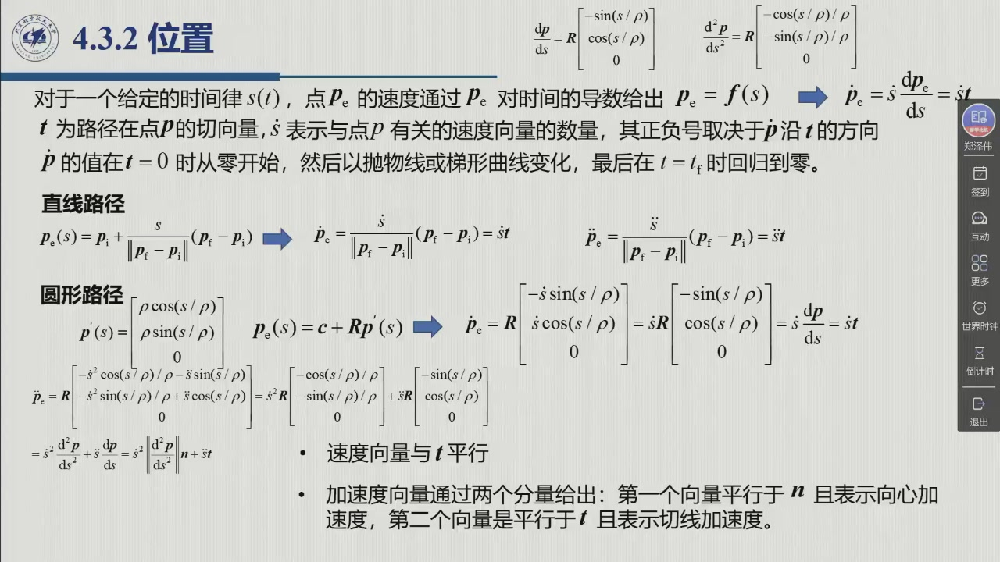
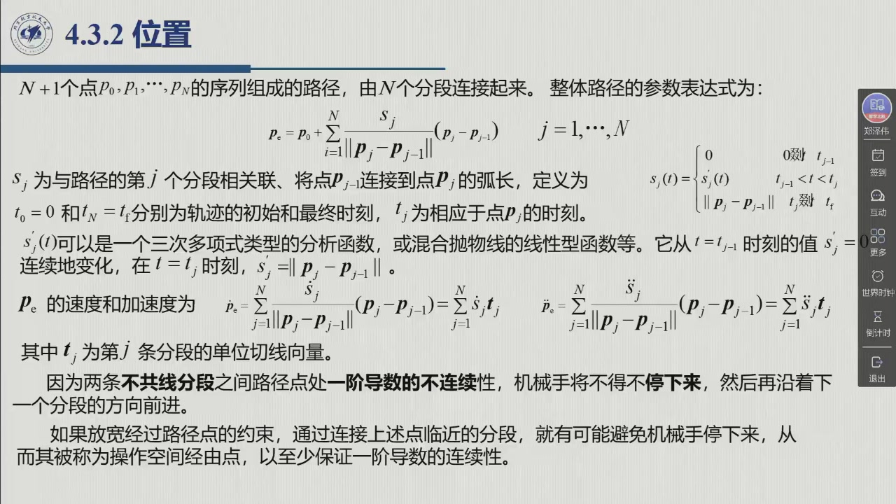

# 4.3.2 位置

已经用弧长写出路径 $p=f(s)$，接下来选择 $s(t)$，确定工具何时走到哪里。两次求导后可以看出：沿曲线匀速运动也会产生加速度；多段运动提前重叠，又会改变拐角附近的几何路径。课堂回看：2:14:03–2:22:28。

## 4.3.2.1 路径与时间律合成位置轨迹

::: def 定义 4.3.4 · 位置轨迹与弧长时间律 {#def-4.3.4}
设路径从 $p_i$ 到 $p_f$，总弧长为 $s_f$（$\mathrm m$）。选定持续时长 $t_f>0$（$\mathrm s$）与弧长时间律 $s(t)$，满足 $s(0)=0$、$s(t_f)=s_f$，则位置轨迹为

$$p_e(t)=f(s(t)).$$

若要求沿路径正向走且不折返，须满足 $\dot s(t)\ge0$；静止起停则要求 $\dot s(0)=\dot s(t_f)=0$。这里 $s(t)$ 是单变量标量函数，因此 [§4.2.1](sec4-2-1.md)–[§4.2.2](sec4-2-2.md) 的三次、五次、梯形速度与样条都可以直接复用，参数仍须结合路径曲率与逆运动学限值选取。
:::

先用几何和量纲看清速度：由[链式法则](../recall.md#chain-rule)得 $\dot p_e=f'(s)\dot s$。因为路径按弧长参数化，$f'(s)=t$ 是单位切向量，所以末端速度的大小就是 $|\dot s|$、方向沿切线 $t$；时间律只管沿路径走多快，几何只管朝哪边走。

把几何和进度拆开后，设计变量少了，但限制仍会耦合：急弯处的曲率会压低允许的速率 $|\dot s|$，逆运动学又决定给定的末端速度需要多大的关节速度，因此初选 $s(t)$ 后还须回代校验。

## 4.3.2.2 两次求导：切向项与法向项

先拿一般弧长路径 $p_e(t)=f(s(t))$ 求二阶导数。对一阶导数 $f'(s)\dot s$ 用乘积法则，并对复合因子 $f'(s(t))$ 再用一次链式法则：

$$\ddot p_e=\frac{\mathrm d}{\mathrm dt}\big(f'(s)\dot s\big)
=\Bigl(\frac{\mathrm d}{\mathrm ds}f'(s)\Bigr)\dot s^2+f'(s)\ddot s
=f''(s)\dot s^2+f'(s)\ddot s.$$

乘积求导把加速度拆成两块：第一项 $f''(s)\dot s^2$ 来自路径本身在转弯、速度方向不断改变；第二项 $f'(s)\ddot s$ 来自沿路径速率在加减。在曲率 $\kappa=\|f''(s)\|>0$ 处代入 $f''=\kappa n$（[@thm-4.3.A]），得

$$\ddot p_e=\kappa\dot s^2n+\ddot s\,t.$$

核对单位：$\kappa$ 的单位为 $\mathrm m^{-1}$，$\dot s^2$ 为 $\mathrm{m^2/s^2}$，相乘恰好是 $\mathrm{m/s^2}$。符号 $t$ 仍表单位切向量，时间自变量由求导记号和 $s(t)$ 区分。
::: thm 定理 4.3.B · 直线与圆弧的速度、加速度 {#thm-4.3.B}
直线的切向固定，二阶弧长导数为零：

$$\dot p_e=\dot s\,\frac{p_f-p_i}{\|p_f-p_i\|}=\dot s\,t,\tag{4.42}$$

$$\ddot p_e=\ddot s\,t.\tag{4.43}$$

圆弧使用上一节的固定 $R$、半径 $\rho$，令 $\alpha=s/\rho$。将弧长导数代入链式法则：

$$\dot p_e=R\begin{bmatrix}-\dot s\sin\alpha\\\dot s\cos\alpha\\0\end{bmatrix},\tag{4.44}$$

$$\ddot p_e=R\begin{bmatrix}
-\dot s^2\cos\alpha/\rho-\ddot s\sin\alpha\\
-\dot s^2\sin\alpha/\rho+\ddot s\cos\alpha\\0
\end{bmatrix}.\tag{4.45}$$

等价的几何形式为 $\ddot p_e=(\dot s^2/\rho)n+\ddot s\,t$。其中向心项朝圆心，切向项沿路径正向或反向。
:::

::: ex 例 4.3.C · 匀速转弯仍要占用加速度预算 {#ex-4.3.C}
取 $\rho=0.5$ m、$R=I$。在 $s=0$ 处，$t=(0,1,0)$、$n=(-1,0,0)$。给 $\dot s=0.2$ m/s、$\ddot s=0.1$ m/s²，逐项算得

$$\dot p_e=(0,0.2,0)^{\mathrm T}\ \mathrm{m/s},\qquad
\ddot p_e=(-0.08,0.1,0)^{\mathrm T}\ \mathrm{m/s^2}.$$

即使令 $\ddot s=0$，向心项仍为0.08 m/s²，因为速度方向在变。法向与切向正交，若总加速度上限为 $a_{\max}$，应检查

$$\|\ddot p_e\|^2=\ddot s^2+\left(\frac{\dot s^2}{\rho}\right)^2\le a_{\max}^2.$$

例如 $a_{\max}=0.1$ m/s²，保留 $\ddot s=0.1$ 就已用尽预算，不能再叠加非零向心项。匀速时可取的路径速率至多为 $\sqrt{\rho a_{\max}}\approx0.2236$ m/s。
:::

## 4.3.2.3 多段路径为什么会在折角停下

::: def 定义 4.3.5 · 多段直线路径与分段进度 {#def-4.3.5}
给定 $N+1$ 个点 $p_0,\ldots,p_N$，先假定相邻点不同。第 $j$ 段长度为 $L_j=\|p_j-p_{j-1}\|$，单位方向为 $u_j=(p_j-p_{j-1})/L_j$。令 $s_j(t)$ 表示该段已完成的长度，可写

$$p_e(t)=p_0+\sum_{j=1}^{N}s_j(t)u_j.\tag{4.46}$$

在不重叠的顺序执行中，$s_j$ 在开始前为0，完成后保持 $L_j$，中间用选定的时间律 $g_j(t)$：

$$s_j(t)=\begin{cases}
0,&t\le t_{j-1},\\
g_j(t),&t_{j-1}<t<t_j,\\
L_j,&t\ge t_j.
\end{cases}\tag{4.47}$$

$g_j(t_{j-1})=0$、$g_j(t_j)=L_j$。只要各段按此截断，总位置就依次累计到每个端点。求导得到

$$\dot p_e=\sum_j\dot s_j u_j,\qquad
\ddot p_e=\sum_j\ddot s_j u_j.\tag{4.48,4.49}$$

这里用 $u_j$ 表示方向，避免与节点时刻 $t_j$ 混淆。
:::

如果两条直线段方向不共线，却要求工具**严格贴着原折线走**并保持速度连续，工具在拐角处只能把速度降到零：折角处左边要求速度平行 $u_j$，右边要求速度平行 $u_{j+1}$，唯一同时平行两个不共线方向的向量就是零向量。要想不在中间点停顿，就只能把尖角削成圆弧或混合过渡，让原本的中间点变成从附近掠过的经由点（与 [§4.2.2.4](sec4-2-2.md#sec-4.2.2.4) 的思路相同）。

### 时间超前改变的是运动重叠

不增加新的多项式混合公式，也可以直接把下一段的启动时刻往前挪，让上一段还没走完时下一段就开始加速，从而抹掉拐角处的停顿（2:20:27–2:22:28）：

::: thm 定理 4.3.D · 时间超前 {#thm-4.3.D}
设第 $j$ 段相对原顺序计划提前 $\Delta t_j$ 启动，令滞后—提前后的进度为

$$\widetilde s_j(t)=s_j(t+\Delta t_j),\qquad
p_e(t)=p_0+\sum_j\widetilde s_j(t)u_j.\tag{4.50}$$

若相邻两段每次多抢跑 $\delta t_j$（单位 $\mathrm s$），则各段的累计提前量按递归累加：

$$\Delta t_j=\Delta t_{j-1}+\delta t_j,\qquad\Delta t_0=0.$$

这里提前的是物理运动的起动时刻（让前后两段在时间上重叠），不是单纯把计算时机往前移；各段原计划时长和 $\delta t_j$ 须相容，保证每段起止顺序不错乱。
:::

### 跟算：提前四分之一秒会偏离多少

取 $p_0=(0,0)$、$p_1=(1,0)$、$p_2=(1,1)\ \mathrm m$，每段原计划各走 $1\ \mathrm s$。时间律选归一化的静止起停三次函数 $H(u)=3u^2-2u^3$（$u\le0$ 时截断为 $0$，$u\ge1$ 时截断为 $1$）。顺序执行时：

$$p_e(t)=\begin{bmatrix}H(t)\\H(t-1)\end{bmatrix},$$

工具在 $t=1\ \mathrm s$ 准时停在折角 $(1,0)$，再用 $1\ \mathrm s$ 走到 $(1,1)$。现在把第二段提前 $\delta t_2=0.25\ \mathrm s$ 启动，时间变成 $t+0.25-1=t-0.75$：

$$p_e(t)=\begin{bmatrix}H(t)\\H(t-0.75)\end{bmatrix}.$$

取重叠期中点 $t=0.875\ \mathrm s$ 代入：第一段进度 $H(0.875)=0.95703125$，第二段已提前走了 $0.125\ \mathrm s$、进度 $H(0.125)=0.04296875$，此时工具位于约 $(0.9570,0.0430)\ \mathrm m$，已经抄近路切过拐角。最终仍停在 $(1,1)\ \mathrm m$，总用时缩短为 $1.75\ \mathrm s$，代价是不再严格经过中间点 $(1,0)$。

本例每段截断函数的两端速度为零且导数连续，所以直接相加后速度仍然连续。若改用其他进度函数，须重新校验截断处的导数连续性、重叠区的合成速度与加速度峰值，以及抄近路后的障碍碰撞余量。

::: think 默写点 · 合上书再写（主动回忆）
不看正文，先自己写出下面三条，再展开核对。

1. 位置轨迹怎样拆成几何与时间律？为什么关节空间的时间律算法可以直接套在 $s(t)$ 上？
2. 分别写出直线和圆弧的 $\dot p_e$ 与 $\ddot p_e$，并标出向心加速度项。
3. 为什么不共线多段折线不削角就必须在折角停顿？时间超前的累计递推式怎样写？

::: sol 核对
1. $p_e(t)=f(s(t))$，$f(s)$ 决定几何路径、$s(t)$ 决定时间进度；$s$ 是单调标量，因此三次、五次、LSPB 与样条都能直接用来生成 $s(t)$。
2. 直线：$\dot p_e=\dot s\,t$，$\ddot p_e=\ddot s\,t$；圆弧：$\dot p_e=\dot s\,t$，$\ddot p_e=(\dot s^2/\rho)n+\ddot s\,t$，其中 $(\dot s^2/\rho)n$ 是只改速度方向的向心加速度。
3. 在折角处若速度连续，唯一同时平行前后两段不共线方向的向量只有零向量。用 $\widetilde s_j(t)=s_j(t+\Delta t_j)$ 与 $\Delta t_j=\Delta t_{j-1}+\delta t_j$ 提前启动下一段，就能在不停顿的前提下平滑切过拐角。
:::
:::

## 4.3.2 小结与常见错误

把路径写成弧长函数 $f(s)$ 再复合时间律 $s(t)$，末端速度就只剩 $\dot p_e=\dot s\,t$，加速度拆成沿路径的切向项 $\ddot s\,t$ 与指向曲率中心的向心项 $\kappa\dot s^2n$。直线曲率为零只留切向；圆弧匀速转弯仍占用法向加速度预算。多段直线若严守折角就必须停顿，提前下一段启动时间 $\Delta t_j$ 虽可消去停顿、缩短用时，却会让工具从拐角内侧经由点掠过。下一节用同样的「先选参数、再配一维时间律」思路处理三维姿态。

::: think 常见错误清单 · 自查三条
1. **把 $\dot s$ 当成速度向量**：$\dot s$ 是带符号的切向速率，完整速度向量必须乘上单位切向 $t$（$\dot p_e=\dot s\,t$）。
2. **算圆弧加速度漏掉向心项**：即使 $\ddot s=0$ 匀速运行，只要在拐弯，就有大小 $\dot s^2/\rho$ 的向心加速度占用总加速度上限。
3. **以为时间超前不改变几何路径**：分段重叠会把轨迹拉进折角内侧，且总峰值与碰撞余量必须重新校验。
:::
