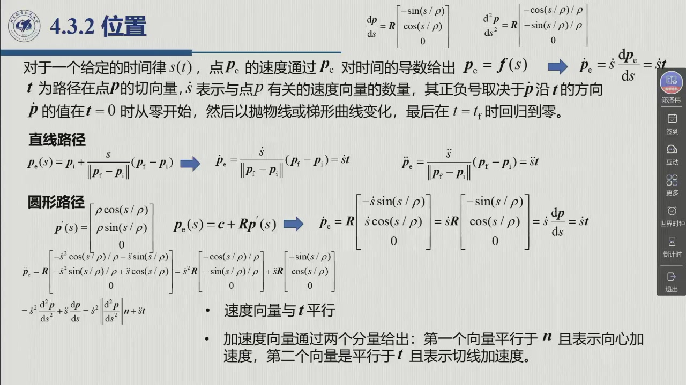
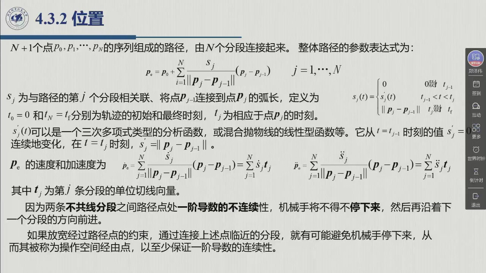
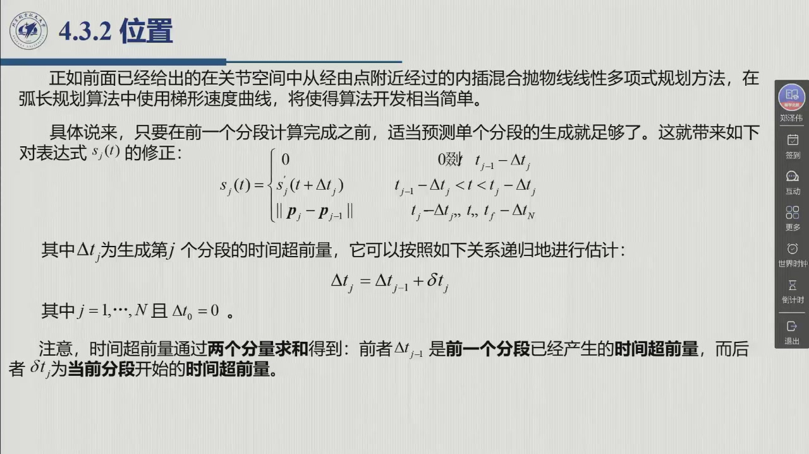

# 4.3.2 位置

已经用弧长写出路径 $p=f(s)$，接下来选择 $s(t)$，确定工具何时走到哪里。两次求导后可以看出：沿曲线匀速运动也会产生加速度；多段运动提前重叠，又会改变拐角附近的几何路径。课堂回看：2:14:03–2:22:28。

## 4.3.2.1 路径与时间律合成位置轨迹

::: def 定义 4.3.4 · 位置轨迹与弧长时间律 {#def-4.3.4}
设路径从 $p_i$ 到 $p_f$，总弧长为 $s_f$。取 $s(0)=0$、$s(T)=s_f$，则位置轨迹为

$$p_e(t)=f(s(t)).$$

这里 $s$ 用m，时间 $t$ 用s。若要求沿路径正向走且不折返，再要求 $\dot s\ge0$；静止起停要求 $\dot s(0)=\dot s(T)=0$。三次、五次和梯形速度都能用于这个标量，但仍须按路径约束选择参数。
:::

[链式法则](../recall.md#chain-rule)给 $\dot p_e=f'(s)\dot s$。因为采用弧长，$f'(s)=t$ 是单位切向，故速度大小为 $|\dot s|$。时间律规定沿路径的进度，几何方向由路径导数提供。

路径与时间律分开后，变量更少，但限制仍会相互影响：曲率约束可用速率，逆运动学又决定实现末端速度需要多大的关节速度。因此初选路径与时间律后，还要检查两者是否相容，必要时调整。

## 4.3.2.2 两次求导：切向项与法向项

先保留一般函数 $f$。对一阶导数再用乘积法则：

$$\ddot p_e=\frac{d}{dt}\big(f'(s)\dot s\big)
=f''(s)\dot s^2+f'(s)\ddot s.$$

乘积求导把加速度分成两项：第一项来自路径方向变化，第二项来自沿路径速率变化。曲率非零时，代入 $f''=\kappa n$，得到

$$\ddot p_e=\kappa\dot s^2n+\ddot s\,t.$$

$\kappa$ 用 $\mathrm m^{-1}$，$\dot s^2$ 用 $\mathrm{m^2/s^2}$，乘起来才是加速度。此处 $t$ 是切向量的名称，时间出现在求导和 $s(t)$ 中。

::: thm 定理 4.3.B · 直线与圆弧的速度、加速度 {#thm-4.3.B}
直线的切向固定，二阶弧长导数为零：

$$\dot p_e=\dot s\,\frac{p_f-p_i}{\|p_f-p_i\|}=\dot s\,t,\tag{4.42}$$

$$\ddot p_e=\ddot s\,t.\tag{4.43}$$

圆弧使用上一节的固定 $R$、半径 $\rho$，令 $\alpha=s/\rho$。将弧长导数代入链式法则：

$$\dot p_e=R\begin{bmatrix}-\dot s\sin\alpha\\\dot s\cos\alpha\\0\end{bmatrix},\tag{4.44}$$

$$\ddot p_e=R\begin{bmatrix}
-\dot s^2\cos\alpha/\rho-\ddot s\sin\alpha\\
-\dot s^2\sin\alpha/\rho+\ddot s\cos\alpha\\0
\end{bmatrix}.\tag{4.45}$$

等价的几何形式为 $\ddot p_e=(\dot s^2/\rho)n+\ddot s\,t$。其中向心项朝圆心，切向项沿路径正向或反向。
:::

::: ex 例 4.3.C · 匀速转弯仍要占用加速度预算 {#ex-4.3.C}
取 $\rho=0.5$ m、$R=I$。在 $s=0$ 处，$t=(0,1,0)$、$n=(-1,0,0)$。给 $\dot s=0.2$ m/s、$\ddot s=0.1$ m/s²，逐项算得

$$\dot p_e=(0,0.2,0)^{\mathrm T}\ \mathrm{m/s},\qquad
\ddot p_e=(-0.08,0.1,0)^{\mathrm T}\ \mathrm{m/s^2}.$$

即使令 $\ddot s=0$，向心项仍为0.08 m/s²，因为速度方向在变。法向与切向正交，若总加速度上限为 $a_{\max}$，应检查

$$\|\ddot p_e\|^2=\ddot s^2+\left(\frac{\dot s^2}{\rho}\right)^2\le a_{\max}^2.$$

例如 $a_{\max}=0.1$ m/s²，保留 $\ddot s=0.1$ 就已用尽预算，不能再叠加非零向心项。匀速时可取的路径速率至多为 $\sqrt{\rho a_{\max}}\approx0.2236$ m/s。
:::

## 4.3.2.3 多段路径为什么会在折角停下

::: def 定义 4.3.5 · 多段直线路径与分段进度 {#def-4.3.5}
给定 $N+1$ 个点 $p_0,\ldots,p_N$，先假定相邻点不同。第 $j$ 段长度为 $L_j=\|p_j-p_{j-1}\|$，单位方向为 $u_j=(p_j-p_{j-1})/L_j$。令 $s_j(t)$ 表示该段已完成的长度，可写

$$p_e(t)=p_0+\sum_{j=1}^{N}s_j(t)u_j.\tag{4.46}$$

在不重叠的顺序执行中，$s_j$ 在开始前为0，完成后保持 $L_j$，中间用选定的时间律 $g_j(t)$：

$$s_j(t)=\begin{cases}
0,&t\le t_{j-1},\\
g_j(t),&t_{j-1}<t<t_j,\\
L_j,&t\ge t_j.
\end{cases}\tag{4.47}$$

$g_j(t_{j-1})=0$、$g_j(t_j)=L_j$。只要各段按此截断，总位置就依次累计到每个端点。求导得到

$$\dot p_e=\sum_j\dot s_j u_j,\qquad
\ddot p_e=\sum_j\ddot s_j u_j.\tag{4.48,4.49}$$

这里用 $u_j$ 表示方向，避免与节点时刻 $t_j$ 混淆。
:::

若两段方向不共线，严格沿原折线且速度连续，就必须在折角处降到零：连续速度既要平行前一方向，又要平行后一方向，唯一的共同向量是零向量。若要保持非零速率，只能改变拐角附近的路径，例如用圆弧或混合段过渡。允许从附近经过的原中间点称为经由点。

### 时间超前改变的是运动重叠

::: thm 定理 4.3.D · 时间超前 {#thm-4.3.D}
设第 $j$ 段相对原计划提前 $\Delta t_j$ 开始，以

$$\widetilde s_j(t)=s_j(t+\Delta t_j),\qquad
p_e(t)=p_0+\sum_j\widetilde s_j(t)u_j\tag{4.50}$$

生成合成轨迹。若相邻段的额外提前量为 $\delta t_j$，累计提前量写成

$$\Delta t_j=\Delta t_{j-1}+\delta t_j,\qquad\Delta t_0=0.$$

这些量都用s，且必须选择相容的开始、结束顺序。它让下一段在上一段运动结束前启动，不是单纯把下一段计算得更早。
:::

### 跟算：提前四分之一秒会偏离多少

取 $p_0=(0,0)$、$p_1=(1,0)$、$p_2=(1,1)$ m，每段原计划用1 s。用三次函数 $H(u)=3u^2-2u^3$，并在区间外截断为0或1。原计划为

$$p_e(t)=\begin{bmatrix}H(t)\\H(t-1)\end{bmatrix},$$

其中函数自变量按每段1 s的时间归一化，故在 $t=1$ s准确到达 $(1,0)$ 并停下。把第二段提前0.25 s，得到

$$p_e(t)=\begin{bmatrix}H(t)\\H(t-0.75)\end{bmatrix}.$$

在 $t=0.875$ s，两个进度分别为 $H(0.875)=0.95703125$、$H(0.125)=0.04296875$，工具已离开第一条直线，位于约 $(0.9570,0.0430)$ m。最终仍到 $(1,1)$，总时长变为1.75 s，中间点却不再严格经过。

本例各段的速度连续，端点速度也为零，因此截断后叠加仍保持速度连续。换成其他实现时，需重新检查截断处导数、重叠段的速度与加速度峰值，以及路径改变后的碰撞余量；提前量递推式只安排时间，不能代替这些检查。

