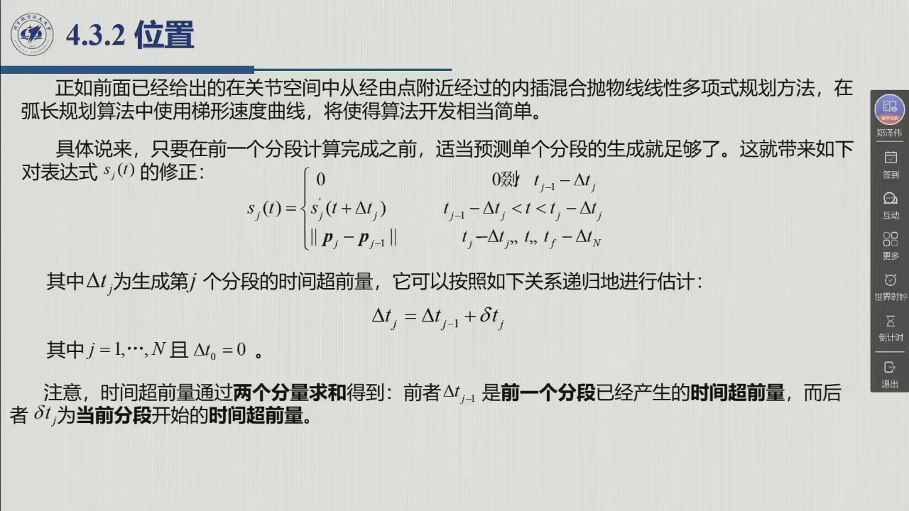

# 4.3.2 位置

上一节用 $p=f(s)$ 描述末端的位置：给出沿路径的距离 $s$，就能找到对应的点。但这个式子还没有安排什么时候到达该点。本节用 $s(t)$ 指定运动时间，再把它代回 $p=f(s)$，得到末端的位置轨迹 $p(t)=f(s(t))$。录播 2:14:03–2:22:28。

## 4.3.2.1 把位置轨迹拆成「几何 × 时间」

与关节空间的 $q(t)$ 一样，操作空间也要描述运动随时间的变化。末端位姿包括位置和指向；先看位置，指向留到 [4.3.3](sec4-3-3.md)（2:14:07）。

::: def 定义 4.3.4 · 操作空间位置轨迹与弧长时间律 {#def-4.3.4}
令三维向量 $p_e=f(s)$ 表示末端位置，$s$ 是从起点 $p_i$ 沿路径走过的弧长，单位为米。若路径总长为 $s_f$，运动从 $t=0$ 的 $s=0$ 出发，在 $t=t_f$ 到达 $s=s_f$。

$s(t)$ 是沿路径的时间律。例如直线路径长 $2\,\mathrm m$，若 $s(1\,\mathrm s)=0.5\,\mathrm m$，就表示第 1 秒末末端沿线走了半米。$s$ 与关节变量 $q$ 的物理含义不同，但都是标量；构造 $s(t)$ 时也可使用三次多项式或混合抛物线等方法（2:15:53）。

点 $p_e$ 的速度由 $p_e$ 对时间求导给出：

$$\dot p_e=\frac{\mathrm dp_e}{\mathrm ds}\,\dot s=\dot s\,\boldsymbol t ,$$

其中 $\boldsymbol t$ 是上一节的切向单位向量；$\dot s$ 是带方向的弧长变化率，实际速率为 $|\dot s|$。如果要求静止起停，就要选择在两端满足 $\dot s=0$ 的时间律。
:::

路径 $f(s)$ 决定几何形状，$s(t)$ 决定沿路径的运动进度；两者合成得到位置轨迹。要用于机械臂，还须检查得到的运动能否满足关节及执行器限制（2:16:14、2:16:41）。

## 4.3.2.2 直线与圆弧：速度与加速度

::: thm 定理 4.3.B · 直线路径与圆弧路径的速度 / 加速度 {#thm-4.3.B}
**直线路径。** 参数表达式为 (4.34)。由复合函数求导法则：

$$\dot p_e=\dot s\,\frac{p_f-p_i}{\|p_f-p_i\|}=\dot s\,\boldsymbol t, \tag{4.42}$$

$$\ddot p_e=\ddot s\,\frac{p_f-p_i}{\|p_f-p_i\|}=\ddot s\,\boldsymbol t . \tag{4.43}$$

对直线，速度与加速度都沿直线方向，它们的模分别为 $|\dot s|$、$|\ddot s|$。

**圆弧路径。** 由 (4.40)(4.41) 求导得：

$$\dot p_e=R\begin{bmatrix}-\dot s\sin(s/\rho)\\[0.6mm] \ \ \dot s\cos(s/\rho)\\[0.6mm] 0\end{bmatrix}, \tag{4.44}$$

$$\ddot p_e=R\begin{bmatrix}-\dot s^2\cos(s/\rho)/\rho-\ddot s\sin(s/\rho)\\[0.6mm] -\dot s^2\sin(s/\rho)/\rho+\ddot s\cos(s/\rho)\\[0.6mm] 0\end{bmatrix}. \tag{4.45}$$

速度向量与 $\boldsymbol t$ 平行；加速度分成两个分量：沿 $n$ 的向心加速度为 $\dot s^2/\rho$，沿 $\boldsymbol t$ 的切向加速度为 $\ddot s$。
:::

::: ex 例 4.3.C · 圆弧上加速度的两个分量（老师 2:18:00 口述分解） {#ex-4.3.C}
把 (4.45) 按 Frenet 标架分解，含义就清楚了：

$$\ddot p_e=\underbrace{\frac{\dot s^2}{\rho}\,n}_{\text{向心：只改方向}}+\underbrace{\ddot s\,\boldsymbol t}_{\text{切向：只改大小}} .$$

老师 2:18:14 的原话：「一部分加速度是沿着切线方向的加速度，它是**改变速度的大小**；另一部分是沿着半径的方向，也就是**向心加速度的方向**……向心加速度只改变速度的方向，而切向加速度改变速度的大小。」

**工程含义**：圆弧路段的 $\dot s$ 不能取太大——向心加速度按 $\dot s^2/\rho$ 增长，曲率半径 $\rho$ 越小，允许的 $\dot s$ 就越小。这正是 [4.1](sec4-1.md#sec-4.1.3) 说的「对曲率比较大的轨迹部分要对速度进行特殊设定」的定量依据。
:::

## 4.3.2.3 多段路径、经由点与时间超前

实际任务中的路径，往往不是单条直线或单段圆弧，而是若干分段首尾相接。先把这种**多段路径**写成统一的参数表达式。

::: def 定义 4.3.5 · 多段路径的参数表达式与经由点 {#def-4.3.5}
考虑由 $N+1$ 个点 $p_0,p_1,\dots,p_N$ 的序列组成的路径，相邻两点由 $N$ 个分段连接。一个切实可行的整体路径参数表达式为

$$p_e=p_0+\sum_{j=1}^{N}\frac{s_j}{\|p_j-p_{j-1}\|}\,(p_j-p_{j-1}), \tag{4.46}$$

其中 $s_j$ 为与第 $j$ 个分段相关联、将 $p_{j-1}$ 连接到 $p_j$ 的弧长：

$$s_j(t)=\begin{cases}
0, & 0\le t\le t_{j-1}\\
s'_j(t), & t_{j-1}<t<t_j\\
\|p_j-p_{j-1}\|, & t_j\le t\le t_f
\end{cases} \tag{4.47}$$

$t_0=0$、$t_N=t_f$ 分别为轨迹的初始与最终时刻。$s'_j(t)$ 可以是三次多项式型的分析函数，也可以是混合抛物线的线性型函数——**它从 $t=t_{j-1}$ 时刻的 $s'_j=0$ 连续变化，在 $t=t_j$ 时刻取 $s_j=\|p_j-p_{j-1}\|$**。对 (4.46) 微分得

$$\dot p_e=\sum_{j=1}^{N}\dot s_j\,\boldsymbol t_j,\qquad \ddot p_e=\sum_{j=1}^{N}\ddot s_j\,\boldsymbol t_j , \tag{4.48,4.49}$$

其中 $\boldsymbol t_j$ 为第 $j$ 条分段的单位切线向量；下标相同的 $t_j$ 表示该段结束时刻。

**问题与「经由点」。** 因为两条**不共线**分段之间，路径点处一阶导数不连续，机械手将**不得不停下来**，然后再沿下一个分段的方向前进（2:20:27）。如果在通过这些路径点时允许一个**松弛的约束条件**，把路径点附近的分段连接起来，就有可能避免机械手停下来——这样的点称为操作空间**经由点**（via point），至少保证一阶导数的连续性。
:::

若允许在中间点附近转弯，就可以提前启动下一段运动，使相邻分段在时间上重叠。这里的“超前”指运动时间上的重叠，不是等计算机算完一段后才计算下一段。重叠改变了原先的折线路径；还要检查衔接处速度是否连续。

::: thm 定理 4.3.D · 时间超前（教材式 4.50） {#thm-4.3.D}
在弧长规划中使用梯形速度曲线时，可以让第 $j$ 段比原计划提前 $\Delta t_j$ 开始。对 (4.47) 中每段的时间安排作如下修正：

$$s'_j(t)=\begin{cases}
0, & 0\le t\le t_{j-1}-\Delta t_j\\
s_j(t+\Delta t_j), & t_{j-1}-\Delta t_j<t\le t_j-\Delta t_j\\
\|p_j-p_{j-1}\|, & t_j-\Delta t_j<t\le t_f-\Delta t_N
\end{cases} \tag{4.50}$$

其中 $\Delta t_j$ 为生成第 $j$ 个分段的时间**超前量**，按如下关系**递归**估计：

$$\Delta t_j=\Delta t_{j-1}+\delta t_j,\qquad j=1,\dots,N,\quad \Delta t_0=0 .$$

注意超前量由两个分量求和得到：$\Delta t_{j-1}$ 是前一个分段已经产生的时间超前量，$\delta t_j$ 为当前分段开始的时间超前量（2:21:04）。
:::

老师对这一步的**坦白提醒**（2:20:27）：「咱们这个规划没有考虑**速度连续性**，就是从一段到另一段，它是不是平滑过渡的（不是）……实际过程中还需要加一个抛线段来进行平滑过渡，或者进行提前的规划。」具体做法就是上一节讲过的：**前一个梯形速度曲线还没走完，就要过渡到下一个梯形速度曲线**，为此引入超前量 $\Delta t_j$ 来做预测。「原理也是比较简单的，但是要写代码还是需要仔细」（2:22:09）。

::: think 考点 · 老师原话（录播时间点）

> **几何与时间解耦，是本节的骨架。** 「这样 $s$ 的运动律就通过 $s$ 来确定了，然后几何是通过路径来确定的」（2:16:18）——**位置规划 = 路径（几何）+ $s(t)$（时间律）**。

> **圆弧加速度必须会分解。** 「一部分加速度是沿着切线方向的加速度，它是改变速度的大小；另一部分是沿着半径的方向，也就是向心加速度的方向……向心加速度只改变速度的方向，而切向加速度改变速度的大小」（2:18:00）。

> **多段路径会「停」在路径点。** 「因为两条不共线分段之间路径点处一阶导数的不连续性，机械手将不得不停下来，然后再沿着下一个分段的方向前进」（2:20:00）——这是**经由点**与**时间超前**要解决的问题。

> **别把它当成直线插补。** 「无需精确遵循路径时，我们可以插入一些路径点，点和点之间可以内插一个函数」（2:18:57）——直线段 + 抛物线混合，与关节空间的 [4.2.2.4](sec4-2-2.md#sec-4.2.2.4) 完全同构。
:::

::: think 默写点 · 合上书再写（主动回忆）

不看正文与速查表，先默写下面三条，再展开核对；写不出来，就说明这一节还没「拿走」。

1. 位置轨迹怎么分解？为什么 $s(t)$ 能直接用关节空间的方法？
2. 写出 $\dot p_e$ 与 $\ddot p_e$ 的表达式（直线、圆弧各一组），标出向心加速度那一项。
3. 多段路径为什么要在路径点做「经由点」处理？时间超前量怎么递归？

::: sol 核对

$p_e=f(s)$（几何，来自路径）与 $s=s(t)$（时间律）解耦；$s$ 是一维标量，因此关节空间的全部方法（三次、梯形、样条）都能直接套在 $s(t)$ 上。

直线：$\dot p_e=\dot s\,\boldsymbol t$，$\ddot p_e=\ddot s\,\boldsymbol t$。圆弧：$\dot p_e=\dot s\,\boldsymbol t$，$\ddot p_e=\dfrac{\dot s^2}{\rho}n+\ddot s\,\boldsymbol t$。第一项是沿 $n$ 的向心加速度，第二项是沿 $\boldsymbol t$ 的切向加速度。

因为相邻不共线分段在路径点处一阶导数不连续，机械手会被迫停下。用抛物线混合「削角」把分段连起来，就得到经由点；为避免全局时间被拉长，用**时间超前** $\Delta t_j=\Delta t_{j-1}+\delta t_j$ 在前一段完成前就启动下一段。

:::

:::

## 4.3.2 小结与常见错误

- **一条主线**：先用 $p_e=f(s)$ 描述几何路径，再用 $s(t)$ 安排时间；直线的加速度沿直线，圆弧则多出向心分量。多段路径可以在中间点附近过渡，但要检查速度连续性。
- **与关节规划的关系**：$s(t)$ 是标量，可以用三次、梯形等方法构造；它表示沿路径的距离，不是关节变量。
- **实现前检查**：给定末端轨迹后，还要通过运动学和机械手限制检查能否执行。

::: think 常见错误清单 · 自查三条
1. 把 $\dot s$ 当成速度向量：它是有符号的弧长变化率；速度向量还需要切向方向，速率为 $|\dot s|$。
2. 圆弧只算切向加速度：还要计入大小为 $\dot s^2/\rho$ 的向心分量。
3. 以为折线路径能以非零速度直接通过转角：若方向发生突变，要么在转角停下，要么改变路径并平滑过渡。
:::
