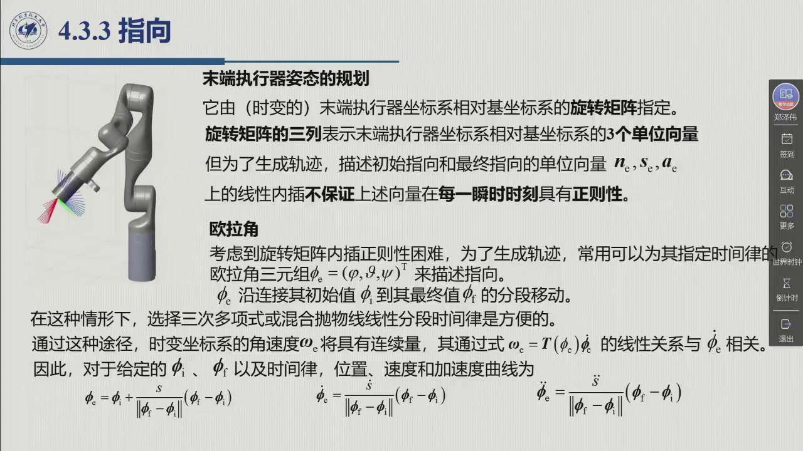
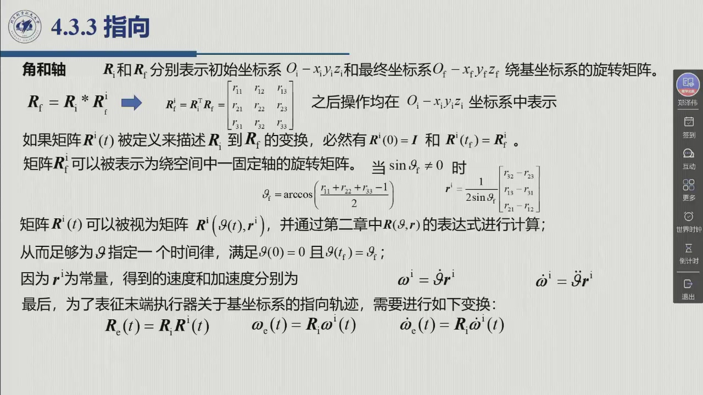

# 4.3.3 指向

工具沿路径移动时，方向也可能需要改变。位置可以逐分量插值，旋转矩阵却受正交约束，逐元素插值通常得不到合法姿态。本节分别用欧拉角和角轴安排姿态随时间的变化，并求出对应的角速度与角加速度。对应录播 2:22:28–2:28:51。

## 4.3.3.1 旋转矩阵为什么不能直接插值

姿态矩阵的三列必须始终是右手正交单位轴。这是每个中间时刻的约束，仅保证起终矩阵合法还不够。

::: thm 定理 4.3.E · 旋转矩阵的线性插值破坏正交性 {#thm-4.3.E}
设初始与最终姿态分别为 $R_i$、$R_f$。若对两矩阵**逐元素**做线性插值

$$R(\lambda)=(1-\lambda)R_i+\lambda R_f,\qquad \lambda\in[0,1],$$

则除 $\lambda=0,1$ 外一般有 $R(\lambda)^{\mathrm T}R(\lambda)\ne I$。

正交性要求各列模为1、不同列内积为0。这些是关于矩阵元素的二次约束，逐元素线性混合通常无法保持。
:::

## 4.3.3.2 方法一：欧拉角

::: def 定义 4.3.6 · 欧拉角时间律 {#def-4.3.6}
先选定ZYZ约定下连续的初终代表 $\varphi_i,\varphi_f\in\mathbb R^3$，记 $\Delta\varphi=\varphi_f-\varphi_i$。用无量纲进度 $\lambda(0)=0,\lambda(T)=1$ 连接参数：

$$\varphi_e=\varphi_i+\lambda\Delta\varphi,\qquad
\dot\varphi_e=\dot\lambda\Delta\varphi,\qquad
\ddot\varphi_e=\ddot\lambda\Delta\varphi.\tag{4.51}$$

$\lambda$ 可选静止起停三次、五次或其他满足条件的时间律。它只是参数曲线的进度，不能直接解释成工具已转过的物理角度；欧拉角插值也不自动给出最短旋转。
:::

由 $R_e=R_z(\varphi)R_y(\vartheta)R_z(\psi)$ 恢复姿态，矩阵在整个过程都合法。若需要基系角速度，再使用[§3.6](../ch03/sec3-6.md)中已推导的映射：

$$\omega_e=T(\varphi_e)\dot\varphi_e,\qquad
\dot\omega_e=\dot T(\varphi_e)\dot\varphi_e+T(\varphi_e)\ddot\varphi_e.$$

第二式对时间变化的两个因子使用乘积法则，不能只保留 $T\ddot\varphi_e$。若要从角速度反求欧拉角速率，还须避开参数图的奇点；姿态本身合法，并不保证参数逆换算可用。

## 4.3.3.3 方法二：角和轴

另一种方法先求初终姿态之间的等效相对转动，再为这个转角安排时间律。这里只计算方向；两个坐标原点是否沿位置路径移动，不影响旋转部分的构造。

::: thm 定理 4.3.F · 角和轴的轨迹生成 {#thm-4.3.F}
令 $R_i$、$R_f$ 分别表示初始坐标系与最终坐标系绕基坐标系的旋转矩阵。回顾 $R_f=R_iR_{\rm rel}$，两坐标系之间的旋转矩阵 $R_{\rm rel}=R_i^{\mathrm T}R_f$ 可由 [2.5](../ch02/sec2-5.md) 的表达式计算。若定义 $R'(t)$ 描述 $R_i$ 到 $R_f$ 的变换，则必有 $R'(0)=I$、$R'(t_f)=R_{\rm rel}$。

于是 $R_{\rm rel}$ 可表示为**绕空间中一固定轴**的旋转矩阵；当 $\sin\theta_f\ne0$ 时，用 [@def-2.5.1] 的公式计算轴的**单位向量** $r'$ 与**旋转角** $\theta_f$：

$$\theta_f=\arccos\!\left(\frac{r_{11}+r_{22}+r_{33}-1}{2}\right),\qquad
r'=\frac{1}{2\sin\theta_f}\begin{bmatrix}r_{32}-r_{23}\\ r_{13}-r_{31}\\ r_{21}-r_{12}\end{bmatrix}. \tag{4.52}$$

（式 4.52 不是新公式——它就是 [2.5.2](../ch02/sec2-5.md#sec-2.5.2) 的逆解「取迹求角、反对称部分求轴」，即对数映射 $\log R_{\rm rel}=\theta_fS(r')$（[2.5.3](../ch02/sec2-5.md#sec-2.5.3)）。下式的 $R'(t)=R'(\theta(t),r')$ 则是指数映射随时间「走」：$R'(t)=\exp\big(\theta(t)S(r')\big)$。）

矩阵 $R'(t)$ 可视为 $R'(\theta(t),r')$，从而**只需为标量 $\theta$ 指定一个时间律**，其类型与单个关节的时间律相同，且 $\theta(0)=0$、$\theta(t_f)=\theta_f$。因为 $r'$ 为**常量**，得到的速度和加速度分别为

$$\omega'=\dot\theta\,r',\qquad \dot\omega'=\ddot\theta\,r' . \tag{4.53,4.54}$$

最后，为表征末端执行器关于基坐标系的指向轨迹，做一次变换：

$$R_e(t)=R_iR'(t),\qquad \omega_e=R_i\,\omega'(t),\qquad \dot\omega_e=R_i\,\dot\omega'(t) . \tag{4.55}$$
:::

<figure>

<figcaption>课堂幻灯片 · 02:26:01：角和轴法——等效轴 $r'$、转角 $\theta_f$ 与(4.52)–(4.55)。</figcaption>
</figure>

为什么还要乘 $R_i$？对 $R_e=R_iR'$ 求导，因 $R_i$ 固定，

$$\dot R_eR_e^{\mathrm T}=R_i(\dot R'R'^{\mathrm T})R_i^{\mathrm T}
=R_iS(r')R_i^{\mathrm T}\dot\theta
=S(R_ir')\dot\theta.$$

左边按定义等于 $S(\omega_e)$，所以基系角速度为 $\omega_e=(R_ir')\dot\theta$。这个方向是固定的，初始系分量为 $r'$，基系分量为 $R_ir'$。

例如 $R_i=R_z(90^\circ)$，目标为 $R_f=R_iR_x(90^\circ)$，则相对轴在初始系中为 $r'=e_x$。基系看到的固定轴是 $R_ir'=e_y$；若此刻 $\dot\theta=0.2$ rad/s，基系角速度就是 $(0,0.2,0)$ rad/s。不能省去 $R_i$，把它误写成绕基系 $x$ 转。

再为同一例子选2 s的零端点速度、加速度五次时间律。令 $u=t/2$、$\theta=(\pi/2)(10u^3-15u^4+6u^5)$，在1 s时已转过 $\pi/4$，角速度为 $(0,15\pi/32,0)$ rad/s。端点角速度、角加速度都为零，可与前后静止姿态连续衔接。

提取轴角时，$\theta_f=0$ 可保持初始姿态；$\theta_f=\pi$ 时不能除以 $\sin\theta_f$，应从 $R_{\rm rel}r'=r'$ 求单位轴并选定连续方向。浮点实现还要把取迹所得余弦限制在 $[-1,1]$ 的舍入范围内。欧拉角法同样需要选连续代表；两端参数相同时则直接保持，不对零长度差向量归一化。

## 4.3.3 小结与常见错误

逐元素插值通常不能保持旋转矩阵的正交性。欧拉角法在所选连续分支上规划角度，再由 $T$ 换算角速度；[角轴法](../recall.md#axis-angle)先求初终相对旋转，再对固定轴的转角安排时间律。两种方法都要检查坐标系、零角与半圈等特殊情况。
