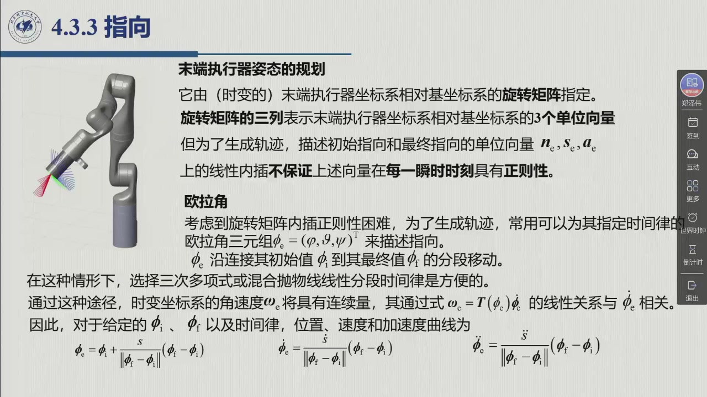

# 4.3.3 指向

上一节安排末端的位置；例如夹爪沿直线移动时，还可能需要同时改变朝向。姿态可以用第二章的旋转矩阵表示，但不能像位置坐标那样直接逐元素插值。本节先看原因，再用欧拉角和角轴两种表示规划姿态。录播 2:22:28–2:28:51。

## 4.3.3.1 旋转矩阵为什么不能直接插值

旋转矩阵的三列表示末端坐标系的三个单位轴在基坐标系中的方向。三根轴必须长度为 1、彼此垂直，因此随便给矩阵的各元素插值，结果未必仍代表姿态（2:23:08）。

::: thm 定理 4.3.E · 旋转矩阵的线性插值破坏正交性 {#thm-4.3.E}
设初始与最终姿态分别为 $R_i$、$R_f$。若对两矩阵**逐元素**做线性插值

$$R(\lambda)=(1-\lambda)R_i+\lambda R_f,\qquad \lambda\in[0,1],$$

则除 $\lambda=0,1$ 外一般有 $R(\lambda)^{\mathrm T}R(\lambda)\ne I$。

例如，初始姿态取 $R_i=I$，最终姿态绕基坐标系 $z$ 轴旋转 $180^\circ$，即 $R_f=\operatorname{diag}(-1,-1,1)$。逐元素取中点得到 $R(1/2)=\operatorname{diag}(0,0,1)$：前两列长度为零，不能表示坐标轴。两个端点都是旋转矩阵，中间矩阵却不是（2:23:33）。
:::

要得到合法的中间姿态，可以先用欧拉角或角轴描述旋转，再为这些量指定时间律。

## 4.3.3.2 方法一：欧拉角

::: def 定义 4.3.6 · 欧拉角时间律 {#def-4.3.6}
用第二章的三个欧拉角 $\varphi_e=(\varphi,\vartheta,\psi)^{\mathrm T}$ 描述姿态。$\varphi_i$ 和 $\varphi_f$ 分别是初始与最终的角度向量；在选定同一种欧拉角约定后，可以先在这两个向量之间插值。沿连接它们的线段引入参数 $s$，再给 $s$ 指定时间律。这里的 $s$ 是**欧拉角空间中的线段长度参数**，不是上一节以米计的空间弧长。

若欧拉角及其速度连续，则在表示有效的区间内，可由 [@thm-3.6.A] 的关系 $\omega_e=T(\varphi_e)\dot\varphi_e$ 得到连续角速度。选择角度表示时还要留意欧拉角的多解和奇异位置。

因此，对于给定的 $\varphi_i$、$\varphi_f$ 以及时间律，位置、速度和加速度曲线为

$$\varphi_e=\varphi_i+\frac{s}{\|\varphi_f-\varphi_i\|}(\varphi_f-\varphi_i),\qquad
\dot\varphi_e=\dot s\,\frac{\varphi_f-\varphi_i}{\|\varphi_f-\varphi_i\|},\qquad
\ddot\varphi_e=\ddot s\,\frac{\varphi_f-\varphi_i}{\|\varphi_f-\varphi_i\|}, \tag{4.51}$$

这里 $s(0)=0$，$s(t_f)=\|\varphi_f-\varphi_i\|$；可使用三次或梯形时间律。若两端欧拉角相同，则保持姿态，不必使用分母为零的式 (4.51)。
:::

插值得到的是欧拉角及其导数。若需要基坐标系下的角速度，先由欧拉角求旋转矩阵 $R_e$（ZYZ 关系见 [@thm-2.4.A]），再用第三章的关系转换（2:25:00、[3.6](../ch03/sec3-6.md)）：

$$R_e=R_e(\varphi_e)\ \Longrightarrow\ \omega_e=T(\varphi_e)\,\dot\varphi_e,\qquad \dot\omega_e=\dot T\dot\varphi_e+T\ddot\varphi_e .$$

因此姿态规划也要规划**角位置、角速度、角加速度**三个量——「其实跟位置规划很像」（2:26:00）。

## 4.3.3.3 方法二：角和轴

另一种做法是先找出初始姿态到最终姿态的相对旋转，再用第二章的角和轴表示它（[@def-2.5.1]）。例如绕固定轴转动夹爪时，轴确定后，只需安排转角如何随时间变化（2:26:06）。

::: thm 定理 4.3.F · 角和轴的轨迹生成 {#thm-4.3.F}
令 $R_i,R_f$ 分别表示初始和最终姿态在基坐标系中的旋转矩阵。由 $R_f=R_iR_i^f$ 可得 $R_i^f=R_i^{\mathrm T}R_f$；它描述从初始姿态到最终姿态的相对旋转，矩阵分量写在初始坐标系中。记运动过程中的相对旋转为 $R'(t)$，于是 $R'(0)=I$、$R'(t_f)=R_i^f$。

将 $R_i^f$ 表示为绕一根固定轴旋转：$r'$ 是轴在初始坐标系中的单位向量，$\theta_f$ 是总转角（弧度）。当 $\sin\theta_f\ne0$ 时，可由 $R_i^f$ 的元素 $r_{ij}$ 求出：

$$\theta_f=\arccos\!\left(\frac{r_{11}+r_{22}+r_{33}-1}{2}\right),\qquad
r'=\frac{1}{2\sin\theta_f}\begin{bmatrix}r_{32}-r_{23}\\ r_{13}-r_{31}\\ r_{21}-r_{12}\end{bmatrix}. \tag{4.52}$$

（式 4.52 不是新公式——它就是 [2.5.2](../ch02/sec2-5.md#sec-2.5.2) 的逆解「取迹求角、反对称部分求轴」，即对数映射 $\log R_i^f=\theta_fS(r')$（[2.5.3](../ch02/sec2-5.md#sec-2.5.3)）。下式的 $R'(t)=R'(\theta(t),r')$ 则是指数映射随时间「走」：$R'(t)=\exp\big(\theta(t)S(r')\big)$。）

当 $\theta_f=0$ 时，两姿态相同，可保持不动，旋转轴不唯一；当 $\theta_f=\pi$ 时，上式分母为零，应按第二章的特殊情形从矩阵求轴，不能直接套用式 (4.52)。

矩阵 $R'(t)$ 可视为 $R'(\theta(t),r')$，从而**只需为标量 $\theta$ 指定一个时间律**，其类型与单个关节的时间律相同，且 $\theta(0)=0$、$\theta(t_f)=\theta_f$。因为 $r'$ 为**常量**，得到的速度和加速度分别为

$$\omega'=\dot\theta\,r',\qquad \dot\omega'=\ddot\theta\,r' . \tag{4.53,4.54}$$

最后，为表征末端执行器关于基坐标系的指向轨迹，做一次变换：

$$R_e(t)=R_iR'(t),\qquad \omega_e=R_i\,\omega'(t),\qquad \dot\omega_e=R_i\,\dot\omega'(t) . \tag{4.55}$$
:::

轴 $r'$ 固定后，姿态随时间的变化只剩转角 $\theta(t)$ 要安排。老师在 2:27:14 说：「这个轴是固定的、不变的，那我们只要规划 $\theta$ 就可以了——相当于把它变成一个一维的问题。」因此可以复用单关节的时间律；最后通过 (4.55) 把相对旋转和角速度表示到基坐标系。

::: think 考点 · 老师原话（录播时间点）

> **本节老师明确「不详细讲」，但原理必须知道。** 「这个（角和轴）有时间关系不能详细地讲，**但是原理可以给大家说一下**」（2:26:06）。姿态规划在考试中属于**了解层面**，但两条思路（欧拉角 / 角和轴）要能说清。

> **核心障碍是正交性。** 「旋转矩阵我指定初始的姿态和终止的姿态，但是从初始到终止，如果采用简单的插值的方法，它**不能保证**整个过程这个旋转矩阵它都是正交的……这是有问题的」（2:23:14）。**这是姿态规划的出发点，也是必答的一句。**

> **角和轴把三维压成一维。** 「任何一个旋转，它都可以表示成空间的一个轴以及绕着这个轴的一个旋转……**那么这个轴是固定的、不变的，那我们只要规划 $\theta$ 就可以了**——相当于把它变成一个一维的问题」（2:26:50）。

> **欧拉角法要记得「回到基坐标系」。** 「实际用的过程中，我们还要把它表示在基坐标系，或者是零空间内」（2:25:01）——由 $R_e$ 经分析雅可比换算，别忘了这一步。
:::

::: think 默写点 · 合上书再写（主动回忆）

不看正文与速查表，先写出下面几条，再展开核对。写不出来就说明这一节还没「拿走」。

1. 旋转矩阵为什么不能逐元素线性插值？
2. 写出欧拉角法的位置 / 速度 / 加速度三式 (4.51)，并说明插值完还要做什么。
3. 写出角和轴法的 $\theta_f$ 与 $r'$ 公式，并说明为什么只需规划一个标量。

::: sol 核对

正交性要求任意两列内积为 0、每列模为 1；两个正交矩阵逐元素按同一比例混合后，得到的矩阵一般不再满足这两条——$R(\lambda)^{\mathrm T}R(\lambda)\ne I$。

$\varphi_e=\varphi_i+\dfrac{s}{\|\varphi_f-\varphi_i\|}(\varphi_f-\varphi_i)$，$\dot\varphi_e=\dot s\dfrac{\varphi_f-\varphi_i}{\|\varphi_f-\varphi_i\|}$，$\ddot\varphi_e=\ddot s\dfrac{\varphi_f-\varphi_i}{\|\varphi_f-\varphi_i\|}$。插值完成后还要由欧拉角算出 $R_e$，再经 $\omega_e=T(\varphi_e)\dot\varphi_e$（[@thm-3.6.A]）换算到基坐标系。

$\theta_f=\arccos\!\big((r_{11}+r_{22}+r_{33}-1)/2\big)$，$r'=\dfrac{1}{2\sin\theta_f}[r_{32}-r_{23};\ r_{13}-r_{31};\ r_{21}-r_{12}]^{\mathrm T}$（$R_i^f=R_i^{\mathrm T}R_f$ 的元素）。因为 $r'$ 是常量，姿态轨迹完全由 $\theta(t)$ 决定——三维姿态规划降为一维标量规划，时间律直接复用点对点 / 系列点的方法。

:::

:::

## 4.3.3 小结与常见错误

- **一条主线**：旋转矩阵不能直接插值（正交性）⇒ 两条正路：**欧拉角**（三标量分别插值，再经 $T$ 换算回基系）与**角和轴**（轴固定、只规划 $\theta$）。
- **一个统一**：位置规划落在 $s(t)$、姿态规划落在 $\theta(t)$——**都化成一维标量时间律**，都能复用 [4.2.1](sec4-2-1.md) / [4.2.2](sec4-2-2.md) 的全部武器。
- **一句话**：「姿态规划比位置规划复杂，复杂在**表示**；一旦选对表示（欧拉角或角和轴），剩下的还是那几套一维时间律。」

::: think 常见错误清单 · 自查三条
1. **逐元素插值旋转矩阵**：得到的是「中间矩阵」，不是旋转矩阵——$R(\lambda)$ 既不正交，也不能当作姿态使用。
2. **欧拉角插值后忘了回基坐标系**：插出来的是 $\varphi_e$，控制要的是 $\omega_e$；中间必须过 $T(\varphi_e)$（[3.6](../ch03/sec3-6.md)），且 $T$ 本身有奇点（$\sin\vartheta=0$）。
3. **角和轴法忘了 $r'$ 是在哪个系里**：$r'$ 是 $R_i^f=R_i^{\mathrm T}R_f$ 的等效轴；$\omega'$ 还要左乘 $R_i$ 才是基系下的 $\omega_e$。
:::
