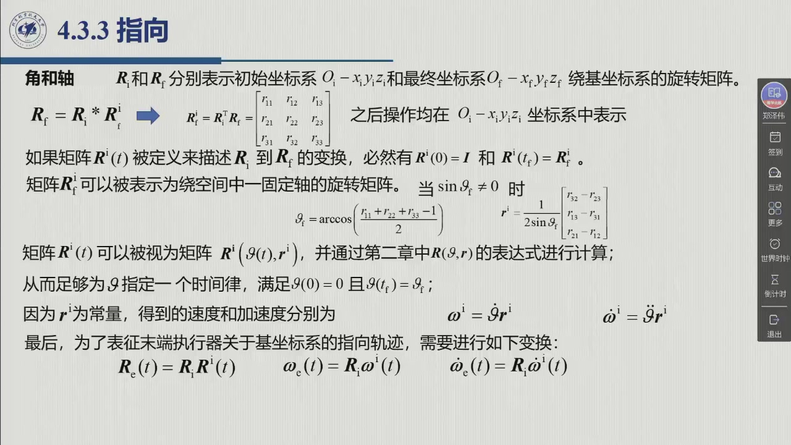

# 4.3.3 指向

工具沿路径移动时，方向也可能需要改变。位置可以逐分量插值，旋转矩阵却受正交约束，逐元素插值通常得不到合法姿态。本节分别用欧拉角和角轴安排姿态随时间的变化，并求出对应的角速度与角加速度。对应录播 2:22:28–2:28:51。

## 4.3.3.1 旋转矩阵为什么不能直接插值

姿态矩阵的三列必须始终是右手正交单位轴。这是每个中间时刻的约束，仅保证起终矩阵合法还不够。

::: thm 定理 4.3.E · 旋转矩阵的线性插值破坏正交性 {#thm-4.3.E}
设初始与最终姿态分别为 $R_i$、$R_f$。若对两矩阵**逐元素**做线性插值

$$R(\lambda)=(1-\lambda)R_i+\lambda R_f,\qquad \lambda\in[0,1],$$

则除 $\lambda=0,1$ 外一般有 $R(\lambda)^{\mathrm T}R(\lambda)\ne I$。

正交性要求各列模为1、不同列内积为0。这些是关于矩阵元素的二次约束，逐元素线性混合通常无法保持。
:::

## 4.3.3.2 方法一：欧拉角

::: def 定义 4.3.6 · 欧拉角时间律 {#def-4.3.6}
在 ZYZ 约定下先选定同一连续分支上的起终欧拉角代表 $\varphi_i,\varphi_f\in\mathbb R^3$，记 $\Delta\varphi=\varphi_f-\varphi_i$。在时长 $t_f>0$ 内选无量纲进度 $\lambda(t)$（$\lambda(0)=0,\lambda(t_f)=1$），令参数按直线段走：

$$\varphi_e(t)=\varphi_i+\lambda(t)\Delta\varphi,\qquad
\dot\varphi_e(t)=\dot\lambda(t)\Delta\varphi,\qquad
\ddot\varphi_e(t)=\ddot\lambda(t)\Delta\varphi.\tag{4.51}$$

进度 $\lambda$ 可选静止起停三次、五次或其他时间律。它只是三元欧拉角向量之间的直线进度，不等于工具绕固定轴转过的物理角度，一般也不走三维空间中的最短转动路径。
:::

每个时刻按 $R_e(t)=R_z(\varphi)\!R_y(\vartheta)\!R_z(\psi)$ 恢复出来的矩阵自动保持正交。控制需要基系角速度 $\omega_e$ 和角加速度 $\dot\omega_e$ 时，再用 [§3.6](../ch03/sec3-6.md) 推导的解析映射 $T(\varphi_e)$ 换算（直接求导须对两项使用乘积法则）：

$$\omega_e=T(\varphi_e)\dot\varphi_e,\qquad
\dot\omega_e=\dot T(\varphi_e)\dot\varphi_e+T(\varphi_e)\ddot\varphi_e.$$

由角速度反解 $\dot\varphi_e=T^{-1}(\varphi_e)\omega_e$ 时，仍要避开 $\sin\vartheta=0$ 的表示奇点（[@thm-3.6.A]）；即使 $R_e(t)$ 本身处处合法，参数映射在奇点处仍然不可逆。

## 4.3.3.3 方法二：角和轴

另一种方法先求初终姿态之间的等效相对转动，再为这个转角安排时间律。这里只计算方向；两个坐标原点是否沿位置路径移动，不影响旋转部分的构造。

::: thm 定理 4.3.F · 角和轴的轨迹生成 {#thm-4.3.F}
令 $R_i$、$R_f$ 分别表示初始坐标系与最终坐标系绕基坐标系的旋转矩阵。回顾 $R_f=R_iR_{\rm rel}$，两坐标系之间的旋转矩阵 $R_{\rm rel}=R_i^{\mathrm T}R_f$ 可由 [2.5](../ch02/sec2-5.md) 的表达式计算。若定义 $R'(t)$ 描述 $R_i$ 到 $R_f$ 的变换，则必有 $R'(0)=I$、$R'(t_f)=R_{\rm rel}$。

于是 $R_{\rm rel}$ 可表示为**绕空间中一固定轴**的旋转矩阵；当 $\sin\theta_f\ne0$ 时，用 [@def-2.5.1] 的公式计算轴的**单位向量** $r'$ 与**旋转角** $\theta_f$：

$$\theta_f=\arccos\!\left(\frac{r_{11}+r_{22}+r_{33}-1}{2}\right),\qquad
r'=\frac{1}{2\sin\theta_f}\begin{bmatrix}r_{32}-r_{23}\\ r_{13}-r_{31}\\ r_{21}-r_{12}\end{bmatrix}. \tag{4.52}$$

（式 4.52 不是新公式——它就是 [2.5.2](../ch02/sec2-5.md#sec-2.5.2) 的逆解「取迹求角、反对称部分求轴」，即对数映射 $\log R_{\rm rel}=\theta_fS(r')$（[2.5.3](../ch02/sec2-5.md#sec-2.5.3)）。下式的 $R'(t)=R'(\theta(t),r')$ 则是指数映射随时间「走」：$R'(t)=\exp\big(\theta(t)S(r')\big)$。）

矩阵 $R'(t)$ 可视为 $R'(\theta(t),r')$，从而**只需为标量 $\theta$ 指定一个时间律**，其类型与单个关节的时间律相同，且 $\theta(0)=0$、$\theta(t_f)=\theta_f$。因为 $r'$ 为**常量**，得到的速度和加速度分别为

$$\omega'=\dot\theta\,r',\qquad \dot\omega'=\ddot\theta\,r' . \tag{4.53,4.54}$$

最后，为表征末端执行器关于基坐标系的指向轨迹，做一次变换：

$$R_e(t)=R_iR'(t),\qquad \omega_e=R_i\,\omega'(t),\qquad \dot\omega_e=R_i\,\dot\omega'(t) . \tag{4.55}$$
:::

<figure>

<figcaption>课堂幻灯片 · 02:26:01：角和轴法——等效轴 $r'$、转角 $\theta_f$ 与(4.52)–(4.55)。</figcaption>
</figure>

为什么角速度 $\omega_e$ 和角加速度 $\dot\omega_e$ 都要左乘 $R_i$？对 $R_e(t)=R_iR'(t)$ 求时间导数，因为起始姿态 $R_i$ 不随时间变化，而 $\dot R'R'^{\mathrm T}=S(\omega')=S(r')\dot\theta$，直接代入并使用[叉乘矩阵共轭恒等式](../ch02/sec2-3.md#thm-2.3.A) $R_iS(r')R_i^{\mathrm T}=S(R_ir')$：

$$\dot R_eR_e^{\mathrm T}
=R_i\dot R'\bigl(R_iR'\bigr)^{\mathrm T}
=R_i\bigl(\dot R'R'^{\mathrm T}\bigr)R_i^{\mathrm T}
=R_iS(r')R_i^{\mathrm T}\dot\theta
=S(R_ir')\dot\theta.$$

左边按定义等于 $S(\omega_e)$，因此基坐标系里的角速度为 $\omega_e=(R_ir')\dot\theta$。轴向在物理空间中保持不变：在初始系 $i$ 中看分量是 $r'$，换到基系中看分量则是 $R_ir'$；再对时间求一次导就得 $\dot\omega_e=(R_ir')\ddot\theta=R_i\dot\omega'$。

例如 $R_i=R_z(90^\circ)$，目标为 $R_f=R_iR_x(90^\circ)$，则相对轴在初始系中为 $r'=e_x$。基系看到的固定轴是 $R_ir'=e_y$；若此刻 $\dot\theta=0.2$ rad/s，基系角速度就是 $(0,0.2,0)$ rad/s，不能省去 $R_i$ 把它误写成绕基系 $x$ 轴转。

再为同一例子选 2 s 的零端点速度、加速度五次时间律。令 $u=t/2$、$\theta=(\pi/2)(10u^3-15u^4+6u^5)$，在 $t=1\ \mathrm s$（$u=1/2$）时已转过 $\pi/4$，此时 $\dot\theta=\frac{\pi}{2}\cdot\frac{30(1/4)(1/4)}{2}=\frac{15\pi}{32}$ rad/s，基系角速度为 $(0,15\pi/32,0)$ rad/s。端点角速度、角加速度都为零，可与前后静止姿态连续衔接。

提取轴角时，$\theta_f=0$ 直接保持初始姿态；$\theta_f=\pi$（半圈）时 $\sin\theta_f=0$，不能用式 (4.52) 除以零，应按 [@thm-2.5.B] 从 $R_{\rm rel}r'=r'$（即 $(R_{\rm rel}+I)/2$ 的最大对角元列）求出单位轴并选定连续方向。浮点实现还要把 $\operatorname{tr}(R_{\rm rel}-I)/2$ 截断到 $[-1,1]$ 防止反余弦越界。欧拉角法同样需要提前选连续分支；两端姿态相同时直接保持，不对零长度差向量归一化。

::: think 默写点 · 合上书再写（主动回忆）
不看正文，先自己写出下面三条，再展开核对。

1. 为什么不能对两个旋转矩阵逐元素做线性插值？
2. 写出欧拉角法 (4.51) 的姿态、速率与加速度式，并写出把 $\dot\varphi_e$ 换回基系角速度 $\omega_e$ 的关系。
3. 写出角轴法的相对旋转矩阵 $R_{\rm rel}$、$\theta_f,r'$ 公式与基系角速度 $\omega_e=R_i\omega'$ 的推导依据。

::: sol 核对
1. 正交条件 $R^{\mathrm T}R=I$ 是元素间的二次约束，$(1-\lambda)R_i+\lambda R_f$ 在 $\lambda\in(0,1)$ 时一般不再满足各列单位长且两两正交。
2. $\varphi_e=\varphi_i+\lambda\Delta\varphi$、$\dot\varphi_e=\dot\lambda\Delta\varphi$、$\ddot\varphi_e=\ddot\lambda\Delta\varphi$；插值完须经 $\omega_e=T(\varphi_e)\dot\varphi_e$（[@thm-3.6.A]）与 $\dot\omega_e=\dot T\dot\varphi_e+T\ddot\varphi_e$ 换回基系。
3. $R_{\rm rel}=R_i^{\mathrm T}R_f$；用取迹与反对称部分提取 $\theta_f,r'$ 后，只需规划一维 $\theta(t)$。因 $R_e=R_iR'$ 且 $\dot R_eR_e^{\mathrm T}=R_i(\dot R'R'^{\mathrm T})R_i^{\mathrm T}=S(R_ir')\dot\theta$，故 $\omega_e=R_i\omega'$。
:::
:::

## 4.3.3 小结与常见错误

旋转矩阵受正交约束，不能逐元素线性插值；姿态轨迹改在欧拉角或角轴表示上安排一维进度。欧拉角法直接沿参数分支直线插值再经 $T(\varphi_e)$ 换算角速度，要注意参数奇点；[角轴法](../recall.md#axis-angle)先求相对旋转 $R_{\rm rel}=R_i^{\mathrm T}R_f$ 再对单轴转角规划，要注意把初始系下的角速度左乘 $R_i$ 换回基坐标系，并单独处理零角与半圈。至此第四章完成运动参考生成，第五章将把这些轨迹送入执行器与传感器，核对电机、驱动与测量能否实现它。

::: think 常见错误清单 · 自查三条
1. **逐元素插值旋转矩阵**：$R(\lambda)=(1-\lambda)R_i+\lambda R_f$ 在中间时刻不正交，不是合法姿态。
2. **欧拉角插值后忘了过 $T(\varphi_e)$**：$\dot\varphi_e$ 是参数导数，控制使用的是基系角速度 $\omega_e=T(\varphi_e)\dot\varphi_e$，且求 $\dot\omega_e$ 时不能漏掉 $\dot T\dot\varphi_e$。
3. **角轴法漏乘 $R_i$**：由 $R_{\rm rel}=R_i^{\mathrm T}R_f$ 提取的 $r'$ 用初始系分量表示，基系里的转轴是 $R_ir'$、角速度是 $R_i\omega'$。
:::
