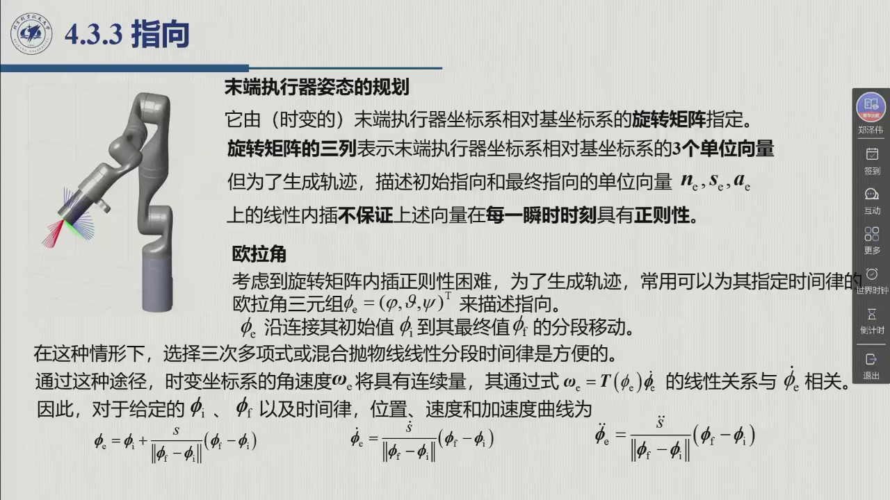
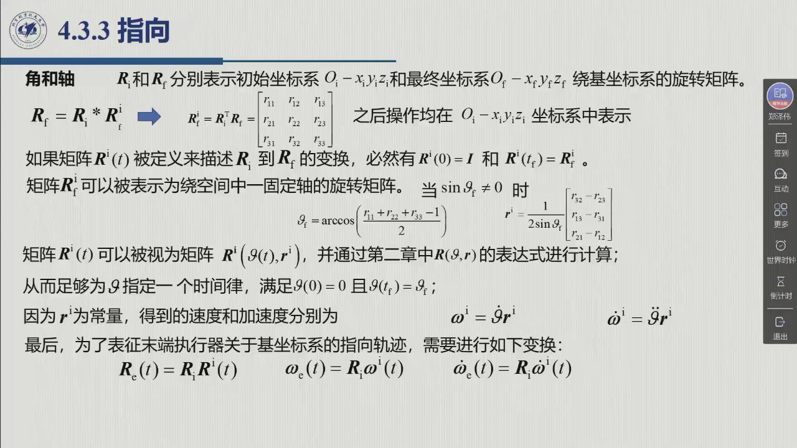

# 4.3.3 指向

位置规划最后落在标量 $s(t)$ 上，姿态就没这么便宜——因为**姿态的表示本身就有约束**。最自然的想法（把旋转矩阵的元素直接插值）会破坏正交性，于是教材给出两条正路：把姿态换成**三个欧拉角**分别插值，或者换成**一根轴 + 一个转角**，把三维问题压成只规划一个标量 $\theta(t)$。本节先讲清楚为什么不能直接插值，再依次走这两条路。录播 2:22:28–2:28:51。

<aside class="lesson-brief" aria-label="4.3.3 学习简报">

PREREQUISITE<strong>你需要先会</strong>
旋转矩阵的正交性 $RR^{\mathrm T}=I$ 与列的含义（[@def-2.2.2]）；ZYZ 欧拉角（[@thm-2.4.A]）；角和轴表示（[@def-2.5.1]）；角速度与分析雅可比的关系 $\omega=T(\varphi)\dot\varphi$（[@thm-3.6.A]）。

TARGET<strong>本节要建立</strong>
旋转矩阵线性插值为何失效（正交性）；**欧拉角法** (4.51) 与角速度 / 角加速度的换算；**角和轴法**：等效轴 $r'$ 与转角 $\theta_f$ 的计算 (4.52)；轴固定，把 $\theta$ 化为一维时间律并给出 $\omega'$、$\dot\omega'$ (4.53)、(4.54)；最后变换回基坐标系 (4.55)。

CHECKPOINT<strong>学完的标准</strong>
能说出旋转矩阵为什么不能逐元素插值；能默写欧拉角法的位置 / 速度 / 加速度三式；能从 $R_f=R_iR_i^f$ 出发写出 $\theta_f$ 与 $r'$ 的公式，并说明为什么轴固定、只需规划 $\theta$。

</aside>

## 4.3.3.1 旋转矩阵为什么不能直接插值

末端执行器的**指向**通常由（时变的）末端执行器坐标系相对基坐标系的**旋转矩阵**指定——众所周知，旋转矩阵的三列，表示的正是该坐标系相对基坐标系的 3 个单位向量。任务指定也常用旋转矩阵（2:23:08）。但为了生成轨迹，**若在初始指向与最终指向的单位向量上做线性内插，就无法保证这些向量在每一瞬时时刻具有正则性**：

::: thm 定理 4.3.E · 旋转矩阵的线性插值破坏正交性 {#thm-4.3.E}
设初始与最终姿态分别为 $R_i$、$R_f$。若对两矩阵**逐元素**做线性插值

$$R(\lambda)=(1-\lambda)R_i+\lambda R_f,\qquad \lambda\in[0,1],$$

则除 $\lambda=0,1$ 外一般有 $R(\lambda)^{\mathrm T}R(\lambda)\ne I$。

**理由**（老师 2:23:33 口述）：旋转矩阵的正交性要求**任意两列的内积为 0、每一列的模为 1**。把两个正交矩阵的元素按同一比例混合，得到的矩阵一般不再是正交矩阵——「如果简单的插值，从初始到终止每个元素直接插值的话，它不能保证（正交性），这是有问题的」。
:::

所以**不能直接从旋转矩阵做插值**。教材给出两种可行的表示（2:24:01）：**欧拉角**与**角和轴**。

## 4.3.3.2 方法一：欧拉角

::: def 定义 4.3.6 · 欧拉角时间律 {#def-4.3.6}
为了生成轨迹，改用**欧拉角三元组** $\varphi_e=(\varphi,\vartheta,\psi)$ 描述指向，并为它指定时间律。通常让 $\varphi_e$ 沿连接初始值 $\varphi_i$ 与最终值 $\varphi_f$ 的线段移动。在这种情形下，同样方便的做法是选用三次多项式时间律，或混合抛物线线性分段时间律——这样一来，时变坐标系的**角速度** $\omega_e$ 具有连续性，并通过 [@thm-3.6.A] 的线性关系 $\omega_e=T(\varphi_e)\dot\varphi_e$ 与 $\varphi_e$ 相关。

因此，对于给定的 $\varphi_i$、$\varphi_f$ 以及时间律，位置、速度和加速度曲线为

$$\varphi_e=\varphi_i+\frac{s}{\|\varphi_f-\varphi_i\|}(\varphi_f-\varphi_i),\qquad
\dot\varphi_e=\dot s\,\frac{\varphi_f-\varphi_i}{\|\varphi_f-\varphi_i\|},\qquad
\ddot\varphi_e=\ddot s\,\frac{\varphi_f-\varphi_i}{\|\varphi_f-\varphi_i\|}, \tag{4.51}$$

其中必须为 $s(t)$ 指定时间律（三次、梯形、样条均可——**又是那个标量 $s(t)$**）。
:::

**回到基坐标系**（2:25:00）：插值虽然是在欧拉角空间里做的，但实际控制需要的是基坐标系（零空间）中的量，所以还差最后一步——先由三个欧拉角算出旋转矩阵 $R_e$（ZYZ 的关系见 [@thm-2.4.A]），再由 $R_e$ 与分析雅可比的关系算出基系下的角速度与角加速度（[3.6](../ch03/sec3-6.md)）：

$$R_e=R_e(\varphi_e)\ \Longrightarrow\ \omega_e=T(\varphi_e)\,\dot\varphi_e,\qquad \dot\omega_e=\dot T\dot\varphi_e+T\ddot\varphi_e .$$

因此姿态规划也要规划**角位置、角速度、角加速度**三个量——「其实跟位置规划很像」（2:26:00）。

## 4.3.3.3 方法二：角和轴

还有一种轨迹生成方法，能在笛卡儿空间里**更清楚地解释指向**。它借助 [2.5](../ch02/sec2-5.md) 的角和轴描述（[@def-2.5.1]）：给定两个在笛卡儿空间中具有**相同原点**和**不同指向**的坐标系，总可以确定一个单位向量，使得第一个坐标系绕该单位向量的轴旋转一个合适的角度，得到第二个坐标系（2:26:06）。

::: thm 定理 4.3.F · 角和轴的轨迹生成 {#thm-4.3.F}
令 $R_i$、$R_f$ 分别表示初始坐标系与最终坐标系绕基坐标系的旋转矩阵。回顾 $R_f=R_iR_i^f$，两坐标系之间的旋转矩阵 $R_i^f=R_i^{\mathrm T}R_f$ 可由 [2.5](../ch02/sec2-5.md) 的表达式计算。若定义 $R'(t)$ 描述 $R_i$ 到 $R_f$ 的变换，则必有 $R'(0)=I$、$R'(t_f)=R_i^f$。

于是 $R_i^f$ 可表示为**绕空间中一固定轴**的旋转矩阵；当 $\sin\theta_f\ne0$ 时，用 [@def-2.5.1] 的公式计算轴的**单位向量** $r'$ 与**旋转角** $\theta_f$：

$$\theta_f=\arccos\!\left(\frac{r_{11}+r_{22}+r_{33}-1}{2}\right),\qquad
r'=\frac{1}{2\sin\theta_f}\begin{bmatrix}r_{32}-r_{23}\\ r_{13}-r_{31}\\ r_{21}-r_{12}\end{bmatrix}. \tag{4.52}$$

（式 4.52 不是新公式——它就是 [2.5.2](../ch02/sec2-5.md#sec-2.5.2) 的逆解「取迹求角、反对称部分求轴」，即对数映射 $\log R_i^f=\theta_fS(r')$（[2.5.3](../ch02/sec2-5.md#sec-2.5.3)）。下式的 $R'(t)=R'(\theta(t),r')$ 则是指数映射随时间「走」：$R'(t)=\exp\big(\theta(t)S(r')\big)$。）

矩阵 $R'(t)$ 可视为 $R'(\theta(t),r')$，从而**只需为标量 $\theta$ 指定一个时间律**，其类型与单个关节的时间律相同，且 $\theta(0)=0$、$\theta(t_f)=\theta_f$。因为 $r'$ 为**常量**，得到的速度和加速度分别为

$$\omega'=\dot\theta\,r',\qquad \dot\omega'=\ddot\theta\,r' . \tag{4.53,4.54}$$

最后，为表征末端执行器关于基坐标系的指向轨迹，做一次变换：

$$R_e(t)=R_iR'(t),\qquad \omega_e=R_i\,\omega'(t),\qquad \dot\omega_e=R_i\,\dot\omega'(t) . \tag{4.55}$$
:::

**为什么这一招高明？** 老师 2:27:14 点破：「**这个轴是固定的、不变的**，那我们只要规划 $\theta$ 就可以了——相当于把它变成一个**一维**的问题。$\theta$ 可以从 0 变化到 $\theta_f$，而且 $\theta$ 的时间率也完全可以用咱们上节课讲的（点对点 / 系列点、三次 / 梯形速度曲线）。」——**三维姿态规划被压成了一个标量规划**，与位置规划的 $s(t)$ 完全同构。

::: think 考点 · 老师原话（录播时间点）

> **本节老师明确「不详细讲」，但原理必须知道。** 「这个（角和轴）有时间关系不能详细地讲，**但是原理可以给大家说一下**」（2:26:06）。姿态规划在考试中属于**了解层面**，但两条思路（欧拉角 / 角和轴）要能说清。

> **核心障碍是正交性。** 「旋转矩阵我指定初始的姿态和终止的姿态，但是从初始到终止，如果采用简单的插值的方法，它**不能保证**整个过程这个旋转矩阵它都是正交的……这是有问题的」（2:23:14）。**这是姿态规划的出发点，也是必答的一句。**

> **角和轴把三维压成一维。** 「任何一个旋转，它都可以表示成空间的一个轴以及绕着这个轴的一个旋转……**那么这个轴是固定的、不变的，那我们只要规划 $\theta$ 就可以了**——相当于把它变成一个一维的问题」（2:26:50）。

> **欧拉角法要记得「回到基坐标系」。** 「实际用的过程中，我们还要把它表示在基坐标系，或者是零空间内」（2:25:01）——由 $R_e$ 经分析雅可比换算，别忘了这一步。
:::

::: think 默写点 · 合上书再写（主动回忆）

不看正文与速查表，先写出下面几条，再展开核对。写不出来就说明这一节还没「拿走」。

1. 旋转矩阵为什么不能逐元素线性插值？
2. 写出欧拉角法的位置 / 速度 / 加速度三式 (4.51)，并说明插值完还要做什么。
3. 写出角和轴法的 $\theta_f$ 与 $r'$ 公式，并说明为什么只需规划一个标量。

::: sol 核对

正交性要求任意两列内积为 0、每列模为 1；两个正交矩阵逐元素按同一比例混合后，得到的矩阵一般不再满足这两条——$R(\lambda)^{\mathrm T}R(\lambda)\ne I$。

$\varphi_e=\varphi_i+\dfrac{s}{\|\varphi_f-\varphi_i\|}(\varphi_f-\varphi_i)$，$\dot\varphi_e=\dot s\dfrac{\varphi_f-\varphi_i}{\|\varphi_f-\varphi_i\|}$，$\ddot\varphi_e=\ddot s\dfrac{\varphi_f-\varphi_i}{\|\varphi_f-\varphi_i\|}$。插值完成后还要由欧拉角算出 $R_e$，再经 $\omega_e=T(\varphi_e)\dot\varphi_e$（[@thm-3.6.A]）换算到基坐标系。

$\theta_f=\arccos\!\big((r_{11}+r_{22}+r_{33}-1)/2\big)$，$r'=\dfrac{1}{2\sin\theta_f}[r_{32}-r_{23};\ r_{13}-r_{31};\ r_{21}-r_{12}]^{\mathrm T}$（$R_i^f=R_i^{\mathrm T}R_f$ 的元素）。因为 $r'$ 是常量，姿态轨迹完全由 $\theta(t)$ 决定——三维姿态规划降为一维标量规划，时间律直接复用点对点 / 系列点的方法。

:::

:::

## 4.3.3 小结与常见错误

- **一条主线**：旋转矩阵不能直接插值（正交性）⇒ 两条正路：**欧拉角**（三标量分别插值，再经 $T$ 换算回基系）与**角和轴**（轴固定、只规划 $\theta$）。
- **一个统一**：位置规划落在 $s(t)$、姿态规划落在 $\theta(t)$——**都化成一维标量时间律**，都能复用 [4.2.1](sec4-2-1.md) / [4.2.2](sec4-2-2.md) 的全部武器。
- **一句话**：「姿态规划比位置规划复杂，复杂在**表示**；一旦选对表示（欧拉角或角和轴），剩下的还是那几套一维时间律。」

::: think 常见错误清单 · 自查三条
1. **逐元素插值旋转矩阵**：得到的是「中间矩阵」，不是旋转矩阵——$R(\lambda)$ 既不正交，也不能当作姿态使用。
2. **欧拉角插值后忘了回基坐标系**：插出来的是 $\varphi_e$，控制要的是 $\omega_e$；中间必须过 $T(\varphi_e)$（[3.6](../ch03/sec3-6.md)），且 $T$ 本身有奇点（$\sin\vartheta=0$）。
3. **角和轴法忘了 $r'$ 是在哪个系里**：$r'$ 是 $R_i^f=R_i^{\mathrm T}R_f$ 的等效轴；$\omega'$ 还要左乘 $R_i$ 才是基系下的 $\omega_e$。
:::
