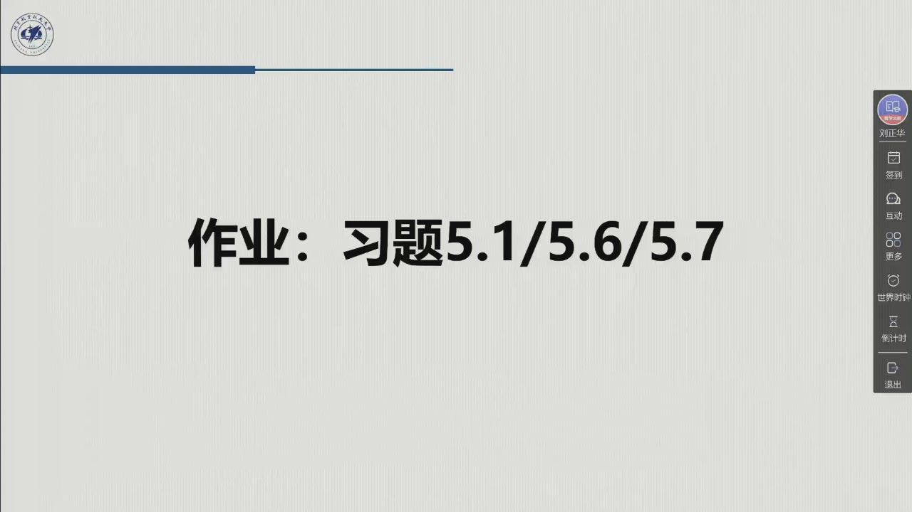

# 作业五：教材习题 5.1 / 5.6 / 5.7（附详细解答与验算）

::: note 作业信息（据录播）
- **题号**：教材第 5 章习题 **5.1、5.6、5.7**（课件末页「作业：习题5.1/5.6/5.7」，02:28:37）；
- **原文**（教材 §5 习题 / 原书 Problems 5.1, 5.6, 5.7）：
  > **5.1** 证明式（5.7）～式（5.10）。（原书：Prove (5.7)–(5.10).）
  > **5.6** 对于如图 5.16 所示的接触情形，令 $r^{cs}_{c}=[-0.3\ 0\ 0.2]^{\mathrm T}$ m，$R^{s}_{c}=\begin{bmatrix}0&0&1\\0&-1&0\\1&0&0\end{bmatrix}$，并令力传感器测量为 $f_s=[20\ 0\ 0]^{\mathrm T}$ N、$\mu_s=[0\ 6\ 0]^{\mathrm T}$ N·m，计算接触坐标系下的**等价力和力矩**。
  > **5.7** 考虑图 2.34 中的 SCARA 机械手，连杆长度 $a_1=a_2=0.5$ m。基坐标系位于第一连杆与基连杆的交点处，$\vartheta_1=0$ 时 $z$ 轴朝下，$z$ 轴方向沿第一连杆方向。腕上装有 CCD 相机，**相机坐标系与末端执行器坐标系一致**。相机参数 $f=8$ mm、$a_x=79.2$ pixel/mm、$a_Y=120.5$ pixel/mm、$X_0=Y_0=250$；观察到目标点 $p=[0.8\ 0.5\ 0.9]^{\mathrm T}$ m。求机械手位姿 $q=[0\ \pi/4\ 0.1\ 0]^{\mathrm T}$ 时该点的**像素坐标**。
- **提交**：一周内。
:::

三道题正好落在本章的三块上：**5.1** 是电气驱动的稳态特性（[5.2.1](sec5-2-1.md)），**5.6** 是力传感器与坐标系变换（[5.4.1](sec5-4-1.md)），**5.7** 是视觉传感器与相机模型（[5.4.3](sec5-4-3.md)）。三题的数值均由 `tools/verify_homework05.py`（`make verify`）与官方《课后习题参考答案》逐项核对。

---

## 5.1 稳态分析：两种发电机特性怎么来的

**题目**：证明式 (5.7)–(5.10)。

**要证的四个式子**分别是：速度控制发电机在 $k_i=0$、且 $F_m\ll k_vk_t/R_a$ 时的转速关系**(5.7)**；力矩控制发电机在 $k_i\neq0$、且 $Kk_i\gg R_a$ 时的力矩关系**(5.8)**；以及两种情形下的输入/输出传递函数**(5.9)(5.10)**。

### 第一步：把动态方程退化成稳态方程

在稳态下，导数项为零，于是 (5.1)–(5.4) 退化为（教材解答手册 S5.1–S5.4）

$$v_a=R_ai_a+v_g,\qquad v_g=k_v\omega_m,\qquad c_m=F_m\omega_m+c_r,\qquad c_m=k_ti_a$$

而放大器的输出（含电流反馈）为

$$v_a=C_i(0)G_v(v'_c-k_ii_a) \tag{S5.5}$$

**注意这一步的含义**：稳态意味着 $s\to0$，所以传递函数 $C_i(s)G_v/(1+sT_v)$ 里的 $s$ 全部取零——**动态环节在稳态只剩常数增益**。这是三道题里「isdigit 稳态」两字的全部技术内容。

### 第二步：$k_i=0$ 的情形 ⇒ 速度控制发电机

取 $k_i=0$，记 $K=C_i(0)G_v$，由 S5.1、S5.2、S5.5 得

$$Kv'_c=R_ai_a+k_v\omega_m$$

再用 S5.3、S5.4 并令 $c_r=0$（$i_a=c_m/k_t=F_m\omega_m/k_t$）消去 $i_a$：

$$Kv'_c=\left(\frac{F_mR_a}{k_t}+k_v\right)\omega_m$$

**若 $F_m\ll k_vk_t/R_a$**，括号里第二项占优，于是

$$\boxed{\ \omega_m\approx\frac{K}{k_v}v'_c=\frac{G_v}{k_v}v'_c\ }\tag{5.7}$$

这就是「**驱动系统具有与速度控制发电机相同的特性**」——转速正比于控制电压，与负载无关。

### 第三步：$k_i\neq0$ 的情形 ⇒ 力矩控制发电机

保留 S5.5 中的 $k_i$，把 S5.1–S5.5 归并（仍令 $c_r=0$、$i_a=c_m/k_t$），得

$$Kv'_c=\left(\frac{R_a+Kk_i}{k_t}\right)c_m+k_v\omega_m$$

**若 $Kk_i\gg R_a$**，含 $R_a$ 的项可略，解出 $c_m$：

$$\boxed{\ c_m\approx\frac{k_t}{k_i}\left(v'_c-\frac{k_v}{K}\omega_m\right)\ }\tag{5.8}$$

**读法**：此时驱动力矩由 $v'_c$ 直接决定，转速 $\omega_m$ 只以 $k_v/K$ 的小权重进入——「考虑到 $G_v$ 的值比较大（即 $K$ 大），**驱动力矩实际上独立于角速度**」。

### 第四步：从稳态到传递函数 (5.9)(5.10)

把上面两条稳态关系配上动态环节，就得到 [5.2.1](sec5-2-1.md) 里的两个输入/输出关系：速度控制发电机为

$$\Omega_m=\frac{\dfrac{1}{k_v}}{1+s\dfrac{R_aI_m}{k_vk_t}}G_vV'_c-\frac{\dfrac{R_a}{k_vk_t}}{1+s\dfrac{R_aI_m}{k_vk_t}}C_l \tag{5.9}$$

力矩控制发电机为

$$\Omega_m=\frac{\dfrac{k_t}{k_iF_m}}{1+s\dfrac{I_m}{F_m}}V'_c-\frac{\dfrac{1}{F_m}}{1+s\dfrac{I_m}{F_m}}C_l \tag{5.10}$$

**两者恰是 (5.7)(5.8) 的「带惯量版本」**：把 (5.7) 除以 $s$（$\omega_m\to\vartheta_m$ 的积分）并补上时间常数 $R_aI_m/(k_vk_t)$，就得到 (5.9) 的第一项；对 (5.8) 做同样的事，就得到 (5.10)。注意两个时间常数的对比：

$$\underbrace{\frac{R_aI_m}{k_vk_t}}_{\text{速度控制}}\ \ll\ \underbrace{\frac{I_m}{F_m}}_{\text{力矩控制}}$$

这正是 [@thm-5.2.B] 说的「**没有电流反馈时干扰抑制更好**」的来源，也是教材把 (5.9)(5.10) 单独列出来的用意。

::: think 考点 · 老师原话（录播时间点）

> 本题对应的正是老师说的「（加上电流环）**带宽增大**」——加了很硬的电流内环以后，外层看到的时间常数从 $R_aI_m/(k_vk_t)$ 这类**含电枢参数**的量，换成了纯机械的 $I_m/F_m$（01:16:55 前后）。
:::

---

## 5.6 接触坐标系下的等价力与力矩

**题目**：传感器测得 $f_s=[20\ 0\ 0]^{\mathrm T}$ N、$\mu_s=[0\ 6\ 0]^{\mathrm T}$ N·m；接触坐标系相对传感器系的位置 $r=[-0.3\ 0\ 0.2]^{\mathrm T}$ m、姿态 $R=\begin{bmatrix}0&0&1\\0&-1&0\\1&0&0\end{bmatrix}$。求 $f_c,\mu_c$。

### 第一步：写出力/力矩的坐标变换

力传感器测到的量**不能直接用于力/运动控制**——它描述的是作用在**传感器**上的等价力，与作用在**末端执行器**上的力不同（教材 §5.4.1 的原话）。因此必须把力从传感器坐标系 $s$ 变换到**约束（接触）坐标系** $c$：

$$\begin{bmatrix}f^c_c\\[1mm]\mu^c_c\end{bmatrix}=\begin{bmatrix}R^s_c & 0\\[1mm] S(r^{cs}_c)R^s_c & R^s_c\end{bmatrix}\begin{bmatrix}f_s\\[1mm]\mu_s\end{bmatrix} \tag{5.32}$$

其中 $S(\cdot)$ 是**反对称算子**：

$$S(r)=\begin{bmatrix}0&-r_z&r_y\\ r_z&0&-r_x\\ -r_y&r_x&0\end{bmatrix}$$

### 第二步：算出 $S(r)$ 与 6×6 变换阵

由 $r=[-0.3,\ 0,\ 0.2]^{\mathrm T}$：

$$S(r^{cs}_c)=\begin{bmatrix}0&-0.2&0\\ 0.2&0&0.3\\ 0&-0.3&0\end{bmatrix},\qquad
S(r)R=\begin{bmatrix}0&0.2&0\\ 0.3&0&0.2\\ 0&0.3&0\end{bmatrix}$$

于是（与官方解答的 6×6 矩阵逐项一致）

$$\begin{bmatrix}f^c_c\\ \mu^c_c\end{bmatrix}=
\begin{bmatrix}0&0&1&0&0&0\\ 0&-1&0&0&0&0\\ 1&0&0&0&0&0\\
0&0.2&0&0&0&1\\ 0.3&0&0.2&0&-1&0\\ 0&0.3&0&1&0&0\end{bmatrix}
\begin{bmatrix}20\\0\\0\\0\\6\\0\end{bmatrix}$$

### 第三步：结果是「力转了向、力矩恰好抵消」

$$f^c_c=[0\ 0\ 20]^{\mathrm T}\ \text{N},\qquad \mu^c_c=[0\ 0\ 0]^{\mathrm T}\ \text{N}\cdot\text{m}$$

**力矩为什么是零？** 把 (5.32) 的第二行拆开看：

$$\mu^c_c=\underbrace{S(r)R f_s}_{\text{力臂产生的力矩}}+\underbrace{R\mu_s}_{\text{传感器直接测到的力矩}}=\begin{bmatrix}0\\6\\0\end{bmatrix}+\begin{bmatrix}0\\-6\\0\end{bmatrix}=\begin{bmatrix}0\\0\\0\end{bmatrix}$$

也就是说：**力传感器的读数中，那部分「由偏心载荷造成的力矩」与 $S(r)Rf_s$ 恰好是一对作用与反作用**——转到同一个坐标系里就精确抵消了。结论正如官方解答所写：「**在接触坐标系中不产生合力矩**」。

**这道题的物理含义**：若末端只受一个通过接触点的纯力（无附加力偶），那么在接触坐标系下它就只是一个纯力——这正是力/运动控制算法所需要的量。

---

## 5.7 SCARA + CCD 相机：目标点的像素坐标

**题目**：$q=[0\ \pi/4\ 0.1\ 0]^{\mathrm T}$，相机参数 $f=8$ mm、$a_x=79.2$、$a_Y=120.5$ pixel/mm、$X_0=Y_0=250$，目标 $p=[0.8\ 0.5\ 0.9]^{\mathrm T}$ m，求像素坐标。

### 第一步：正运动学给出相机（= 末端）坐标系

SCARA 在 $q=[\vartheta_1,\vartheta_2,d_3,\vartheta_4]^{\mathrm T}=[0,\pi/4,0.1,0]^{\mathrm T}$ 下的齐次变换（教材 §2.9、图 2.34）：

$$T^b_c=\begin{bmatrix}\cos(\vartheta_1+\vartheta_2)&-\sin(\vartheta_1+\vartheta_2)&0&x\\ \sin(\vartheta_1+\vartheta_2)&\cos(\vartheta_1+\vartheta_2)&0&y\\ 0&0&1&d_3\\ 0&0&0&1\end{bmatrix}
=\begin{bmatrix}0.707&-0.707&0&0.854\\ 0.707&0.707&0&0.354\\ 0&0&1&0.1\\ 0&0&0&1\end{bmatrix}$$

其中末端的平面位置由两连杆直接给出：$x=a_1\cos\vartheta_1+a_2\cos(\vartheta_1+\vartheta_2)=0.5+0.5\cos45^\circ=0.854$，$y=a_1\sin\vartheta_1+a_2\sin(\vartheta_1+\vartheta_2)=0.5\sin45^\circ=0.354$。

### 第二步：把目标点换算到相机坐标系

$$\tilde p_c=(T^b_c)^{-1}\tilde p=\begin{bmatrix}(R^b_c)^{\mathrm T}&-(R^b_c)^{\mathrm T}o\\ 0&1\end{bmatrix}\begin{bmatrix}p\\1\end{bmatrix}$$

$(R^b_c)^{\mathrm T}o$ 的展开给出 $p_c=R^{\mathrm T}(p-o)$，其中 $o=[0.854\ 0.354\ 0.1]^{\mathrm T}$：

$$p-o=\begin{bmatrix}-0.0536\\0.1464\\0.8\end{bmatrix}\ \Rightarrow\
\tilde p_c=\begin{bmatrix}0.066\\0.141\\0.8\end{bmatrix}$$

（第三分量 $\tilde p_{c,z}=0.8$ 保留为**深度**——它将在投影里充当比例因子 $\lambda$。）

### 第三步：相机内参矩阵与投影

$$\Omega=\begin{bmatrix}f a_x&0&X_0\\ 0&f a_Y&Y_0\\ 0&0&1\end{bmatrix}=\begin{bmatrix}633.6&0&250\\ 0&964&250\\ 0&0&1\end{bmatrix},\qquad
\begin{bmatrix}x_I\\y_I\\\lambda\end{bmatrix}=\Omega\,\tilde p_c$$

$$x_I=633.6\times0.066+250\times0.8=241.82,\qquad y_I=964\times0.141+250\times0.8=335.92,\qquad \lambda=0.8$$

### 第四步：除以深度得到像素坐标

$$\boxed{\ X_I=\frac{x_I}{\lambda}=\frac{241.82}{0.8}=302.27,\qquad Y_I=\frac{y_I}{\lambda}=\frac{335.92}{0.8}=419.90\ }$$

即目标点落在图像上约 $(302,\ 420)$ 处——**恰在图像中心 $(250,250)$ 的右下方**，这与目标点在相机坐标系中 $x_c>0,y_c>0$ 一致。

::: note 关于中间量的取整
官方解答把 $\tilde p_c$ 取到三位小数（$0.066,0.141$）后得到 $(302.27,\ 419.90)$。若全程保留有效数字，$\tilde p_c=[0.06569,0.14142,0.8]^{\mathrm T}$，结果为 $(302.02,\ 420.41)$——**差约 0.5 pixel**，来自中间步骤的取整，两种答案都可接受；本教程按官方解答的数值著录，并在验算脚本中把两者都打印出来。
:::

---

## 三题对照

| 题 | 落在哪一节 | 考的是 | 关键一步 |
|:--|:--|:--|:--|
| **5.1** | [5.2.1 电气驱动](sec5-2-1.md) | 稳态下两种发电机特性 | 稳态 ⇒ $s=0$；两个不等式 $F_m\ll k_vk_t/R_a$ 与 $Kk_i\gg R_a$ |
| **5.6** | [5.4.1 力传感器](sec5-4-1.md) | 力/力矩的坐标变换 (5.32) | $S(r)$ 反对称阵；力矩项精确抵消 |
| **5.7** | [5.4.3 视觉传感器](sec5-4-3.md) | 相机模型与投影 | 先 $T^{-1}$ 到相机系，再 $\Omega$，最后除以深度 $\lambda$ |

三题的共同点：**都是「换一个坐标系看同一个物理量」**——5.1 换的是「电压域 ↔ 力矩域」，5.6 换的是「传感器系 ↔ 接触系」，5.7 换的是「世界系 ↔ 像素系」。