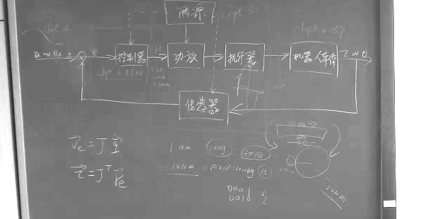

# 第五章 · 执行器与传感器

前四章在运动学、静力学与轨迹规划层面算出了期望的关节角位置 $\boldsymbol q(t)$、角速度 $\dot{\boldsymbol q}(t)$、角加速度 $\ddot{\boldsymbol q}(t)$ 及接触力映射。在物理机械手中，这些数学指令必须借助硬件装置实现，并由测量系统在线送回控制环：前半章（[5.1 关节执行系统](sec5-1.md)、[5.2 驱动](sec5-2.md)）分析功率如何从能源经功放、伺服发动机与传动装置传向关节并折算为 $s$ 域动力学模型；后半章（[5.3 本体传感器](sec5-3.md)、[5.4 外部传感器](sec5-4.md)）讨论如何测量关节自身状态以及机器人与环境交互的力、距离与视觉信息。

{{#include ../assets/figures/robot-actuator.md}}

## 一、核心符号与术语对照表

| 符号 | 中文名称 | 物理与几何含义 | 单位 / 口径 |
|:--|:--|:--|:--|
| $P_c,P_e,P_a,P_m,P_u$ | 执行系统五项功率 | 控制信号功率、一次能源功率、功放输出功率、发动机机械功率、关节驱动功率 | 标量；$\mathrm W$ |
| $P_{da},P_{dm},P_{dt}$ | 执行链三处损耗 | 功放、发动机、传动装置内部功率耗散 | 标量；$\mathrm W$ |
| $\eta_m,\ \eta_t$ | 发动机与传动效率 | 正向供能且忽略储能变化时，$\eta_m=P_m/P_a$，$\eta_t=P_u/P_m$ | 无量纲（$0<\eta\le 1$） |
| $V_a,I_a,V_g,R_a,L_a$ | 电枢电路变量与参数 | 电枢电压、电流、反电动势 $V_g=k_v\Omega_m$、电枢电阻与电感 | $\mathrm V,\ \mathrm A,\ \mathrm V,\ \Omega,\ \mathrm H$ |
| $k_v,\ k_t$ | 电压常数与转矩常数 | 反电动势系数与电磁转矩系数；一致 SI 理想直流模型下数值相等 | $\mathrm{V\cdot s/rad}$；$\mathrm{N\cdot m/A}$ |
| $I_m,F_m,C_m,C_l$ | 转子参数与力矩 | 转子转动惯量、轴黏滞摩擦系数、驱动转矩、载荷转矩 | $\mathrm{kg\cdot m^2}$，$\mathrm{N\cdot m\cdot s/rad}$，$\mathrm{N\cdot m}$ |
| $k_r,\ I_{eq},\ F_{eq}$ | 传动比与等效参数 | $k_r=\omega_m/\omega$；折算至电机轴的等效惯量 $I_m+I/k_r^2$ 与摩擦 $F_m+F/k_r^2$ | 转动无量纲；丝杠 $\mathrm{rad/m}$ |
| $Q,Q_m,Q_l,Q_c$ | 液压体积流量四项 | 分布器总流量、排量流量、高压渗漏流量、液体可压缩等效流量 | 标量；$\mathrm{m^3/s}$ |
| $p,\ k_c,\ k_q,\ k_p$ | 液压压差与系数 | 发动机两侧压差、压缩因子 $\gamma V$、排量系数、压差转矩系数 | $\mathrm{Pa},\ \mathrm{m^3/Pa},\ \mathrm{m^3/rad},\ \mathrm{N\cdot m/Pa}$ |
| $n,\ N,\ \Delta t,\ \Delta t_p$ | 编码器与测速参数 | 绝对式码盘轨道数（$2^n$ 位置）、四倍频每转计数、测频窗口与脉冲周期 | 无量纲；$\mathrm s$ |
| $\boldsymbol f^s_s,\boldsymbol\mu^s_s,\boldsymbol r^c_{cs},R^c_s$ | 腕力传感器变换量 | 传感器系力/力矩、传感器原点在约束系中的位置、旋转矩阵 | $\mathbb R^3,\ \mathbb R^{3\times 3}$ |
| $\Xi=\Omega\Pi(T^b_c)^{-1}$ | 相机校准矩阵 | 内参数阵 $\Omega$、透视投影阵 $\Pi$、基系到相机系外参逆 $(T^b_c)^{-1}$ | $\mathbb R^{3\times 4}$ |

## 二、全章架构与考纲分层索引

| 节次 | 解决的核心问题 | 考纲定位 | 衔接与任务 |
|:--|:--|:--|:--|
| **[5.1 关节执行系统](sec5-1.md)** | 功率链组成与能量平衡；传动装置作用与直驱取舍；有刷/无刷/步进/液压四类对比；斩波/逆变与蓄能器 | **核心必考**（功放与能源作了解） | [5.1.1](sec5-1.md#part-5.1.1)、[5.1.2](sec5-1.md#part-5.1.2) |
| **[5.2 驱动](sec5-2.md)** | 电气四式与两种发电机特性；液压六式与电液差异（空化不考）；$1/k_r$ 与 $1/k_r^2$ 折算及摆线性化边界；PI 与双环位置控制 | **核心必考**（5.2.3）/ **重点掌握** | [作业五 5.1](homework05.md)、[两连杆第六关](../training/two-link.md#mission-drive) |
| **[5.3 本体传感器](sec5-3.md)** | 本体与外部划分；绝对/增量编码器、分辨率与格雷码；旋转变压器；测速 M 法/T 法与直/交流转速计 | **核心必考** | [5.3.1](sec5-3.md#part-5.3.1)、[5.3.2](sec5-3.md#part-5.3.2) |
| **[5.4 外部传感器](sec5-4.md)** | 应变片与腕力传感器坐标变换；声纳温度修正、激光 ToF/三角测距、三点定位与卡尔曼滤波；理想针孔相机模型 | **重点掌握**（器件工艺作精简） | [作业五 5.6、5.7](homework05.md) |

## 三、全章学习要点与后续接口

1. **硬件选型从关节端倒推**：关节通常需要低速高转矩，发动机往往处于高速低转矩高效区。先由关节力（矩）与速度确定 $P_u$，再顺次考虑传动比 $k_r$、发动机类型与放大器选配，而不是先选手边现成电机。
2. **两个减速比折算因子**：惯量与黏滞摩擦折算到电机侧按 $1/k_r^2$ 衰减，外负载力矩与重力非线性按 $1/k_r$ 衰减；但是大减速比并不自动保证全行程线性化或忽略负载惯量，仍须核算行程范围与比值 $I/(k_r^2 I_m)$。
3. **本体闭环与环境感知分工**：按**被测量物理属性**而非安装位置划分本体传感器（关节位置、速度、力矩）与外部传感器（接触力、接近、距离、视觉）。关节力矩属本体量，六维腕力传感器测交互接触力属外部传感器。
4. **向后对接动力学与控制**：本章导出的电机侧等效模型 $I_{eq},F_{eq}$ 直接进入[第六章动力学](../ch06/overview.md)（作为各关节折算转子惯量 $k_{ri}^2 I_{mi}$）；速度控制与力矩控制驱动特性及位置/速度双环反馈，则是[第七章运动控制](../ch07/overview.md)的直接被控对象。

<figure>

<figcaption>执行系统与传感器闭环总图（课堂板书对照）：一次能源经功率放大器、执行器作用于机器人本体（输出位置/速度 $z,\omega,\theta$），再经传感器反馈至输入端构成闭环。</figcaption>
</figure>

依据 Siciliano 等《机器人学：建模、规划与控制》第 5 章与教学实践整理 · 数值算例与习题核对脚本：`tools/verify_homework05.py`。
