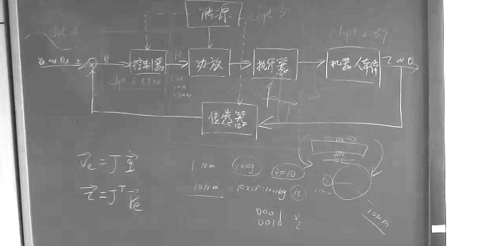
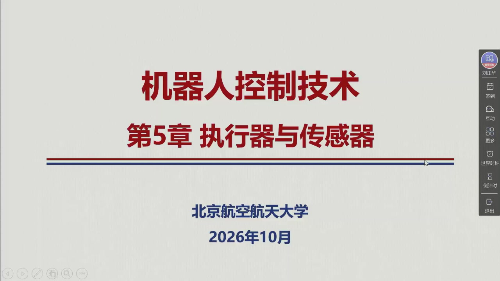

# 第五章 · 执行器与传感器

本编依据 Siciliano 等《机器人学：建模、规划与控制》第 5 章整理扩充，**覆盖 §5.1–§5.4 全部十二个子节**，并与**第 6 周录播全程对齐**（2026-10-12，2:29:00）。前四章一直在「算」——位姿、速度、静力学、轨迹；这一章换到硬件侧：**算出来的量，最终靠什么装置去实现、又靠什么装置读回来**。

正文与课件、板书三者逐节对应：老师的**考点提示、重点指定、工程取舍**（「传动装置还有一个作用就是定性的作用，把转动转化为平动」@0:31:26、「惯量它是起到一个延迟的作用，惯量小的话就比较容易控制」@0:33:01）都已写入正文并标注时间点，幻灯片截图则随文嵌入。

{{#include ../assets/figures/robot-actuator.md}}

## 本编信息（录播）

::: note 素材与生成方式
- **录播**：《机器人控制技术》第 6 周星期一第 3–5 节（2026-10-12 09:50–12:15），时长 2:29:00，学院路校区 B-228；平台会话 `sub_id=5877638`、**教师流** `resource_guid=cee46cc20d8f44a588afddb2374a5d53`；
- **板书**：整节课黑板上只有**开课前预写的执行系统框图一页**（能源 → 功放 → 执行器 → 机器人本体 + 传感器闭环；全程逐点抽样比对，老师只指点、不新写）。左下两行 $v_e=J\dot q$、$\tau=J^{\mathrm T}F_e$ 是上一章留下未擦的；
- **课件**：平台课件检测器共触发 **247 帧**；本编另从课件录像本地补入 **9 帧**（平台在 43:00–55:08 有 729 秒盲区，缺 5.1.2 伺服发动机与液压伺服发动机几页，由 `raw/detect_slides.py` 补足），合并 256 帧去重后 **79 页**；本编嵌入 **35 幅**（含封面、目录、作业页与板书），每幅标注首现时刻；
- **口述**：平台语音转写本周**未生成**（`search-trans-result` 对本周恒定返回 `未查询到语音数据`，第 3、4 周同一接口对照正常），本编转录改由本地 whisper.cpp 完成——600 s 分块转写 + 文本侧幻听清洗（2139 → 1757 句），术语错字按课件与上下文逐处订正，对照表见[勘误页](errata.md)；
- **关键勘误**：平台的 `created` 列比真实播放时刻**早 120 秒**，**文件名的毫秒才是播放时刻**（本编用录像做归一化互相关实测，8 帧误差 $<1$ s）；**这一结论与 `src/ch04/errata.md` E4.1 相反**，第 4 章图注可能整体早 2 分钟，已记为待复核项（见[勘误页](errata.md) E5.2）。
:::

## 全章路线图（板书，本页还原）

老师开课前把这一章的总图写在黑板上（课件首帧之前就已写好）。它其实是**§5.1 的功率链**加上**传感器闭环**：

$$\text{能源}\to\boxed{\text{功放}}\to\boxed{\text{执行器}}\to\boxed{\text{机器人本体}}\ ;\qquad \text{传感器}\ \circlearrowleft$$

<figure>

<figcaption>第 6 周板书原貌（教师流 142:30 截取，本教程轻度增强）：<b>能源 → 功放 → 执行器 → 机器人本体</b>，输出 $z,\omega,\theta$；<b>传感器</b>闭环回求和点（标 $e$，信号标 $P$）。框上标注的章节号是老师讲课时指出的全书位置：$chpt\,5$ 是本章，$chpt\,6,7,10$ 是后面的控制器，$chpt\,2$ 是传感器信息的来源。左下 $v_e=J\dot q$、$\tau=J^{\mathrm T}F_e$ 为上一章残留未擦。</figcaption>
</figure>

板书、课件与教材三者对本章的结构划分**完全一致**：**执行器（能源 / 功放 / 伺服发动机 / 传动装置）在前，传感器（本体 / 外部）在后**——这棵树就是本章的目录。

## 十二节一览

十二节各有分工。下表先列出每节回答的核心问题与建议优先级，随后再逐条说明理由。

| 节 | 这一节回答的问题 | 优先级 |
|:--|:--|:--|
| [5.1 关节执行系统](sec5-1.md) | 关节运动靠哪四部分实现？功率怎么流？ | 概念（必知） |
| [5.1.1 传动装置](sec5-1-1.md) | 为什么必须有减速器？有哪三种？ | **核心（重点）** |
| [5.1.2 伺服发动机](sec5-1-2.md) | 有刷、无刷、液压、步进各是什么？怎么选？ | **核心（重点）** |
| [5.1.3 功率放大器](sec5-1-3.md) | 斩波器与逆变器有什么区别？ | 了解（点状） |
| [5.1.4 能源](sec5-1-4.md) | 电源与液压源各由什么组成？ | 了解（点状） |
| [5.2 驱动](sec5-2.md) | 为什么要用传递函数描述驱动？ | 概念（必知） |
| [5.2.1 电气驱动](sec5-2-1.md) | 电机的四个方程怎么推？两种「发电机」差在哪？ | **精读（动手）** |
| [5.2.2 液压驱动](sec5-2-2.md) | 液压侧多了哪两项？ | 精读 |
| [5.2.3 传动装置影响](sec5-2-3.md) | 减速比到底改变了什么？ | **核心（重点）** |
| [5.2.4 位置控制](sec5-2-4.md) | 为什么位置环必须带积分？ | 精读（动手） |
| [5.3 本体传感器](sec5-3.md) + [5.3.1](sec5-3-1.md) / [5.3.2](sec5-3-2.md) | 关节位置和速度怎么测？ | **核心（重点）** |
| [5.4 外部传感器](sec5-4.md) + [5.4.1](sec5-4-1.md) / [5.4.2](sec5-4-2.md) / [5.4.3](sec5-4-3.md) | 力、距离、视觉怎么测？ | 精读（动手） |

**优先级说明（按老师的课堂权重，引号内为原话）**

- **核心 · 重点**（5.1.1、5.1.2）：传动装置的三重作用是本章第一处「考点密度最高」的地方；老师讲了**八分钟**，从作用讲到三种装置再到直接驱动的取舍，还给了「平方关系」的经验估算法（0:36:53）。伺服发动机部分则把有刷/无刷、电动/液压两条对比讲透——「从轻量化的角度，采用无刷的更好」（0:46:43）。
- **核心 · 重点**（5.2.3）：减速比把负载惯量按 $1/k_r^2$、把负载力矩与非线性按 $1/k_r$ 折算——这一条是「为什么用大减速器」的全部数学内容，也是第 7、8 章的地基。
- **精读 · 动手**（5.2.1、5.2.4）：电气驱动的四个方程与两种发电机特性需要能默写；位置控制的 PI 结构是原书第 8 章的正题前奏。
- **核心 · 重点**（5.3）：老师说「**测量关节位置和速度是（伺服控制的）基础**」——编码器与测速发电机是工业机器人上**唯一必然存在**的传感器（5.3.1/5.3.2）。
- **精读 · 动手**（5.4.1–5.4.3）：六维腕力传感器的坐标变换（作业 5.6）、距离传感器的几种原理、相机投影与 CCD/CMOS（作业 5.7）都是可算可考的素材。
- **了解 · 点状**（5.1.3、5.1.4）：放大器与能源在课堂上各只讲了一两分钟，记住「斩波器对永磁直流、逆变器对无刷」与「储液器 = 滤波电容」即可。

> **第一遍的验收标准**：能默画出执行系统功率链并标出全部功率符号；能说出传动装置的三重作用与三种装置的适用场合；能默写电气驱动四个方程与 $I_{eq},F_{eq}$；能说出位置环为什么必须加积分；能讲清编码器与测速发电机各自测什么、精度受什么限制——这五条就是本章的底线。

### 本章在全书中的位置（老师开课前 5 分钟的铺垫）

老师在正式讲第一节前，花了约十分钟把**本章与前后各章的对应关系**讲了一遍（00:13:36「我把这个章跟咱们大概的对应关系……给大家列了一下，可能也不非常严格」）：

| 章 | 主题 | 与「机器人」的关系 |
|:--|:--|:--|
| 第 2 章 | 位姿运动学 | **机器人本体**（从建模的角度）——连杆、关节、轴承构成的机械结构 |
| 第 3 章 | 速度运动学 / 微分运动学 | 同上——「把机器人本体的物理规律表示出来」 |
| **第 5 章** | **执行器与传感器** | **硬件**：本章 |
| 第 6 章 | 控制体系 | 与硬件相关的系统级内容——「如果学了第六章，对于**怎么装配或者选型一个机器人系统**是有帮助的」 |
| 第 7 章 | 动力学 | **机器人本体**（建模） |
| 第 4 章 | 轨迹规划 | 为**底层伺服控制**提供参考输入 |
| 原书第 8 章 | 运动控制 | 控制器设计（位置 / 速度 / 姿态） |
| 第 9 章 | 力控制 | 涉及**与环境交互** |
| 第 10 章 | 视觉伺服 | 控制器设计的范畴 |

**为什么模型要准**（00:14:53–00:15:37）：模型不要求百分之百准确，但它为**参数调节提供初始参考**——「如果模型很准，这个初始参考值就可以满足控制律的需求；如果不准，就在初始参考值附近调一调，从而使系统稳定，或者达到我们想要的工程目标」。这也是本章要花力气建立驱动数学模型的原因。

**一个很好用的类比**（00:18:28–00:18:46）：人能感觉到自己关节的角度和输出的力，靠的是**本体感觉**（从神经系统传到大脑）——「可能不看自己的手，就可以感觉到它在什么位置」。机器人对应的器官就是**编码器与力矩传感器**（老师 00:18:46：「对机器人来说，就需要编码器和力矩传感器来实现」）。

**机械手还要接末端执行器**（00:19:35–00:20:00）：一只机械手由**执行系统 + 机械机构（关节、连杆）+ 末端执行器**组成。「末端比如说可以加磨削的工具，或者是加一个螺丝刀、加剪刀——**跟实际的应用相关的执行器**」。本章只讲执行系统与传感器，末端执行器本身不属于本章。

**人也是这个回路里的一环**（00:20:59–00:21:28）：「除了机械手自己，**人也要与机械手进行交互**，或者**人其实是最高级的控制**」——人可以通过**示教系统**直接发指令，也可以**辅助完成某些动作**来实现对机械手的规划。与第 4 章的联系：老师提到「通过**示教**的方式，机械手和自己的**内部传感器**可以储存一个轨迹，用这种方式来进行轨迹规划也是可以的」——即**示教再现**（第 6 章）本身就是一种轨迹规划途径，这与 [4.1](../ch04/sec4-1.md) 里「若规划通过示教再现技术进行，则对关节变量**直接测量**」相呼应。

**关于讲授深度的一句诚实交代**（00:22:18）：「内部传感器这部分也会讲一下原理……其实如果**真的去做传感器设计**的话，底层的模型是非常复杂的，咱们**三个课时肯定是不够的**」——本章讲的是**选型与使用所需的原理**，不是器件设计。

**本章的讲授重点**（老师 00:22:39–00:23:41 明确交代）：

- 「**三种驱动方式，重点讲的是电气驱动**」，气动和液压简单介绍；
- 「尤其是本体传感器，重点会讲**位置传感器**」；
- 「**外部传感器**包括力传感器、距离传感器以及视觉传感器」；
- 编码器的地位：「基本上**用到电机**就可以用到的传感器，就是**编码器**」——因为控制电机必须知道位置或速度（这一点在 [5.3.1](sec5-3-1.md) 展开）。

各节的**关键结论**与**典型陷阱**，都汇总在[全章总结](summary.md)中，可随时回查。

## 一条主线

> **关节要的是「低速度、大转矩」，而伺服发动机的最优工况恰好是「高速度、低转矩」——这个矛盾由传动装置抹平。传动装置的作用有三重：定量（降速增矩）、定性（转动→平动）、减重解耦；三种典型装置（齿轮 / 丝杠 / 带与链）各管一段。发动机一侧，电机按「有刷 / 无刷」分化，液压按「低速大扭矩」取胜。到了建模，电气驱动写成四个方程、两种发电机特性（速度控制 / 力矩控制），液压驱动是同一套结构的平行版本（多出渗漏与可压缩性两项），传动装置则按 $1/k_r^2$ 改写惯量与摩擦、按 $1/k_r$ 改写力矩与非线性——于是多轴强耦合被削弱成「可独立设计的单轴 + 干扰」，位置环的 PI + 测速反馈才成立。传感器一侧分内外：本体传感器（位置 / 速度）是伺服的反馈源，外部传感器（力 / 距离 / 视觉）让机器人知道自己在跟什么打交道。**（完整版见[全章总结](summary.md)）

::: method 怎么用这一编
- **对照录播**：每节标题后的括注是该节在录播中的时间区间；图注「课堂幻灯片 · mm:ss」标出课件首现时刻，可在原片定位；板书照片见上。
- **先看老师的取舍**：每节末尾的「考点 · 老师原话」框，把老师关于**重点是什么、工业上怎么选**的原话连同时间点一并列出——这些句子比公式更接近考试的边界。
- **动手验证**：作业三道题与 $I_{eq}$、相机投影、编码器分辨率等数值，都已逐一数值验证，见 `tools/verify_homework05.py`（`make verify`）。
:::
