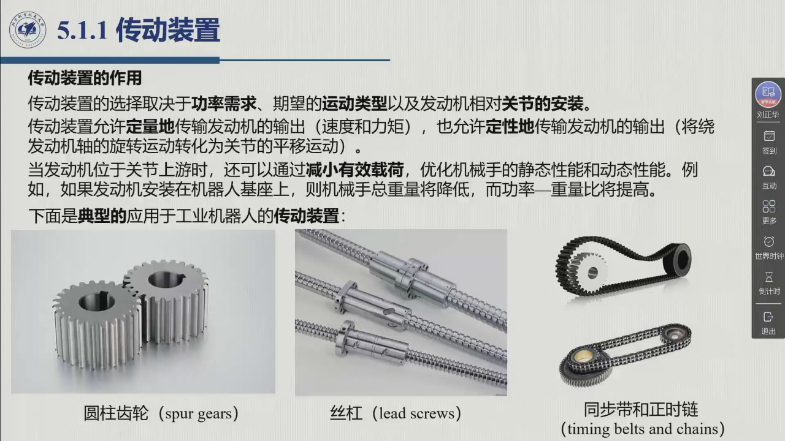

# 5.1.1 传动装置

上一节把执行器输出记作 $P_m$，关节端输出记作 $P_u$。传动装置位于这两个端口之间：它可以改变速度与力矩的比例，也可以改变运动形式或传递动力的位置。先确定需要哪种改变，再比较具体机构，才有选型依据。课堂回看：00:30:54–00:38:23。

## 5.1.1.1 传动装置的三个作用

::: def 定义 5.1.3 · 传动装置的三重作用 {#def-5.1.3}
传动装置可以完成三种不同的任务。

第一种是匹配速度与力矩。例如减速齿轮让电机转得更快、关节转得更慢，理想情况下输出力矩按相反比例增大，即[降速增矩](../recall.md#gear)。

第二种是改变运动形式。例如丝杠把电机的转角转换为螺母沿轴的位移，用旋转电机驱动移动关节。

第三种是改变电机的安装位置。例如用带、链或线缆把上游电机的动力送到远端关节，减少随远端连杆一起运动的电机质量。
:::

远置电机减少的是远端运动部件携带的附加负载。新增的带、链或线缆也有质量、弹性和摩擦，因此还需一起计入，不能据此断定整机总质量下降。

随连杆运动的质量还会影响转动惯量。绕固定轴运动时，质量离轴越远，通常带来的惯量越大；由 $\ddot\theta=\tau/I$ 可见，同一净力矩下加速度会减小。这种响应变化不能当成输入被原样推迟的“纯延迟”。多关节情况用[惯性矩阵](../recall.md#kinetic)描述，见第六章。

## 5.1.1.2 三种典型传动装置

下面按输入与输出的运动形式比较三类机构，再检查承载、刚度、间隙和安装布置。重量只是其中一项，不能只凭“带轻、链重”决定方案。

::: method 方法 5.1.C · 三种传动装置的选型 {#method-5.1.C}
| 机构 | 运动关系 | 主要用途与检查项 |
|:--|:--|:--|
| 圆柱齿轮 | 旋转输入、旋转输出；外啮合齿轮副两轴反向 | 改变传动比和轴间位置；检查齿隙、刚度、润滑与承载 |
| 丝杠 | 转角转换为轴向位移 | 驱动移动关节；检查导程、摩擦、回差和轴向刚度 |
| 同步带或链 | 把旋转传递到相隔一定距离的轴 | 远置电机；检查张紧、弹性、允许速度及力矩 |
:::

用丝杠把第二行算具体。令导程 $L$ 表示每转一圈的轴向进给，单位 m/rev；电机转角为 $\theta$ rad，则

$$x=\frac{L}{2\pi}\theta,\qquad v=\frac{L}{2\pi}\dot\theta.$$

忽略损失时，输入功率与输出功率相等：$\tau\dot\theta=Fv$。代入速度关系，得 $\tau=FL/(2\pi)$。同一导程同时决定速度转换和力转换，不能只用位置公式选电机。

对旋转减速器，定义 $k_r=\dot\theta_m/\dot q>0$，先把两端正方向选成相容方向。理想功率关系给

$$\dot q=\frac{\dot\theta_m}{k_r},\qquad \tau=k_r\tau_m.$$

例如电机输出1 N·m、转速10 rad/s，减速比10时，理想关节输出为10 N·m、1 rad/s，两端均为10 W。真实输出还受效率和允许力矩限制。

::: intuition 动手实验 · 三种传动装置转起来看（3D）
先观察输入转过一圈时输出转多少、向哪边运动。外啮合齿轮改变转向，丝杠改变运动形式，同步带可把动力送到另一根轴。再用上面的速度关系和功率等式核对读数。

:::

::: thm 定理 5.1.F · 无间隙刚性传动 ⇒ 纯比例关系 {#thm-5.1.F}
当传动比固定、连接无间隙且刚度可视为无限大时，两端运动满足固定的比例约束。再忽略摩擦和其他损失，才能由功率相等得到相应的力或力矩比例。

“无间隙、刚性”和“无损失”是不同假设。若有弹性、回差或速度相关损失，传动模型就需要相应的额外状态或非线性项。
:::

## 5.1.1.3 直接驱动：可以不用传动装置吗

::: def 定义 5.1.4 · 直接驱动 direct drive {#def-5.1.4}
直接驱动把执行器直接连接到关节，不使用独立减速传动。电机必须在关节所需速度下直接提供所需力矩。
:::

省去减速器后，也省去了这一级传动带来的齿隙、摩擦和弹性。电机自身及关节结构仍有损失和有限刚度，不能因此认为整个关节完全刚性、无摩擦。

直接驱动时，负载不经减速比折算，机械臂的惯性、重力和速度耦合直接作用于电机轴，控制器须按实际负载设计。大减速比能够使某些折算负载项相对电机本身变小，但物理耦合依然存在；具体折算见[§5.2.3](sec5-2-3.md)。

因此，直驱与减速驱动要比较同一任务下的电机、传动、散热、安装质量和控制要求。不能套用“电机质量必然按力矩平方增长”这样的通用比例，也不能只把减速器的质量加到一个较小电机上就结束选型。

::: think 检查理解
1. 把电机移到基座附近，为什么可能减小远端惯量，却不一定减小整机总质量？
2. 导程翻倍、转角和轴向负载不变时，位移及理想输入力矩各怎样变化？
3. 减速比10为何不能同时使速度与力矩都变为输入的10倍？
4. 直接驱动省掉了哪些问题，又把哪些要求交给电机与控制器？

::: sol 核对
远端不再携带同一台电机，但增加的传动仍须计重。由 $x=L\theta/(2\pi)$ 与 $\tau=FL/(2\pi)$，导程翻倍使两者均翻倍。若速度和力矩同时放大10倍，机械功率会放大100倍，违背理想功率平衡。直驱省去独立减速传动的损失、间隙和弹性，但电机需直接满足关节的负载与运动要求。
:::
:::
