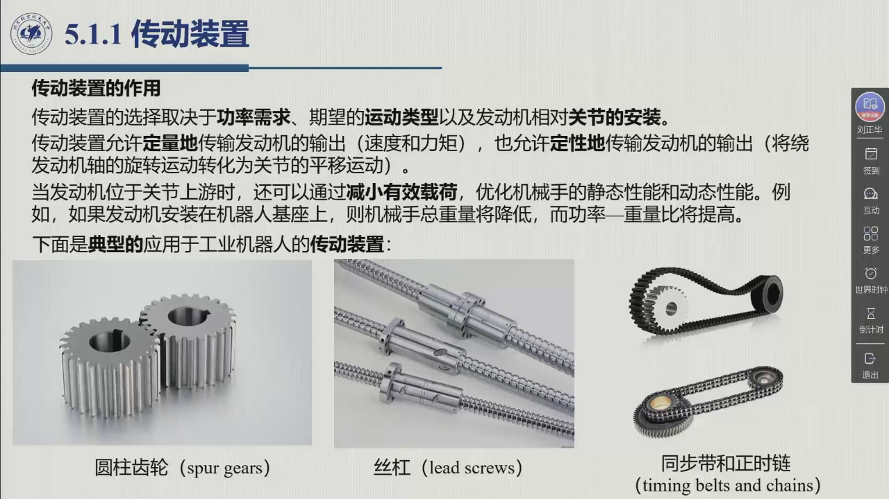

# 5.1.1 传动装置

上一节留下了执行系统的功率链和工况矛盾：能源经功放送到伺服发动机，输出机械功率 $P_m$，再经传动装置变成关节功率 $P_u$；一般商用电机在高速低转矩下效率最高，关节却需要低速大转矩。传动装置夹在发动机和关节之间，负责把发动机侧的运动和力矩换成关节需要的形式。课堂回看：00:30:54–00:38:23。

## 5.1.1.1 传动装置的三个作用

先用具体例子看电机直接接关节会遇到什么问题。关节要求低速大力矩，高速电机直接连上去转太快、力矩又不够；如果关节要做直线移动，旋转电机更没法直接推动；如果把笨重的电机直接装在机械臂末端附近，连杆每次加减速都要带动这台电机，远端惯量就会变大。老师讲到这里时说（00:33:01）：“惯量它是起到一个延迟的作用”，惯量小的话就比较容易控制，惯量大则必须提前预判补偿。

按上述三类问题，教材与课堂把传动装置的功能分成三种（00:31:03–00:32:55）。

::: def 定义 5.1.3 · 传动装置的三重作用 {#def-5.1.3}
传动装置按功率、运动形式和安装布置完成三项任务：

1. **定量变换**：改变速度和力矩的比例，即用减速传动[降速增矩](../recall.md#gear)，把高速低转矩的发动机输出换成低速高转矩的关节输出。
2. **定性变换**：改变运动形式，例如用丝杠、曲柄滑块或齿轮齿条把旋转电机输出变成移动关节所需的直线平移（00:31:26–00:32:14）。
3. **远置发动机以减重**：把较重的电机装在基座或上游，通过传动把动力送到远端关节，减小远端携带的附加质量和转动惯量，同时提高静态功率—重量比并改善动态响应。
:::

远置电机能减小随远端连杆运动的质量和惯量，但新增的带、链或线缆也有自身的质量、弹性和摩擦，整机总重量和动态模型必须把传动件一起算进来。转动惯量增大会使同样净力矩下的角加速度 $\ddot\theta=\tau/I$ 变小，响应变慢（这种物理变化不是信号被原样推迟的纯时间延迟）；多连杆的耦合惯量用[惯性矩阵](../recall.md#kinetic)描述，将在第六章展开。

## 5.1.1.2 三种典型传动装置

确定需要哪种变换后，再按运动关系、载荷和速度选机构。工业机器人最常用圆柱齿轮、丝杠、同步带和正时链三类。

::: method 方法 5.1.C · 三种传动装置的选型 {#method-5.1.C}
| 机构 | 运动关系 | 特点与选型核查 |
|:--|:--|:--|
| 圆柱齿轮 | 旋转 → 旋转；外啮合副两轴反向，可平移轴位置 | 用于减速增矩和改变轴间位置；核查齿隙、刚度、润滑与承载 |
| 丝杠 | 旋转 → 直线平移 | 驱动移动关节，常预装滚珠丝杠把滑动摩擦改为滚动以减隙增刚；核查导程、摩擦、回差与轴向刚度 |
| 同步带或正时链 | 旋转 → 旋转（运动学等价，用于远置电机） | 同步带轻，适合高速低矩，橡胶带受力矩过大会变形；正时链为钢质，耐低速高矩，但质量大、高速易颤动（00:34:07–00:34:59） |
:::

具体算一遍丝杠与旋转减速器的换算。设丝杠导程（每转一圈螺母的轴向进给量）为 $L$（m/rev），电机转角为 $\theta$（rad），转一圈 $\theta=2\pi$ 对应轴向位移 $x=L$，因此

$$x=\frac{L}{2\pi}\theta,\qquad v=\frac{L}{2\pi}\dot\theta.$$

若忽略摩擦损失，输入旋转功率等于输出直线功率，即 $\tau\dot\theta=Fv$。将 $v=\frac{L}{2\pi}\dot\theta$ 代入并消去 $\dot\theta$，得到所需电机转矩 $\tau=\frac{FL}{2\pi}$。可见导程 $L$ 同时决定速度比例和力矩比例：导程越大，电机转一圈走得越远，同一推力 $F$ 所需的输入转矩也越大。

再看旋转减速器。将两端正方向按相容转向选定，定义减速比 $k_r=\dot\theta_m/\dot q>0$（其中 $\dot\theta_m$ 为电机角速度，$\dot q$ 为关节角速度）。理想无损时功率相等，$\tau_m\dot\theta_m=\tau\dot q$，于是

$$\dot q=\frac{\dot\theta_m}{k_r},\qquad \tau=k_r\tau_m.$$

拿一组数代入：电机输出 $1\ \mathrm{N\cdot m}$、转速 $10\ \mathrm{rad/s}$，配 $k_r=10$ 的减速器后，理想关节输出变为 $10\ \mathrm{N\cdot m}$、$1\ \mathrm{rad/s}$，两侧功率同为 $10\ \mathrm W$；同时放大速度和力矩会使功率变成 $100\ \mathrm W$，违背能量守恒。实际输出还要扣除传动效率并受齿轮允许转矩限制。

::: intuition 动手实验 · 三种传动装置转起来看（3D）
先观察输入转过一圈时输出转多少、向哪边运动。外啮合齿轮改变转向，丝杠改变运动形式，同步带可把动力送到另一根轴。再用上面的速度关系和功率等式核对读数。

:::

::: thm 定理 5.1.F · 无间隙刚性传动 ⇒ 纯比例关系 {#thm-5.1.F}
当传动比固定、连接无间隙且构件可视为刚性时，两端位移和速度满足固定的纯比例约束。在此基础上再忽略摩擦和其他损耗，才能由功率平衡得到力和力矩的比例关系。

“无间隙、刚性”保证几何运动成比例，“无损失”才保证力矩按反比换算。一旦存在弹性、回差或速度相关摩擦，模型就必须补入额外状态或非线性项；[§5.2.3](sec5-2-3.md) 在这一假设下推导传动比对惯量和负载的影响。
:::

## 5.1.1.3 直接驱动：可以不用传动装置吗

既然传动装置带来摩擦、齿隙和弹性，能否省掉它直接用电机连关节？

::: def 定义 5.1.4 · 直接驱动 direct drive {#def-5.1.4}
直接驱动把执行器直接连接到关节，不使用独立减速传动。电机必须在关节所需转速下直接发出所需转矩。
:::

省去减速器后，确实消除了这一级齿轮带来的齿隙、弹性变形和摩擦损失（不过电机本身与关节轴承仍有摩擦和有限刚度）。但代价落在控制算法、电机尺寸和成本上。老师在课上说明了直驱为什么难控（00:35:19–00:36:30）：没有减速装置时，当前关节和下游连杆的惯性、重力与速度耦合直接落回电机轴，各轴呈强耦合状态；加上大减速比后，“我控制这个关节就单独控制这个关节”，下游的动力耦合和非线性影响被比例系数削弱（具体折算系数 $1/k_r$ 与 $1/k_r^2$ 见 [§5.2.3](sec5-2-3.md)），多轴系统才近似拆成可独立设计的单轴系统。

尺寸与成本差距同样明显。老师在课上给了一个经验估算帮助建立数量感（00:36:53–00:38:23，注：这是课堂工程经验，不是精确物理定律，选型仍须按电机转矩常数、散热与安装核算）：直驱方案下，电机体积和质量随所需转矩增长很快，若发 $1\ \mathrm{N\cdot m}$ 需约 $10\ \mathrm{kg}$ 级电机，直接做 $10\ \mathrm{N\cdot m}$ 按平方估算就要 $10\times10^2=1000\ \mathrm{kg}$；改用发 $1\ \mathrm{N\cdot m}$ 的电机配 $k_r=10$ 的减速器，同样输出 $10\ \mathrm{N\cdot m}$，减速箱只有几十到几百克。因此商用工业机械手多数采用高速电机配减速器，直驱多用于精密低负载、高速高刚度特定场合或实验室研究。

::: think 检查理解
1. 把电机移到基座附近，为什么可能减小远端惯量，却不一定减小整机总质量？
2. 导程翻倍、转角和轴向负载不变时，位移及理想输入力矩各怎样变化？
3. 减速比10为何不能同时使速度与力矩都变为输入的10倍？
4. 直接驱动省掉了哪些问题，又把哪些要求交给电机与控制器？

::: sol 核对
远端不再携带同一台电机，但增加的传动仍须计重。由 $x=L\theta/(2\pi)$ 与 $\tau=FL/(2\pi)$，导程翻倍使两者均翻倍。若速度和力矩同时放大10倍，机械功率会放大100倍，违背理想功率平衡。直驱省去独立减速传动的损失、间隙和弹性，但电机需直接满足关节的负载与运动要求，控制器也须处理更强的多轴动力学耦合。
:::
:::

## 5.1.1 小结与常见错误

传动装置接在发动机和关节之间，起三类作用：降速增矩（定量变换）、转动变平动（定性变换）、远置电机减小末端惯量（减重与解耦）。在无间隙刚性、无损失假设下，输入输出速度和力矩按固定比例互换，功率守恒。直接驱动虽消除了独立减速级的间隙和弹性，却把大转矩和强耦合直接交给电机和控制器。

::: think 常见错误清单 · 自查三条
1. 只记住降速增矩，漏掉定性变换（转动变平动）与远置减重／削弱耦合。
2. 以为理想传动能放大功率：理想传动保持 $P_u=P_m$，速度和力矩按反比分配；真实传动还会减去损失 $P_{dt}$。
3. 把直驱当成无条件更先进的方案：它省去的是减速器的间隙与弹性，但对电机转矩密度和耦合控制的要求更高。
:::
