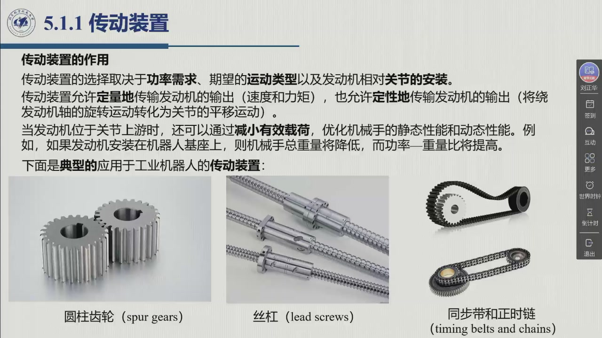
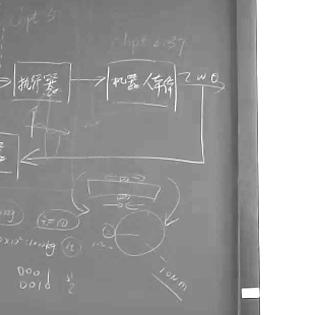

# 5.1.1 传动装置

上一节留下的问题在这里回答：**发动机与关节的工况正好相反**，传动装置是把这个矛盾抹平的部件。但它的作用远不止「减速」——老师把它拆成三个：**定量变换、定性变换、以及减重**。本节最后讨论「那不用传动装置行不行」（直接驱动），并给出老师的一个经验估算法。录播 00:30:54–00:38:23。

<aside class="lesson-brief" aria-label="5.1.1 学习简报">

PREREQUISITE<strong>你需要先会</strong>
发动机与关节的工况矛盾（[@thm-5.1.B]）；执行系统的功率链与损失 $P_{dt}$（[@def-5.1.2]）。

TARGET<strong>本节要建立</strong>
传动装置的**三重作用**（定量 / 定性 / 减重）；三种典型装置（圆柱齿轮 / 丝杠 / 同步带与正时链）各自的适用场合；「无间隙刚性传动 ⇒ 纯比例」这条假定；直接驱动为什么在工业上不普遍。

CHECKPOINT<strong>学完的标准</strong>
能不看笔记说出传动装置的三个作用各解决什么问题；能说出同步带与正时链该怎么选（按速度高低）；能用老师的平方关系估算「直驱要多大电机」。

</aside>

## 5.1.1.1 传动装置的三个作用

教材 §5.1.1 的表述是：传动装置的选择取决于**功率需求、期望的运动类型、以及发动机相对关节的安装**——这三条恰好对应三个作用。

::: def 定义 5.1.3 · 传动装置的三重作用 {#def-5.1.3}
1. **定量变换**：**定量地传输发动机的输出**（速度和力矩）——即「降速增矩」。老师 0:31:03：「就是降速增矩」。
2. **定性变换**：**定性地改变运动形式**——把绕发动机轴的**旋转运动**转化为关节的**平移运动**。老师 0:31:26：「电机只能提供一个转动的需求，但实际的过程中我们可能需要一个平动的需求……就需要一个机构，把转动转化成为平动。」
3. **减重（优化有效载荷）**：当发动机位于**关节上游**时，可以通过减小有效载荷，优化机械手的**静态性能和动态性能**。典型做法是把发动机装在机器人**基座**上——「则机械手总重量将降低，而**功率—重量比**将提高」（教材 §5.1.1）。
:::

第 3 条老师在 0:32:10 展开得最细，值得原样保留：**把比较重的质量和机械臂都放在基座附近，通过传动方式把动力传到末端**，这样末端惯量小，「其实是有助于控制的」。他举的例子是实验室做的**线缆驱动**（远端驱动）机械手——电机放在身上或近端，通过线缆把动力传到末端，「这样可以大大减小（末端）附加惯量」。

为什么惯量小就好控制？老师给了一句很本质的话（0:33:01）：

> **「惯量它是起到一个延迟的作用。」** 惯量大了，做算法补偿时始终得考虑这个惯量、提前预判它会带来什么影响；惯量小的话就比较容易控制。

这正是 [3.8 静力学](../ch03/sec3-8.md) 之后第一次出现「**动力学**」这个词——本章只做定性讨论，第 7 章才正式建模。

## 5.1.1.2 三种典型传动装置

教材 §5.1.1 与课件 0:33:23 页给出工业机器人上最常用的三种：

::: method 方法 5.1.C · 三种传动装置的选型 {#method-5.1.C}
| 装置 | 变换性质 | 特点 | 什么时候用 |
|:--|:--|:--|:--|
| **圆柱齿轮**（spur gears） | 旋转 → 旋转 | 通过**改变旋转轴**和/或**平移作用点**来改变发动机的旋转运动；通常具有宽截面齿和下沉轴结构 | 需要换向 / 换轴位置时 |
| **丝杠**（lead screws） | 旋转 → **平移** | 把发动机的旋转运动**转换为平移运动**，用于**移动关节**；为减小摩擦常预装**滚珠丝杠**以提高刚性并降低间隙 | 移动关节（棱柱关节）的驱动 |
| **同步带**（timing belts） / **正时链**（chains） | 旋转 → 旋转 | 运动学上**二者等价**，用于把发动机**定位在远离驱动关节的轴上**；皮带靠拉紧传动，用于**高速度、低力量**；链条质量大，高速时会**颤动**，用于**低速度**需求 | 按速度高低二选一 |
:::

老师在 0:34:07 把「二选一」讲成了物理直觉，比教材更直白：

- **同步带**「相对来说比较轻，可以（在）高速的时候效果好一点」——但带是橡胶的，「**矩太大的话就会变形**」；
- **正时链**「质量比较大，所以说它速度高的话，惯量大是会有（震颤）」，所以高速不合适；「但是低速高矩是可以，**因为它是钢的**」。

一句话总结：**要快要轻用带，要重（大力矩）耐操用链。**

::: thm 定理 5.1.F · 无间隙刚性传动 ⇒ 纯比例关系 {#thm-5.1.F}
在**无间隙刚性传动**的假定下，**输入力（速度）与输出力（速度）之间是纯比例关系**（教材 §5.1.1）。

这条假定是本章往后一切推导的地基：§5.2.3 用它把传动装置写成**比例环节**，从而得到「传动比如何改变系统的等效惯量、等效刚度与非线性影响」的全部结论。
:::

## 5.1.1.3 直接驱动：可以不用传动装置吗

::: def 定义 5.1.4 · 直接驱动 direct drive {#def-5.1.4}
某些时候，执行系统发动机的机械特性可能允许**不使用任何传动装置**而把发动机**直接连接**到关节上，称为**直接驱动**。

**收益**：由于传动装置**弹性和间隙**导致的缺点被消除——没有齿隙、没有回差、没有传动刚度问题。

**代价**：需要**更复杂精密的控制算法**。教材 §5.1.1 给出的理由是：**没有了减速齿轮，就无法忽略动力学模型中的非线性耦合项**。
:::

老师把「代价」讲得更具体（0:35:19–0:36:30）：直驱时「**它对控制算法的要求就非常高**」——因为关节与下游各关节之间是**强耦合**的：

> 「因为（没有）传动装置的情况下，相当于这个关节和下游关节，它都是**强耦合**的……如果我们加上传动装置，**我控制这个关节就单独控制这个关节**；通过传动装置这个比例系数，可以把下游的动力耦合或者非线性的耦合因素给减弱了。」

也就是说，传动装置还有第四个隐藏作用：**解耦**——把「一整条链上的强耦合系统」切成「每轴一个近似独立的单输入单输出系统」。这正是为什么第 8–10 章的控制器大多可以**按关节分别设计**。

结论（教材 §5.1.1）：由于**成本、发动机尺寸和控制复杂性**的原因，直接驱动在工业机械手中**并不普遍**。

**老师的经验估算（0:36:53–0:38:23）。** 他用一个「不严格但工厂上可以这样理解」的算法说明直驱为什么不划算：**直驱所需的电机质量随所需转矩的平方增长**——要产生 1 N·m 也许要 10 kg 的电机；那么同样用直驱去产生 10 N·m，就要 $10\times 10^2=1000$ kg（一吨）级的电机。而如果改成**减速比 10 的减速器**，「输入的是一牛米，这个是 10 倍，输出的就可以是（10 N·m）」，而「这个减速箱可能几百克、几十克就可以了」。

板书右下角画的正是这个算例：

<figure>

<figcaption>第 6 周板书右下（教师流 142:30 截取）：上面矩形标 $F,v$（平动侧），下面圆标 $\tau,\omega$（转动侧），两侧弧形箭头表示传动关系；左侧圈注 $(100\,\mathrm{g})$、$\tau=10$、$10\times10^{-2}=10^{-2}\ \mathrm{kg}$ 与 $10\ \mathrm{cm}$，正是老师 36:53–38:05 讲的「1 N·m 输入、减速比 10、输出 10 N·m」以及「10 cm 臂长举 100 g」的算例。</figcaption>
</figure>

::: think 考点 · 老师原话（录播时间点）

> **三个作用**：「在这边的作用我们刚才讲的是其中一个作用，就是定量的一个作用，就是**降速增矩**」（0:31:03）；「还有一个作用就是**定性的作用**……把转动转化成为平动」（0:31:16）；「为了减少有效载荷、减少末端的惯量，这个时候我们就可以把比较重的质量和机械臂都放在**基座附近**」（0:32:10）。

> **惯量的本质**：「**惯量它是起到一个延迟的作用**……惯量小的话就比较容易控制」（0:33:01）——这句话是第 7 章动力学的引子。

> **带与链的分工**：「一般**高速低矩**要求的时候可以采用同步带；**低速高矩**要求是采用正时链」（0:34:07）。

> **直驱为什么难**：「采用直驱，它对**控制算法的要求就非常高**」；「（没有）传动装置的情况下，相当于这个关节和下游关节都是强耦合的；加上传动装置，**我控制这个关节就单独控制这个关节**」（0:35:26、0:36:12）。

> **平方关系（经验、不严格）**：「（直驱）这就是**平方倍**的关系，相当于 $10\times10^2=1000$ 千克的一个电机」（0:37:20）；换成减速比 10 的减速器，「**这个减速箱可能几百克、几十克就可以了**」（0:38:12）。
:::

::: think 默写点 · 合上书再写（主动回忆）

1. 传动装置的三个作用各是什么？第三个作用改善的是静态性能还是动态性能，为什么？
2. 同步带与正时链分别在什么速度/力矩需求下使用？各自的物理原因是什么？
3. 「无间隙刚性传动」这条假定给出了什么结论？它在后面哪一节被用来推导传动比的影响？
4. 直接驱动省掉了什么、付出了什么代价？为什么说传动装置还起了「解耦」作用？

::: sol 核对

① 定量变换（降速增矩）；② 定性变换（旋转 → 平移）；③ 减重/优化有效载荷——发动机移到基座或上游，减小末端惯量，**同时**改善静态（功率—重量比提高）与动态（末端惯量小、易控制）性能。

同步带：高速度、低力量（带轻、但橡胶带力矩大会变形）；正时链：低速度、大力矩（钢质耐大矩，但质量大、高速会颤）。

纯比例关系（输入力/速度 ↔ 输出力/速度线性成比例）。它在 §5.2.3「传动装置影响」中被用来推导等效惯量、等效刚度与非线性耦合的减弱。

省掉传动装置的弹性与间隙；代价是没有减速齿轮后**动力学模型的非线性耦合项无法忽略**，需要更复杂的控制算法（甚至要用传感器在线评估末端的非线性因素）。传动装置同时把强耦合的多轴系统**解耦**成可独立设计的单轴系统。

:::

:::

## 5.1.1 小结与常见错误

- **一句话**：传动装置把发动机的工作点（高速低矩）搬到关节需要的工作点（低速高矩），顺带完成换向、换运动形式和减重解耦。
- **三种装置**：齿轮换向、丝杠转平动、带/链做远置传动（带快、链重）。
- **一条假定**：无间隙刚性 ⇒ 纯比例，这是 §5.2.3 的地基。
- **一个取舍**：直驱精度高但控制难、成本高，工业上用「电机 + 减速器」更普遍。

::: think 常见错误清单 · 自查三条
1. 只记住「减速增矩」，漏掉**定性变换**与**减重解耦**——后两条恰是老师反复强调的。
2. 认为传动装置「改变功率」——理想传动不改变功率（$P_u=P_m$），只重新分配力与速度。
3. 把直驱当成「更先进所以更好」——它换掉的是**弹性与间隙**，代价是**控制复杂度**；工业上多数场合并不采用。
:::