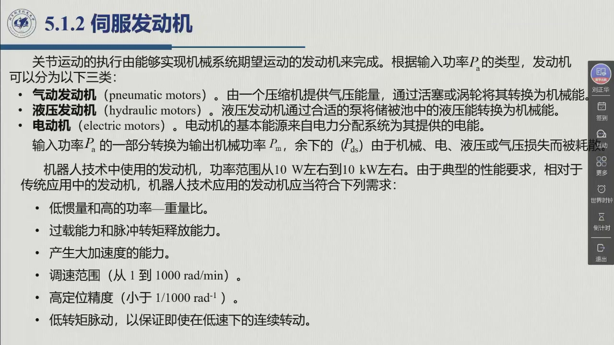
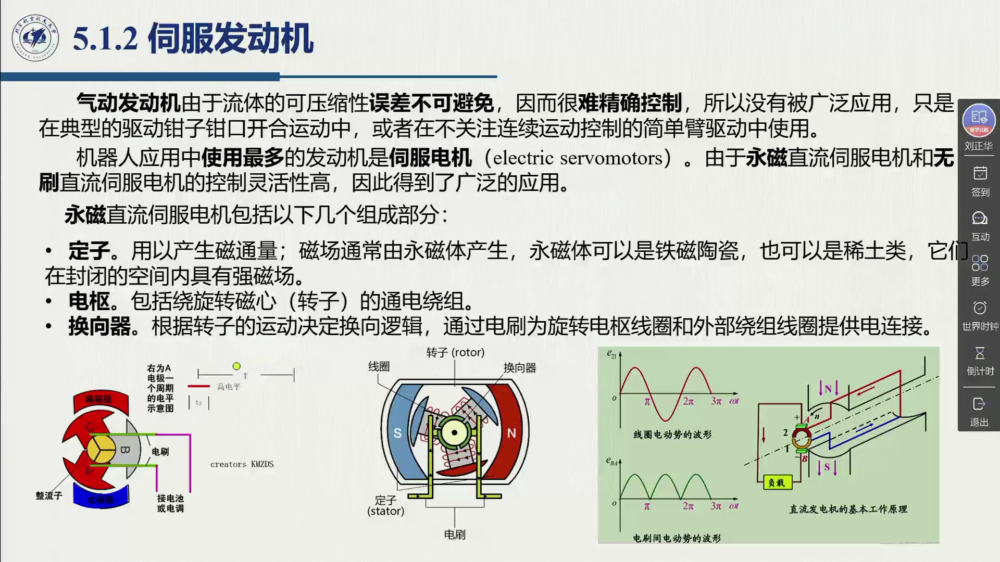
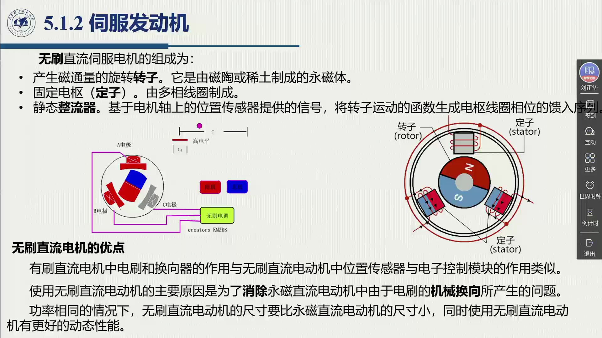
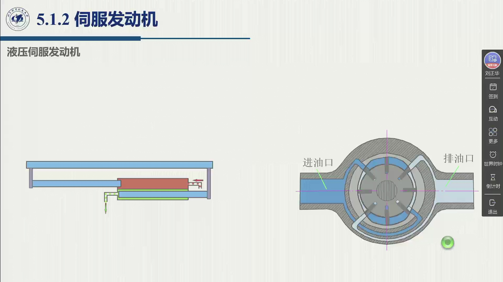

# 5.1.2 伺服发动机

在“能量—驱动—传动—测量”这条链上，上一节讲的传动装置从功率放大器后面的执行器接过机械输出 $P_m$。本节向上倒推到这台执行器本身：功率放大器把调节后的电能、液压能或气压能 $P_a$ 送给它，它再按控制命令给出轴上的转矩或直线力。老师在课上提醒（00:38:41），这里统称“伺服发动机”而不是电机，因为实际机械手除了电动方案，在特定负载和安全要求下也会采用液压或气动。课堂回看：00:38:41–00:59:59。

## 5.1.2.1 三类发动机与「伺服」的来历

执行器把哪种能源变成机械功，直接决定后面的功率放大器和数学模型长什么样。随着机器人对轨迹跟踪和定位精度要求提高，执行器必须随控制器命令连续调节输出，这就是“伺服”的意思。

::: def 定义 5.1.5 · 发动机的分类与伺服发动机 {#def-5.1.5}
按输入功率 $P_a$ 的形式，伺服发动机分为三类：电动机通过电磁作用产生转矩，液压发动机利用流体压差驱动活塞或马达，气动发动机依靠压缩空气推动活塞或涡轮。在忽略储能变化的正向驱动工况中，输出机械功率为 $P_m$，耗散损失为 $P_{dm}=P_a-P_m$。
:::

只看额定功率还不够选型：同样 100 W 的执行器，热负荷、过载能力和低速平顺性可能相差很大。教材把选型要求拆成六条具体指标，机器人常用发动机的功率范围大致在 10 W 到 10 kW（00:41:45–00:42:35）。

::: def 定义 5.1.6 · 机器人发动机的六条性能要求 {#def-5.1.6}
| 检查项 | 要解决的工程问题 |
|:--|:--|
| 转动惯量与功率／质量 | 执行器自身要随关节加速，装在运动连杆上时还会加重上游负载 |
| 持续与峰值力矩、过载与脉冲释放 | 决定稳态发热上限与短时急加速能力 |
| 加速能力 | 净力矩除以等效惯量决定实际角加速度（见 [§5.1.1](sec5-1-1.md)） |
| 调速范围 | 需覆盖低速精调、高速空载与频繁换向（教材参考 1 到 1000 rad/min） |
| 定位精度 | 由编码器等传感、传动刚度和闭环共同实现（教材参考小于 $1/1000$ rad） |
| 低速转矩脉动 | 脉动过大时低速爬行或抖动，影响平滑跟踪 |
:::

三类方案里，气动在工业机械手上用得较少。因为气体可压缩性大，外负载一变，压力、流量和位置就会互相牵连，难以用简单模型实现精密连续跟踪；老师提到（00:39:52–00:41:00、00:42:35），气动常用在跟人交互较柔和的场合（如人工肌肉），或者只需要夹爪开合（二值控制）和少数固定点位的简单搬运。精密连续轨迹控制主要用电动和液压。

## 5.1.2.2 伺服电机：有刷与无刷

电动机利用磁场与通电绕组的作用产生转矩。转子转过 90° 后，如果绕组里的电流方向不跟着切换，电磁力就会反向把转子拉回去（00:43:15–00:43:56）。为了让电机朝同一方向连续旋转，必须随转子位置不断切换绕组电流，这一步叫换向或换相。有刷永磁直流电机与无刷直流电机用两种不同结构完成同一件事。

::: def 定义 5.1.7 · 永磁直流伺服电机的组成 {#def-5.1.7}
有刷永磁直流电机由三部分组成：定子上的永磁体提供恒定磁场（磁铁氧体或稀土材料，而非通电励磁线圈），转子上的电枢绕组通过电流，固定电刷配合随转子旋转的机械换向器随转角切换绕组通电方向。
:::

把发热的绕组留在转子上、又靠电刷和铜片滑动摩擦来换向，会带来接触压降、机械磨损、换向电弧，以及转子散热难的问题。如果把永磁体和绕组的位置对调（永磁体放到转子上，多相电枢绕组固定到定子外壳上），会怎样？

::: def 定义 5.1.8 · 无刷直流伺服电机的组成与换相原理 {#def-5.1.8}
永磁无刷直流电机将永磁体放在转子上，多相电枢绕组固定在定子上，并由位置传感器与电子功率开关（静态整流器）根据转子实时位置安排各相电流。因此，有刷电机里“电刷与机械换向器”的通电切换职责，在无刷电机里改由“位置传感器与电子驱动器”共同承担（00:45:57）。
:::

切换各相电流时，驱动器依据转子位置调整定子合成磁场，使平均电磁转矩保持在所需方向；至于具体相电流采用方波还是正弦波、各瞬间磁场是否严格正交，则取决于驱动控制方式，后续在 [§5.2.1](sec5-2-1.md) 建立等效模型。先在三维剖面里把两台电机的动静部件对一遍。

::: intuition 动手实验 · 把伺服电机剖开看（3D）
先找出哪部分固定、哪部分转动，再追踪电流怎样进入绕组。有刷结构中，电刷固定、换向器随转子转；无刷结构中，绕组固定，由电子驱动器切换各相。最后指出每种结构中由谁提供转子位置与通电次序的联系。

:::

::: thm 定理 5.1.C · 为什么用无刷：定转子功能互换的四个好处 {#thm-5.1.C}
取消机械电刷与换向器，直接消除了接触压降和摩擦、电弧损耗；绕组放到定子上后热量更容易经外壳散出；转子不再背负绕组并可用稀土永磁，结构更紧凑、转动惯量更小；因此同功率下无刷电机通常尺寸更小、轻量化和动态加速性能更好（00:46:15–00:47:10）。

注意这里消去的是电刷接触与机械换向损耗，电机自身的线圈铜损和铁心铁损仍在；选型时还须结合绕组设计、散热、驱动器复杂度与成本综合比较。
:::

## 5.1.2.3 步进电动机

无刷电机靠位置传感器和电子驱动器严密跟踪转子位置，成本较高。如果对精度和高速响应要求不高，能否省掉位置传感器，只靠一串开关脉冲让电机按固定步距走？

::: def 定义 5.1.9 · 步进电动机 {#def-5.1.9}
步进电机按照外部给定的激磁脉冲序列切换各相通电，使转子一步一步跟随定子磁场转动。在典型开环工作方式下，控制器通过统计发出的脉冲数来推算转角，无需转角位置传感器参与换相（00:47:25–00:48:35）。
:::

脉冲数能代表转角，前提是转子每一步都确实跟上了磁场。一旦负载转矩过大、加减速过快或遇上共振而发生失步，转子落后或停在原地，命令脉冲数就会与真实转角脱节；开环状态下控制器无从察觉这类误差，而且步进式的离散切相也容易激发机械结构振荡。因此步进电机多见于成本敏感、负载轻且可承受开环或加装反馈校验的小型或微型机械手。

## 5.1.2.4 液压伺服发动机

回到重载荷工况：如果关节要求在很低转速下输出很大转矩，高速电机即便配大减速器也可能受限于体积和齿轮强度，这时可以考虑液压执行器。

::: def 定义 5.1.10 · 液压伺服发动机 {#def-5.1.10}
液压伺服发动机把受压流体的压差与流量转化为机械力和运动：液压缸靠活塞两侧压差推动活塞杆做有限行程的直线运动，旋转液压马达则由多活塞容积腔将压差变为连续旋转（00:54:50–00:55:15）。注意与能源端的液压泵区分：泵把原动机的机械能输入液压回路，而液压执行器从回路取出能量对外做功。
:::

教材与课堂在以下几项上对比了电动方案与液压方案，帮助决定什么场合选哪一种（00:55:20–00:58:10）。

::: method 方法 5.1.D · 电动 vs 液压：一张对照表 {#method-5.1.D}
| 比较项 | 电动方案 | 液压方案 |
|:--|:--|:--|
| 供能和配套 | 电网或电池配电子驱动器，产品线宽、易小型化 | 需独立液压泵站、阀与管路，成本高、难小型化 |
| 工况与减速需求 | 自身高速低转矩，通常需配减速器（带来间隙与弹性） | 靠压差与作用面积可在低速下直接产生大转矩 |
| 静态保持 | 堵转维持重物时电能全转成线圈发热，易过热保护熄火，常需配机械抱闸 | 可借液压油路维持静态压力，但须核算阀泄漏、压力保持与断能锁止 |
| 维护与环境 | 清洁无油污，但在易燃易爆环境中需专门防爆保护 | 自润滑、循环油液便于散热，高功重比；但有漏油污染环境及维护需求 |
| 动态与建模 | 电气动态与机械负载，控制灵活性高 | 阀流量、流体可压缩性（受油温影响）与泄漏（见 [§5.2.2](sec5-2-2.md)） |
:::

选型时先看两件事：第一，负载和安装空间是否迫使我们在低速下输出极大转矩（搬运重载荷时液压不仅工况合适，还常能省去沉重昂贵的机电传动）；第二，工作环境是否允许油液存在，以及静态停机时靠抱闸还是靠保压阀安全锁定负载。

::: think 检查理解
1. 有刷永磁电机的“永磁”与“有刷”分别描述哪件事？
2. 无刷取消了哪些接触部件？为什么仍然需要安排通电次序？
3. 开环步进电机发出100个脉冲，能否仅凭脉冲数证明实际转了100步？
4. 为什么液压执行器静止时也要检查泄漏和压力保持？

::: sol 核对
“永磁”说明励磁来源，“有刷”说明电连接和机械换向方式。无刷取消电刷与机械换向器，但电流仍须随转子位置改变以持续输出同向转矩。脉冲数只是命令，负载超限或共振可导致失步。液压静态承载仍依赖实际压差，阀或密封泄漏会造成压力下降与位置漂移。
:::
:::

## 5.1.2 小结与常见错误

伺服发动机按输入功率分电动、液压和气动三类，机器人上以电动最多、重载低速多用液压、气动多用于夹持或简单点位。伺服电机分为有刷永磁直流与无刷直流，无刷把绕组移到定子、用位置传感与电子开关取代电刷换向，换来无摩擦电弧、散热好与转子惯量小；步进电机按脉冲序列开环步进，易受负载和共振影响而失步。

::: think 常见错误清单 · 自查三条
1. 把机械换向器与静态整流器混为一谈：有刷靠电刷和铜片机械接触换向，无刷靠转子位置检测和电子开关换相。
2. 以为无刷电机“没有损耗”：无刷只是消除了电刷接触压降、摩擦和换向电弧，线圈铜损和铁损仍然存在。
3. 以为步进电机精度比伺服更高，或一定不会丢步：开环步进的特点是无需位置传感器，但过载或高速时可能失步。
:::
