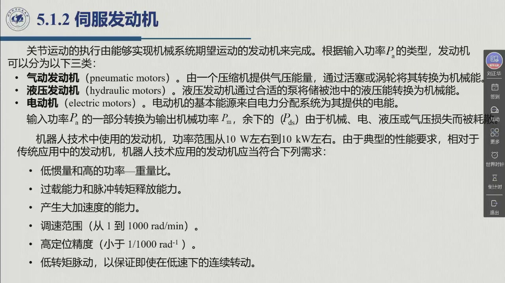
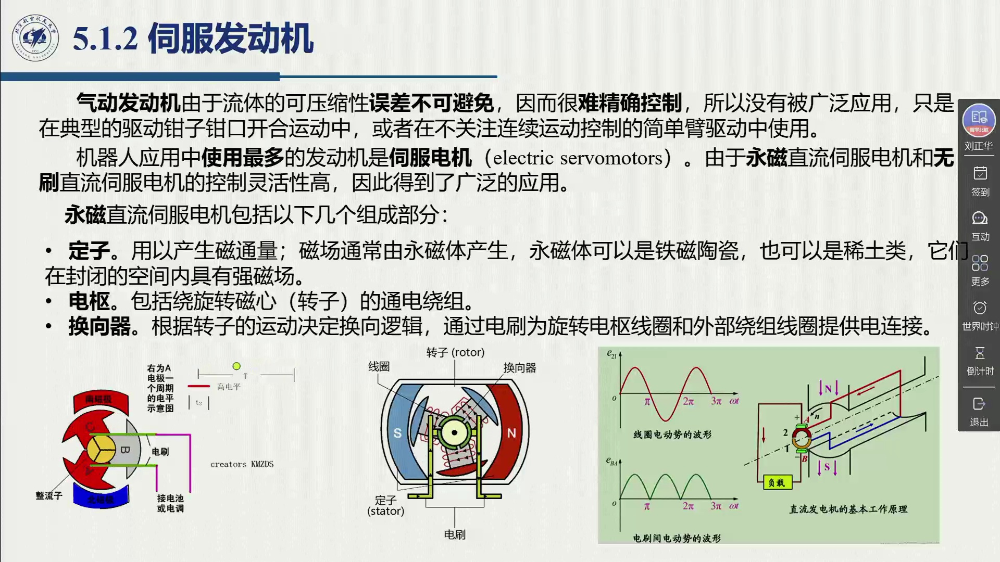
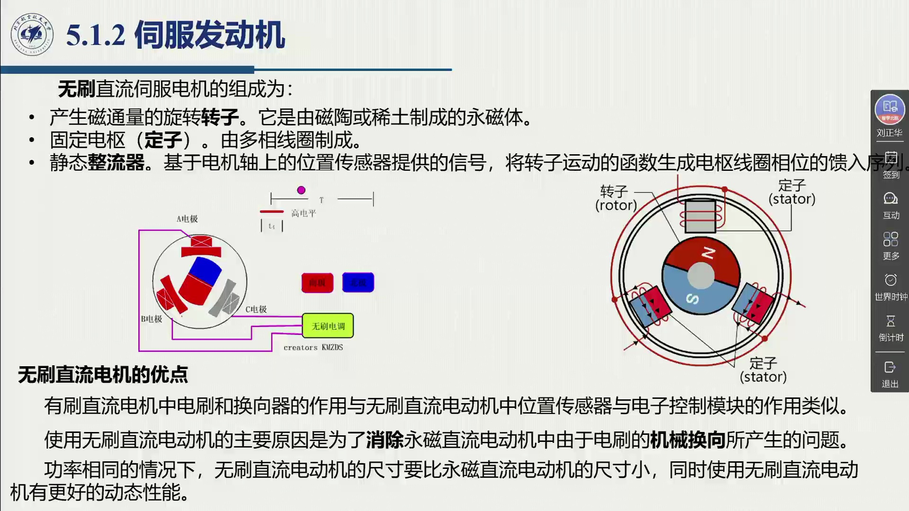
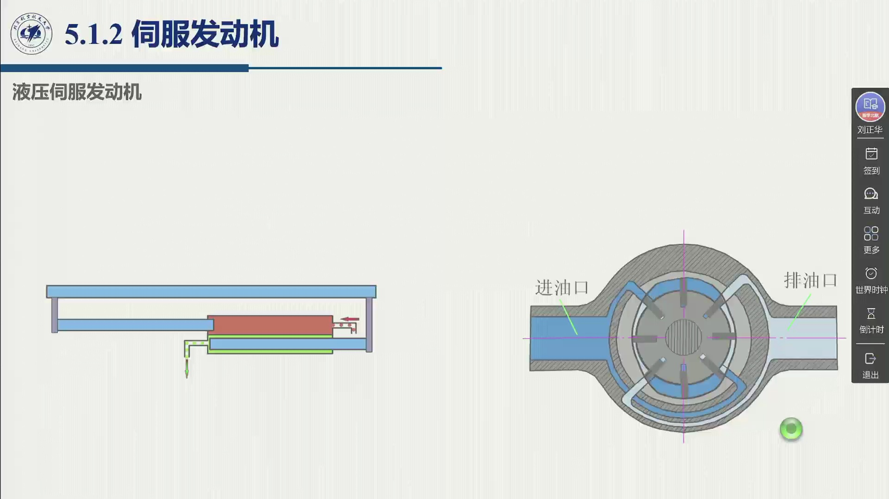

# 5.1.2 伺服发动机

执行系统的心脏是**伺服发动机**——注意老师特意强调用「发动机」而不是「电机」（0:38:41）：「因为实际的部分不可能、或者可能不完全采用电机，有些情况采用液压，有些情况采用气动」。本节按输入功率的种类把发动机分成三类，然后重点讲用得最多的**伺服电机**（永磁直流与无刷直流），最后给出电动机与液压伺服发动机的全面对比。录播 00:38:41–00:59:59。

<aside class="lesson-brief" aria-label="5.1.2 学习简报">

PREREQUISITE<strong>你需要先会</strong>
执行系统的功率链与输入功率 $P_a$、损失 $P_{dm}$（[@def-5.1.2]）；传动装置与工况矛盾（[@thm-5.1.B]、[@def-5.1.3]）。

TARGET<strong>本节要建立</strong>
发动机的三分类（气动/液压/电动）与「伺服发动机」的来历；永磁直流伺服电机与无刷直流伺服电机的**组成与换相原理**（定子/电枢/换向器 ↔ 转子/定子/静态整流器）；步进电动机的特点与局限；电动机与液压伺服发动机的优缺点对照表。

CHECKPOINT<strong>学完的标准</strong>
能说出有刷电机的电刷+换向器与无刷电机的「位置传感器+电子控制模块」为什么是**对应**的两个角色；能解释无刷为什么能做得更小、动态性能更好；能被问「重载荷搬运选什么」时立刻答出液压并给出理由。

</aside>

## 5.1.2.1 三类发动机与「伺服」的来历

::: def 定义 5.1.5 · 发动机的分类与伺服发动机 {#def-5.1.5}
**按输入功率 $P_a$ 的类型**，发动机分为三类（教材 §5.1.2）：

| 类别 | 能量来源 | 能量转换方式 |
|:--|:--|:--|
| **气动发动机**（pneumatic motors） | 压缩机提供的气压能 | 通过**活塞或涡轮**转换为机械能 |
| **液压发动机**（hydraulic motors） | 泵把储液池中的液压能送出 | 通过**合适的泵**转换为机械能 |
| **电动机**（electric motors） | 电力分配系统提供的电能 | 电磁作用转换为机械能 |

输入功率 $P_a$ 的一部分转换为输出机械功率 $P_m$，余下的（$P_{dm}$）由于**机械、电、液压或气压损失**而被耗散。

**伺服发动机**（servomotor）：随着机器人执行系统对**轨迹跟踪能力**和**定位精确性**的要求提高，上述要求也被提高，**从而发动机必须起到伺服作用**——这就是「伺服发动机」这个说法的来历。
:::

**机器人用的发动机有多大？** 教材给的范围是**功率 10 W 左右到 10 kW 左右**。老师在这一页（课件 0:39:06）逐条念了机器人对发动机的六条性能要求，它们是本章后面所有讨论的验收标准：

::: def 定义 5.1.6 · 机器人发动机的六条性能要求 {#def-5.1.6}
1. **低惯量**和**高的功率—重量比**；
2. 过载能力和**脉冲转矩释放能力**；
3. 产生**大加速度**的能力；
4. **调速范围**（从 1 到 1000 rad/min）；
5. **高定位精度**（小于 $1/1000$ rad）；
6. **低转矩脉动**，以保证即使在低速下的连续转动。
:::

对照这六条再看 §5.1.1：第 1 条（低惯量）正是「把发动机放到基座、用传动装置把动力送下去」的理由；第 4、6 条（宽调速 + 低速连续）是液压的强项（见本节末尾对照表）。

**气动为什么用得不广？** 教材 §5.1.2 给出的原因很物理：**流体的可压缩性误差不可避免**，因而**很难精确控制**。所以气动发动机只用在两类场合：典型的**驱动钳子钳口开合**运动，或者**不关注连续运动控制**的简单臂驱动。

## 5.1.2.2 伺服电机：有刷与无刷

「在机器人应用中使用最多的发动机是**伺服电机**（electric servomotors），其中**永磁直流**与**无刷直流**两种因控制灵活性高而得到广泛应用」（教材 §5.1.2）。老师 0:43:02 的概括是「一般两种，**永磁的**和**无刷的**」。

::: def 定义 5.1.7 · 永磁直流伺服电机的组成 {#def-5.1.7}
1. **定子线圈**：用以产生磁通量。磁场通常由**永磁体**产生——可以是**铁磁陶瓷**，也可以是**稀土类**材料，它们在封闭空间内具有强磁场。
2. **电枢**：包括绕旋转磁心（**转子**）的**通电绕组**。
3. **换向器**：根据转子的运动**决定换向逻辑**，并通过**电刷**为旋转的电枢线圈与外部绕组线圈提供电连接。
:::

::: def 定义 5.1.8 · 无刷直流伺服电机的组成与换相原理 {#def-5.1.8}
**组成**（与有刷的恰好「功能互换」）：

1. **产生磁通量的旋转线圈（转子）**：由磁陶或稀土制成的**永磁体**；
2. **固定电枢（定子）**：由**多相线圈**制成；
3. **静态整流器**：基于**电机轴上的位置传感器**提供的信号，把转子运动的函数**生成电枢线圈相位的馈入序列**。

**换相原理**（教材 §5.1.2）：通过**转子位置传感器**找到**与磁场正交的线圈**，磁场作用于该线圈产生转子旋转；转子转过后，**电子控制模块**使磁场依次与定子各相绕组作用，从而**电枢磁场始终与定子磁场正交**。其电磁交感方式，与永磁直流电机**电刷位于与激磁磁场成 $\pi/2$ 角**时的工作方式相似。

**一句话对照**：有刷电机里**电刷与换向器**所起的作用，与无刷电机里**位置传感器与电子控制模块**所起的作用**是类似的**（老师 0:45:57 说的也是这一句）。
:::

::: thm 定理 5.1.C · 为什么用无刷：定转子功能互换的四个好处 {#thm-5.1.C}
**动机**：使用无刷直流电动机的主要原因是**消除永磁直流电动机中电刷机械换向所产生的问题**（教材 §5.1.2）：

- **电损耗**：电刷与换向器的**接触产生接触压降**；
- **机械损耗**：**摩擦**以及**换向过程中线圈自感引起的电弧**。

**结果**（定子与转子功能交换带来的便利）：

1. **散热更好**——电枢线圈放在**定子**上而不在转子上，有利于散热；
2. **转子紧凑**——转子上没有绕组，且可用**稀土永磁**，转子结构更紧凑；
3. **转动惯量更小**——紧凑的转子结构直接减小惯量（对照 [@def-5.1.6] 第 1 条「低惯量」！）；
4. **同功率下尺寸更小、动态性能更好**。

**但成本也必须考虑**：「对于在一个特定应用场合选择一个最合适的伺服电动机，**成本也是必须考虑的问题**」。
:::

## 5.1.2.3 步进电动机

::: def 定义 5.1.9 · 步进电动机 {#def-5.1.9}
步进电动机由**合适的激磁序列**控制，其运行**不需要电动机转角位置的测量信息**——这是它最大的特点（也就是「开环可控」）。

**两条限制**（教材 §5.1.2）：

1. 其**动态性能在很大程度上受到有效载荷的影响**；
2. 它还会**导致机械手机械结构的振荡**。

这些不便之处**限制了步进电动机在微型机械手领域的应用**——在这一领域，相对于更高的动态性能，**低成本**是首先考虑的因素。
:::

老师 0:47:25 把步进与无刷的差别讲得更直白：两者**原理有很大区别**——无刷是「转子用永磁体，定子里通电产生旋转磁场，用旋转磁场带动转子」，因此「**需要比较高级的算法**」去处理**转子位置与磁场（电流）的关系**；步进而不需要位置反馈。

## 5.1.2.4 液压伺服发动机

::: def 定义 5.1.10 · 液压伺服发动机 {#def-5.1.10}
工作原理很简单：**基于压缩流体的容积变化**。从结构看，它由**活塞**构成的**一个或多个腔室**组成（缸体在腔室内作往复运动）：

- **线性伺服发动机**：行程**有限**，仅由一个活塞构成；
- **旋转伺服马达**：行程**不受限制**，由**多个（通常是奇数个）活塞**相对于发动机旋转轴**轴向或径向**布置构成。

其**静态和动态性能与电动伺服马达具有可比性**。
:::

::: method 方法 5.1.D · 电动 vs 液压：一张对照表 {#method-5.1.D}
教材 §5.1.2 从「使用的角度」做了完整对照，这是本章最典型的**选型素材**：

| | **伺服电机** | **液压伺服发动机** |
|:--|:--|:--|
| **优势** | 能源来源广泛；成本低且产品范围宽；功率转化效率高；易于维护；对工作环境无污染 | 静态下**不会熄火**；**自润滑**，循环液体便于热处理；在**有害环境**下也很安全；**很高的功率—重量比** |
| **局限/缺点** | 由于机械手受重力作用，**静态条件下会引起熄火问题**，需要紧急刹车；在**易燃环境**下工作需特别保护 | 需要**液压源**；成本高、产品范围窄、**难以小型化**；功率转化效率低；需要操作维护；**漏油会造成环境污染** |
| **工况特点** | 速度高、转矩低 ⇒ **需要用齿轮传动装置**（带来弹性与间隙） | **能在低速度下产生大转矩** |
| **动态性能** | 有更好的**控制灵活性**（但两者都有很好的动态性能） | 动态性能**取决于压缩流体的温度** |
| **适用场合** | 一般工业机械手 | **搬运重载荷**——不仅最合适，而且装置成本能降低操纵系统的整体开销 |

读这张表的正确方式是**抓两行**：**「速度高转矩低 vs 低速大转矩」**决定了用不用传动装置；**「会不会熄火 + 环境要求」**决定了在危险或大负载场合选谁。
:::

::: think 考点 · 老师原话（录播时间点）

> **为什么叫「发动机」不叫「电机」**：「这里实际是伺服发动机，没说是电机。因为实际的这个部分不可能、或者是可能不完全采用电机——**有些情况采用液压，有些情况采用气动**」（0:38:41）。

> **无刷与有刷的角色对应**：「电刷和换向器的作用是**类似的**（与位置传感器+电子控制模块）」（0:45:57）；「对于有刷的，它通过电刷是有**机械摩擦**的，会**打火**等等；而无刷的就消除了这个」（0:46:15）。

> **轻量化就看无刷**：「无刷的尺寸要比永磁的小、更轻。**从轻量化的角度，采用无刷的更好**」（0:46:43）。

> **步进与无刷原理不同**：「和无刷的类似，但是**原理是有很大区别的**……对于无刷的，是需要**比较高级的算法**（处理转子位置与磁场/电流的关系）」（0:47:25、0:47:49）。
:::

::: think 默写点 · 合上书再写（主动回忆）

1. 按输入功率的类型，发动机分哪三类？「伺服发动机」这个称呼是怎么来的？
2. 永磁直流伺服电机由哪三部分组成？无刷直流伺服电机的三部分又是什么？两边各是哪两个角色在「互相对应」？
3. 无刷相对有刷的四个好处，分别来自哪个结构变化？
4. 步进电动机最大的特点与两条限制是什么？
5. 搬运重载荷选哪种发动机？给出教材的两条理由。

::: sol 核对

气动 / 液压 / 电动（按 $P_a$ 类型）。随着对轨迹跟踪能力与定位精确性要求提高，发动机必须起到伺服作用，故称伺服发动机。

有刷：定子线圈（永磁体产生磁通）、电枢（转子上的通电绕组）、换向器（+电刷）。无刷：永磁转子、多相定子（固定电枢）、静态整流器（+轴上位置传感器）。**有刷的「电刷 + 换向器」对应无刷的「位置传感器 + 电子控制模块」**。

消除电刷换向的接触压降（电损耗）与摩擦/电弧（机械损耗）；电枢挪到定子 ⇒ 散热好；转子无绕组 + 可用稀土永磁 ⇒ 结构紧凑、转动惯量小 ⇒ 同功率下尺寸更小、动态性能更好。

特点：由激磁序列控制，**不需要转角位置测量**。限制：动态性能受有效载荷影响大；会引起机械结构振荡（因而在微型机械手领域让位于低成本的考虑）。

**液压**伺服发动机。理由：① 低速下能产生**大转矩**（伺服电机速度高转矩低，需齿轮传动并带来弹性与间隙）；② 静态下不会熄火、功率—重量比高；此外装置成本还能降低整体开销。

:::

:::

## 5.1.2 小结与常见错误

- **三分类**按**输入功率 $P_a$ 的类型**：气动（可压缩、难精确控制、用得少）、液压（低速度大转矩）、电动（用得最多）。
- **伺服电机的两条技术路线**：永磁直流（定子/电枢/换向器）与无刷直流（永磁转子/多相定子/静态整流器），后者的动机是**消除电刷换向**，收益是散热、紧凑、小惯量。
- **一张对照表**：电动 vs 液压的优劣与适用场合，是本节的选型结论。
- **一条线索**：六条性能要求（[@def-5.1.6]）——后面每一节都在往这几条上靠。

::: think 常见错误清单 · 自查三条
1. 把**换向器**与**整流器**混为一谈：有刷电机的换向器是**机械**装置（靠电刷），无刷电机的静态整流器是**电子**装置（靠位置传感器 + 控制模块）。
2. 说「无刷就是没有损耗」——无刷消除的是**电刷接触与换向电弧**两类损耗，电机本身的铜损铁损照旧。
3. 忘记**步进电机不需要位置反馈**这一条——它常是概念题的分水岭；但也要同时说出它的两条限制。
:::