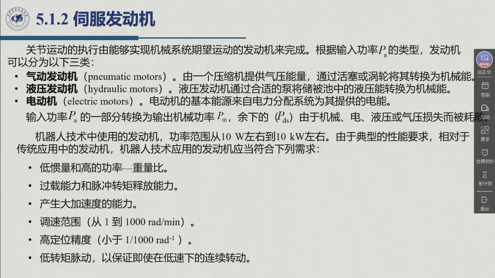
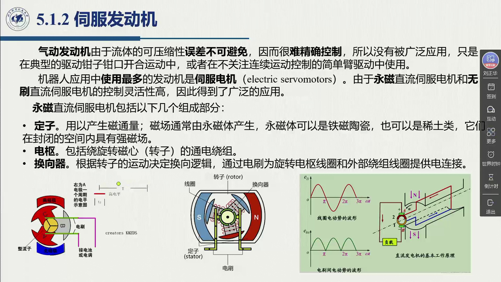
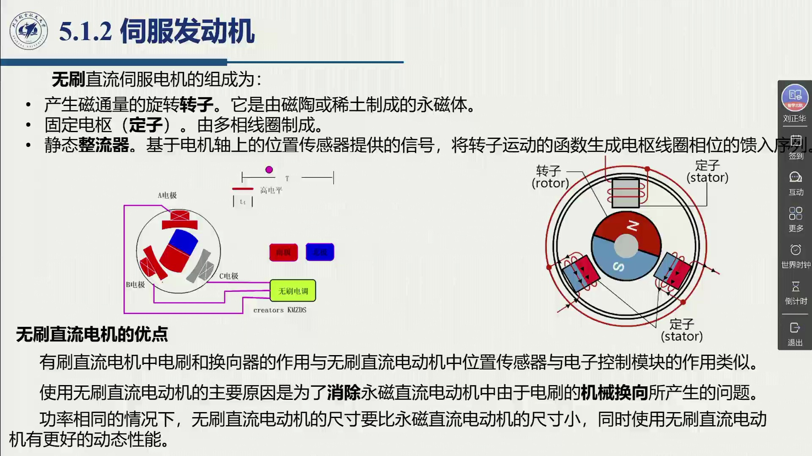
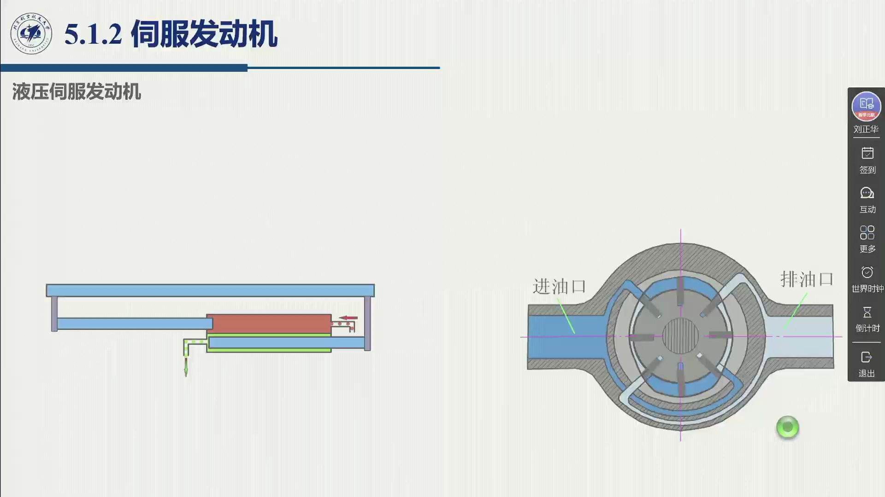

# 5.1.2 伺服发动机

“伺服”说明执行器怎样参与控制：它按照命令提供力或运动，并与反馈系统一起实现位置、速度或力矩跟踪。它不表示某一种唯一的能量转换原理。本节先区分电动、液压和气动，再说明有刷、无刷与步进电机的工作差别。课堂回看：00:38:41–00:59:59。

## 5.1.2.1 三类发动机与「伺服」的来历

::: def 定义 5.1.5 · 发动机的分类与伺服发动机 {#def-5.1.5}
按输入能量，执行器可分为电动、液压和气动。电动机通过电磁作用产生力矩；液压和气动执行器利用压差作用于活塞、叶片等结构，产生力或力矩。

教材统称它们为伺服发动机。输入功率为 $P_a$，机械输出为 $P_m$，在不计储能变化的正向驱动工况中，损失为 $P_{dm}=P_a-P_m$。
:::

额定功率只反映一部分能力。为判断执行器能否完成任务，还需将关节要求分别写成以下可核查的条件。

::: def 定义 5.1.6 · 机器人发动机的六条性能要求 {#def-5.1.6}
| 检查项 | 为什么需要它 |
|:--|:--|
| 转动惯量与功率／质量 | 执行器自身也要加速，随连杆移动时还增加上游负载 |
| 持续与峰值力矩 | 稳态运行和短时加速的热负荷不同 |
| 加速能力 | 净力矩除以等效惯量，才得到角加速度 |
| 调速范围 | 需要覆盖任务中的低速、巡航和换向 |
| 定位与测量能力 | 精度取决于传感、传动和闭环，不能只看电机名义指标 |
| 转矩脉动 | 低速时力矩周期变化可能导致运动不均匀 |
:::

压缩空气具有明显的可压缩性，负载变化会使压力、流量和位置相互影响。精密连续跟踪因此需要更细致的模型与反馈；简单夹持开合只需满足有限个终点状态，要求相对不同。这些是选型时要处理的困难，不表示气动系统不能闭环控制。

## 5.1.2.2 伺服电机：有刷与无刷

电机要持续输出同向力矩，通电绕组与磁场之间的作用方向必须随转子位置调整，这个过程称为换向或换相。有刷与无刷电机主要通过不同的结构完成这件事。

::: def 定义 5.1.7 · 永磁直流伺服电机的组成 {#def-5.1.7}
这里讨论有刷永磁直流电机：定子上的永磁体提供磁场，转子上放置通电电枢绕组，固定电刷通过随转子转动的换向器向绕组送电。换向器在转子转到相应位置时改变绕组的通电连接。

永磁体不是“定子线圈”。励磁线圈和永磁体是产生磁场的不同方式，不能在组成说明里混为一个部件。
:::

::: def 定义 5.1.8 · 无刷直流伺服电机的组成与换相原理 {#def-5.1.8}
这里讨论永磁无刷结构：永磁体放在转子上，多相电枢绕组固定在定子上，电子驱动器按照转子位置给各相安排电流。转子位置可由相应传感器提供；本节按带位置检测的方案说明。

机械换向器与电刷的通电切换任务，改由位置检测和电子功率开关完成。比较的重点是通电切换的职责，而不是说两个系统的所有零件都一一相同。
:::

转子位置决定磁场方向，定子电流决定电枢磁场。驱动器需要按位置调整电流，才能产生所需的平均力矩。不能把“磁场始终正交”当成所有无刷换相方法在每一时刻都严格满足的性质；具体电流波形和控制方式还要在驱动模型中说明。

::: intuition 动手实验 · 把伺服电机剖开看（3D）
先找出哪部分固定、哪部分转动，再追踪电流怎样进入绕组。有刷结构中，电刷固定、换向器随转子转；无刷结构中，绕组固定，由电子驱动器切换各相。最后指出每种结构中由谁提供转子位置与通电次序的联系。

:::

::: thm 定理 5.1.C · 为什么用无刷：定转子功能互换的四个好处 {#thm-5.1.C}
取消电刷接触，可消除该接触处的压降、摩擦与换向电弧问题。把发热绕组放在定子上，也便于向外壳传热；转子不再携带电枢绕组，为紧凑结构和较小惯量提供条件。

这些结构优势不能单独保证任意两台电机在同功率下都满足某种尺寸或性能排序。还应比较绕组、磁路、散热、驱动器和成本；无刷电机仍有铜损、铁损等损失。
:::

## 5.1.2.3 步进电动机

::: def 定义 5.1.9 · 步进电动机 {#def-5.1.9}
步进电机按照给定的激磁序列，使转子逐步跟随定子磁场。典型开环使用中，用脉冲数推算转角，不必测量实际转角来完成每次换相。
:::

按脉冲数推算转角，以转子确实跟上命令为前提。负载、加速度或共振一旦造成失步，命令脉冲数就不再对应实际步数；缺少位置反馈时，控制器无法只凭已发送的脉冲发现这类误差。

因此，比较步进与伺服不能只问“能不能控制角度”。还应问负载在什么范围内、起停多快、是否允许漏步，以及是否需要位置反馈。也存在加入位置反馈的步进方案；“步进”与“永远开环”不是同义词。

## 5.1.2.4 液压伺服发动机

::: def 定义 5.1.10 · 液压伺服发动机 {#def-5.1.10}
液压执行器把流体的压差与流量转换成机械力和运动。液压缸中，活塞两侧压差产生推力；活塞移动使工作腔容积改变。旋转液压马达则把同类作用转成连续转动。

液压源的泵把机械能送入液压回路；执行器从回路取出能量。两者的能量转换方向不同，不能把液压马达的作用直接写成“通过泵产生机械能”。
:::

::: method 方法 5.1.D · 电动 vs 液压：一张对照表 {#method-5.1.D}
| 比较项 | 电动方案 | 液压方案 |
|:--|:--|:--|
| 供能和配套 | 电源与电子驱动器 | 泵站、阀、管路及油液处理 |
| 低速大力矩 | 可直接选相应电机，也可使用减速传动 | 可利用压差与有效作用面积或排量产生大负载能力 |
| 静态保持 | 检查保持电流、热负荷和制动器 | 检查压力保持、阀和泄漏，不能假定断能后自然锁住 |
| 维护与环境 | 检查电气保护、散热与运行环境 | 还须考虑泄漏、油液污染与温度变化 |
| 控制模型 | 电气动态、反电动势及机械负载 | 阀流量、流体压缩、泄漏及机械负载 |
:::

静态保持时，两类执行器都要检查停止后怎样承载，以及失去能源后怎样保持或安全释放负载。用“电机会熄火、液压不会熄火”区分两者，会掩盖这些条件。选型仍要结合负载、安装和环境，不能只凭“大负载”就决定采用液压。

::: think 检查理解
1. 有刷永磁电机的“永磁”与“有刷”分别描述哪件事？
2. 无刷取消了哪些接触部件？为什么仍然需要安排通电次序？
3. 开环步进电机发出100个脉冲，能否仅凭脉冲数证明实际转了100步？
4. 为什么液压执行器静止时也要检查泄漏和压力保持？

::: sol 核对
“永磁”说明励磁来源，“有刷”说明电连接和机械换向方式。无刷取消电刷与机械换向器，但电流仍须随转子位置改变。脉冲数只是命令，负载超限等情况可导致失步。液压静态承载仍依赖实际压差，泄漏或压力损失可能改变保持能力。
:::
:::
