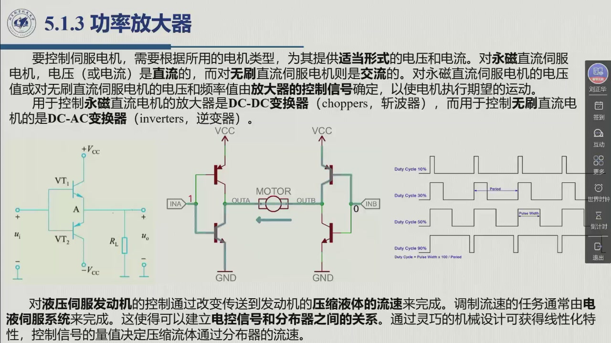

# 5.1.3 功率放大器

上一节确定了伺服发动机需要怎样的电能或液压能输入 $P_a$。但控制器的运算输出只有几伏、毫安级（毫瓦量级），根本推不动几十瓦到数千瓦的执行器。连接微电子控制器和执行器的这一级，就是功率放大器：它接收一次能源的主功率 $P_e$，按照控制命令 $P_c$ 的变化规律进行调制，输出执行器所需的电压、电流或流体流量 $P_a$。课堂回看：00:59:59–01:02:18。

## 5.1.3.1 放大器的任务

在正向驱动且忽略内部储能变化和小功率控制信号 $P_c$ 时，放大器从能源取得的功率 $P_e$ 一部分送往执行器，另一部分变成发热损耗：

$$P_e=P_a+P_{da}.$$

::: def 定义 5.1.11 · 功率放大器的调节任务 {#def-5.1.11}
功率放大器按控制信号 $P_c$ 的规律，从一次能源 $P_e$ 中取出与之成比例的可用功率，以适当形式的电压、电流或流量 $P_a$ 送给伺服发动机。能量来自 $P_e$ 端口，控制端 $P_c$ 只提供调制指令。
:::

需要区分“命令按比例”和“功率在所有工况都按比例”。在电压驱动下，电机转速升高产生反电动势会改变电枢电流；如果采用电流闭环控制，功率放大器则按参考电流调节输出电压。因此后文 [§5.2](sec5-2.md) 建模时，必须先写明功放接受的是电压指令还是参考电流。

## 5.1.3.2 伺服电机的放大器：斩波器与逆变器

电源侧通常提供直流母线电压，而不同电机需要的输入波形不同（01:00:18–01:01:55），功率放大器的电路拓扑随之分开。

::: thm 定理 5.1.D · 按电机类型选放大器 {#thm-5.1.D}
有刷永磁直流电机需要可调的直流电枢电压或电流，配直流斩波变换器（DC-DC，chopper）；多相永磁无刷直流电机需要按转子位置把直流转成各相交流波形，配逆变器（DC-AC，inverter）（01:01:00）。可见“无刷直流”名称里的直流指直流母线供电，电机绕组侧实际输入是多相交变信号。
:::

千瓦级开关晶体管放大器普遍用脉宽调制（PWM）来调压：开关管以远高于机械频率的速度周期性通断，把直流母线切成一串脉冲。在最简单的单向理想斩波模型中，每个周期内导通占空比为 $d\in[0,1]$，导通时加直流母线电压 $U_{dc}$、关断时为零，一个周期的平均输出电压为

$$\bar u=dU_{dc}.$$

这说明平均电压随占空比线性变化；但电枢电流还要由电阻、电感和反电动势共同决定，角速度也不能直接看成与 $d$ 成正比。

::: method 方法 5.1.E · PWM 晶体管放大器与两个指标 {#method-5.1.E}
评估功率放大器看两个比值，注意它们的分母不同：

$$\eta_a=\frac{P_a}{P_e}=\frac{P_a}{P_a+P_{da}},\qquad G_P=\frac{P_a}{P_c}.$$

功率转化率（效率）$\eta_a$ 比较输出到执行器的功率与从能源取用的总功率；功率增益 $G_P$ 比较输出功率与控制信号功率。教材与课堂给出典型数量级作参考：$\eta_a>0.9$，$G_P$ 可达 $10^5$ 到 $10^6$ 级（00:59:15–00:59:55）。例如在某一计算工况下，$P_a=100\ \mathrm W$、$P_{da}=10\ \mathrm W$、$P_c=1\ \mathrm{mW}$，则 $\eta_a=100/110\approx0.909$，而 $G_P=100/10^{-3}=10^5$；电源仍须提供 $110\ \mathrm W$。大增益反映控制信号以小控大的倍率，不等于没有功率损耗。
:::

## 5.1.3.3 液压侧的放大器：电液伺服系统

液压执行器没有电枢端子，控制手段是改变送入工作腔的压缩流体体积流量 $Q$（$\mathrm{m^3/s}$，注意它乘以流通截面积的倒数才是局部流速 $\mathrm{m/s}$）（01:02:04）。

::: def 定义 5.1.12 · 电液伺服系统与分布器 {#def-5.1.12}
电液伺服系统承担液压侧的功率调制任务：电控指令先经电流放大驱动电磁阀，再控制“分布器”（伺服阀阀芯）移动，改变供油和回油通道的开口大小，从而调节送入液压执行器的流量。同时用位置传感器测量阀杆位移形成局部位置内环，帮助阀口精确跟踪电控指令并减轻阀环节本身的不稳定问题。
:::

阀杆位移跟踪指令只是功率放大器这一层的任务；由于负载压差、流体可压缩性和泄漏都会反过来影响实际流量，最终关节位置是否稳定、响应有多快，还需把阀模型与执行器、机械负载联立起来求解，这正是 [§5.2.2](sec5-2-2.md) 的内容。

::: think 检查理解
1. 输出100 W、控制信号功率1 mW，为什么不违反能量守恒？
2. 占空比确定了平均电压，为什么还不能确定电机电流？
3. 阀杆位置跟踪良好，是否足以证明液压关节位置误差趋零？

::: sol 核对
能源端提供主要能量，信号端只参与调节。电流还受电阻、电感和反电动势影响。阀口跟踪只是内部一层，执行器与负载及外环的稳定性仍需分析。
:::
:::

## 5.1.3 小结与常见错误

功率放大器按毫瓦级控制指令调制能源端的主功率，输出给执行器。有刷永磁直流电机配 DC-DC 斩波器，无刷直流电机配 DC-AC 逆变器，常用 PWM 技术实现高效率（典型 $>90\%$）和高功率增益（$10^5$–$10^6$ 级）；液压侧通过电液伺服阀与阀杆位置闭环调节体积流量。

::: think 常见错误清单 · 自查三条
1. 把功率放大器当成信号放大器，忽略了能量来自一次能源 $P_e$ 而非控制信号 $P_c$。
2. 记反斩波器与逆变器：斩波器是 DC-DC（有刷永磁直流），逆变器是 DC-AC（多相无刷直流）。
3. 混淆体积流量 $Q$（$\mathrm{m^3/s}$）与局部流速（$\mathrm{m/s}$），或把阀杆位置跟踪良好等同于液压关节整体闭环稳定。
:::
