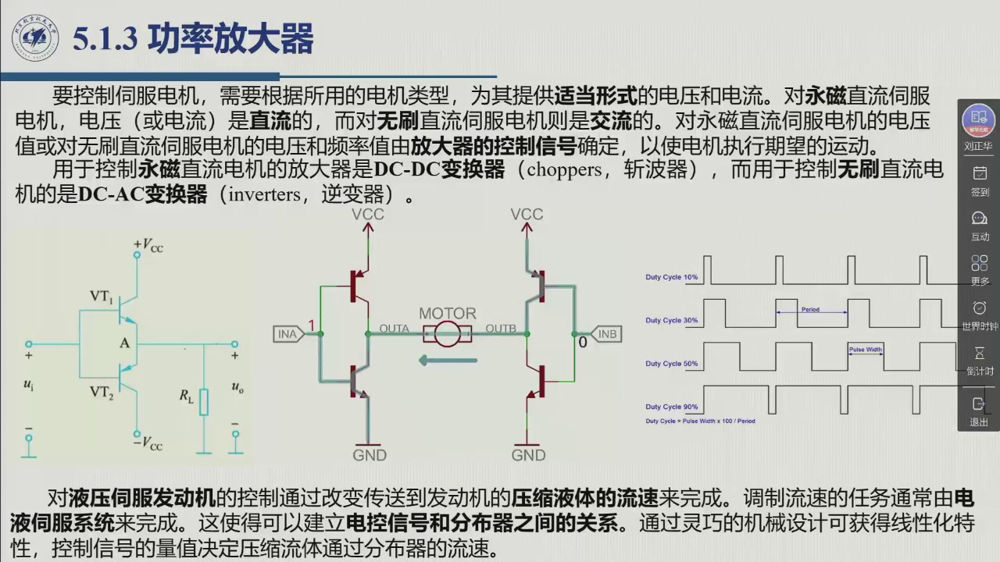

# 5.1.3 功率放大器

执行系统的第三环。它的名字容易引起误解——**放大的不是信号，是功率**：控制信号 $P_c$ 只负责「指挥」，真正的能量从能源 $P_e$ 来。本节讲放大器在各型发动机上的具体形态：电机的斩波器/逆变器，液压的电液伺服阀。录播 00:59:59–01:02:18。

<aside class="lesson-brief" aria-label="5.1.3 学习简报">

PREREQUISITE<strong>你需要先会</strong>
功率链与 $P_c,P_e,P_a,P_{da}$ 的含义（[@def-5.1.2]）；永磁直流与无刷直流伺服电机的差别（[@def-5.1.7]、[@def-5.1.8]）。

TARGET<strong>本节要建立</strong>
放大器的「调节」任务；按电机类型选择电压/电流形式（直流 ↔ 交流）；PWM 晶体管放大器的两个指标（功率转化率 > 0.9、功率增益达 $10^6$ 级）；斩波器与逆变器的分工；液压侧「电液伺服系统 + 分布器 + 阀杆位置反馈」的调节链。

CHECKPOINT<strong>学完的标准</strong>
能说出「为什么对无刷电机必须用逆变器」；能默写功率转化率与功率增益的定义式（$P_a/(P_a+P_{da})$ 与 $P_a/P_c$）并说明为什么后者能到 $10^6$。

</aside>

## 5.1.3.1 放大器的任务

::: def 定义 5.1.11 · 功率放大器的调节任务 {#def-5.1.11}
功率放大器具有**调节任务**：在控制信号的作用下，**功率流由一次能源提供，而且必须被传输到执行器**以执行期望的运动。

换成教材 §5.1.3 的另一句话：**放大器从能源中获取与控制信号成比例的部分可用功率，然后按照适当的力和流量将这些功率传送到发动机**。

**功率分配**：放大器的输入是从一次能源获取的功率，这些功率与**控制信号 $P_c$ 相关联**；总功率**一部分被传送到执行器（$P_a$）、一部分被耗散掉（$P_{da}$）**。
:::

注意这里的因果结构：**$P_c$ 决定「取多少」，$P_e$ 提供「取的东西」**。这就是为什么功率增益可以做到极大（见下）——分母只是一个小小的控制信号功率。

## 5.1.3.2 伺服电机的放大器：斩波器与逆变器

教材 §5.1.3 从「电机的类型」出发：**要控制伺服电机，需要根据所用的电机类型，为其提供适当形式的电压和电流**。

::: thm 定理 5.1.D · 按电机类型选放大器 {#thm-5.1.D}
- **永磁直流伺服电机**：电压（或电流）是**直流**的 ⇒ 用 **DC-DC 变换器**（choppers，**斩波器**）；
- **无刷直流伺服电机**：电压（或电流）是**交流**的 ⇒ 用 **DC-AC 变换器**（inverters，**逆变器**）。

**控制什么量**：对永磁直流伺服电机是**电压值**；对无刷直流伺服电机是**电压和频率值**——两者都由放大器的控制信号确定，「以使电机执行期望的运动」。
:::

::: method 方法 5.1.E · PWM 晶体管放大器与两个指标 {#method-5.1.E}
对于关节运动通常需要的功率范围（**千瓦级**），使用通过**脉宽调制（PWM）**技术进行适当切换的**晶体管放大器**。教材给出两个量化指标：

$$\text{功率转化率}=\frac{P_a}{P_a+P_{da}}>0.9,\qquad \text{功率增益}=\frac{P_a}{P_c}\ \text{达到}\ 10^6\ \text{级}$$

读法：**功率转化率**衡量「从能源取来的电有多少真正到了电机」（效率，>90%）；**功率增益**衡量「控制信号以小博大到什么程度」（$10^6$ 量级）。后者能这么大，正因为 $P_c$ 只是控制信号功率、真正的能量来自 $P_e$。
:::

## 5.1.3.3 液压侧的放大器：电液伺服系统

液压发动机没有「电压」可加，控制手段只能是**流量**（教材 §5.1.3）：

::: def 定义 5.1.12 · 电液伺服系统与分布器 {#def-5.1.12}
**对液压伺服发动机的控制，通过改变传送到发动机的压缩液体的流速来完成。** 调制流速的任务通常由接口（**电液伺服系统**）来完成，这使得可以建立**电控信号和分布器**之间的关系。

- **分布器**：能够改变从一次能源传送到发动机的**流体流速**；
- **执行链**：电控信号通常是**电流放大**，并馈入一个（直接地或间接地）驱动分布器的**电磁阀**，其位置由适当的**传感器测量**；
- **结果**：得到一个**基于阀杆位置的伺服系统**——「它可以减少可能在发动机控制中发生的任何稳定性问题」。

**线性化**：通过**灵巧的机械设计**可能获得**线性化特性**；控制信号的量值决定压缩流体通过分布器的流速。
:::

这里值得注意的是方法：**液压放大器的核心不是「放大电流」，而是「用一个位置伺服系统去驱动一个阀」**——把流量控制问题转化成一个成熟的阀杆位置控制问题，这正是教材所说的「减少稳定性问题」。

::: think 考点 · 老师原话（录播时间点）

> **直流与交流的分工**：「而对于控制无刷，这时候就需要把它**转化成交流**，把直流转成交流，来提供给无刷（直流）电机的各个（相）」（01:01:00）。

> **液压靠改流速**：「对于液压发动机呢，可以通过**改变传送到发动机的流体的流速**，来实现对发动机的（控制）」（01:02:04）。
:::

::: think 默写点 · 合上书再写（主动回忆）

1. 放大器从能源取功率，取多少由什么决定？取来的功率分成哪两部分？
2. 永磁直流与无刷直流各配什么放大器？为什么？
3. 功率转化率与功率增益的定义式各是什么？为什么增益能到 $10^6$？
4. 液压侧靠什么调节发动机？「基于阀杆位置的伺服系统」是怎么构成的？

::: sol 核对

取多少由**控制信号 $P_c$** 决定；取来的功率一部分传送到执行器（$P_a$），一部分耗散（$P_{da}$）。

永磁直流配 **DC-DC 变换器（斩波器）**，因为其电压/电流是直流的；无刷直流配 **DC-AC 变换器（逆变器）**，因为其电压/电流是交流的（需把直流转成交流供给各相）。

$\dfrac{P_a}{P_a+P_{da}}>0.9$；$\dfrac{P_a}{P_c}$ 达 $10^6$ 级。因为分母 $P_c$ 只是控制信号的功率，能量主体 $P_e$ 从能源来，故比值可以极大。

靠**改变传送到发动机的压缩液体的流速**。构成：电流放大后的电控信号 → 电磁阀（直接或间接驱动分布器）→ 分布器改变流速；阀杆位置由传感器测量并闭环，构成**阀杆位置伺服系统**。

:::

:::

## 5.1.3 小结与常见错误

- **一句话**：放大器 = 「用控制信号决定从能源取多少功率」的调节器，不是信号放大器。
- **两条路线**：电机侧按电压形式分斩波器/逆变器，控制量是电压（或电压与频率）；液压侧控制流量，靠电液伺服系统 + 分布器 + 阀杆位置反馈。
- **两个数**：功率转化率 > 0.9，功率增益 $10^6$ 级。

::: think 常见错误清单 · 自查三条
1. 把 $P_c$ 当成「被放大的信号」以为能量来自它——能量来自 $P_e$，$P_c$ 只决定分配比例。
2. 记反斩波器/逆变器：**斩波 = DC-DC（永磁直流）**，**逆变 = DC-AC（无刷）**。
3. 以为液压侧也在「放大电流」——放大的是阀的**位移**，流量才是被控量。
:::