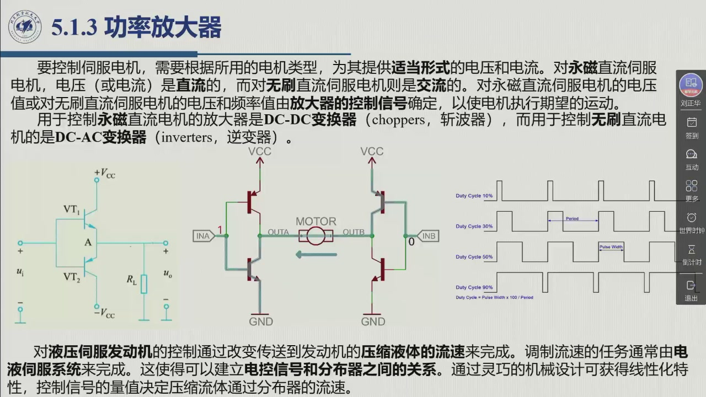

# 5.1.3 功率放大器

控制器算出的命令可能是一个电压、数字量或参考电流。功率放大器将命令转换为执行器能够接受的电压、电流或液压流量，同时从能源取得主要驱动能量。选型时必须先明确执行器的电气或液压接口。课堂回看：00:59:59–01:02:18。

## 5.1.3.1 放大器的任务

::: def 定义 5.1.11 · 功率放大器的调节任务 {#def-5.1.11}
功率放大器按控制命令调节从能源送往执行器的功率。正向驱动、忽略内部储能变化和控制信号的小功率时，输入 $P_e$ 分为输出 $P_a$ 与损失 $P_{da}$：

$$P_e=P_a+P_{da}.$$

控制端关联的信号功率为 $P_c$。$P_c$ 与 $P_e$ 是不同端口上的量；输出能量主要来自 $P_e$。
:::

输出功率还取决于驱动器与负载，通常不会在所有工况下都与信号电压严格成比例。例如，电压命令可能先进入电流环，转速又通过反电动势影响电流。因此后面建模时要明确输入接口：采用电压驱动，还是近似力矩源。

## 5.1.3.2 伺服电机的放大器：斩波器与逆变器

::: thm 定理 5.1.D · 按电机类型选放大器 {#thm-5.1.D}
有刷直流电机需要合适的电枢电压和电流，可用直流斩波变换器调节。多相无刷电机还需要按转子位置组织各相电流，可用逆变器把直流母线转换为各相电气输入。

“无刷直流”中的直流不表示每个定子绕组始终流过同方向恒定电流。电源侧的直流母线与电机侧的多相输入属于不同位置。
:::

脉宽调制（PWM）通过改变开关周期中的导通时间调节平均输出。以最简单的理想单向斩波为例，开关导通时向负载加 $U_{dc}$，其余时间平均按零电压计算，导通占空比为 $d\in[0,1]$，则

$$\bar u=dU_{dc}.$$

这个式子给出简化开关模型的平均电压。电流还需由电机方程求解，角速度也不能直接视为与 $d$ 成比例。

::: method 方法 5.1.E · PWM 晶体管放大器与两个指标 {#method-5.1.E}
效率衡量取来的能量有多少到达执行器，功率增益则比较输出功率与控制信号功率：

$$\eta_a=\frac{P_a}{P_e}=\frac{P_a}{P_a+P_{da}},\qquad G_P=\frac{P_a}{P_c}.$$

两者分母不同，因此“大增益”不等于“高效率”。例如同一计算工况下，$P_a=100$ W、$P_{da}=10$ W、$P_c=1$ mW，则 $\eta_a=100/110\approx0.909$，而 $G_P=10^5$。能量平衡仍要求能源提供约110 W。

课件中的效率和增益数值用于说明数量级，不能当作所有 PWM 驱动器的性能保证。
:::

## 5.1.3.3 液压侧的放大器：电液伺服系统

::: def 定义 5.1.12 · 电液伺服系统与分布器 {#def-5.1.12}
电液伺服阀把电控制信号转换为阀口的变化，再调节送往执行器的流量。教材所称的“分布器”负责把供油和回油连接到相应工作腔。

这里的流量 $Q$ 是单位时间通过的流体体积，单位 $\mathrm{m^3/s}$；局部流速则是长度除以时间。二者通过流通截面积联系，不能交替当作同一个量。
:::

阀杆位置反馈帮助阀口跟踪命令，执行器运动则还受负载压差、流体压缩和泄漏影响。若将命令近似映射为流量，需注明工作点与线性化范围；阀杆内环跟踪良好，并不足以证明整个机械关节稳定。

电机驱动也需区分内部功率转换与最终关节动态。后者要把机械负载和外环控制一起纳入分析；[§5.2.2](sec5-2-2.md)先联立流量、压力和机械方程，建立液压对象模型。

::: think 检查理解
1. 输出100 W、控制信号功率1 mW，为什么不违反能量守恒？
2. 占空比确定了平均电压，为什么还不能确定电机电流？
3. 阀杆位置跟踪良好，是否足以证明液压关节位置误差趋零？

::: sol 核对
能源端提供主要能量，信号端只参与调节。电流还受电阻、电感和反电动势影响。阀口跟踪只是内部一层，执行器与负载及外环的稳定性仍需分析。
:::
:::
