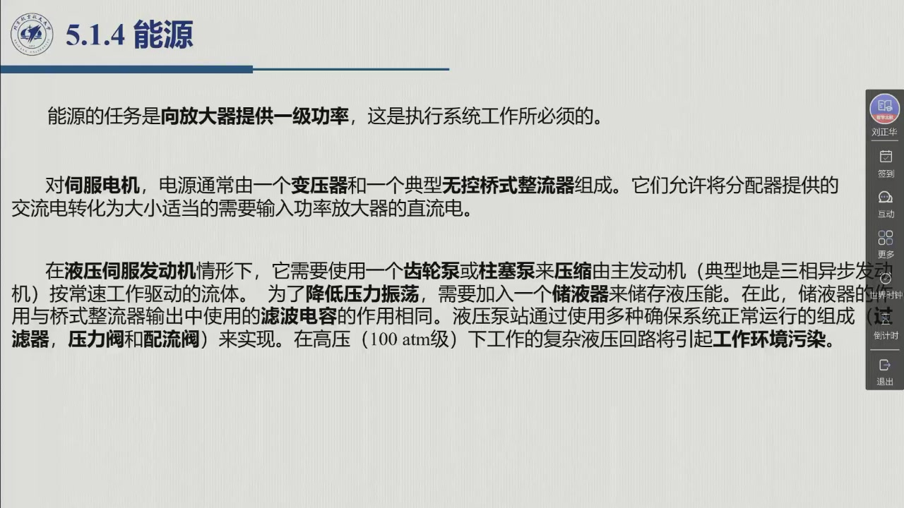

# 5.1.4 能源

执行系统的最后一环，也是**最容易被跳过的一环**。教材对它的处理很简洁，但留下了一条极好的类比：液压回路里的**储液器**，作用与整流器输出端的**滤波电容**完全相同。本节把电源与液压源并排讲。录播 01:02:18–01:03:28。

<aside class="lesson-brief" aria-label="5.1.4 学习简报">

PREREQUISITE<strong>你需要先会</strong>
放大器在两种发动机上的形态（[@thm-5.1.D]、[@def-5.1.12]）；能量从 $P_e$ 到 $P_a$ 的路径（[@def-5.1.2]）。

TARGET<strong>本节要建立</strong>
能源的任务（向放大器提供**一级功率**）；电源的构成（变压器 + 无控桥式整流器）；液压源的构成（齿轮泵/柱塞泵 + 三相异步电动机 + 储液器 + 过油器/压力阀/配流阀）；以及「储液器 ↔ 滤波电容」这条类比。

CHECKPOINT<strong>学完的标准</strong>
能说出为什么液压源比电源「显然更复杂」；能解释储液器稳定的是**压力振荡**，电容稳定的是**电压纹波**——两者在数学上是同一个角色。

</aside>

## 5.1.4.1 能源的任务

::: def 定义 5.1.13 · 能源的任务 {#def-5.1.13}
**能源的任务是向放大器提供一级功率**，这是执行系统工作所必须的。

**电源（伺服电机用）**：通常由一个**变压器**和一个典型的**无控桥式整流器**组成。它们允许把分配器提供的**交流电**转化为**大小适当的、需要输入功率放大器的直流电**。

**液压源（液压伺服发动机用）**：**显然更复杂**。它需要：

1. 一个**齿轮泵**或**柱塞泵**，用来压缩流体；
2. 流体由**主发动机**（典型地是**三相异步电动机**）按**常速工作**驱动；
3. 一个**储液器**，用来储存液压能——目的是**降低由发动机工作条件决定的流速需求所引起的、不可避免的压力振荡**；
4. 一整套确保系统正常运行的组成：**过油器、压力阀、配流阀**（即液压泵站）。
:::

::: note 储液器 = 滤波电容 {#note-5.1.4}
教材 §5.1.4 给出一条极干净的类比：**储液器的作用，与桥式整流器输出中使用的滤波电容的作用相同**。

- **电源侧**：整流器把交流变直流，输出带有**纹波**；并联的**电容**储能、把电压纹波抹平；
- **液压侧**：泵的流速需求随工况波动，回路中产生**压力振荡**；并联的**储液器**储能、把压力振荡抹平。

「储能元件并联在输出端吸收波动」——这是同一个物理角色在两种介质里的实现。凡是遇到「脉动/振荡/纹波」的问题，第一反应都应该是**加一个储能环节**。
:::

**代价**：教材最后给出一句警示——「在**高压（100 atm 级）**下工作的复杂液压回路，将引起**可观的工作环境污染**」。这与 [@method-5.1.D] 对照表中「漏油会对工作环境造成污染」是同一条。

::: think 考点 · 老师原话（录播时间点）

> **能源是「被忽略的一环」**：「第四个呢，就是能源」——老师在这一页只讲了两分钟，但把两种能源的结构都点了（01:02:21）。

> **储液器与电容同功**：「要降低压力震荡，还需要加入一个储液器。这储液器的功能呢，跟（整流）电路中的（滤波）电容是一样（的）」（01:03:12）。

> **执行系统是心脏**：讲完能源后老师总结「整个上面就是咱们的关节执行系统……**是（机器人）机械系统的心脏**，相当于咱们**人体的肌肉**这部分」（01:03:27）。
:::

::: think 默写点 · 合上书再写（主动回忆）

1. 能源的任务是什么？
2. 电源由哪两部分构成？完成什么转换？
3. 液压源由哪几部分构成？储液器解决什么问题？
4. 「储液器 ↔ 滤波电容」这条类比的关键是什么？

::: sol 核对

向**放大器提供一级功率**，这是执行系统工作所必须的。

**变压器 + 无控桥式整流器**；把分配器提供的**交流电**转化为大小适当的、供功率放大器使用的**直流电**。

**齿轮泵或柱塞泵**（压缩流体）+ **三相异步电动机**（按常速驱动）+ **储液器**（储存液压能）+ **过油器、压力阀、配流阀**（泵站组成）。储液器解决**由流速需求引起的压力振荡**。

两者都是「**并接在输出端的储能元件**」，吸收波动：电容抹平整流输出的**电压纹波**，储液器抹平泵站回路的**压力振荡**。

:::

:::

## 5.1.4 小结与常见错误

- **一句话**：能源给放大器提供**一级功率**——电机侧是「变压器 + 整流 → 直流」，液压侧是「泵 + 电机 + 储液器 + 阀组」。
- **一个类比**：储液器 = 滤波电容（储能元件并联吸收波动）。
- **一个代价**：高压液压回路带来可观的环境污染。

::: think 常见错误清单 · 自查三条
1. 把**能源**与**放大器**的职责搞反：能源给「与 $P_a$ 同性质」的一级功率 $P_e$，放大器才是受 $P_c$ 调制的那一级。
2. 认为液压源只是「一只泵」——泵站还必须有过油器、压力阀、配流阀，以及**储液器**。
3. 忽略环境污染这一条：它是 §5.2.2 液压驱动取舍里的硬约束之一。
:::