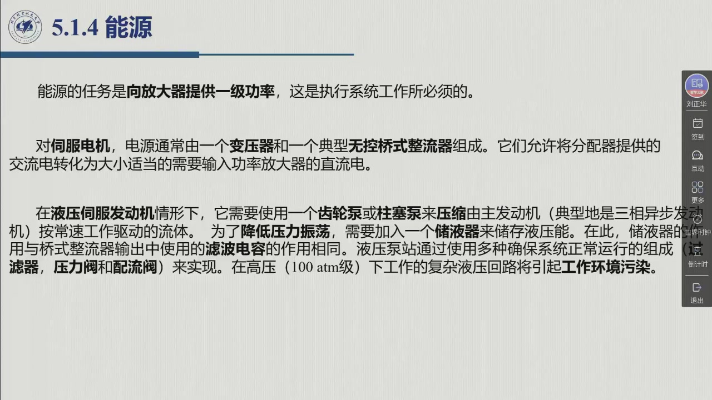

# 5.1.4 能源

功率放大器需要独立供能。能源部分把电网或泵站的输出整理成驱动器可用的形式，还要应对负载变化时的能量需求。本节分别说明电源和液压源，并区分液压蓄能器与储油箱。课堂回看：01:02:18–01:03:28。

## 5.1.4.1 能源的任务

::: def 定义 5.1.13 · 能源的任务 {#def-5.1.13}
能源向功率放大器提供主功率 $P_e$。教材举出的电源结构使用变压器与桥式整流器，将交流电转换为驱动器所需的直流供电；具体系统还需按电压、电流、滤波及保护要求设计。

液压源则通常包含驱动泵的电机、液压泵、储油箱、过滤和阀组等部件。泵向流体输入能量，阀和管路把流体送往执行器；需要储能缓冲时另设蓄能器。
:::

供能端要按多个关节同时工作的情况确定额定能力，并检查短时峰值、持续负载和能量回流。前面的整流电路是一种配置示例，不能直接当成所有驱动电源的固定结构。

::: note 储液器与滤波电容的类比 {#note-5.1.4}
教材把液压储能缓冲元件与电源滤波电容类比，比较的是两者暂存和释放能量的作用。电容能量为 $E_C=\tfrac12CU^2$：当负载取能使电压下降时，电容释放部分能量；供给有余时再补充。

液压蓄能器同样可在一定压力范围内接收或释放流体，缓冲供给与需求的差异。它与常压储油箱不同：储油箱主要容纳油液、参与回油和供油，不能仅凭里面有油就认为具有同样的压力储能能力。
:::

储能缓冲的效果取决于容量、允许的压力或电压范围、通路阻力，以及负载变化速度，不能使所有波动消失。遇到振荡时，还需区分闭环不稳定、机械弹性和管路动态等原因，不能只检查是否缺少储能元件。

液压系统还需检查密封、泄漏和油液污染。环境影响要结合泄漏与维护状况判断，不能仅由压力高低推断。执行器方案的比较见[@method-5.1.D]。

::: think 检查理解
1. 在功放命令不变时，为什么主电源能力仍会限制输出？
2. 储油箱与蓄能器在系统中的作用有什么区别？
3. 为什么“与滤波电容类似”不能推出接上蓄能器就能消除所有振荡？

::: sol 核对
功放不能持续输出超过供能与额定能力允许的功率。储油箱容纳油液，蓄能器利用压力状态暂存并释放能量。储能缓冲的容量和响应有限，也不能代替对控制稳定性、机械弹性及管路动态的检查。
:::
:::
