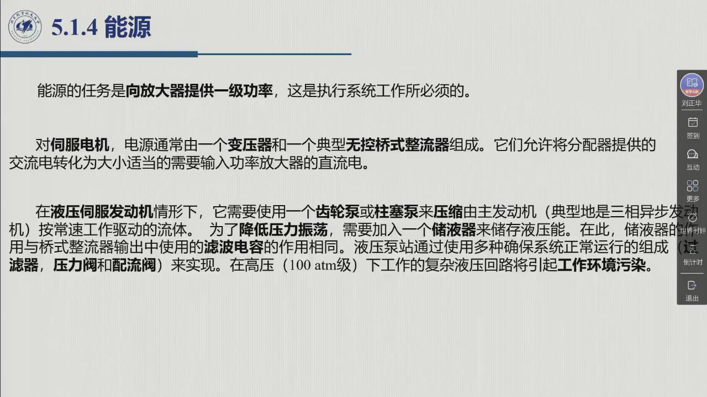

# 5.1.4 能源

倒推功率链的最后一环是能源：上一节的功率放大器无论调节多精确，都必须先有一次能源向它输送主功率 $P_e$，且供能品质要跟得上多个关节同时加减速时的峰值与回流需求。课堂回看：01:02:18–01:03:28。

## 5.1.4.1 能源的任务

电动执行系统和液压执行系统需要的“原料”完全不同：前者需要电压平稳的直流母线，后者需要高压恒流或可缓冲的油路。

::: def 定义 5.1.13 · 能源的任务 {#def-5.1.13}
能源的任务是向功率放大器提供满足电压、电流或压力流量要求的一级功率 $P_e$。

- **电源（伺服电机用）**：典型结构用变压器调整交流电压幅值，再经无控桥式整流器变成驱动器需要的直流供电；工程上还需配合稳压滤波、保护及制动能量回馈处理，应对多关节同时启停的功率波动。
- **液压源（液压伺服发动机用）**：一般由恒速三相异步电动机驱动齿轮泵或柱塞泵给流体增压，并配备常压储油箱、过滤器、压力阀和配流阀组成泵站；需要吸收流量脉动和冲击时另加液压蓄能器（01:02:24–01:03:20）。
:::

电源输出会有整流纹波，液压泵站工作时也会因执行器流速需求突变而出现压力振荡。两者都靠并联一个储能元件来抹平波动，老师在课上把这一步直接类比到电路里（01:03:12）：“而降低压力震荡呢，还需要加入一个储液器，这储液器的功能跟咱们电路中的滤波电容是一样的。”

::: note 储液器与滤波电容的类比 {#note-5.1.4}
电源滤波电容的储能为 $E_C=\tfrac12CU^2$：当负载突然取电导致母线电压下降时，电容放出一部分电荷托住电压；电源有余时再补回电量。液压蓄能器（教材中常译作储液器）在高压回路里起同样作用：负载瞬时需大流量时放出带压油液缓冲压力跌落，需求回落时再充入储能。注意区分**蓄能器**和**常压储油箱**：储油箱主要用来容纳油液、回油散热和供泵吸油，并不在工作压力下储存和释放弹性流体能。
:::

储能缓冲能削弱波动，但效果受容积、允许压差或压降范围以及管路阻力限制；若系统出现持续振荡，还须排查控制环失稳、机械结构弹性和管路动态，不能指望加一个电容或蓄能器就消除所有振荡。此外，教材提醒高压液压回路（100 atm 量级）必须防范密封老化、泄漏、油液污染和工作环境污染；电动与液压方案的完整取舍见 [@method-5.1.D]。

::: think 检查理解
1. 在功放命令不变时，为什么主电源能力仍会限制输出？
2. 储油箱与蓄能器在系统中的作用有什么区别？
3. 为什么“与滤波电容类似”不能推出接上蓄能器就能消除所有振荡？

::: sol 核对
功放不能持续输出超过供能与额定能力允许的功率。储油箱容纳油液并参与回油散热，蓄能器利用压力状态暂存并释放能量以缓冲压力振荡。储能缓冲的容量和响应有限，也不能代替对控制稳定性、机械弹性及管路动态的检查。
:::
:::

## 5.1.4 小结与常见错误

能源位于功率链最上游，向功放提供一次功率 $P_e$：电源典型通过变压与整流滤波提供直流母线，液压源通过电机带泵站提供高压油液并配蓄能器缓冲压力脉动。讲完能源后，整条执行系统便从关节倒推到了源头，下一节 [§5.2](sec5-2.md) 开始把这些部件写成微分方程和传递函数。

::: think 常见错误清单 · 自查三条
1. 把常压储油箱混同于液压蓄能器，认为只要有油箱就能缓冲高压脉动。
2. 把能源和功率放大器职责颠倒：能源提供一次功率，功放按控制信号进行调制。
3. 以为加装滤波电容或蓄能器就能解决闭环控制系统引起的振荡问题。
:::
