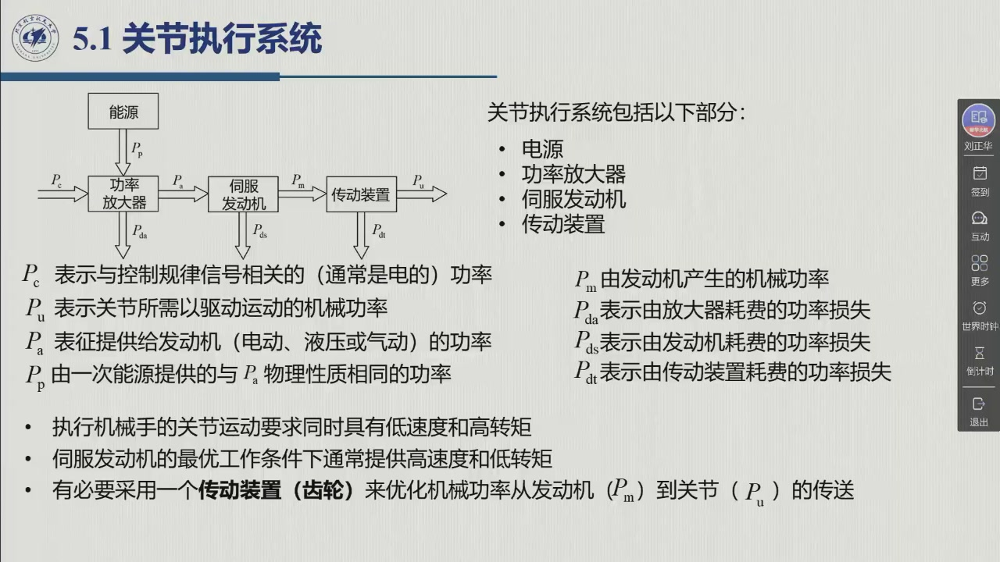
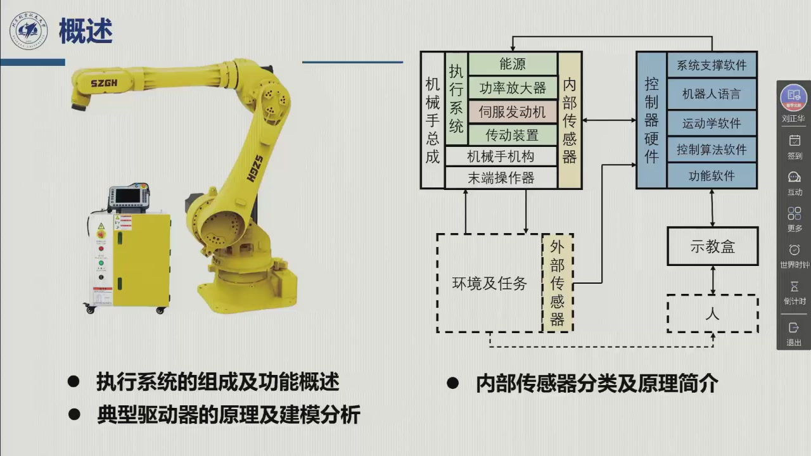
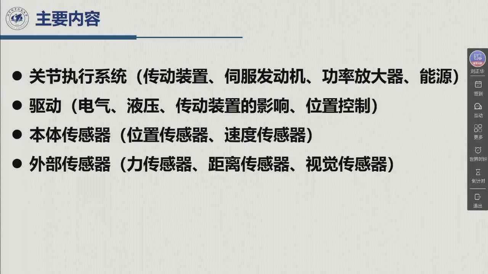

# 5.1 关节执行系统

前四章解决的全是「**算**」：位姿怎么描述、速度怎么映射、轨迹怎么设计。从这一章起换到硬件侧——**算出来的力矩和位置指令，最终要靠什么物理装置去实现**。本章分两半：**执行器**（把电能/液压能变成关节运动）与**传感器**（把关节和环境的真实状态读回来）。本节先立总账：执行系统由哪四部分组成、功率从哪来又损失在哪、以及选型的出发点是什么。录播 00:23:44–00:33:19。

<aside class="lesson-brief" aria-label="5.1 学习简报">

PREREQUISITE<strong>你需要先会</strong>
静力学的力/力矩映射 $\tau=J^{\mathrm T}F$（[@def-3.8.1]）；关节空间与操作空间的划分（[@def-2.10.1]）；关节速度与末端速度的线性映射 $v_e=J(q)\dot q$（[@def-3.1.1]）。

TARGET<strong>本节要建立</strong>
执行系统的四部分构成与「能源 → 功放 → 伺服发动机 → 传动装置 → 关节」这条功率链；六个功率符号各自代表谁的功率、谁被损失掉；为什么「从关节所需的力和速度出发」是选型的唯一正确起点。

CHECKPOINT<strong>学完的标准</strong>
能默画执行系统框图并标出 $P_c,P_a,P_m$ 的位置与 $P_{da},P_{dm},P_{dt}$ 三处损失；能一句话说出传动装置存在的根本原因（关节要低速高转矩，而发动机的最优工况恰好相反）。

</aside>

## 执行系统的四个组成部分

::: def 定义 5.1.1 · 关节执行系统 actuating system {#def-5.1.1}
施加在机械手关节上的运动，通常由**执行系统**实现。执行系统由四部分组成（教材 §5.1、课件 0:23:44 页）：

1. **能源**（power supply）——一次能源，提供与控制信号无关的功率；
2. **功率放大器**（power amplifier）——把控制规律给出的**小信号**放大成能驱动发动机的功率；
3. **伺服发动机**（servomotor）——把电/液压/气动的功率转成**机械功率**；
4. **传动装置**（transmission）——把发动机的高转速低转矩，匹配成关节需要的低转速高转矩。

这四部分串成一条**功率链**，末端才是关节与机械手本体（见下图）。
:::

<figure>

<figcaption>课堂幻灯片 · 00:23:44：5.1 关节执行系统。框图上标注的正是下面 §5.1.2 的功率符号：$P_c$ 从控制器来、$P_e$ 由能源供、$P_a$ 经功放、$P_m$ 由发动机输出，三处损失 $P_{da},P_{dm},P_{dt}$ 分别发生在功放、发动机、传动装置里。右侧列出「电源 / 功率放大器 / 伺服发动机 / 传动装置」四个组成部分。</figcaption>
</figure>

**板书画的也是同一条链。** 老师开课前把这一章的总图写在黑板上（与第四章用的是同一面黑板，只擦掉了中间那棵轨迹规划知识树）：左侧是给定值与误差 $e$，中间一串方框，输出是机器人本体的 $z,\omega,\theta$，下方是传感器闭环。

<figure>

<figcaption>第 6 周板书（教师流 142:30 截取，本教程增强）：<b>能源 → 功放 → 执行器 → 机器人本体</b>，输出 $z,\omega,\theta$；<b>传感器</b> 闭环回输入端。框上标注的章节号是老师讲课时指出的全书位置——$chpt\,5$ 是本章（能源 / 功放 / 执行器 / 传动），$chpt\,6,7,10$ 是后面的控制器，$chpt\,2$ 是传感器信息的来源（位姿与运动学）。左下两行 $v_e=J\dot q$、$\tau=J^{\mathrm T}F_e$ 是上一章留下的（未擦）。</figcaption>
</figure>

**为什么要有功放这一环？** 老师在 00:09:29–00:11:20 用一组具体数字把这件事讲得最清楚，值得完整记下来：

| | 控制器输出 | 电机 |
|:--|:--|:--|
| 器件 | 快速计算的**微电子电路**（如 TTL） | 几十瓦 / 几百瓦 / 上千瓦 |
| 电压 | 约 **3.3 V** | 视电机而定 |
| 电流 | **微安级到毫安级** | 安培级 |
| 功率 | 按 $3.3\ \mathrm{V}\times1\ \mathrm{mA}$ 算约 **3.3 mW** | 与上面差 $10^{5}$ 量级 |
| 好处 | **计算快**——每秒万次到千万次 | 能产生运动 |

**结论**：控制器信号的功率**不足以让电机动起来**，但它**有规律**（幅值、相位都是确定的）——而这个「规律」正是控制律的载体。所以功放要做的不是「造出能量」，而是**按这个规律去调制能源送来的功率**（老师：「等比例地放大」）。这正是它的名字（"功率放大器"）的来历：**放大的是功率，不是信号**。

::: note 功率总是「力 × 速度」 {#note-5.1.1}
教材特意提醒：**功率总可以表示为速度和力的乘积**。这条恒等式的好处是，它**物理内涵上指明了功率的种类**——机械功率是「力 × 线速度」或「力矩 × 角速度」，电功率是「电压 × 电流」，液压/气动功率是「压力 × 流量」。因此功率链上每一段的功率，都能用该段的「力」和「速度」两个量写出来，这正是 §5.1.3 选型要从力和速度出发的原因。
:::

## 功率流：六个符号

::: def 定义 5.1.2 · 执行系统的功率符号 {#def-5.1.2}
按教材 §5.1 的约定（图 5.1，即上面的课件页）：

| 符号 | 含义 | 出现在哪一段 |
|:--|:--|:--|
| $P_c$ | 与控制规律信号相关的功率（**通常是电的**） | 控制器输出，功放的输入 |
| $P_e$ | 由**一次能源**提供的功率，与 $P_a$ 物理性质相同 | 能源 → 功放 |
| $P_a$ | 提供给**发动机**的功率（电动、液压或气动） | 功放输出，发动机输入 |
| $P_m$ | 由**发动机产生**的机械功率 | 发动机输出，传动装置输入 |
| $P_u$ | 关节所需、用以**驱动运动**的机械功率 | 传动装置输出，关节输入 |
| $P_{da}$ | 由**放大器**耗费的功率损失 | 功放内部 |
| $P_{dm}$ | 由**发动机**耗费的功率损失 | 发动机内部 |
| $P_{dt}$ | 由**传动装置**耗费的功率损失（主要是摩擦） | 传动装置内部 |
:::

把这张表读成一句话：**能量从 $P_c$ 一路「放大加粗」，沿途三次被截留，最后以 $P_u$ 的形式作用在关节上**。老师 0:30:54 的原话是「（加）传动装置会引起一部分的（损耗）、摩擦」，说的就是 $P_{dt}$。

::: method 方法 5.1.A · 功率链怎么算 {#method-5.1.A}
沿链写功率平衡（教材 §5.1）：

$$P_c \;\Longrightarrow\; P_a \;\Longrightarrow\; P_m \;\Longrightarrow\; P_u,\qquad
P_m = P_a - P_{dm},\qquad P_u = P_m - P_{dt}$$

- **放大器**：$P_a$ 与 $P_c$ 之间是**放大关系**，不是守恒关系——$P_a$ 的绝大部分来自能源 $P_e$，$P_c$ 只起「控制」作用；
- **发动机**：输入 $P_a$、输出 $P_m=P_a-P_{dm}$，效率 $\eta_m=P_m/P_a$；
- **传动装置**：输入 $P_m$、输出 $P_u=P_m-P_{dt}$，效率 $\eta_t=P_u/P_m$。

在 §5.2.3 会用「无间隙刚性传动 ⇒ 输入输出**纯比例**」这条假定，把传动装置写成**比例环节**；那时可以看到：**理想传动装置不改变功率**（$P_u=P_m$），它改变的是**力与速度的分配**。
:::

## 选型的出发点：从关节的力和速度出发

教材 §5.1 给出一句很简短的方针：**为了选择执行系统的组成，应当「从构成机械功率 $P_u$ 所需的描述关节运动的力和速度出发」**。这句话看起来平淡，实际是本章往后所有工程取舍的源头——因为我们真正知道的需求，只有关节端要出多大力、走多快。

于是矛盾立刻出现（教材 §5.1.1、课件 0:33:23 页）：

::: thm 定理 5.1.B · 发动机与关节的根本工况矛盾 {#thm-5.1.B}
- **关节需要的**：同时具有**低速度和高转矩**；
- **伺服发动机最优工作条件下的**：**高速度和低转矩**。

两者正好相反，所以「一般而言，这种要求难以容许有效使用伺服发动机的机械特性」——**必须插入一个传动装置**，才能把发动机的工作点搬到关节需要的工作点上（教材 §5.1.1）。
:::

这条矛盾就是本章的第一个「为什么」：**传动装置不是可选的配件，而是工况匹配的必需品**。它的三重作用（定量变换、定性变换、以及把发动机挪到基座附近以减小有效载荷）见 [5.1.1 传动装置](sec5-1-1.md)。

**本章的四块内容**，老师在 0:22:45 的目录页上列得很清楚：

::: think 考点 · 老师原话（录播时间点）

> **本章的定位**：讲完执行系统四部分后老师说「整个上面就是咱们的关节执行系统……**是（机器人）机械系统的心脏**，相当于咱们**人体的肌肉**这部分」（01:03:27）。

> **为什么要从功率讲起**：「回顾功率总可以被表示为速度和力的乘积，其**物理内涵容许指明功率的种类**」（教材 §5.1）；老师对功放这一环的说明是「（控制信号）需要**功放**——因为它要驱动电机，需要把功率放大」（0:11:04 前后）。
:::

::: think 默写点 · 合上书再写（主动回忆）

1. 执行系统由哪四部分组成？按功率流的顺序写出来。
2. $P_c,P_e,P_a,P_m,P_u$ 各是谁的功率？三处损失 $P_{da},P_{dm},P_{dt}$ 分别发生在哪个环节？
3. 执行系统选型应该从什么出发？
4. 发动机与关节的「工况矛盾」是什么？由此必然推出哪个部件？

::: sol 核对

能源 → 功率放大器 → 伺服发动机 → 传动装置（末端接关节与机械手本体）。控制信号功率 $P_c$ 进入功放，能源提供 $P_e$，功放输出 $P_a$ 给发动机，发动机输出机械功率 $P_m$，经传动装置后以 $P_u$ 作用于关节。

$P_c$ 控制规律信号（电）、$P_e$ 一次能源（与 $P_a$ 同性质）、$P_a$ 提供给发动机（电/液压/气动）、$P_m$ 发动机产生的机械功率、$P_u$ 关节所需的机械功率。损失：$P_{da}$ 放大器、$P_{dm}$ 发动机、$P_{dt}$ 传动装置（摩擦）。

从**构成机械功率 $P_u$ 所需的、描述关节运动的力和速度**出发。

关节要**低速度、高转矩**，而伺服发动机最优工况是**高速度、低转矩**，两者相反 ⇒ 必须用**传动装置**做工况匹配。

:::

:::

## 5.1 小结与常见错误

- **一条功率链**：能源 → 功率放大器 → 伺服发动机 → 传动装置 → 关节。四部分各司其职，三处损失各记一个符号。
- **一个出发点**：选型从**关节端的力与速度**倒推，而不是从手上现成的电机倒推。
- **一对矛盾**：「关节低速高转矩」对「发动机高速低转矩」——这是传动装置存在的理由，也是 §5.2.3 要定量分析的起点。

::: think 常见错误清单 · 自查三条
1. 把**功率放大器**当成「信号放大器」——它放大的是**功率**；控制信号 $P_c$ 只是「指挥」，能量来自能源 $P_e$。
2. 以为传动装置**改变功率**——理想（无间隙刚性）传动装置**不改变功率**，只改变力与速度的分配；真实的损失才体现为 $P_{dt}$。
3. 忽略损失那一环——算执行系统效率时，要用 $P_u/P_a=(\eta_m\eta_t)$，而不是只看电机效率。
:::