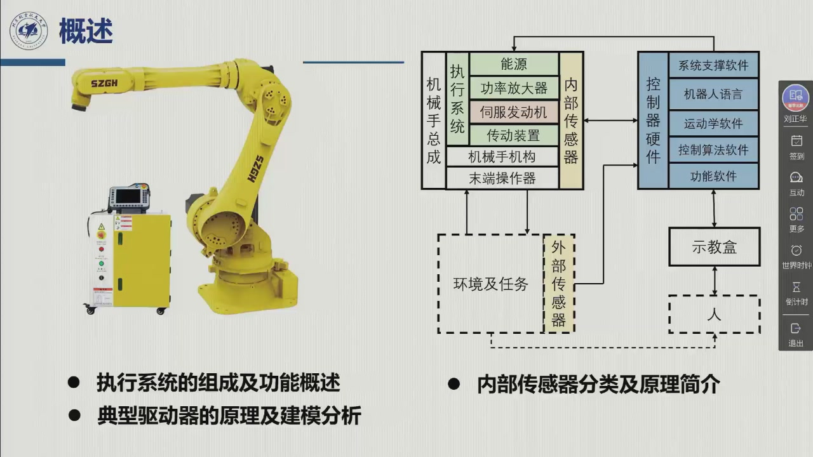
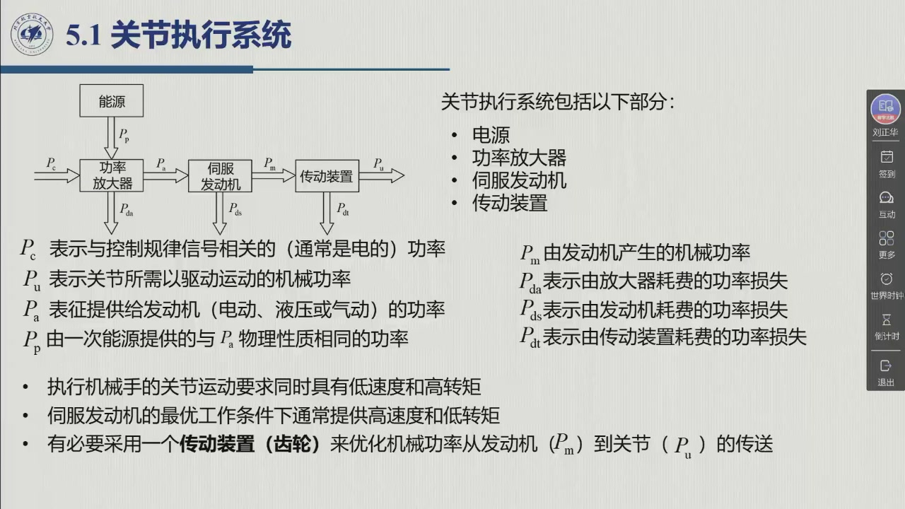
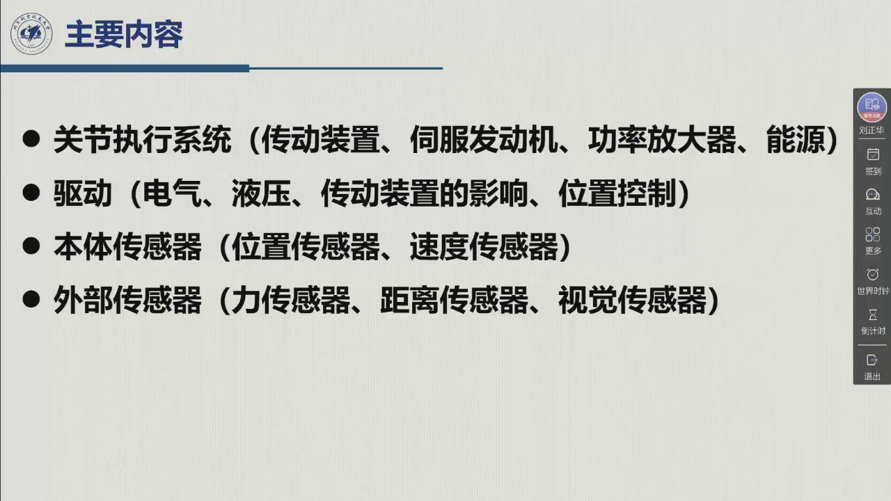

# 5.1 关节执行系统

第二到第四章算出了关节应当怎样运动：轨迹上的位置 $q(t)$、速度 $\dot q(t)$ 和加速度 $\ddot q(t)$。要让关节真的这样动，还需要驱动力：转动关节要力矩，移动关节要直线力。本章沿“能量—驱动—传动—测量”这条链，讲驱动力从哪里来、怎样建模、实际运动怎样测回来。§5.1 列出链上的部件并算能量账，[§5.2](sec5-2.md) 为驱动与传动建方程，[§5.3](sec5-3.md)、[§5.4](sec5-4.md) 讲测量。课堂回看：00:23:44–00:33:19。

链上有两条通路。能量通路从能源经功率放大器、伺服发动机和传动装置送到关节，本节算的是这条路上的功率和损失；信息通路由控制器发命令，传感器把实际运动读回控制器，与期望值比较后修改命令。下图（课件 00:16:52）中，执行系统方框里的四个部件构成能量通路，传感器与控制器硬件之间的箭头构成信息通路。

## 执行系统的四个组成部分

控制器为什么不能直接带动电机？老师在本章开头（00:09:59–00:11:26）算过：控制器是快速运算的微电子电路，输出按 3.3 V、1 mA 计只有 $3.3\times10^{-3}$ W，而机器人用的电机是几十瓦到上千瓦，按 100 W 到 1 kW 算相差 $3\times10^4$ 到 $3\times10^5$ 倍。这个小信号的幅值和相位按控制律变化，老师强调“这个规律是很重要的”。功率放大器另接能源，按这个规律调节送给电机的功率，理想情况下是等比例放大：能量来自能源，控制信号决定取多少、怎样随时间变化。

::: def 定义 5.1.1 · 关节执行系统 actuating system {#def-5.1.1}
执行系统由能源、功率放大器、伺服发动机和传动装置组成，四者沿能量通路串成一条功率链。

| 部件 | 接收什么 | 提供什么 |
|:--|:--|:--|
| 能源 | 电网、液压泵站等供能条件 | 驱动所需的能量 |
| 功率放大器 | 能源与控制器命令 | 受调节的电压、电流或液压流量 |
| 伺服发动机 | 电能、液压能或气压能 | 轴上的力矩或直线力 |
| 传动装置 | 发动机的机械输出 | 与关节速度、力矩和运动形式相匹配的机械输出 |

本书沿用原教材的“伺服发动机”称呼，泛指电动、液压或气动执行器，原因见 [§5.1.2](sec5-1-2.md)；讨论电动方案时直接称电机。直接驱动可省去独立的传动装置，见 [§5.1.1](sec5-1-1.md)。
:::

下图是这条功率链：沿能源的箭头追到关节输出，是能量的走向；控制器的箭头 $P_c$ 只接到功放，它只负责调节。

<figure>

<figcaption>执行系统的能量流（课件 00:23:44）。$P_e$ 为能源输入，$P_a$ 为执行器输入，$P_m$ 为执行器机械输出，$P_u$ 为传动后的关节输出；每个转换环节都可能有损失。课件把能源功率记作 $P_p$、发动机损失记作 $P_{ds}$，即本书的 $P_e$ 与 $P_{dm}$。</figcaption>
</figure>

图中能源只有一支箭头通往功放，即驱动电机的主功率，电压常为 24、36 或 48 V。老师补充（00:24:21–00:26:05），控制器和传感器也要从能源分电，而且对电压有要求：控制器约 3.3 V，偏高会烧坏，偏低跑不起来；传感器常在 10–20 V 内工作，有的必须是 15 V，电压波动会使读数不准甚至烧坏器件。这些支路由电源管理单独稳压，功率远小于驱动电机，所以功率链只计功放一支。

::: note 不同介质中的功率配对 {#note-5.1.1}
功率链上每一段的功率，都能写成该段一对量的乘积。转动机械功率为 $P=\tau\omega$，直线机械功率为 $P=fv$；直流电路中为 $P=ui$，液压回路中为 $P=\Delta p\,Q$。其中 $\tau$ 是力矩、$\omega$ 是角速度，$\Delta p$ 是压差，$Q$ 是体积流量。

这些乘积的单位均为 W。机械量有方向时使用[功率内积](../recall.md#wrench)，如 $\tau^{\mathrm T}\dot q$；它的正负还表示能量传递方向。后面选型从关节端的力矩和速度出发，用的就是这种拆法。
:::

## 功率流：端口功率与损失

::: def 定义 5.1.2 · 执行系统的功率符号 {#def-5.1.2}
前五个符号是控制端口与能量通路上各端口的功率，最后一行是三处耗散，下标 $d$ 表示损失。

| 符号 | 含义 |
|:--|:--|
| $P_c$ | 控制器输出信号关联的小功率 |
| $P_e$ | 能源送入功放的功率（课件记作 $P_p$） |
| $P_a$ | 功放送给执行器的功率 |
| $P_m$ | 执行器输出的机械功率 |
| $P_u$ | 传动装置送到关节的机械功率 |
| $P_{da},P_{dm},P_{dt}$ | 功放、执行器和传动装置各自耗散的功率（课件把 $P_{dm}$ 记作 $P_{ds}$） |
:::

三处损失各有来源（00:27:36–00:28:15）：功放工作时发热；电机线圈发热，液压执行器还有摩擦和流体压缩带来的损失；传动装置有摩擦，有间隙时也会损耗一部分能量。

先看正向驱动：能量从能源流向关节，部件内部储存的能量基本不变。这时每个环节的输入等于输出加损失。

::: method 方法 5.1.A · 功率链怎么算 {#method-5.1.A}
$P_c$ 只有毫瓦级，与 $P_e$ 相比可以略去，于是三个环节的平衡式为

$$P_e=P_a+P_{da},\qquad P_a=P_m+P_{dm},\qquad P_m=P_u+P_{dt}.$$

分别定义 $\eta_a=P_a/P_e$、$\eta_m=P_m/P_a$、$\eta_t=P_u/P_m$。将三个比值相乘，中间功率约去：

$$\frac{P_u}{P_e}=\frac{P_a}{P_e}\frac{P_m}{P_a}\frac{P_u}{P_m}
=\eta_a\eta_m\eta_t.$$

若只从电机输入端开始核算，得到的是 $P_u/P_a=\eta_m\eta_t$，少乘了功放效率。报告效率时必须说明输入端和输出端。若部件内部储能明显变化（如转子加速），或制动时能量回馈，需把相应项补入平衡式。
:::

举一组假设的数。设 $P_a=300$ W，电机效率与传动效率均为0.9，则 $P_m=270$ W、$P_u=243$ W，这两个环节分别损失30 W和27 W，合计57 W，$P_u/P_a=0.81$ 而非0.9。再取功放效率0.9，能源须提供 $P_e=300/0.9\approx333.3$ W，功放损失约33.3 W；从能源到关节的效率是 $0.9^3=0.729$，三处共损失约90.3 W。

## 选型的出发点：从关节的力和速度出发

教材的方针是：从构成关节机械功率 $P_u$ 所需的力和速度出发选执行系统。任务规定的正是关节要出多大力矩、转多快，确定这两项后再沿功率链往能源一端折算。只知道瓦数不够：同样100 W，可以是10 N·m乘10 rad/s，也可以是1 N·m乘100 rad/s，所需的电机和传动不同。

::: thm 定理 5.1.B · 发动机与关节的工况矛盾 {#thm-5.1.B}
机械手关节通常要求低速度、高转矩，伺服发动机在最优工作条件下通常提供高速度、低转矩。在两者之间加一级减速比为 $k_r$ 的传动装置，关节转速降为电机的 $1/k_r$，理想情况下力矩增为 $k_r$ 倍，两端的工作状态才能匹配。
:::

上面两组100 W正是这种情形：电机在1 N·m、100 rad/s工作，经 $k_r=10$ 的减速器，关节得到10 N·m、10 rad/s（课件 00:23:44 页下方三条，讲解 00:28:29–00:29:38）。按老师的说法，厂家设计电机时追求能量转换效率最高，这样的电机提供的是高速度、低转矩。

能不能直接用低速大转矩的电机？老师说有，但很贵（00:29:38–00:30:50）：需求量小，能量转换效率也不高，价格可能是普通电机的几倍到十几倍，多见于实验室自制的样机；商用机器人一般用高速电机配减速器。若电机本身能满足关节的力矩、速度、散热与安装要求，也可以直接驱动，代价见 [§5.1.1](sec5-1-1.md)。

后续选型还要检查峰值与持续负载、转动惯量、传动刚度、间隙和反馈测量；关节端的力矩和速度怎样经减速比折回电机端，在 [§5.2](sec5-2.md) 中计算。§5.1.1–§5.1.4 按课件目录（下图，00:22:45）从关节一端往能源一端讲：传动装置、伺服发动机、功率放大器、能源，这也是选型倒推的顺序。

::: think 检查理解
1. 若控制器发出了正确命令，电源却没有接通，电机会获得驱动能量吗？
2. 为什么只报 $P_u/P_a$ 不能代表从能源到关节的总效率？
3. 同为100 W的两组力矩与速度，为什么不一定能用同一电机直接驱动？
4. 按能量通路的顺序写出执行系统的四个部分，标出各段之间的 $P_e,P_a,P_m,P_u$；三处损失各发生在哪里？

::: sol 核对
控制命令不提供主要驱动能量；功放还需要能源输入。$P_u/P_a$ 没有计入功放损失，从能源出发应计算 $P_u/P_e$，上面的算例中两者分别为0.81与0.729。功率只约束乘积，还须分别满足力矩、速度与其他工况要求。四个部分依次是能源、功率放大器、伺服发动机、传动装置：能源送出 $P_e$，功放送出 $P_a$，发动机送出 $P_m$，传动装置把 $P_u$ 送到关节；$P_{da}$、$P_{dm}$、$P_{dt}$ 依次在功放、发动机、传动装置中耗散。
:::
:::

## 5.1 小结与常见错误

执行系统由能源、功率放大器、伺服发动机和传动装置串成功率链，功放、发动机和传动装置三处有损失，从能源到关节的效率是 $P_u/P_e=\eta_a\eta_m\eta_t$。毫瓦级的控制信号经功放调节能源的功率，本身不供能。选型从关节端的力矩和速度出发：关节要低速大转矩，电机适合高速小转矩，由减速传动换算。老师讲完能源后把这一整套称为“机器人或机械系统的心脏，相当于咱们人体的肌肉”（01:03:05–01:03:46）：前几章算出的轨迹，要经这条链才变成关节上的力矩和运动。

::: think 常见错误清单 · 自查三条
1. 把功率放大器当成信号放大器：它放大的是功率，控制信号 $P_c$ 只决定从能源取多少，能量来自 $P_e$。
2. 以为传动装置能增加功率：理想传动只重新分配力矩与速度，$P_u=P_m$；真实传动还要减去损失 $P_{dt}$。
3. 把 $P_u/P_a=\eta_m\eta_t$ 当作从能源到关节的总效率：它漏掉了功放损失，总效率是 $P_u/P_e=\eta_a\eta_m\eta_t$。
:::
