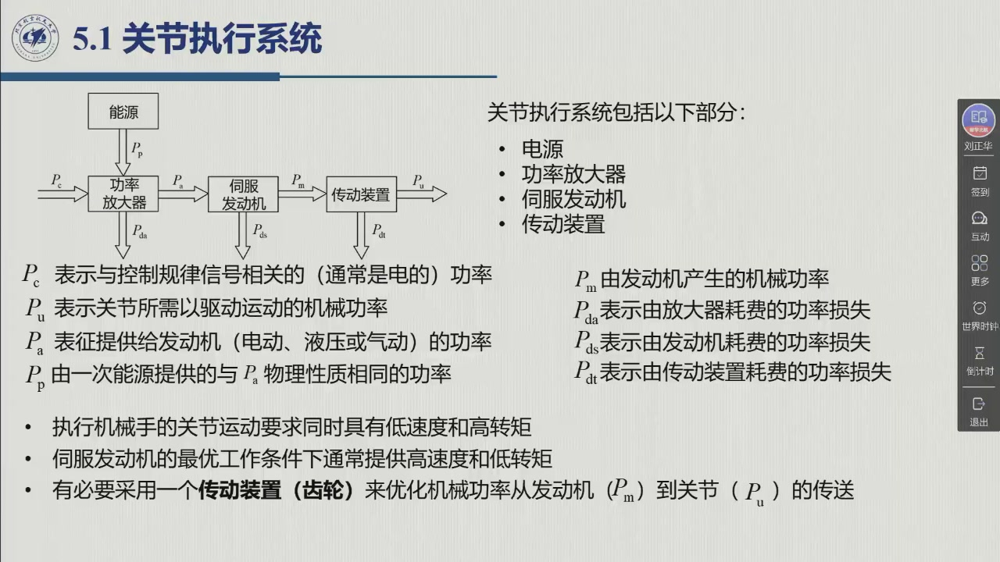
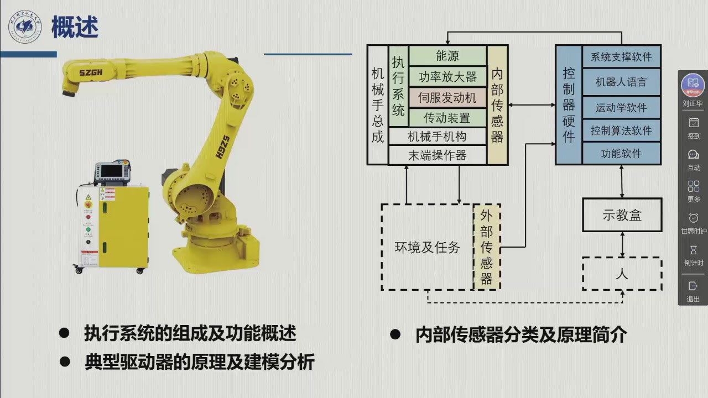
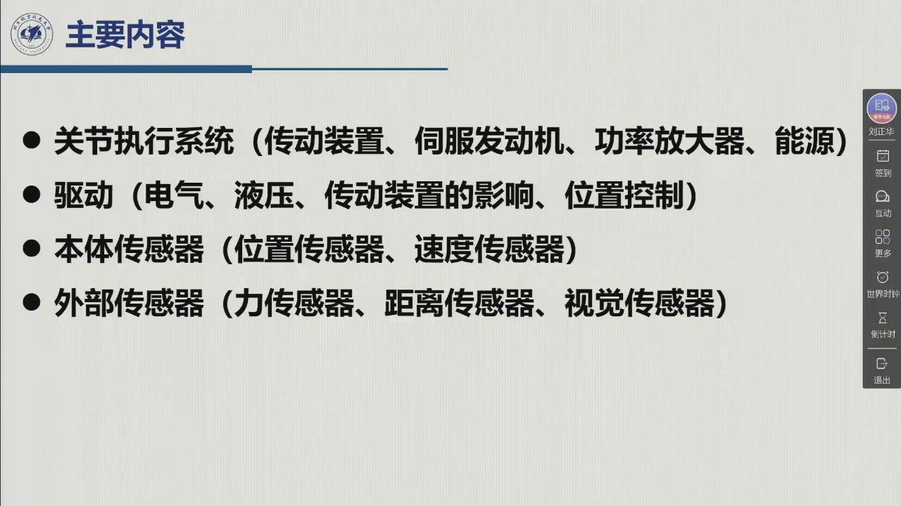

# 5.1 关节执行系统

前四章求出了关节应当怎样运动，例如一段轨迹上的位置 $q(t)$、速度 $\dot q(t)$ 和加速度 $\ddot q(t)$。真实关节还需要相应的驱动力。对于转动关节，驱动力是力矩；对于移动关节，驱动力是直线力。执行系统负责把能源送来的能量转换成这些机械作用。

本节先沿能量流认识部件，再计算各环节损失。另一条信息通路负责调节：传感器读回实际运动，控制器将它与期望值比较，随后调整驱动命令。读图时要同时识别这两条通路，分清哪条传能、哪条传递测量与命令。课堂回看：00:23:44–00:33:19。

## 执行系统的四个组成部分

::: def 定义 5.1.1 · 关节执行系统 actuating system {#def-5.1.1}
执行系统由能源、功率放大器、伺服执行器和传动装置组成。各部件的任务如下。

| 部件 | 接收什么 | 提供什么 |
|:--|:--|:--|
| 能源 | 电网、液压泵站等供能条件 | 驱动所需的能量 |
| 功率放大器 | 能源与控制器命令 | 受调节的电压、电流或液压流量 |
| 伺服执行器 | 电能、液压能或气压能 | 轴上的力矩或直线力 |
| 传动装置 | 执行器的机械输出 | 与关节速度、力矩和运动形式相匹配的机械输出 |

本书沿用原教材的“伺服发动机”称呼，泛指电动、液压或气动执行器。讨论电动方案时直接称电机。直接驱动可省去独立的传动装置，见 [§5.1.1](sec5-1-1.md)。
:::

下图用箭头区分控制信号和功率输入。阅读时从能源箭头追到机械输出，再看控制器的箭头接在哪里：控制器决定怎样调节，能源承担驱动所需的能量。

<figure>

<figcaption>执行系统的能量流。$P_e$ 为能源输入，$P_a$ 为执行器输入，$P_m$ 为执行器机械输出，$P_u$ 为传动后的关节输出；每个转换环节都可能有损失。</figcaption>
</figure>

电机所需功率通常远高于控制器输出端口能直接供给的功率。例如，3.3 V、1 mA 的信号功率只有 $3.3\times10^{-3}$ W。它可以表达命令，却不能直接提供几百瓦的机械输出。功率放大器因此还接有独立的供能端口，用控制命令调节该端口向电机送出的能量。

功率放大器用小功率命令调节大功率输出，驱动能量来自独立供能端口。“放大”指这种控制能力，既不表示凭空增加能量，也不只是让信号更清晰。

::: note 不同介质中的功率配对 {#note-5.1.1}
转动机械功率为 $P=\tau\omega$，直线机械功率为 $P=fv$；直流电路中为 $P=ui$，液压回路中为 $P=\Delta p\,Q$。其中 $\tau$ 是力矩、$\omega$ 是角速度，$\Delta p$ 是压差，$Q$ 是体积流量。

这些乘积的单位均为 W。机械量有方向时使用[功率内积](../recall.md#wrench)，如 $\tau^{\mathrm T}\dot q$；它的正负还表示能量传递方向。
:::

## 功率流：端口功率与损失

::: def 定义 5.1.2 · 执行系统的功率符号 {#def-5.1.2}
表中前五项分别标记控制信号与供能链上的端口功率，最后一行记录三处耗散。下标 $d$ 表示损失，不是另一个输入端口。

| 符号 | 含义 |
|:--|:--|
| $P_c$ | 控制器输出信号关联的小功率 |
| $P_e$ | 能源送入功放的功率 |
| $P_a$ | 功放送给执行器的功率 |
| $P_m$ | 执行器输出的机械功率 |
| $P_u$ | 传动装置送到关节的机械功率 |
| $P_{da},P_{dm},P_{dt}$ | 功放、执行器和传动装置各自耗散的功率 |
:::

先考虑正向驱动，并忽略部件内部储能变化。将控制端口的小功率单列后，各环节的输入功率等于输出与耗散之和。若储能明显变化或发生回馈制动，就需把相应项补入平衡式。

::: method 方法 5.1.A · 功率链怎么算 {#method-5.1.A}
忽略 $P_c$ 对总能量的微小贡献时，有

$$P_e=P_a+P_{da},\qquad P_a=P_m+P_{dm},\qquad P_m=P_u+P_{dt}.$$

分别定义 $\eta_a=P_a/P_e$、$\eta_m=P_m/P_a$、$\eta_t=P_u/P_m$。将三个比值相乘，中间功率约去：

$$\frac{P_u}{P_e}=\frac{P_a}{P_e}\frac{P_m}{P_a}\frac{P_u}{P_m}
=\eta_a\eta_m\eta_t.$$

若只从电机输入端开始核算，才有 $P_u/P_a=\eta_m\eta_t$。报告效率时必须说明输入端和输出端。
:::

例如，某计算工况取 $P_a=300$ W，电机效率与传动效率均为0.9，则 $P_m=270$ W、$P_u=243$ W。这两个环节分别损失30 W和27 W，合计57 W；总效率为0.81，而非0.9。这只是演示效率连乘的算例，不代表某种电机的额定性能。

## 选型的出发点：从关节的力和速度出发

选执行系统时，先由任务取得关节端所需的运动与负载，再向前折算到电机和能源。仅知道“需要多少瓦”并不充分：相同的100 W，可以是10 N·m与10 rad/s的乘积，也可以是1 N·m与100 rad/s的乘积，所需电机和传动并不相同。

::: thm 定理 5.1.B · 发动机与关节的根本工况矛盾 {#thm-5.1.B}
常见减速驱动中，关节要求较低转速和较大力矩，而所选电机适合较高转速、较小力矩。减速传动用速度的降低换取力矩的增加，使两端工作状态相匹配。

这是采用减速器的一个理由，不能推出所有机器人都必须使用减速器。若电机本身能满足关节力矩、速度、散热与安装要求，也可采用直接驱动。
:::

后续选型还要检查峰值与持续负载、转动惯量、传动刚度、间隙和反馈测量。这里先建立各部件的职责，电机模型和负载折算在 [§5.2](sec5-2.md) 中计算。

::: think 检查理解
1. 若控制器发出了正确命令，电源却没有接通，电机会获得驱动能量吗？
2. 为什么只报 $P_u/P_a$ 不能代表从能源到关节的总效率？
3. 同为100 W的两组力矩与速度，为什么不一定能用同一电机直接驱动？

::: sol 核对
控制命令不提供主要驱动能量；功放还需要能源输入。$P_u/P_a$ 没有计入功放损失，从能源出发应计算 $P_u/P_e$。功率只约束乘积，还须分别满足力矩、速度与其他工况要求。
:::
:::
