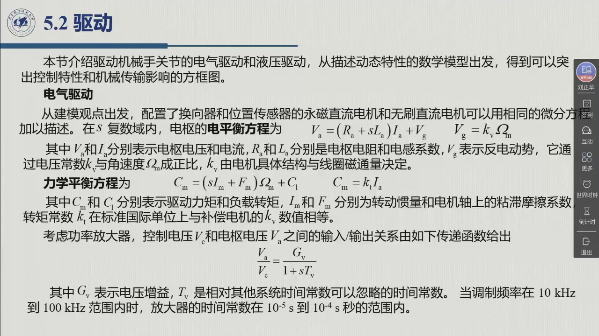
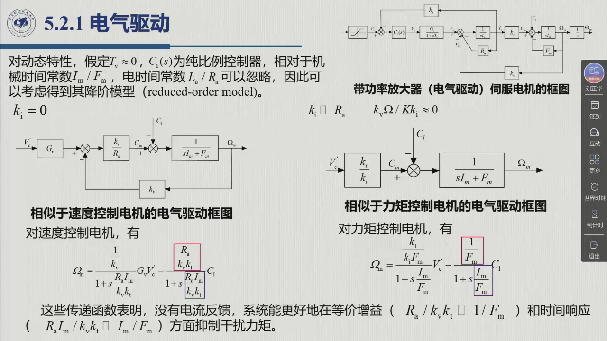
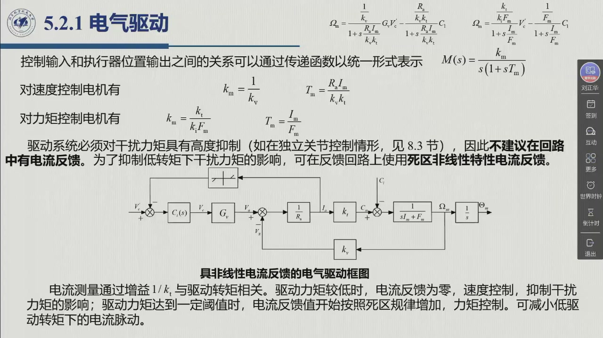

# 5.2.1 电气驱动

电机模型要把两个过程联立起来：电压形成电流，电流产生力矩并使转子加速；转速又通过反电动势改变电流。本节先保留电气与机械动态，再说明电压驱动和快速电流环各自采用哪些近似。课堂回看：01:05:27–01:22:09。

以下采用等效直流电机模型。完成适当换相的无刷电机，在一定条件下也可使用类似外部模型；其多相内部过程仍与有刷电机不同。

## 5.2.1.1 四个基本方程

::: def 定义 5.2.1 · 电气驱动的四个基本方程 {#def-5.2.1}
先在时域取电枢电压 $v_a$（V）、电流 $i_a$（A）、转速 $\omega_m=\dot\theta_m$（rad/s）和负载阻力矩 $c_l$（N·m）。约定正电流产生正向电磁力矩，正 $c_l$ 阻碍正转。方程为

$$v_a=R_ai_a+L_a\dot i_a+v_g,\qquad v_g=k_v\omega_m,$$

$$I_m\dot\omega_m+F_m\omega_m=c_m-c_l,\qquad c_m=k_ti_a.$$

$R_a$ 为电阻，$L_a$ 为电感，$I_m$ 为转动惯量，$F_m$ 为黏滞摩擦系数。注意 $I_m$ 是惯量而 $i_a$ 是电流；下标相近并不表示同一类量。

在零初值下做拉普拉斯变换，大写字母表示对应变换量，得教材四式：

$$V_a=(R_a+sL_a)I_a+V_g \tag{5.1}$$
$$V_g=k_v\Omega_m \tag{5.2}$$
$$C_m=(sI_m+F_m)\Omega_m+C_l \tag{5.3}$$
$$C_m=k_tI_a. \tag{5.4}$$
:::

反电动势常数 $k_v$ 的单位是 V/(rad/s)，转矩常数 $k_t$ 的单位是 N·m/A。采用相容的理想等效模型和国际单位时，两者数值相等：电磁转换功率一方面是 $v_gi_a$，另一方面是 $c_m\omega_m$，代入比例式即可比较系数。使用实际无刷电机的相值、线值或有效值参数时，必须先核对约定。

### 从时域到传递函数，中间两次消元

由机械方程先求电流：

$$I_a=\frac{(sI_m+F_m)\Omega_m+C_l}{k_t}.$$

代入电压方程，把两边乘 $k_t$，再将含 $\Omega_m$ 的项放在左侧：

$$\big[(R_a+sL_a)(sI_m+F_m)+k_vk_t\big]\Omega_m
=k_tV_a-(R_a+sL_a)C_l.$$

定义共同分母

$$D(s)=L_aI_ms^2+(R_aI_m+L_aF_m)s+R_aF_m+k_vk_t,$$

便能分开看电压和负载的影响：

$$\Omega_m=\frac{k_t}{D(s)}V_a-\frac{R_a+sL_a}{D(s)}C_l.$$

负载通路的符号可由物理意义核对：电压固定时，正阻力矩增大会使正转速度下降。若输出改为位置，由 $\Theta_m=\Omega_m/s$ 再增加一个[积分环节](../recall.md#laplace)。此时仍保留两个动态状态和位置积分，尚未作后面的一阶近似。

## 5.2.1.2 含电流反馈的驱动框图

教材将功放近似成一阶环节：

$$\frac{V_a}{V_c}=\frac{G_v}{1+sT_v}. \tag{5.5}$$

$G_v$ 为电压增益，$T_v$ 为其时间常数。只有所研究频率满足 $|sT_v|\ll1$ 时，才可把它近似成常数。某个开关频率较高，并不足以单独证明电机、传感器和控制器组成的所有内环都可忽略。

::: def 定义 5.2.2 · 电流反馈回路的双重目的 {#def-5.2.2}
电流内环测量 $i_a$，将它与参考量比较，再调节电枢电压。它可以使电流在指定带宽内跟随参考，也能配合限流与过载保护。

限制命令幅值与限制实际电流是两件事。两者怎样联系，取决于闭环、采样、限幅和电机动态；不能只在控制信号上放一个饱和块，就无条件保证实际电流不会超限。
:::

为看清内环做了什么，暂将快速功放和比例电流调节器合成增益 $K$，电流传感增益为 $k_i$。令

$$V_a=K(V_c'-k_iI_a).$$

代入电气方程，得到

$$[R_a+sL_a+Kk_i]I_a+k_v\Omega_m=KV_c'.$$

若研究频带内回路增益足够高、没有限幅，且速度引起的扰动能被回路有效抑制，可近似 $I_a\approx V_c'/k_i$。此时电磁力矩近似跟随参考量，而非由转速与电压平衡间接决定。

## 5.2.1.3 两种特性：速度控制发电机与力矩控制发电机

“发电机”是原教材给驱动等效特性采用的名称，并不表示此时正在向外发电。下面比较两种模型时，分别注明它们的输入端口与近似条件。

::: thm 定理 5.2.A · 两种特性与统一传递函数 {#thm-5.2.A}
**电压驱动。** 忽略电感与功放动态，取 $V_a=G_vV_c'$，再要求 $R_aF_m\ll k_vk_t$。由前面的完整分母得到

$$\Omega_m=\frac{\dfrac{1}{k_v}}{1+s\dfrac{R_aI_m}{k_vk_t}}\;G_vV_c'-\frac{\dfrac{R_a}{k_vk_t}}{1+s\dfrac{R_aI_m}{k_vk_t}}\;C_l. \tag{5.9}$$

**快速电流环。** 用 $I_a\approx V_c'/k_i$ 代入机械方程，保留 $F_m>0$，得

$$\Omega_m=\frac{\dfrac{k_t}{k_iF_m}}{1+s\dfrac{I_m}{F_m}}\;V_c'-\frac{\dfrac{1}{F_m}}{1+s\dfrac{I_m}{F_m}}\;C_l. \tag{5.10}$$

只取命令到位置的通路，两式都可整理成

$$M(s)=\frac{k_m}{s(1+sT_m)}. \tag{5.11}$$

但输入缩放须同时注明：

$$\text{以 }G_vV_c'\text{ 为输入：}\quad k_m=\frac{1}{k_v},\qquad T_m=\frac{R_aI_m}{k_vk_t}; \tag{5.12}$$

$$\text{以 }V_c'\text{ 为输入：}\quad k_m=\frac{k_t}{k_iF_m},\qquad T_m=\frac{I_m}{F_m}. \tag{5.13}$$

若第一式仍以 $V_c'$ 为输入，增益还须乘 $G_v$。当 $F_m=0$ 时，第二种速度模型应保留为 $\Omega_m=[(k_t/k_i)V_c'-C_l]/(I_ms)$，不能在含 $1/F_m$ 的参数式中直接代零。
:::

::: thm 定理 5.2.B · 电流反馈的取舍结论 {#thm-5.2.B}
式 (5.9) 中，固定电压时反电动势提供速度相关的反馈。按所用参数范围，其负载到转速的静态增益 $R_a/(k_vk_t)$ 可小于式 (5.10) 中的 $1/F_m$。这比较的是两个未加外速度环或位置环的简化模型。

快速电流环使电机更接近力矩源；固定参考电流时，它不再凭自身反电动势抵消外部负载，外层控制器需要承担相应调节。这并不推出“独立关节控制都不应有电流环”。完整方案还须比较外环、限流、带宽、噪声和饱和。
:::

课件还给出下图的死区限流结构。它是特定实现，使用前需分析有效工作区间，不能直接代替对所有动态电流保护的分析。

::: think 检查理解
1. 从四个基础方程消去 $I_a$，为什么转速表达式中仍有两个输入？
2. 位置模型的原点极点来自哪里？忽略 $L_a$ 又删去了什么动态？
3. 反电动势会随转速改变电流，为什么快速电流环却能近似保持给定力矩？
4. 两个模型中的 $T_m$ 不同，是否说明加电流环一定让所有响应更快？

::: sol 核对
电压是驱动输入，负载力矩是扰动输入，均影响转速。位置是速度的积分；忽略电感删去电流储能的快速动态。电流环通过调整电压对抗反电动势等影响，但只在其有效带宽和输入能力内成立。时间常数来自不同闭环与假设，不能脱离输入和外环直接比较快慢。
:::
:::
