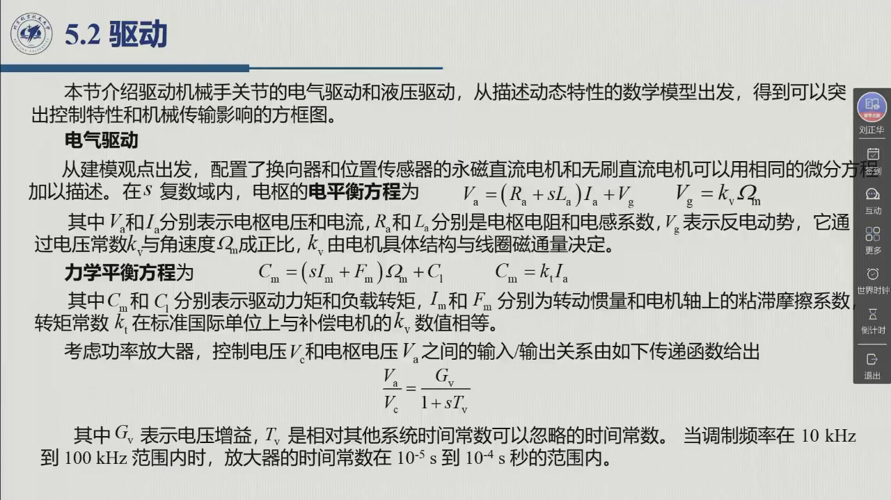
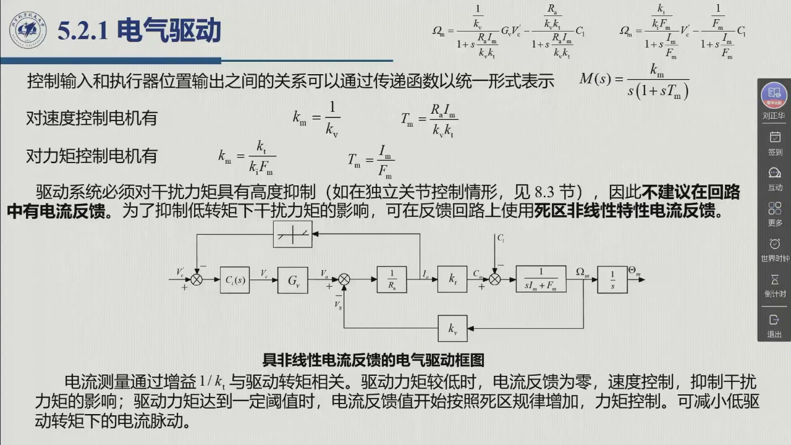

# 5.2.1 电气驱动

本节把伺服电机写成传递函数。**关键的前提是一句「可以统一处理」**：配置了换向器和位置传感器的**永磁直流电机**与**无刷直流电机**，从建模的观点出发**可以用相同的微分方程加以描述**（教材 §5.2.1）——这就是为什么「有刷/无刷」之争在建模层面消失了。录播 01:05:27–01:22:09。

<aside class="lesson-brief" aria-label="5.2.1 学习简报">

PREREQUISITE<strong>你需要先会</strong>
永磁直流与无刷直流伺服电机的组成（[@def-5.1.7]、[@def-5.1.8]）；斩波器/逆变器与放大器的传递函数形式（[@method-5.1.E]）。

TARGET<strong>本节要建立</strong>
电气驱动的**四个基本方程**（5.1–5.4）；含**电流反馈**（传感器 $k_i$、调节器 $C_i(s)$、饱和非线性）的驱动框图；无电流反馈时的**速度控制发电机**特性与有电流反馈时的**力矩控制发电机**特性；统一传递函数 $M(s)=k_m/[s(1+sT_m)]$ 与两个时间常数；以及「独立关节控制不加电流反馈、集中控制必须加」这条结论。

CHECKPOINT<strong>学完的标准</strong>
能默写 (5.1)–(5.4) 与 (5.11)–(5.13)；能解释电流反馈的**双重目的**；能说出为什么 $R_a/(k_vk_t)\ll 1/F_m$ 意味着「干扰抑制更好」。

</aside>

## 5.2.1.1 四个基本方程

::: def 定义 5.2.1 · 电气驱动的四个基本方程 {#def-5.2.1}
在 $s$ 复数域内（教材式 5.1–5.4）：

**电枢电平衡方程**

$$V_a=(R_a+sL_a)I_a+V_g \tag{5.1}$$

**反电动势**

$$V_g=k_v\Omega_m \tag{5.2}$$

其中 $V_a,I_a$ 分别为**电枢电压和电流**，$R_a,L_a$ 分别是**电枢电阻和电感系数**，$V_g$ 表示**反电动势**——它通过**电压常数 $k_v$** 与角速度 $\Omega_m$ 成正比；$k_v$ 由电机的**具体结构与线圈磁通量**决定。

**力学平衡方程**

$$C_m=(sI_m+F_m)\Omega_m+C_l \tag{5.3}$$

**驱动力矩**

$$C_m=k_tI_a \tag{5.4}$$

其中 $C_m$ 和 $C_l$ 分别是**驱动力矩与负载转矩**，$I_m$ 和 $F_m$ 分别是**转动惯量**与**电机轴上的粘滞摩擦系数**；**转矩常数 $k_t$ 在标准国际单位上与电压常数 $k_v$ 数值相等**（这一条在后续推导中反复用到）。
:::

四个方程的读法：**(5.1)+(5.2) 是「电」，(5.3)+(5.4) 是「机」，$k_t=k_v$ 是电与机之间的桥**。反电动势 $V_g$ 的存在说明：电机转得越快，留给「推电流」的电压越少——这正是电机**自然的速度负反馈**。

## 5.2.1.2 含电流反馈的驱动框图

功率放大器本身的模型很简单（教材式 5.5）：

$$\frac{V_a}{V_c}=\frac{G_v}{1+sT_v} \tag{5.5}$$

其中 $G_v$ 是**电压增益**，$T_v$ 是**时间常数**。它的量级值得记：当调制频率在 **10 kHz 到 100 kHz** 范围时，放大器的时间常数在 $10^{-5}$ 到 $10^{-4}$ s 量级——**比机械时间常数小几个数量级**，因此后面做降阶模型时可以令 $T_v\approx 0$。

::: def 定义 5.2.2 · 电流反馈回路的双重目的 {#def-5.2.2}
带功率放大器的电气驱动框图（教材图 5.2）里，除上述环节外还有三样东西：

1. 一个**电枢电流反馈**（current feedback）回路——电流由**电机功率放大器与电枢线圈之间的传感器 $k_i$** 测量；
2. 一个**电流调节器** $C_i(s)$；
3. 一个**饱和非线性特性**元件。

**这一反馈有双重目的**（教材 §5.2.1）：

- **其一**：电压 $v_c$ 起到**参考电流**的作用；通过选择适当的调节器 $C_i(s)$，可以**减小电流 $I_a$ 与电压 $v_c$ 之间的滞后**。
- **其二**：引入**饱和非线性**可以限制 $v_c$ 的值，从而**起限流作用**——在非正常工作条件下**保证对功率放大器的保护**。
:::

## 5.2.1.3 两种特性：速度控制发电机与力矩控制发电机

现在到了本节的核心：**同一个电机，配上不同的调节器与电流反馈取舍，会表现成两种完全不同的「发电机」**（教材 §5.2.1）。

::: thm 定理 5.2.A · 两种特性与统一传递函数 {#thm-5.2.A}
**（一）$k_i=0$（不加电流反馈）⇒ 速度控制发电机（velocity-controlled generator）。**
驱动器具有与**速度控制发电机**相同的特性。降阶模型（$T_v\approx0$、纯比例控制器、电时间常数 $L_a/R_a$ 相对机械时间常数 $I_m/F_m$ 可忽略）给出（教材式 5.9）：

$$\Omega_m=\frac{\dfrac{1}{k_v}}{1+s\dfrac{R_aI_m}{k_vk_t}}\;G_vV_c'-\frac{\dfrac{R_a}{k_vk_t}}{1+s\dfrac{R_aI_m}{k_vk_t}}\;C_l \tag{5.9}$$

**（二）$k_i\neq0$ 且电流回路取大回路增益（$Kk_i\gg R_a$）⇒ 力矩控制发电机（torque-controlled generator）。**
此时（教材式 5.10）：

$$\Omega_m=\frac{\dfrac{k_t}{k_iF_m}}{1+s\dfrac{I_m}{F_m}}\;V_c'-\frac{\dfrac{1}{F_m}}{1+s\dfrac{I_m}{F_m}}\;C_l \tag{5.10}$$

「考虑到 $G_v$ 的值比较大，**驱动力矩实际上独立于角速度**。」

**（三）统一形式。** 控制输入与执行器位置输出之间的关系，可以用统一的传递函数表示（教材式 5.11–5.13）：

$$M(s)=\frac{k_m}{s(1+sT_m)} \tag{5.11}$$

$$\text{速度控制：}\quad k_m=\frac{1}{k_v},\qquad T_m=\frac{R_aI_m}{k_vk_t} \tag{5.12}$$

$$\text{力矩控制：}\quad k_m=\frac{k_t}{k_iF_m},\qquad T_m=\frac{I_m}{F_m} \tag{5.13}$$
:::

**注意放大器的位置差别**——教材专门提醒：在**速度控制**情形下，功率放大器以常数 $G_v$ 直接作用于输入/输出关系（见 5.9 式）；而在**电流控制**情形下，放大器处在**局部反馈回路内部**，它不再单独出现，而是**以因子 $1/k_i$ 的形式钻进 $k_m$ 里**（见 5.13 式）。老师讲到这里时的说法是「**带宽增大**（电流环让驱动更快）」——电流环把电气时间常数「包」进了内环，外层看到的只剩机械时间常数 $I_m/F_m$。

![课堂幻灯片 · 01:16:55：统一传递函数 $M(s)=k_m/[s(1+sT_m)]$ 与两种发电机下的 $k_m,T_m$](../assets/ch05/unified-transfer.jpg)

::: thm 定理 5.2.B · 电流反馈的取舍结论 {#thm-5.2.B}
比较 5.9 与 5.10 两式，教材得出结论：**没有电流反馈时，系统对干扰力矩的抑制更好**——无论在**等价增益**（$\dfrac{R_a}{k_vk_t}\ll\dfrac{1}{F_m}$）还是**时间响应**（$\dfrac{R_aI_m}{k_vk_t}\ll\dfrac{I_m}{F_m}$）方面都是如此。

因此在**需要高度抑制干扰力矩**的场合（如**独立关节控制**，第 8.3 节）**不建议在回路中有电流反馈**——至少当所有量都在其标称值内时是这样。

**但保护问题仍要解决**：此时可以通过**在反馈回路上使用具有死区非线性特性的电流反馈**来限制电流，而**不是**用控制信号的饱和来限制（教材图 5.5）。这样得到的电流限制「切实可行，**其精度与死区斜率一样高**」。

**反过来**：如第 8.5 节将说明的，**集中控制**方案要求驱动系统具有**力矩控制发电机**的特性，这时就**应该**使用具有适当调节器 $C_i(s)$ 的电流反馈，以赋予电流回路良好的静态与动态特性。此时驱动转矩伺服是**间接**完成的——因为它基于电流测量，而电流通过增益 $1/k_t$ 与驱动转矩相关。
:::

::: think 考点 · 老师原话（录播时间点）

> **框图化简是要考的**（01:13:23–01:13:44）：「没有化简的话，大家感兴趣上面可以自己去画一下，也**复习一下本科学（过）的（框图）简化**——比如说比较点、引出点，**前移、后移**，怎么来进行化简。**如果考研的话，应该可以（考）到这个**：（给）具体（的框图）上给出来，**画（化简）之后，你就可以把简化之后的传递函数写出来**，（写成）是这样的形式。」

> **化简的代价与理由**（01:13:52–01:14:22）：「这里也用到了一些假设……其实也是为了简化计算，或者说实际的需求**没有要求那么高的一个精度**。如果不简化的话，它可能就是**二阶的，或者是三阶的**，但是模型就非常复杂了，成本会非常高。虽然（做了）那种简化，（但）它是可以满足需求的。」

**这一条把本节的定位说清了**：图 5.2 的框图**不是终点**，考（学）点在于**把它化简成 $M(s)=k_m/[s(1+sT_m)]$ 那样的一阶惯性 + 积分形式**——这正是 [@thm-5.2.A] 的推导过程。

> **电流环的作用是「带宽增大」**：老师在 01:16 前后指着电流环说明——加上电流内环后，驱动（等效）增益变大、（等效）时间常数主要由机械环节决定（01:16:55 页）。

> **两种发电机对应两种控制需求**：速度控制（不加电流反馈，干扰抑制好）适合**独立关节控制**；力矩控制（加电流反馈，力矩与转速解耦）适合**集中控制/计算力矩**（01:19:45 前后）。
:::

::: think 默写点 · 合上书再写（主动回忆）

1. 写出电气驱动的四个基本方程，并指出哪一个常数把「电」与「机」连起来。
2. 电流反馈的双重目的是什么？
3. 速度控制发电机与力矩控制发电机的 $k_m,T_m$ 各是什么？放大器在两种情形下分别出现在哪里？
4. 为什么独立关节控制「不建议」加电流反馈？保护问题怎么解决？

::: sol 核对

$V_a=(R_a+sL_a)I_a+V_g$；$V_g=k_v\Omega_m$；$C_m=(sI_m+F_m)\Omega_m+C_l$；$C_m=k_tI_a$。**$k_t=k_v$**（标准国际单位下数值相等）把电与机连起来。

其一，$v_c$ 作参考电流，选 $C_i(s)$ 减小 $I_a$ 与 $v_c$ 的滞后；其二，饱和非线性限制 $v_c$，起限流与保护功放的作用。

速度控制：$k_m=1/k_v$、$T_m=R_aI_m/(k_vk_t)$，放大器以 $G_v$ 显式出现在输入/输出关系中；力矩控制：$k_m=k_t/(k_iF_m)$、$T_m=I_m/F_m$，放大器在局部反馈回路内部，以 $1/k_i$ 的形式进入 $k_m$。

因为无电流反馈时干扰力矩的等价增益 $R_a/(k_vk_t)$ 与时间响应 $R_aI_m/(k_vk_t)$ 都远小于有反馈时的 $1/F_m$ 与 $I_m/F_m$，抑制更好。保护改用**带死区非线性的电流反馈**在反馈回路上限流。

:::

:::

## 5.2.1 小结与常见错误

- **四个方程**：电枢电平衡、反电动势、力学平衡、力矩方程；$k_t=k_v$ 是电—机之间的桥。
- **一条反馈**：电流反馈的**双重目的**（减小滞后 + 限流保护），以及它与**饱和非线性**的分工（饱和用在控制信号上，死区非线性用在反馈上）。
- **两种特性**：速度控制发电机（无电流反馈，抗干扰好）与力矩控制发电机（有电流反馈，力矩独立于转速）。
- **一个统一式**：$M(s)=\dfrac{k_m}{s(1+sT_m)}$——位置输出对控制输入，一阶惯性 + 一个积分。

::: think 常见错误清单 · 自查三条
1. 把 $k_v$ 与 $k_t$ 当成两个独立参数——标准单位下**数值相等**，这是 (5.12)(5.13) 化简的前提。
2. 认为「加了电流反馈一定更好」——恰恰相反：**独立关节控制不加更好**（抗干扰），集中控制才需要。
3. 忘了放大器的时间常数**比机械时间常数小几个数量级**——这是降阶模型成立、模型里可以令 $T_v\approx0$ 的根据。
:::
