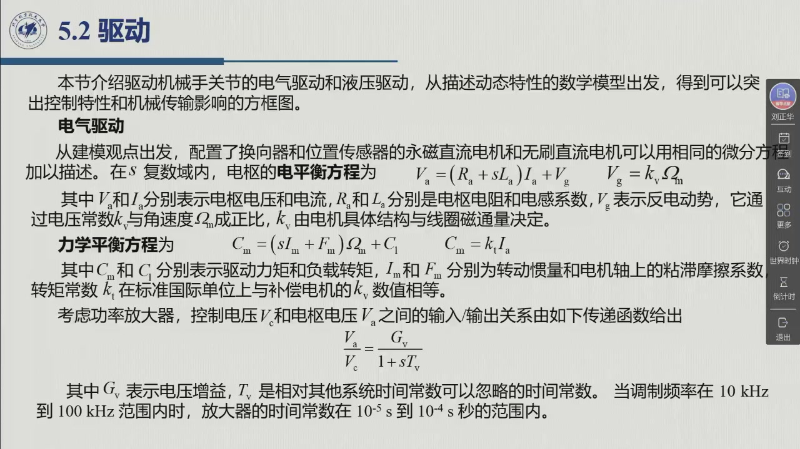
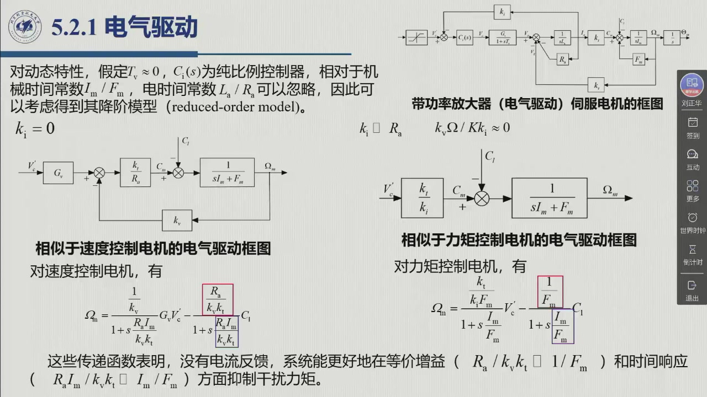
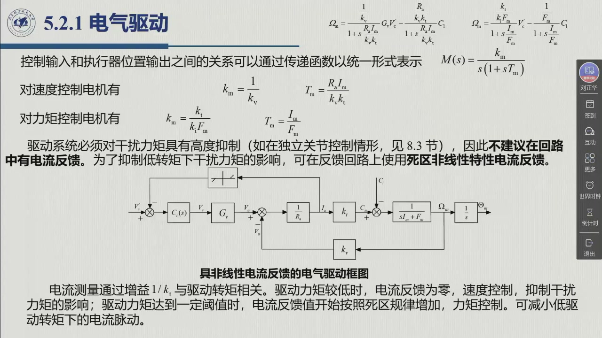

# 5.2.1 电气驱动

[§5.2](sec5-2.md) 把电气驱动与液压驱动的建模框架对齐，本节先走电气一侧：把电枢电压、电枢电流和转子角速度联立成传递函数，看同一台电机在不加电流反馈时怎样表现成“速度控制发电机”，在加上快速电流反馈后又怎样表现成“力矩控制发电机”，最后比较两者抗负载扰动的能力。课堂回看：01:05:27–01:22:09。

以下采用等效直流电机模型。配置了位置传感器与电子换相的无刷直流电机，在忽略多相开关脉动后也可以用同一组等效微分方程描述外部机械特性（01:04:30–01:05:10）；分析具体电机时，相值、线值或有效值参数仍须按厂商约定折算。

## 5.2.1.1 四个基本方程

电机转动时，电侧和机侧通过两个交叉项互相牵连：电枢电流 $i_a$ 产生电磁转矩 $c_m$ 去加速转子；转子转起来以后，线圈切割磁场又产生反电动势 $v_g$ 顶住电源电压。把这两条平衡关系各自写出来，就得到四个基本方程。

::: def 定义 5.2.1 · 电气驱动的四个基本方程 {#def-5.2.1}
在时域取电枢电压 $v_a$（V）、电流 $i_a$（A）、转子转速 $\omega_m=\dot\theta_m$（rad/s）和负载阻力矩 $c_l$（N·m）。约定正电流产生正向电磁力矩，正 $c_l$ 阻碍正转：

$$v_a=R_ai_a+L_a\dot i_a+v_g,\qquad v_g=k_v\omega_m,$$

$$I_m\dot\omega_m+F_m\omega_m=c_m-c_l,\qquad c_m=k_ti_a.$$

其中 $R_a$ 为电枢电阻（$\Omega$），$L_a$ 为电枢电感（H），$I_m$ 为转子转动惯量（$\mathrm{kg\cdot m^2}$，注意它与电流 $i_a$ 符号不同），$F_m$ 为电机轴黏滞摩擦系数（$\mathrm{N\cdot m\cdot s/rad}$），$k_v$ 为反电动势常数（$\mathrm{V\cdot s/rad}$），$k_t$ 为转矩常数（$\mathrm{N\cdot m/A}$）。在零初值下做[拉普拉斯变换](../recall.md#laplace)，$s$ 为拉普拉斯复变量，大写字母表示对应变换量，得教材式 (5.1)–(5.4)：

$$V_a=(R_a+sL_a)I_a+V_g \tag{5.1}$$
$$V_g=k_v\Omega_m \tag{5.2}$$
$$C_m=(sI_m+F_m)\Omega_m+C_l \tag{5.3}$$
$$C_m=k_tI_a. \tag{5.4}$$
:::

反电动势常数 $k_v$ 的单位是 $\mathrm{V/(rad/s)}$，转矩常数 $k_t$ 的单位是 $\mathrm{N\cdot m/A}$。采用国际单位制的理想等效直流模型时，电磁转换功率一方面等于电功率 $v_gi_a=k_v\omega_mi_a$，另一方面等于机械功率 $c_m\omega_m=k_ti_a\omega_m$，比较系数可见 $k_v$ 与 $k_t$ 数值相等。

### 从四个方程到完整传递函数

由 (5.3) 和 (5.4) 先消去 $C_m$，解出电枢电流：

$$I_a=\frac{(sI_m+F_m)\Omega_m+C_l}{k_t}.$$

将 (5.2) 与上式一起代入 (5.1)：

$$V_a=(R_a+sL_a)\frac{(sI_m+F_m)\Omega_m+C_l}{k_t}+k_v\Omega_m.$$

两边同乘 $k_t$，把含 $\Omega_m$ 的项移到左侧、含 $C_l$ 的项移到右侧：

$$\big[(R_a+sL_a)(sI_m+F_m)+k_vk_t\big]\Omega_m=k_tV_a-(R_a+sL_a)C_l.$$

展开左侧中括号并按 $s$ 的降幂整理，定义二阶共同分母

$$D(s)=L_aI_ms^2+(R_aI_m+L_aF_m)s+R_aF_m+k_vk_t,$$

便得到电压输入与负载扰动共同作用下的完整转速方程：

$$\Omega_m=\frac{k_t}{D(s)}V_a-\frac{R_a+sL_a}{D(s)}C_l.$$

先用物理直觉核对负载通路的负号：保持电压 $V_a$ 不变时，正阻力矩 $C_l$ 增大必定拖慢正转速度，因此 $C_l$ 前面是减号。若输出改为转角 $\Theta_m=\Omega_m/s$，则再串入一个积分环节 $1/s$。此时模型仍保留电感储能与转子惯量两个动态极点，尚未做任何降阶。

## 5.2.1.2 含电流反馈的驱动框图

实际系统中控制命令 $V_c$ 先经过功率放大器才加到电枢上。教材将功放建模为一阶惯性环节：

$$\frac{V_a}{V_c}=\frac{G_v}{1+sT_v}. \tag{5.5}$$

其中 $G_v$ 为电压增益，$T_v$ 为功放时间常数。PWM 开关频率在 10 kHz 到 100 kHz 时，$T_v$ 约在 $10^{-5}$ 到 $10^{-4}\ \mathrm s$ 量级，远小于毫秒至数十毫秒级的机械时间常数；在所研究频带满足 $|sT_v|\ll1$ 时，可近似取 $V_a\approx G_vV_c$。

图中的框图还在功放与电机电枢之间引出了电枢电流 $I_a$，经传感器增益 $k_i$ 反馈并与参考电压比较，再送入电流调节器 $C_i(s)$ 与饱和限幅环节。老师在课上强调（01:13:23–01:14:22），复习自动控制原理的框图化简（比较点、引出点前移后移）把这张图化简成下面的降阶传递函数，是本章的重要练习。

::: def 定义 5.2.2 · 电流反馈回路的双重目的 {#def-5.2.2}
电枢电流反馈回路测出 $i_a$ 并与参考输入比较后调节电枢电压，有两个目的：

1. 让输入电压 $v_c$ 起参考电流的作用，选用合适的电流调节器 $C_i(s)$ 可减小电枢电流 $I_a$ 对参考命令的相位与时间滞后；
2. 配合饱和非线性环节限制命令幅值，在异常工况下限制电流以保护功率放大器与电机绕组（限流效果还需结合闭环带宽、采样和电机动态检验，不能仅凭控制端加饱和块无条件保证实际电流不超限）。
:::

为看清电流内环怎样改写电机外特性，暂取快速功放（$T_v\approx0$）和纯比例电流调节器的合成前向增益为 $K=C_i(0)G_v$（满足 $V_a=K(V_c'-k_iI_a)$，这里 $V_c'$ 为电流环或功放入口处的有效参考输入，$k_i$ 为电流传感器增益，单位 $\mathrm{V/A}$）。代入 (5.1) 和 (5.2) 得

$$K(V_c'-k_iI_a)=(R_a+sL_a)I_a+k_v\Omega_m \quad\Longrightarrow\quad (R_a+sL_a+Kk_i)I_a+k_v\Omega_m=KV_c'.$$

两边同除以 $K$：

$$\left(\frac{R_a+sL_a}{K}+k_i\right)I_a+\frac{k_v}{K}\Omega_m=V_c'.$$

在研究频带内若回路增益足够高（$Kk_i\gg|R_a+sL_a|$，且未发生饱和限幅），反电动势折合项 $(k_v/K)\Omega_m$ 也被大幅压小，于是 $I_a\approx V_c'/k_i$，电磁转矩 $C_m=k_tI_a\approx(k_t/k_i)V_c'$ 近似只听参考信号指挥，而不再随转速自由波动。

## 5.2.1.3 两种特性：速度控制发电机与力矩控制发电机

根据是否保留上述高增益电流反馈，同一个电机对外会表现出截然不同的输入—输出特性。原教材把这两种等价模型分别称为“速度控制发电机”和“力矩控制发电机”（这里“发电机”是等价特性名称，并非指电机在对外发电）。

先看如何从前面的完整二阶分母 $D(s)$ 一步步化出电压驱动下的式 (5.9)：

1. 不加电流反馈（$k_i=0$），且在低频段忽略功放延迟，取 $V_a=G_vV_c'$；
2. 电气时间常数 $L_a/R_a$ 远小于机械时间常数，因此令 $L_a\approx0$，于是完整分母 $D(s)$ 降为一阶：
   $$D(s)\big|_{L_a=0}=R_aI_ms+R_aF_m+k_vk_t;$$
3. 在标准电机参数下，机械黏滞阻力与电阻的乘积通常远小于机电耦合项，即 $R_aF_m\ll k_vk_t$，忽略 $R_aF_m$ 后分母进一步简化为
   $$D(s)\approx k_vk_t+R_aI_ms=k_vk_t\left(1+s\frac{R_aI_m}{k_vk_t}\right);$$
4. 将该分母与 $L_a\approx0$、$V_a=G_vV_c'$ 代入前面求得的 $\Omega_m$ 表达式：
   $$\Omega_m=\frac{k_t}{k_vk_t\left(1+s\dfrac{R_aI_m}{k_vk_t}\right)}G_vV_c'-\frac{R_a}{k_vk_t\left(1+s\dfrac{R_aI_m}{k_vk_t}\right)}C_l,$$
   分子分母约去第一项的 $k_t$，即得教材式 (5.9)。

再看高增益电流环情形：将近似关系 $I_a\approx V_c'/k_i$ 直接代入机械方程 (5.3)–(5.4)，有 $(k_t/k_i)V_c'=(sI_m+F_m)\Omega_m+C_l$。当 $F_m>0$ 时把系数 $F_m$ 提到前面，就得到教材式 (5.10)。若输出改为角位置 $\Theta_m=\Omega_m/s$，两条模型对控制输入都具有相同形式。

::: thm 定理 5.2.A · 两种特性与统一传递函数 {#thm-5.2.A}
**电压驱动（速度控制发电机，$k_i=0$）。** 在上述忽略 $T_v$、$L_a$ 及 $R_aF_m\ll k_vk_t$ 条件下，得（教材式 5.9）：

$$\Omega_m=\frac{\dfrac{1}{k_v}}{1+s\dfrac{R_aI_m}{k_vk_t}}\;G_vV_c'-\frac{\dfrac{R_a}{k_vk_t}}{1+s\dfrac{R_aI_m}{k_vk_t}}\;C_l. \tag{5.9}$$

**快速电流环（力矩控制发电机，$k_i\neq0$ 且 $Kk_i\gg R_a$）。** 当 $F_m>0$ 时，得（教材式 5.10）：

$$\Omega_m=\frac{\dfrac{k_t}{k_iF_m}}{1+s\dfrac{I_m}{F_m}}\;V_c'-\frac{\dfrac{1}{F_m}}{1+s\dfrac{I_m}{F_m}}\;C_l. \tag{5.10}$$

只取参考命令到转角位置 $\Theta_m=\Omega_m/s$ 的通道，两种驱动模式都可以写成统一的传递函数形式（教材式 5.11–5.13）：

$$M(s)=\frac{k_m}{s(1+sT_m)}, \tag{5.11}$$

其中两种输入端口约定对应的参数分别为：

$$\text{速度控制（以 }G_vV_c'\text{ 为输入）：}\quad k_m=\frac{1}{k_v},\qquad T_m=\frac{R_aI_m}{k_vk_t}; \tag{5.12}$$

$$\text{力矩控制（以 }V_c'\text{ 为输入）：}\quad k_m=\frac{k_t}{k_iF_m},\qquad T_m=\frac{I_m}{F_m}. \tag{5.13}$$

注意功放增益 $G_v$ 在两式中的位置差别：速度控制时功放串在输入前向通道上，若仍以 $V_c'$ 作输入，则增益还需乘以 $G_v$；电流控制时功放被包在电流内环内部，输出与功放增益无关，而以 $1/k_i$ 的形式进入 $k_m$（老师在 01:16:55 前后指出这使内环等效带宽增大）。当 $F_m=0$ 时，不能往含 $1/F_m$ 的式子里硬代零，而应直接保留纯积分形式 $\Omega_m=[(k_t/k_i)V_c'-C_l]/(I_ms)$。
:::

有了 (5.9) 和 (5.10)，马上可以算一笔抗扰账。对比两式右端的负载扰动项 $C_l$ 前面的系数：在没有电流反馈时，稳态增益是 $R_a/(k_vk_t)$、时间常数是 $R_aI_m/(k_vk_t)$；加上快速电流环后，这两个量变成了 $1/F_m$ 和 $I_m/F_m$。只要满足前面已经用到过的同一条不等式 $R_aF_m\ll k_vk_t$，两边同时除以 $k_vk_tF_m$ 就有

$$\frac{R_a}{k_vk_t}\ll\frac{1}{F_m},\qquad \frac{R_aI_m}{k_vk_t}\ll\frac{I_m}{F_m}.$$

例如取一组典型电机数：$R_a=0.2\ \Omega$，$k_v=k_t=0.2$，$F_m=0.01\ \mathrm{N\cdot m\cdot s/rad}$，$I_m=1.4\times10^{-3}\ \mathrm{kg\cdot m^2}$，则 $R_a/(k_vk_t)=5$ 远小于 $1/F_m=100$，时间常数 $T_m$ 也从 $7\times10^{-3}\ \mathrm s$ 放大到 $0.14\ \mathrm s$（差了 20 倍）。原因很物理：固定电枢电压时，外负载把电机拖慢，反电动势 $k_v\omega_m$ 随之下降，腾出的电压立刻推动电枢电流上升去顶住负载，等于电机自带了一层速度负反馈；而快速电流环死死钉住电流恒定，反电动势的变化被电流环抵消，负载变化就直接落到转子上。

::: thm 定理 5.2.B · 电流反馈的取舍结论 {#thm-5.2.B}
对比 (5.9) 与 (5.10) 可知，在未加外速度环或位置环的开环驱动模型里，无电流反馈（速度控制发电机）在等价增益和响应时间常数两方面对负载干扰力矩的抑制都明显优于强电流反馈。因此在强调抑制干扰力矩的分散（独立关节）控制中，在标称工作区内通常不建议加线性电流内环；而第七章介绍的集中／计算力矩控制需要直接指令关节力矩，这时才采用高带宽电流反馈把电机变成力矩源（01:18:20–01:21:07）。

同时要注意两条工程边界：第一，上文比较的是无外环的简化模型，完整伺服还有外层位置环、速度环、测量噪声与饱和，不能据此绝对化地认为独立关节控制一定不能用电流环；第二，若为抗扰不在标称区引入线性电流反馈，仍需在反馈回路上使用下图的死区非线性电流反馈来做过流保护（01:21:07–01:21:50），使用时需分析其死区阈值和有效工作区间。
:::

::: think 检查理解
1. 从四个基础方程消去 $I_a$，为什么转速表达式中仍有两个输入？
2. 位置模型的原点极点来自哪里？忽略 $L_a$ 又删去了什么动态？
3. 反电动势会随转速改变电流，为什么快速电流环却能近似保持给定力矩？
4. 两个模型中的 $T_m$ 不同，是否说明加电流环一定让所有响应更快？

::: sol 核对
电压是驱动输入，负载力矩是扰动输入，均影响转速。位置是速度的积分，因而引入原点极点 $1/s$；忽略电感删去了电枢电流储能的快速电气动态。电流环通过快速调整电压对抗反电动势等影响，但只在其有效带宽和输入能力内成立。时间常数来自不同闭环与假设，不能脱离输入端口和外环直接比较快慢（例如上面的算例中，电流环让负载视角的时间常数 $I_m/F_m$ 反而变大了）。
:::
:::

## 5.2.1 小结与常见错误

电气驱动由电平衡、反电动势、力矩方程与机械平衡四个方程联立，国际单位下 $k_t=k_v$ 把电侧和机侧连接起来。忽略功放延迟和电感动态并利用 $R_aF_m\ll k_vk_t$，无电流反馈时得速度控制发电机特性，抗负载扰动能力强；加入高增益电流内环后得力矩控制发电机特性，两者对位置的传递函数统一写成 $M(s)=k_m/[s(1+sT_m)]$。

::: think 常见错误清单 · 自查三条
1. 把 $k_v$ 和 $k_t$ 当成互不相关的常数，忘记国际单位下二者数值相等这一化简关键。
2. 认为“加上电流反馈在所有方面都更好”：电流内环让电磁力矩跟随参考电流，却削弱了反电动势对外部负载扰动的天然抑制。
3. 在计算力矩控制传递函数时忘记功放增益 $G_v$ 已被包进内环、参数变成 $1/k_i$，或在 $F_m=0$ 时向含 $1/F_m$ 的式子硬代零。
:::
