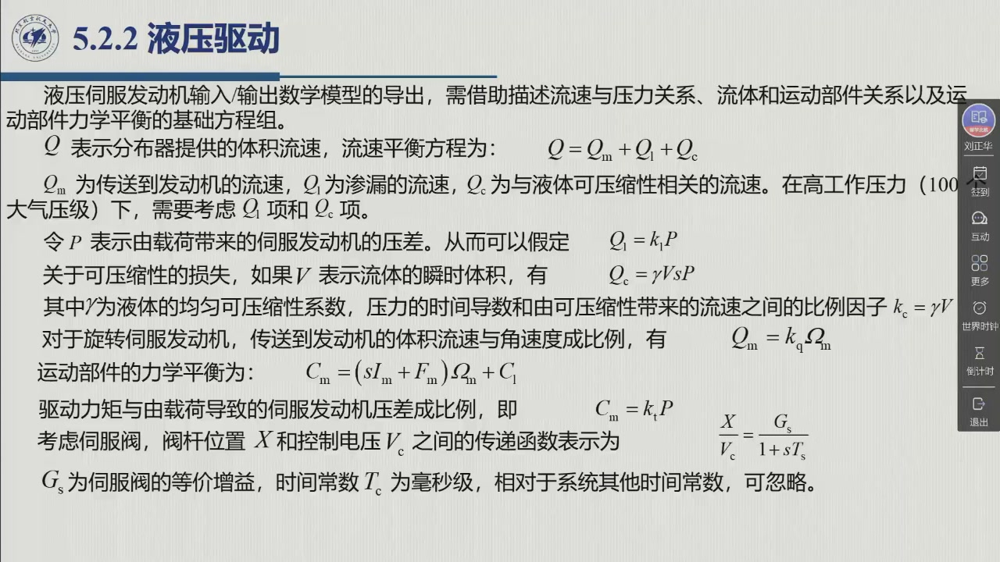

# 5.2.2 液压驱动

进入液压执行器的流量有三种去向：推动工作腔、经泄漏通路流走，以及压缩流体、改变压力。因此输入流量不会全部立即变成轴转动；预测转速时，需将三项与机械负载联立。课堂回看：01:22:09–01:24:51。

以下建立旋转执行器在一个工作点附近的常系数模型，采用零初值拉普拉斯变换。$Q$ 表体积流量，单位 $\mathrm{m^3/s}$；$p$ 表压差，单位 Pa。它们不是局部流速和末端位置。

## 5.2.2.1 六条基础方程

::: def 定义 5.2.3 · 液压驱动的基础方程组 {#def-5.2.3}
首先按流量去向列平衡式：

$$Q=Q_m+Q_l+Q_c. \tag{5.14}$$

$Q_m$ 推动执行器运动，$Q_l$ 为泄漏，$Q_c$ 与压缩储能有关。在线性化模型中，泄漏近似与压差成正比：

$$Q_l=k_lp. \tag{5.15}$$

令 $k_c=\gamma V$，其中 $\gamma$ 为可压缩性系数、$V$ 为所取工作点的有效流体体积。改变压力需要压缩流量：

$$Q_c=k_csp. \tag{5.16}$$

转速越高，单位时间需要填充的工作腔容积越大。用排量系数 $D$ 表示这一关系：

$$Q_m=D\Omega_m. \tag{5.17}$$

机械侧仍由惯量、黏滞摩擦与负载决定：

$$C_m=(sI_m+F_m)\Omega_m+C_l. \tag{5.18}$$

压差产生驱动力矩，写成

$$C_m=k_pp. \tag{5.19}$$

这里 $k_l$ 是泄漏系数，$k_p$ 是压差到力矩的系数；$D$ 与它们含义不同，单位也不同。
:::

可分别取两个极限检查流量分解：压力恒定时，压缩项 $Q_c$ 为零；轴不转时，运动项 $Q_m$ 为零。两种情况下都仍可能有泄漏，不能据前一项为零判断总流量。

还需要把控制电压连接到供油流量。教材先用一阶环节近似电液伺服机构的阀杆位置：

$$\frac{x}{V_c}=\frac{G_c}{1+sT_c}. \tag{5.20}$$

其中 $x$ 为阀杆位移。阀口、压差和流量本来是非线性关系，在固定工作点附近写成

$$p=k_xx-R_hQ. \tag{5.21}$$

$R_h$ 是该线性化关系中的流量压降系数。原教材在 (5.17) 与 (5.21) 中使用相同字母表示不同系数，本节分别改记 $D$ 与 $R_h$，避免误代。式 (5.21) 中的量按工作点增量理解，不能把这一线性式任意外推到阀口全开、反向或饱和等状态。

### 把六条式子合成一次，观察压缩项的作用

将三种流量代入平衡式，先得到

$$Q=D\Omega_m+(k_l+k_cs)p.$$

再代入阀口关系并移项：

$$[1+R_h(k_l+k_cs)]p=k_xx-R_hD\Omega_m.$$

机械方程给出 $k_pp=(sI_m+F_m)\Omega_m+C_l$。用它消去压差，整理为

$$\big\{[1+R_h(k_l+k_cs)](sI_m+F_m)+k_pR_hD\big\}\Omega_m
=k_pk_xx-[1+R_h(k_l+k_cs)]C_l.$$

若记 $\alpha=1+R_hk_l$、$\beta=R_hk_c$，分母展开为

$$\beta I_ms^2+(\alpha I_m+\beta F_m)s+\alpha F_m+k_pR_hD.$$

二次项来自压力储能与机械惯性同时存在。先把压缩项删去，会使 $\beta=0$ 并降低模型阶次；这种简化必须由研究频带和实际参数支持。阀杆响应也只有在 $|sT_c|\ll1$ 时才可取 $x\approx G_cV_c$。

直线液压缸的工作腔体积随位置变化；旋转执行器也需按结构与工作点确定有效体积。因此 $k_c$ 是否可视为常数，要从具体模型判断，不能只凭“旋转式”或“直线式”标签决定。

::: method 方法 5.2.A · 与电气驱动逐条对照 {#method-5.2.A}
两种模型都把内部储能变量与机械转速联立：电气侧为电流，液压侧为压力。电流或压差产生力矩，净力矩再使惯量加速。

类比到这里即可。液压中的泄漏、工作腔容积与阀口非线性，不能用电机的一个电阻或电感数值直接替换；负载压差影响流量的物理关系，也不等于额外安装了压力传感器反馈。
:::

::: think 检查理解
1. 轴静止、压力恒定时，供油流量是否一定为零？
2. 若瞬间提高压力，为什么即使轴还没转，也可能需要输入流量？
3. 消元后的分母为什么含 $s^2$？若计入阀杆的一阶动态，阶次还会怎样变化？

::: sol 核对
泄漏存在时仍需补充流量。提高压力需要压缩流体，对应 $k_c\dot p$。压力储能与机械惯性提供两个动态，乘开得到 $s^2$ 项；再保留阀杆一阶动态时还会增加一阶，除非具体传递函数发生约消。
:::
:::
