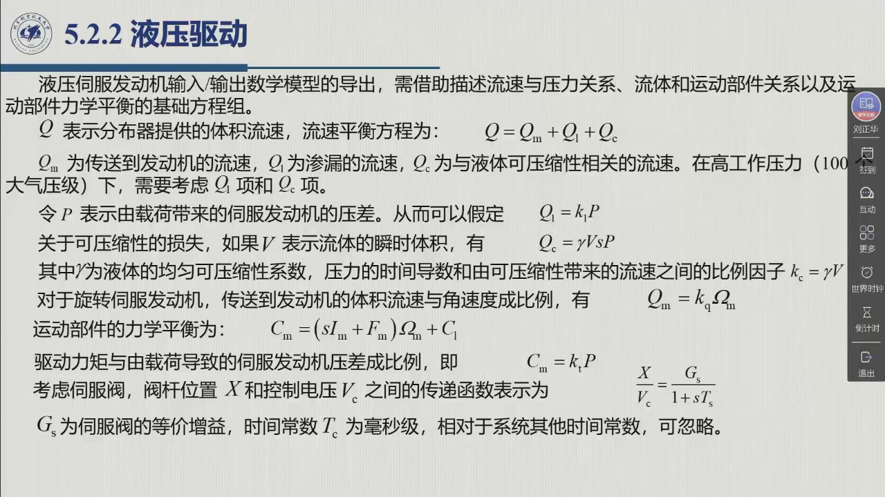

# 5.2.2 液压驱动

上一节把电气驱动写成了包含电感、电阻和反电动势的传递函数；在“能量—驱动—传动—测量”链的驱动模型层，本节用完全平行的步骤处理液压伺服驱动。把电流换成压差、电压换成体积流量，进入液压执行器的油液不会全部推着活塞转：高压下（百个大气压级）还有一路漏过间隙流走，另一路用来压缩腔内油液提升压力，因此必须把这三条去向一起联立到机械负载方程里。课堂回看：01:22:09–01:24:51。

以下针对旋转液压执行器在给定工作点附近建立常系数线性化模型，在零初值下做拉普拉斯变换。符号口径先钉死：体积流量 $Q$ 的单位是 $\mathrm{m^3/s}$（不是局部流速 $\mathrm{m/s}$），执行器两侧压差 $p$ 的单位是 $\mathrm{Pa}$（不是位置坐标）。

## 5.2.2.1 六条基础方程

和电机先列电压平衡与力矩平衡一样，液压驱动把“流体往哪里去”和“压差怎样推动负载”拆成流量平衡、机械平衡以及电液伺服阀三部分来写（01:22:10–01:23:54）。

::: def 定义 5.2.3 · 液压驱动的基础方程组 {#def-5.2.3}
令 $Q$ 为分布器送入执行器的总体积流量，按去向拆成三路平衡：

$$Q=Q_m+Q_l+Q_c. \tag{5.14}$$

1. 推动工作腔运动的有效流量 $Q_m$ 正比于转速 $\Omega_m$，排量系数为 $D$（原教材在排量与阀阻中混用了同一字母，本节改记 $D$ 与 $R_h$ 以免误代）：
   $$Q_m=D\Omega_m. \tag{5.17}$$
2. 经密封间隙的泄漏流量 $Q_l$ 在工作点附近近似正比于压差 $p$，$k_l$ 为泄漏系数：
   $$Q_l=k_lp. \tag{5.15}$$
3. 流体受压压缩吸收的储能流量 $Q_c$ 取决于有效工作腔体积 $V$ 与流体可压缩性系数 $\gamma$，记 $k_c=\gamma V$：
   $$Q_c=\gamma Vsp=k_csp. \tag{5.16}$$
4. 机械侧平衡与电机式 (5.3) 完全同形（$I_m$ 为转子转动惯量、$F_m$ 为黏滞摩擦系数、$C_l$ 为负载阻力矩），压差 $p$ 经有效排量系数 $k_p$（$\mathrm{N\cdot m/Pa}$）产生驱动力矩 $C_m$：
   $$C_m=(sI_m+F_m)\Omega_m+C_l,\qquad C_m=k_pp. \tag{5.18–5.19}$$
:::

先拿两个极限核对这几条式子：压力恒定时 $sp=0$，于是压缩流量 $Q_c=0$；轴锁死不转时 $\Omega_m=0$，于是运动流量 $Q_m=0$。但只要压差 $p$ 存在，泄漏 $Q_l=k_lp$ 仍然存在，因此静止保压时仍需供油补充泄漏。此外，$k_c=\gamma V$ 取决于流体有效体积：旋转液压马达的工作腔体积大体不变，$k_c$ 可作常数；直线液压缸的有效腔体随活塞行程改变，动态特性会随工作点位置变化（不能把常数 $k_c$ 直接套到长行程液压缸）。

要把控制器命令 $V_c$ 接到上述模型上，还需要电液伺服阀和分布器的关系。阀杆位置闭环把阀位移 $x$ 对指令 $V_c$ 近似成一阶惯性环节：

$$\frac{x}{V_c}=\frac{G_c}{1+sT_c}, \tag{5.20}$$

其中 $G_c$ 为阀的等效增益，$T_c$ 为毫秒级时间常数，低频下（$|sT_c|\ll1$）可取 $x\approx G_cV_c$。分布器阀口的压差、流量与位移本来高度非线性，在固定工作点附近取增量线性化，写成

$$p=k_xx-R_hQ, \tag{5.21}$$

其中 $k_x$ 为阀口位移—压差系数（$\mathrm{Pa/m}$），$R_h$ 为线性化流量压降系数（$\mathrm{Pa\cdot s/m^3}$，只在该工作点小增量内有效，不能外推到阀口全开或反向饱和）。

### 从六条式子消元到传递函数

模仿 [§5.2.1](sec5-2-1.md) 的消元步骤，先求压差 $p$，再消去内部变量。将 (5.15)–(5.17) 代入流量平衡 (5.14)：

$$Q=D\Omega_m+(k_l+k_cs)p.$$

把上式代入线性化阀口方程 (5.21) 消去 $Q$：

$$p=k_xx-R_h\big[D\Omega_m+(k_l+k_cs)p\big] \quad\Longrightarrow\quad \big[1+R_h(k_l+k_cs)\big]p=k_xx-R_hD\Omega_m.$$

由机械方程 (5.18)–(5.19) 得 $p=\big[(sI_m+F_m)\Omega_m+C_l\big]/k_p$，代回上式消去 $p$，两边同乘 $k_p$ 并把含 $\Omega_m$ 的项归到左侧：

$$\big\{[1+R_h(k_l+k_cs)](sI_m+F_m)+k_pR_hD\big\}\Omega_m=k_pk_xx-\big[1+R_h(k_l+k_cs)\big]C_l.$$

记 $\alpha=1+R_hk_l$、$\beta=R_hk_c$，把左端花括号按 $s$ 降幂展开，分母多项式为

$$\beta I_ms^2+(\alpha I_m+\beta F_m)s+\alpha F_m+k_pR_hD.$$

对照电气驱动的分母 $D(s)$，可以看到完全对称的结构：这里 $s^2$ 项系数 $\beta I_m=R_hk_cI_m$ 正对应电气侧的 $L_aI_m$，来自流体压缩储能与机械转动惯量同时存在。只有当研究频带低到流体压缩与渗漏都可以忽略时，才能把二阶降阶为一阶，具体取舍必须由工作压力（百个大气压级下两者往往不可略）和实际频带决定。

::: method 方法 5.2.A · 与电气驱动逐条对照 {#method-5.2.A}
把两节的建模方程排在一起（01:23:54–01:24:51）：电气侧用电阻电感平衡方程 (5.1) 求电流，液压侧拆成流量平衡、渗漏和压缩方程 (5.14)–(5.16) 求压差；两侧机械方程 (5.3) 与 (5.18) 完全同形，力矩各自正比于电流 $i_a$ 或压差 $p$；功放 (5.5) 和伺服阀 (5.20) 都是一阶高速惯性。

类比止步于结构对应。第一，液压中的泄漏、工作腔随行程变化与阀口非线性，无法直接用定常电阻电感值替代；第二，也是教材明确警示的区别，电气驱动可以自由选择保留或去掉电流反馈环（[§5.2.1](sec5-2-1.md)），而液压分布器的压差—流量耦合 (5.21) 是物理结构自带的固有反馈，不另加压力传感器与补偿电路无法拆掉，因此液压驱动无法直接复现电机“速度／力矩控制发电机”的模式切换。
:::

::: intuition 动手实验 · 液压缸与流量的三条去路（3D）
剖开一只液压缸：缸体、活塞、活塞杆（杆的伸缩就是移动关节的位移，见 [§6.3.1](../ch06/sec6-3-1.md) 的两连杆笛卡儿臂），以及泵送来的流量 $Q$ 的三条去路：$Q_m$ 推活塞、$Q_l$ 经缸壁间隙漏回储液池、$Q_c$ 把油液压扁储存在缸里。拖动各条支路看占比变化，对照上面流量平衡方程中的三项。

:::

::: think 检查理解
1. 轴静止、压力恒定时，供油流量是否一定为零？
2. 若瞬间提高压力，为什么即使轴还没转，也可能需要输入流量？
3. 消元后的分母为什么含 $s^2$？若计入阀杆的一阶动态，阶次还会怎样变化？
4. 为什么说液压系统与电气驱动结构平行，却不能简单去掉压差对流量的影响？

::: sol 核对
1. 存在压差与泄漏时仍需补充泄漏流量 $Q_l=k_lp$。
2. 提高压力需要压缩腔内流体，对应压缩流量 $Q_c=k_c\dot p$。
3. 流体压缩储能与机械惯性构成两个动态储能元件，相乘给出 $s^2$ 项；计入阀杆一阶动态后整体变为三阶（除非出现极零点对消）。
4. 负载压差反过来决定分布器流量是阀口的固有物理耦合，不同于电气侧可自行选择撤除的测量电流反馈环。
:::
:::

## 5.2.2 小结与常见错误

液压驱动由流量平衡（运动、泄漏、压缩三路）、压差力矩关系、机械平衡以及线性化阀口方程联立导出二阶分母，形式上与电气驱动完全平行。百个大气压级工况下泄漏 $Q_l$ 和流体压缩 $Q_c$ 不可随意忽略，且分布器的压差—流量耦合是固有结构特征。

::: think 常见错误清单 · 自查三条
1. 漏掉泄漏项 $Q_l$ 或压缩项 $Q_c$，把液压模型误写成只有 $Q=D\Omega_m$ 的纯比例关系。
2. 把旋转马达的常数 $k_c=\gamma V$ 直接套用到有效流体体积随位移变化的直线液压缸。
3. 把伺服阀位移跟踪的线性一阶环节 (5.20) 与阀口在工作点附近线性化的非线性关系 (5.21) 混为一谈。
:::
